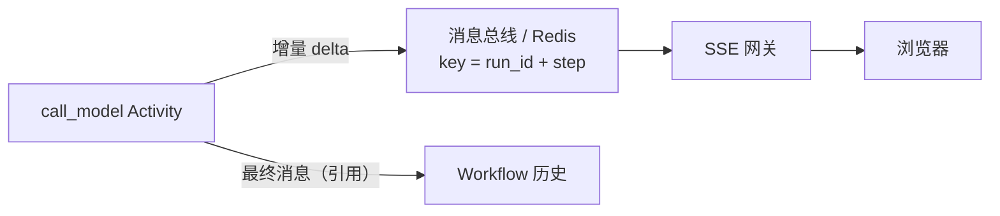
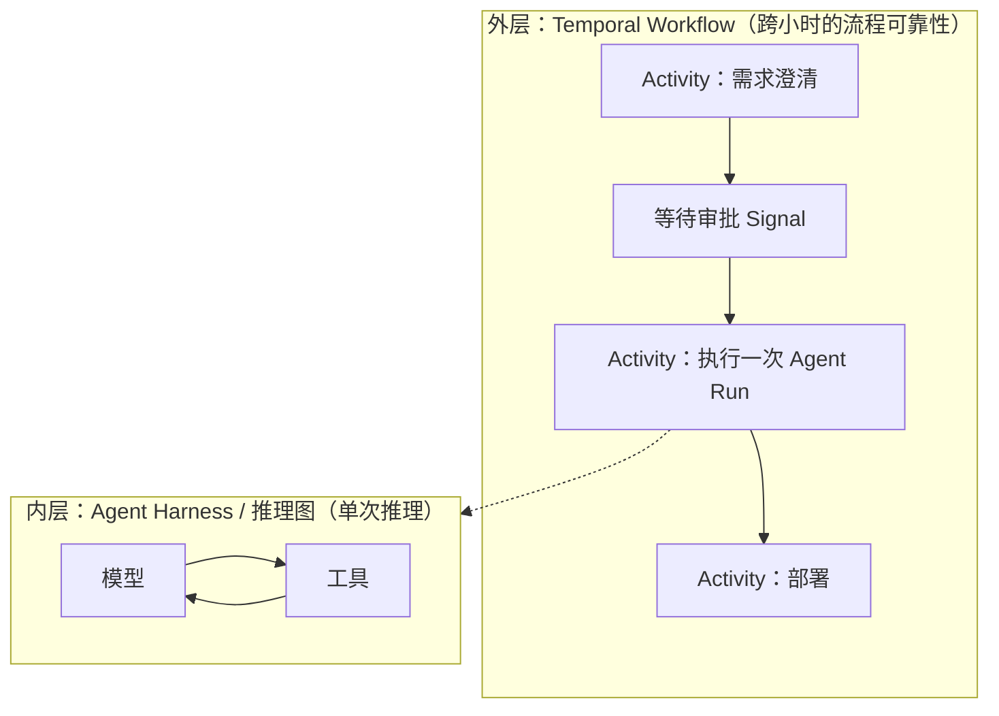

# 25 持久执行引擎映射

第 09–14 章用 SQLite 手写了一套轻量的持久化：条目只追加、工具调用预写日志、CAS 状态机、心跳租约。
这一章把它与工业级持久执行引擎 Temporal 逐项对照：同一个 Agent Loop 放进 Temporal 应该怎样切分、会撞上哪些约束，以及什么时候值得从自研迁移过去。

## 持久执行的核心思想

持久执行（durable execution）承诺的是：**代码写起来像运行在一台永不崩溃的机器上**。实现它只有一个前提——把所有“不确定的结果”（网络调用的返回值、当前时间、随机数、人的决定）都记录下来；崩溃后用记录把状态恢复出来。

恢复状态有两条路：

| 路线 | 做法 | 代表 | 对代码的要求 |
|---|---|---|---|
| 重放代码 | 重新执行编排代码，遇到“已记录过的不确定操作”直接取记录的结果，直到追上崩溃点 | Temporal | 编排代码必须确定：同样的历史必须走出同样的分支 |
| 状态重建 | 不重放代码，而是把“继续执行所需的全部状态”持久化成事实，崩溃后读事实、从当前位置接着跑 | flywhl-harness、LangGraph checkpointer | 每个安全点上，内存状态都必须能由持久化事实推出 |

Agent Loop 非常适合持久执行，因为它的不确定性高度集中在两处：**模型调用**和**工具调用**。其余部分（拼请求、判断是否结束、计数预算）都是纯计算。

flywhl 走的是第二条路。`AgentLoop._body` 在恢复时并不“重放”之前的回合，而是：

```python
# src/flywhl_harness/agent/loop.py · AgentLoop._body
# 修复/恢复：上一次中断遗留的、尚未得到结果的工具调用（崩溃恢复的关键一步）。
# 必须先于恢复说明处理：tool 结果要紧跟在它的 assistant 调用之后……
pending = unpaired_tool_calls(rc.log.context().messages)
if pending:
    # ...
    async for ev in self.executor.run_batch(pending, recovering=True):
        yield ev
if rc.resume and rc.resume_note:
    yield self._append(user_message(reminder(rc.resume_note), kind=MsgKind.RESUME_NOTE))
```

上下文从 `entries` 重建，没有结果的工具调用按 `steps` 对账，补上恢复说明，然后直接进入下一轮——这依赖一个性质：**Loop 在两轮之间几乎不持有内存状态**，消息历史就是它的全部状态。
少数确实存在的内存状态需要单独持久化：`Harness._checkpoint` 在每轮结束时把 `Budget.state()`（轮次、工具调用数、用量、已用墙钟）写进 `runs.checkpoint`，恢复时由 `Budget.restore` 接着计数；暂停时尚未注入的 steer / follow-up 也随检查点带回；会话污点（`tainted`）与会话级授权（`grants`）写在 `session.meta` 里，恢复后保留。
而 `LoopGuard` 的观察窗口、`stop_blocks` 计数、软阈值“已提醒过”的记录没有持久化，恢复后从零开始。这个“几乎”恰好是两种路线差异最大的地方：重放代码的引擎不需要逐项决定“哪些变量要存”。

## Temporal 关键概念速览

| 概念 | 含义 | 在 Agent 场景里对应 |
|---|---|---|
| Workflow | 确定性的编排代码，状态由事件历史重放得到 | Agent Loop 的控制流 |
| Activity | 允许任意副作用的函数，结果写入历史；可配超时、重试、心跳 | 模型调用、工具执行、压缩摘要、验收命令 |
| Event History | Workflow 的只追加事件序列，是唯一事实源 | 类似 flywhl 的 `entries` + `steps` + `events` 合体 |
| Worker / Task Queue | 拉取任务并执行 Workflow 与 Activity 代码的进程 | flywhl 的 `Harness` 进程（`worker_id`） |
| Signal | 向运行中的 Workflow 异步投递消息 | 审批结果、steer、follow_up、暂停 |
| Query | 只读查询 Workflow 当前状态，不写历史 | “当前第几轮、在等什么” |
| Update | 同步的、可校验、可返回值的写操作 | 需要确认送达的插话或参数修改 |
| `wait_condition` + 持久定时器 | 等待某个条件成立或超时；等待期间不占用 Worker | 等审批等几天 |
| RetryPolicy | Activity 的重试间隔、次数与不可重试错误类型 | flywhl 的 `ResilientProvider` 与 `TransientToolError`；Run 级的 `Harness.retry`（`failed → queued`，`attempt + 1`，从持久化历史继续） |
| Heartbeat | 长 Activity 定期上报进度，用于更快发现失联与传递取消 | flywhl 的 `Store.heartbeat`（粒度是 Run；条件更新，续租失败即自我 fencing） |
| continue-as-new | 以新的空历史“续命”同一个 Workflow，携带压缩后的状态 | 长对话的历史截断 |
| Versioning / `patched` | 代码变更时让旧历史走旧分支，避免重放非确定性错误 | flywhl 的“会话元数据冻结” |

## 把 Agent Loop 放进 Temporal

### Workflow / Activity 怎么切

| 逻辑 | 放在 | 理由 |
|---|---|---|
| 回合循环、终止判断、预算计数、Stop 验收的“是否继续” | Workflow | 纯计算，必须随历史重放出相同结果 |
| 模型调用（含流式） | Activity | 网络调用，结果不确定 |
| 工具执行 | Activity（每个调用一个） | 副作用；超时、重试、取消都按工具粒度配置 |
| 压缩摘要 | Activity | 本身就是一次模型调用 |
| 验收命令（`verify_command`）、进程外 hook（`CommandHook`） | Activity | 启动子进程 |
| 进程内 hook | 视情况 | 只读传入数据的纯函数可放在 Workflow；读文件、查库的必须放进 Activity |
| 等待审批 / 插话 | Workflow（Signal + `wait_condition`） | 等待本身不需要计算资源 |

### 确定性约束：flywhl 的 Loop 哪些地方不能直接搬

Temporal 要求 Workflow 代码不能直接取当前时间、随机数或做 IO。对照 flywhl 的 Loop 代码，以下几处都需要改写：

| flywhl 中的写法 | 位置 | 在 Workflow 中的替代 |
|---|---|---|
| `mid = new_id("m_")`（随机 ID） | `AgentLoop._call_model` | `workflow.uuid4()` |
| `now()` 时间戳 | `_call_model`、`_finish` 等 | `workflow.now()` |
| `time.monotonic` 墙钟预算 | `Budget.elapsed` | 用 `workflow.now()` 计算，或用持久定时器表达截止时间 |
| `rc.log.context()` 从 SQLite 读上下文 | `_call_model`、`_maybe_compact` | 移进 Activity（见下文 claim check） |
| `asyncio.wait(..., timeout=...)` 的工具超时赛跑 | `ToolExecutor._race` | Activity 的 `start_to_close_timeout` |
| `rc.cancel.sleep(...)` 退避 | `ToolExecutor._invoke` | Activity RetryPolicy，或 `workflow.sleep` |

### 示意代码

下面是把 flywhl 的 Loop 骨架映射到 Temporal Python SDK 的**示意代码**（本项目未实现；类型与 Activity 名均为假设，API 细节以 Temporal 官方文档为准）：

```python
# 示意代码：Agent Loop 作为 Temporal Workflow
import asyncio
from dataclasses import dataclass, field
from datetime import timedelta

from temporalio import workflow
from temporalio.common import RetryPolicy

with workflow.unsafe.imports_passed_through():
    from agent_activities import call_model, run_tool, ModelInput, ToolInput


@dataclass
class AgentState:                   # continue-as-new 时携带的“压缩后状态”
    session_id: str
    head: str | None                # 上下文只传引用（claim check），不传消息全文
    turns: int = 0
    tool_calls: int = 0
    cost_usd: float = 0.0
    stop_blocks: int = 0


@workflow.defn
class AgentWorkflow:
    def __init__(self) -> None:
        self.phase = "running"
        self.decisions: dict[str, bool] = {}
        self.steers: list[str] = []
        self.st: AgentState | None = None

    @workflow.signal
    def resolve_approval(self, call_id: str, approved: bool) -> None:
        self.decisions[call_id] = approved

    @workflow.signal
    def steer(self, text: str) -> None:
        self.steers.append(text)

    @workflow.query
    def progress(self) -> dict:
        return {"phase": self.phase, "turns": self.st.turns if self.st else 0}

    @workflow.run
    async def run(self, st: AgentState) -> str:
        self.st = st
        while st.turns < 40:                                   # 预算计数在 Workflow 中，随历史重放
            st.turns += 1
            turn = await workflow.execute_activity(
                call_model,
                ModelInput(st.session_id, st.head, msg_id=str(workflow.uuid4()), steers=self.steers[:]),
                start_to_close_timeout=timedelta(minutes=5),
                heartbeat_timeout=timedelta(seconds=30),
                retry_policy=RetryPolicy(maximum_attempts=4,
                                         non_retryable_error_types=["ContextOverflow", "InvalidRequest"]),
            )
            self.steers.clear()
            st.head, st.cost_usd = turn.head, st.cost_usd + turn.cost_usd
            if not turn.tool_calls:
                return turn.text                               # Stop 验收同样可以是一个 Activity
            for call in turn.tool_calls:
                if call.needs_approval:
                    self.phase = "waiting_human"
                    try:                                       # 持久等待：等三天也不占用 Worker
                        await workflow.wait_condition(lambda: call.id in self.decisions,
                                                      timeout=timedelta(days=3))
                    except asyncio.TimeoutError:
                        self.decisions[call.id] = False        # 超时默认拒绝，与 flywhl 一致
                    self.phase = "running"
                res = await workflow.execute_activity(
                    run_tool,
                    ToolInput(st.session_id, call, approved=self.decisions.get(call.id, True),
                              idem_key=f"{workflow.info().workflow_id}:{call.id}"),
                    start_to_close_timeout=timedelta(seconds=call.timeout),
                    retry_policy=RetryPolicy(maximum_attempts=1 if not call.idempotent else 3),
                )
                st.head, st.tool_calls = res.head, st.tool_calls + 1
            if workflow.info().is_continue_as_new_suggested():
                workflow.continue_as_new(st)                   # 历史过长：带着压缩后的状态续命
        return "budget_exhausted"
```

几个要点逐一展开。

### 审批：Signal + `wait_condition`

flywhl 的审批对象是持久化的（`approvals` 表，`Store.resolve_approval` 用 `WHERE status='pending'` 做 CAS），但**等待本身在内存里**：`ApprovalBroker.request` 用 `asyncio.wait_for(..., self.timeout)` 等一个 future，默认 600 秒；进程崩溃后，`Harness.recover` 会把该 Run 名下所有 pending 审批标为 `expired`，恢复后的 Run 重新判定权限、重新发起审批（因为 `steps` 里还没有这次调用的 `started` 记录，执行器走的是普通路径）。

Temporal 的等待是历史里的一个“未决条件 + 定时器”，Worker 重启、甚至整批 Worker 换代都不影响；等三天和等三秒的资源占用一样。这是长时人审场景下两者最本质的差别。

### 状态 Query

flywhl 查询 Run 状态是直接读 `runs` 表（`status`、`status_reason`、`checkpoint`），或订阅事件流。Temporal 的 Query 读的是 Workflow 的**内存状态**，而内存状态由历史重放得到——所以 Query 返回的永远与持久化事实一致，不需要额外的“同步到状态表”步骤。

### 历史膨胀：claim check + continue-as-new

Temporal 的事件历史有数量与体积上限，单个载荷也有上限（官方默认值大致是数万事件、数十 MB 历史、单载荷数 MB，以官方文档为准）。Agent 的消息历史天然会增长，直接把消息列表作为 Activity 的入参与返回值，会让每一轮都把整个上下文写进历史一次——几十轮就会触顶。

两个配套手段：

| 手段 | 做法 | 在示意代码中 |
|---|---|---|
| claim check（大载荷外置） | 消息与大工具结果存在外部存储，历史里只记引用 | `AgentState.head` 只是一个条目 ID；Activity 按 `session_id + head` 自己加载上下文 |
| continue-as-new | 定期以新历史重启，携带压缩后的状态 | 携带 `AgentState`：引用 + 预算计数器 + `stop_blocks` |

这正好就是 flywhl 已经在做的事：`entries` 表是上下文的事实源，`BlobStore` 外置大结果，会话的 `head` 是一个指针。换句话说，**flywhl 的存储层可以原样充当 Temporal 方案中的 claim check 存储**。

::: warning Activity 写外部存储也要幂等
Activity 是至少一次执行的：写完消息、还没把结果返回给 Temporal 就崩溃，重试时会再写一次。
示意代码把 `msg_id` 用 `workflow.uuid4()` 在 Workflow 里生成（重放时值不变）再传给 Activity；
flywhl 的 `SessionLog.append_message` 以 `entry_id=f"e_{msg.id}"` 写入，而 `entries.id` 有 `UNIQUE` 约束——重复写会撞唯一键，Activity 捕获后按“已完成”返回即可。
:::

### 流式旁路

Activity 无法把 token 流式地交给 Workflow：Workflow 只能拿到 Activity 的最终结果。流式展示要走旁路：



flywhl 的 `EventHub` + `Harness.subscribe` 是同一个模式的单进程版本：事件有单调 `seq`，断线后按 `Last-Event-ID` 从库里补齐（见 [15 流式与续传](/reliability/streaming)）。迁移到 Temporal 时，`seq` 应由“`step` + 步内序号”构成，这样 Activity 重试产生的重复增量能被网关按键去重——这对应 flywhl 里 `retry` 流事件的 `discard_partial`。

### 版本化

Workflow 代码一旦改了分支结构（比如在“调模型”和“执行工具”之间加一个 Activity），用旧代码录下的历史在新代码上重放就会走出不同的命令序列，触发非确定性错误。Temporal 用 `workflow.patched("id")` 让旧历史走旧分支、新执行走新分支，待旧执行全部结束后再清理。

flywhl 没有重放，所以没有这个问题；它要钉住的是“影响模型输出的输入”：`Harness.create_session` 把系统提示、模型、provider、工具名单写进 `session.meta`。
`_build_rc` 使用 meta 中的系统提示，并按 meta 中的工具名单从当前工具集取子集（之后新增的工具不会出现在老会话里，已不存在的工具被跳过）。
模型则允许换、但必须留痕：`RunContext.model` 取自当前 `Harness`；`start_run` 与 `resume` 都会调用 `_note_model_switch`，发现会话记录的模型与当前不同时，写一条 `model_switched` 的 NOTICE 事件，并把 meta 中的 `model` 更新为新模型。
这与 `patched` 的思路相近：不禁止变更，但让“这里换过模型”在历史里可见，回放与评测时能据此区分行为基线。

### 幂等仍然需要自己做

Temporal 保证 Workflow 的“恰好一次”语义，但 Activity 是至少一次。对外部副作用工具，以下设计与 flywhl 完全相同：

- 幂等键：`workflow_id:call_id`，对应 flywhl `ToolExecutor._ctx` 中的 `f"{rc.run_id}:{call.id}"`；
- 不幂等的工具 `maximum_attempts=1`，超时即“结果未知”，交给一个“对账 Activity”查询外部状态——对应 flywhl 的 `Tool.reconcile` 与 `unknown` 状态（见 [14 幂等](/reliability/idempotency)）。flywhl 的 `ToolExecutor._race` 对 `effect` 为 `EXTERNAL` 且不幂等的工具，超时返回的就是 `unknown` 而不是 `timeout`：请求可能已被对方处理，只是响应没回来；不可中断工具在取消宽限期内没结束，同样记为 `unknown`。

## flywhl 自研 journal 与 Temporal 逐项对照

| 维度 | flywhl-harness | Temporal |
|---|---|---|
| 事实源 | `entries`（上下文，只追加）+ `steps`（工具 intent→result）+ `events`（审计流）+ `runs`（状态、检查点） | 单一事件历史 |
| 恢复方式 | 状态重建：从 `entries` 重建上下文，从当前位置继续 | 代码重放：重跑 Workflow，已完成的 Activity 直接取结果 |
| 内存状态 | 两轮之间几乎无状态；预算计数器每轮写入检查点、恢复时延续；污点与授权在 `session.meta`；`LoopGuard` 窗口与 `stop_blocks` 不持久，恢复后重新计数 | 所有 Workflow 变量都随重放恢复 |
| 未完成调用的对账 | `run_batch(recovering=True)`：`started` 无结果 → `reconcile()` → 只读/幂等则重做 → 否则 `unknown` | Activity 超时后按 RetryPolicy 重试；非幂等需自己写对账 |
| 超时 | 工具：`ToolExecutor._race` 赛跑，外部副作用且不幂等的工具超时记为 `unknown`；模型：`request_timeout`；Run：`max_wall_seconds` | Activity 四种超时（schedule-to-start、start-to-close、schedule-to-close、heartbeat），Workflow 执行超时 |
| 取消 | `CancelToken` 协作式传递；先 CAS 到 `cancelling` 决出与完成的竞争；不可中断工具有宽限期 | Workflow 取消 → Activity 通过心跳感知取消；需要自己处理清理 |
| 长时间等待 | 审批在内存等待（默认 600 秒），崩溃后审批过期、恢复时重新发起 | Signal + `wait_condition` + 持久定时器，可等数天 |
| Worker 失联判定 | 心跳租约：`heartbeat_seconds=2`、`stale_after_seconds=10`；`Harness.recover` 扫描过期 Run 并 CAS 接管，`recovery_loop` 周期性重复扫描；残留子 Run 直接收尾为 `cancelled`，由恢复后的父 Run 重新派生 | 服务端判定 Activity 心跳超时 / Workflow Task 超时，自动重新调度 |
| 并发接管 | 迁移钉在扫描时看到的 `version` 上（`expect_version`），只有一个 Worker 成功；认领失败的 Worker 安静退出 | 服务端保证同一 Workflow 只有一个执行在推进 |
| 优雅关闭 | `aclose()` 让活动主 Run 在安全点暂停（`paused_by=shutdown`），重启后 `recover()` 自动继续；宽限期内停不下来的按崩溃处理 | Worker 停止拉取任务，Workflow 由其他 Worker 继续推进 |
| 版本钉住 | `session.meta` 冻结系统提示与工具名单；换模型允许，但记 `model_switched` 事件并更新 meta | `patched` / Worker Versioning |
| 历史体积 | 无硬上限；靠压缩控制上下文、`BlobStore` 外置大结果 | 有硬上限；需要 claim check + continue-as-new |
| 运维代价 | 一个 SQLite 文件；单进程 | 需要运行 Temporal 集群（或使用托管服务）及其持久化后端，Worker 部署与版本管理 |

::: details CAS 接管的三层 fencing
`Harness.recover` 的注释写道“两个 Worker 同时接管只有一个成功”。靠的是三层条件写：

1. **接管钉住版本。** `recover` 把 `running → interrupted` 的迁移钉在扫描 `stale_runs` 时看到的 `version` 上（`RunStateMachine.transition(..., expect_version=run.version)`）。指定 `expect_version` 时 `transition` 不重读重试：版本一旦变了（别的 Worker 已接管并 `resume` 回 `running`），直接抛 `TransitionConflict`，`recover` 跳过这个 Run。没有这一层时，晚到的 Worker 会重读到新的 `running`，`running → interrupted` 是合法迁移，同一个 Run 就可能被两个 Worker 同时推进。
2. **认领与状态迁移同一次 CAS。** `_drive` 开始时以 `expect={QUEUED}` 迁移到 `running` 并写入自己的 `worker_id`；失败说明别人抢先认领，安静退出，绝不把别人正在跑的 Run 标成 `failed`。
3. **续租是条件更新。** `Store.heartbeat` 只在 `worker_id` 仍是自己（或为空）时更新并返回 `True`；`_heartbeat` 发现返回 `False` 或 `worker_id` 已变，就由 `_fence()` 按崩溃处理：丢弃之后的事件、抢占式中止驱动任务（不走协作式收尾，否则会把新主人的 Run 改成 cancelled）。

离线迁移（创建、恢复、离线取消）不经过活动 `EventHub`，由 `Store.append_event_next` 在同一事务里分配事件序号，不会和其它写入撞号。Temporal 由服务端统一调度，不需要应用层做这些。
:::

## 三种编排选型对照

| 维度 | Temporal | 自研“队列 + 状态表”（flywhl 属于此类） | LangGraph checkpointer |
|---|---|---|---|
| 恢复模型 | 代码重放 | 状态重建 | 状态重建（每个节点后保存图状态快照） |
| 粒度 | Activity 级 | 由你决定（flywhl 是消息 + 工具调用级） | 图节点级 |
| 长时间等待 | 原生（Signal、定时器） | 需要自己实现持久等待与唤醒 | `interrupt` 后保存状态，外部再以同一 thread 恢复 |
| 对代码的约束 | 强（确定性、版本化） | 弱（自己保证安全点上的状态可重建） | 中（状态需可序列化，节点内副作用需自己保证幂等） |
| 跨进程 / 跨机器调度 | 原生 | 需要自己做租约、接管、队列 | 取决于部署方式 |
| 适合 | 跨小时到跨天、多步骤、有人审与外部系统交互的业务流程 | 单机或小规模、希望完全掌控存储模型、教学 | 单次推理图的状态管理与中断续跑 |

## 双层编排

两类引擎并不互斥。常见的组合是：



- 外层只关心“流程走到哪一步”，每一步是一个 Activity；
- 内层在 Activity 里跑完整的 Agent Loop。内层的中间状态 Temporal 看不见：Activity 重试意味着整个内层 Run 重来。因此内层需要**自己的** checkpointer——用 flywhl 的话说，Activity 重试时应续跑同一个 Run，而不是 `start_run` 新开一个：`paused` / `interrupted` 用 `Harness.resume`，`failed` 用 `Harness.retry`；若上一次 Activity 所在进程崩溃，Run 会停在 `running`，要先等心跳过期、由 `recover()` 接管。

公开报道中，OpenAI Codex（Web 版）、Replit、Lovable 等使用 Temporal 承担持久执行；OpenAI Agents SDK 也提供了 Temporal 集成（Agent Loop 在 Workflow 中，模型调用是 Activity，工具可用 `activity_as_tool` 包装）。具体集成方式与发布状态以各自官方文档为准。

## 什么时候该从自研迁移到 Temporal

| 信号 | 说明 |
|---|---|
| 等待以小时、天计 | 人审、外部回调、定时重试成为常态；内存等待 + 超时过期已经不够 |
| 多机部署、Worker 频繁滚动发布 | 需要可靠的跨进程调度、接管与 fencing，而不是单机心跳 |
| 编排跨越多个 Agent Run 与非 Agent 步骤 | 一条业务流程里 Agent 只是其中几步 |
| 审计要求“任意时刻的完整状态可复现” | 代码重放给出的保证比状态快照更强 |
| 自研层开始重复造轮子 | 你在写持久定时器、重试调度器、分布式锁时，就是在重写一个更差的 Temporal |

反过来，以下情况自研更合适：单机或单租户部署、Run 以分钟计、希望存储模型就是“会话树”本身（便于分支、压缩、回放），或者团队不愿承担额外的集群运维。

迁移时可以复用的部分：`Tool` 接口与 `reconcile`、`Provider` 抽象、`entries`/`BlobStore` 作为 claim check 存储、事件模型与 `seq` 续传；需要重写的部分：`AgentLoop` 的控制流（改为确定性 Workflow）、`Budget` 计时（改用 `workflow.now()`）、`ApprovalBroker` 的等待（改为 Signal）、`Harness.recover` 与 `recovery_loop`（由 Temporal 接管）。

下一章：[26 端云协同](/advanced/edge-cloud)。
