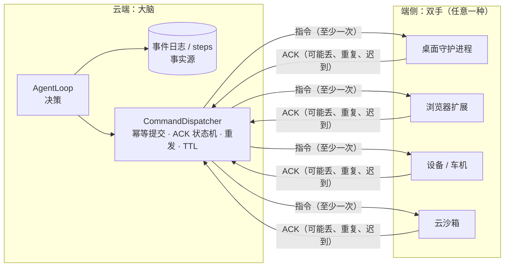
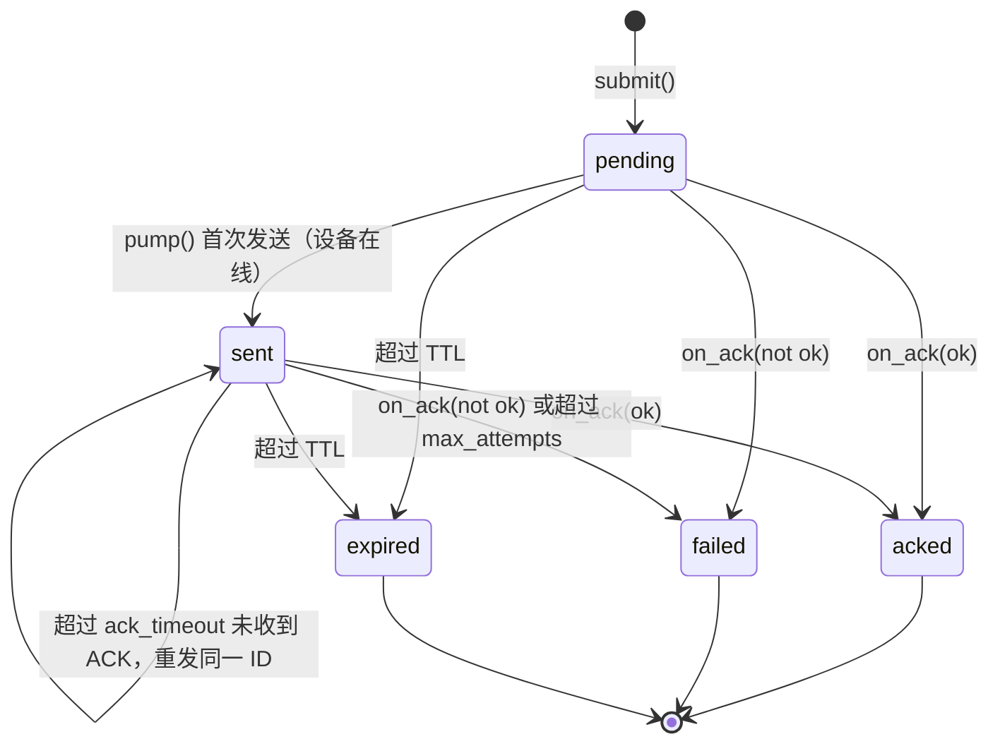
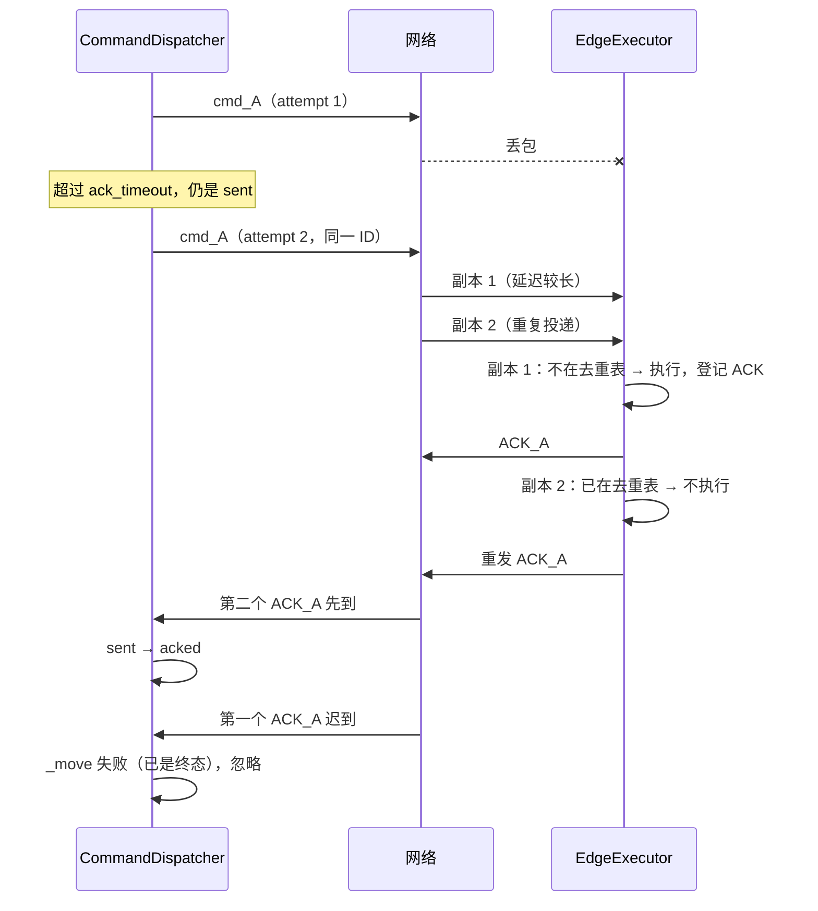

# 26 端云协同

当编排（“大脑”）在云端，而执行（“双手”）在用户的桌面、浏览器、设备或一个远程沙箱里时，两者之间隔着一张会断、会重复、会乱序的网络，两侧还会各自崩溃。本章讨论如何在这样的环境里让每条指令 **效果上恰好执行一次**，以及执行接管、离线、产物交付这些随之而来的问题。

先说清范围：flywhl-harness 只实现了 **指令下发与幂等消费** 的最小模型（`src/flywhl_harness/runtime/dispatch.py`，配套示例 `examples/09_edge_cloud.py`）。执行接管、离线操作同步、产物分片续传、本地守护进程接入都没有实现，本章给出的是设计思路，并明确标注与现有代码的衔接点。

## 大脑与双手



把执行环境看成“一双可替换的手”，而不是 harness 的一部分，有几个直接的好处：大脑可以独立重启、独立扩缩容，手坏了换一双；安全边界清晰，凭据留在大脑一侧，执行环境里只有完成任务所需的最小权限。Anthropic 介绍其 Managed Agents 架构时描述过同样的分工：harness 把沙箱当成一个工具来调用（给出名称与输入，拿回字符串结果），凭据不进入沙箱（具体设计以官方资料为准）。

在 flywhl-harness 的概念里，一次端侧执行就是一个 `EXTERNAL` 级的工具调用，只是工具的 `execute()` 不在本地完成，而是变成“提交一条指令、等待 ACK”。两套概念的对应关系：

| harness 侧 | 端云侧 | 说明 |
|---|---|---|
| `ToolContext.idempotency_key`（`run_id:call_id`） | `Command.idem_key` | 跨崩溃稳定，保证重复提交只生成一条指令（见 [14 幂等与副作用](/reliability/idempotency)） |
| `step_started`（预写 intent） | 指令进入 `pending` | 都是“副作用之前先记账” |
| 工具结果 | ACK 中的 `result` | |
| `Tool.reconcile()` | 按指令 ID 向端侧查询执行状态 | 本项目未实现端侧查询接口 |
| 取消宽限期超时 → `unknown`；EXTERNAL 且非幂等的工具执行超时 → `unknown` | 指令 `failed` / `expired` 但可能已执行 | 下文详解。超时不等于没发生：请求可能已被对方处理，只是响应没回来 |

本项目没有提供把 `CommandDispatcher` 包装成工具的代码。如果要接，形态大致如下（**示意，非项目代码**；它假设有一个后台任务在持续调用 `dispatcher.pump()`）：

```python
class EdgeTool(Tool):                       # 示意
    effect = Effect.EXTERNAL
    idempotent = True                       # 端侧按指令 ID 去重
    interruptible = False                   # 指令发出后不能半途收回

    async def execute(self, args, ctx):
        cmd = dispatcher.submit(self.device_id, {"tool": self.remote_name, "args": args},
                                idem_key=ctx.idempotency_key)   # 崩溃重启后再提交，拿到的是同一条指令
        while cmd.status not in CmdStatus.TERMINAL:
            await ctx.cancel.sleep(0.2)
        if cmd.status == CmdStatus.ACKED:
            return ToolResult(str(cmd.result))
        return ToolResult.error(f"端侧指令 {cmd.id} 状态 {cmd.status}：{cmd.error}，结果可能未知")
```

`idempotent = True` 在这里有实际后果：执行器对 EXTERNAL 且**非幂等**的工具，执行超时的结果记为 `unknown`（“请先核实外部状态，不要直接重试”）；声明了幂等的工具超时记为普通的 `timeout`，因为用同一个 `idempotency_key` 再提交拿到的是同一条指令，重试不会产生第二次副作用。只有端侧真的按指令 ID 去重时，才能这样声明。

## 端云六问

设计任何端云方案之前，先回答这六个问题。下表同时标出本项目的现状：

| 问题 | 为什么重要 | 本项目 | 缺口与生产化思路 |
|---|---|---|---|
| 1. 事实源在哪一侧？ | 两侧状态不一致时，必须有一方说了算 | 云端：Run、消息、steps 都在 `Store`；指令状态在 `CommandDispatcher` | 指令表目前只在内存里（`self.commands`），云端重启即丢失；应与 steps 同库持久化 |
| 2. 指令的幂等键是什么？ | 决定重复提交与重复投递能否被识别 | 两级：`idem_key` 去重 **提交**（云端），`Command.id` 去重 **执行**（端侧）；重发沿用同一 ID | `_by_key` 在生产中应是数据库唯一约束 |
| 3. 断网期间本地能做什么、不能做什么？ | 决定离线体验与安全边界 | 端离线时云端只排队，不发送；端侧没有自主能力 | 只读与可回滚的本地操作可离线执行；需要审批、凭据或不可逆的外部操作必须等云端 |
| 4. 重连后如何对账？ | 断网期间两侧各自前进了 | 云端按超时重发同一 ID；端侧对已执行的 ID 重发上次 ACK；迟到 ACK 被忽略 | 缺少“重连握手”：端侧应上报已执行的指令 ID 与最后应用的序号，云端据此一次性收敛 |
| 5. 谁可以接管执行？迁移哪些状态？ | 笔记本合盖、设备没电时任务要能继续 | 未实现端侧接管；云端 worker 之间的接管有（心跳 + CAS，见 [11 检查点与崩溃恢复](/reliability/checkpoint-recovery)） | 见下文“执行接管” |
| 6. 产物如何交付？ | 端侧生成的文件、截图、日志要可靠地回到云端 | 未实现；云端的 `BlobStore` 用内容寻址存大结果 | 内容寻址 + 分片续传 + 哈希校验，见下文 |

## dispatch.py 精读

### 云端：幂等提交

```python
class CommandDispatcher:
    def __init__(self, transport: "Transport", *, ack_timeout: float = 1.0, max_attempts: int = 6,
                 clock: Callable[[], float] = now):
        # ...
        self.commands: dict[str, Command] = {}
        self._by_key: dict[str, str] = {}    # 幂等键 → 指令 ID（生产中是数据库唯一约束）
        self.online: set[str] = set()

    def submit(self, device_id: str, payload: dict[str, Any], idem_key: str, ttl: float = 300.0) -> Command:
        if idem_key in self._by_key:
            old = self.commands[self._by_key[idem_key]]
            if (old.device_id, old.payload) != (device_id, payload):
                raise IdempotencyKeyReused(f"幂等键 {idem_key} 已用于另一条指令（{old.id}），拒绝用不同内容提交")
            return old  # 重复提交（内容相同）：返回已有指令，不新建
        cmd = Command(new_id("cmd_"), idem_key, device_id, payload, ttl=ttl, created_at=self.clock())
        cmd.history.append("pending")
        self.commands[cmd.id] = cmd
        self._by_key[idem_key] = cmd.id
        return cmd
```

为什么需要两级标识？`idem_key` 由调用方给出，表达“同一个意图”——harness 崩溃重启后重新执行同一个工具调用，拿到的仍是那条指令。`Command.id` 由云端生成，是指令在网络上的身份：无论重发多少次，端侧看到的都是同一个 ID，于是端侧只需要按 ID 去重，不必理解调用方的键。`clock` 可注入，测试与示例都用一个列表驱动时间，不必真的等待超时。

`submit()` 去重时同时比较内容：同一个 `idem_key` 配上相同的设备与 `payload`，返回已有指令；内容不同则抛出 `IdempotencyKeyReused`
（`tests/test_runtime.py::test_dispatcher_rejects_reused_key_with_different_payload`），而不是返回旧指令、让新内容被静默丢弃。
项目里的模拟外部服务 `FakeNotifyService`（`tools/demo.py`）遵守同一规则：同一幂等键配不同的接收人或内容时抛出 `IdempotencyConflict`；
`SendNotificationTool.reconcile()` 对账时发现已发送内容与本次参数不一致，也会报错要求人工核实，而不是把它当作“已发送”。
幂等键表达的是“同一个意图”，键相同而内容不同说明调用方有 bug（或键的生成规则有问题），应当显式报错。
生产中 `_by_key` 是数据库唯一约束，旁边存一份 payload 的哈希即可做同样的比较。

### ACK 状态机



所有迁移都经过 `_move()`，它是条件更新的内存版：

```python
def _move(self, cmd: Command, frm: set[str], to: str) -> bool:
    """条件迁移（CAS 的内存版）：只有处于 frm 中的状态才能迁移，终态不可变。"""
    if cmd.status not in frm:
        return False
    cmd.status = to
    cmd.history.append(to)
    return True

def on_ack(self, msg: dict[str, Any]) -> bool:
    cmd = self.commands.get(msg.get("id", ""))
    if cmd is None:
        return False  # 未知指令的 ACK：忽略
    ok = msg.get("ok", True)
    moved = self._move(cmd, {CmdStatus.SENT, CmdStatus.PENDING}, CmdStatus.ACKED if ok else CmdStatus.FAILED)
    if moved:
        cmd.result, cmd.error = msg.get("result"), msg.get("error")
    return moved  # False：重复/迟到的 ACK，幂等忽略
```

`on_ack` 只接受 `pending` / `sent` 出发的迁移，所以同一条指令的第二个 ACK、过期之后才到的 ACK、不认识的 ID 都返回 `False`，不改变任何状态。持久化之后，这就是一条 `UPDATE commands SET status=? WHERE id=? AND status IN ('pending','sent')`，与 `Store.resolve_approval()` 的写法同构。

### pump：离线排队、TTL、超时重发

```python
async def pump(self) -> None:
    t = self.clock()
    for cmd in sorted(self.commands.values(), key=lambda c: c.created_at):
        if cmd.status in CmdStatus.TERMINAL:
            continue
        if t - cmd.created_at > cmd.ttl:
            self._move(cmd, {CmdStatus.PENDING, CmdStatus.SENT}, CmdStatus.EXPIRED)
            continue
        if cmd.device_id not in self.online:
            continue  # 离线：留在队列里
        due = cmd.status == CmdStatus.PENDING or (
            cmd.status == CmdStatus.SENT and cmd.last_sent_at is not None and t - cmd.last_sent_at >= self.ack_timeout)
        if not due:
            continue
        if cmd.attempts >= self.max_attempts:
            cmd.error = f"超过最大投递次数 {self.max_attempts}"
            self._move(cmd, {CmdStatus.SENT}, CmdStatus.FAILED)
            continue
        cmd.attempts += 1
        cmd.last_sent_at = t
        if cmd.status == CmdStatus.PENDING:
            self._move(cmd, {CmdStatus.PENDING}, CmdStatus.SENT)
        await self.transport.to_device(cmd.device_id, {"type": "command", "id": cmd.id, "payload": cmd.payload,
                                                       "attempt": cmd.attempts})
```

- **检查顺序有讲究。** 先判 TTL 再判在线：离线期间过期的指令，上线后不会被发出去。先判超时再判次数：只有“到了该重发的时候”才计较是否超过上限。
- **按创建时间遍历，不等于端侧按序执行。** 网络延迟会打乱到达顺序（示例里的 `FlakyTransport` 正是这样）。如果指令之间有先后依赖，需要每台设备一个单调递增的序号，端侧按序应用、遇到空洞就等待；或者把指令设计成可交换的。
- **重发是被动驱动的。** `pump()` 不自带定时器，由调用方周期性调用（示例里每轮调用一次并把时钟推进 1.1 秒）。生产中通常是一个后台循环，或由“设备上线”“收到心跳”等事件触发。

一个容易被忽略的问题是：**终态并不都意味着“没执行”。**

| 终态 | 端侧是否可能已经执行 | 原因 |
|---|---|---|
| `acked` | 是，且已确认 | |
| `failed`（ACK 报错） | 可能执行了一部分 | `handler` 抛异常之前也许已产生副作用 |
| `failed`（超过最大次数） | **未知** | 每次都可能是 ACK 丢了，而不是指令丢了 |
| `expired`（从 `pending`） | 否 | 从未发出 |
| `expired`（从 `sent`） | **未知** | 发出过；而且端侧不检查 TTL，一份延迟到达的副本仍会被执行 |

所以 `failed` 与 `expired` 交给上层时，应当区分“确定没执行”和“结果未知”，后者走对账流程，而不是直接告诉模型“失败了，请重试”。另一个改进是把截止时间放进指令本身（例如 `expires_at`），让端侧拒绝执行已过期的指令——这需要两侧时钟大致同步，或者改用相对时长加端侧收到时刻。

### 端侧：执行去重表

```python
class EdgeExecutor:
    """端侧执行器：至少一次投递 + 幂等消费。

    去重要覆盖两种重复：**执行完之后** 才到达的重复（查已执行表，重发上次的 ACK），
    以及 **执行过程中** 就到达的重复（云端重试比执行快）——后者等同一个在途任务的结果，而不是再执行一遍。
    """

    def __init__(self, device_id: str, transport: "Transport", handler: Callable[[dict[str, Any]], Awaitable[Any]]):
        # ...
        self.executed: dict[str, dict[str, Any]] = {}   # 指令 ID → ACK（生产中要持久化，重启后依然去重）
        self._inflight: dict[str, asyncio.Future[dict[str, Any]]] = {}
        self.side_effects = 0

    async def on_message(self, msg: dict[str, Any]) -> None:
        if msg.get("type") != "command":
            return
        cid = msg["id"]
        if cid in self.executed:  # 重复投递：不再执行，重发上次的 ACK
            await self.transport.to_cloud(self.executed[cid])
            return
        if cid in self._inflight:  # 执行中又收到同一条指令：等那一次的结果
            await self.transport.to_cloud(await asyncio.shield(self._inflight[cid]))
            return
        fut: asyncio.Future[dict[str, Any]] = asyncio.get_running_loop().create_future()
        self._inflight[cid] = fut
        try:
            try:
                result = await self.handler(msg["payload"])
                ack = {"type": "ack", "id": cid, "ok": True, "result": result}
                self.side_effects += 1
            except Exception as e:  # noqa: BLE001
                ack = {"type": "ack", "id": cid, "ok": False, "error": str(e)}
            self.executed[cid] = ack
            fut.set_result(ack)
        finally:
            self._inflight.pop(cid, None)
            if not fut.done():
                fut.cancel()
        await self.transport.to_cloud(ack)
```

重复投递时 **重发上次的 ACK** 而不是沉默，这一点很关键：云端之所以重发，往往正是因为上次的 ACK 丢了；端侧沉默，云端就会一直重发直到判失败。去重表的保留时长要覆盖“TTL + 最长重发窗口”，否则一份很晚才到的副本会被当成新指令；表要持久化，否则端侧重启后去重失效。

两张表分别吸收两种重复：

| 表 | 何时登记 | 吸收哪种重复 | 重复副本得到什么 |
|---|---|---|---|
| `executed`（已执行表） | `handler` 返回之后 | 执行完之后才到达的副本（重发、网络重复投递） | 立即重发上次的 ACK |
| `_inflight`（在途表） | 开始执行之前，放入一个 `Future` | 执行过程中就到达的副本（云端的重发比端侧执行快） | 等同一个 `Future` 完成，再发出同一份 ACK |

只有已执行表时，`handler` 一旦挂起（真实的副作用几乎总要等 I/O），第二份副本检查去重表时第一份还没登记，就会被再执行一次。在途表就是“先登记、后执行”：收到新 ID 的第一件事是占位，之后的副本看到占位就等待，不会进入 `handler`。几个细节：

- **两次投递都回 ACK**：等待的副本拿到结果后同样调用 `to_cloud()`。云端收到两个 ACK，第二个被状态机守卫忽略，但端侧不能沉默——云端可能正是因为丢了第一个 ACK 才重发；
- **`asyncio.shield`**：等待方被取消（例如连接断开、处理协程被关闭）时，不会连带取消那个 `Future`，执行方仍能把结果写进去；
- **`finally` 里兜底**：`handler` 被取消时 `fut` 还没有结果，这里把它取消掉，正在等它的副本随之结束，而不是永远挂起；在途表的条目同时移除，下一次投递会重新执行——此时并没有 ACK 发出，云端会按超时重发。

`test_edge_dedupes_duplicate_arriving_mid_execution` 让同一条指令的两份副本并发进入 `on_message()`，`handler` 里 `sleep(0.05)`，断言 `handler` 只被调用一次、`side_effects == 1`、发出了 2 个 ACK。把整条链路接上也一样，下面的实验让每条指令都被重复投递：

```python
net = FlakyTransport(drop=0.0, dup=1.0, max_delay=0.01, seed=1)   # 每条都重复投递
async def handler(p):
    await asyncio.sleep(0.05)          # 真实副作用通常要等 I/O
    ran.append(p["n"])
    return "ok"
# 5 条指令 → 执行次数：5 [0, 1, 2, 3, 4]
```

两张表都只在内存里，覆盖的是“同一个端侧进程活着”的情形。端侧进程在 `handler` 执行中崩溃，重启后两张表都是空的，迟到的副本会再执行一次。持久化版本的做法是同一个思想落到存储上：先插入一行 `status='running'`（主键冲突即说明已在执行或已执行），执行完再更新为最终 ACK。而崩溃在执行中的那一行，和 harness 侧“有 intent 无结果”的 step 一样，只能靠对账判断副作用是否已经发生。

### Transport 与 FlakyTransport

`Transport` 只有两个方法：`to_device()` 与 `to_cloud()`，生产中可以是 MQTT、WebSocket 或 HTTP 长轮询。`FlakyTransport` 在每次投递时按概率丢弃（`drop`）、复制一份（`dup`），并给每一份加上随机延迟（`max_delay`），延迟不同就产生了乱序。注意它的 `stats` 统计的是 **两个方向** 的消息总数——指令与 ACK 都算。

## 推演：丢包、重发、重复投递、ACK 乱序



这张图里每一步异常都被某个机制吸收：丢包靠超时重发，重复投递靠端侧去重表，ACK 乱序与迟到靠状态机守卫。没有任何一个机制单独能做到“恰好一次”，组合起来才行。（图中副本 1 与副本 2 是先后到达的；如果副本 2 在副本 1 执行过程中到达，它会命中在途表，等副本 1 的结果后再发出同一份 ACK。）

## examples/09：运行结果解读

```bash
.venv/bin/python examples/09_edge_cloud.py
```

```text
» 重复提交同一幂等键 → 返回同一条指令：True
» 端侧离线：指令留在队列里
  已发送 0 条，状态：['pending', 'pending', 'pending']…
» 端侧上线：开始投递（丢包 30%、重复 25%、随机延迟导致乱序）
  3 轮投递；网络统计：{'sent': 28, 'dropped': 6, 'duplicated': 8}
  每条指令的投递次数：[2, 1, 1, 3, 1, 1, 1, 1, 3, 1]
  端侧实际执行：[0, 1, 2, 3, 4, 5, 6, 7, 8, 9]（共 10 次，每条恰好一次）
  状态历史示例：['pending', 'sent', 'acked']
```

逐行看：

- 第 0 条指令用同一个幂等键提交了两次，得到同一个对象——提交侧去重生效。
- 设备离线时 `pump()` 一条都没发，10 条指令都停在 `pending`。
- 上线后 3 轮就全部确认。`sent: 28` 包含两个方向：指令共投递了 15 次（各条投递次数之和），其余 13 条是 ACK（10 个首次 ACK，加 3 个因重复投递或重发而补发的 ACK）。
- 投递次数为 3 的指令，经历了两次超时重发：要么指令丢了，要么 ACK 丢了——云端无从区分，也不需要区分。
- 端侧执行恰好 10 次，副作用没有因为重复与重发而增加。
- `history` 记录了每次迁移，`sent → sent` 的重发不追加记录，所以历史里看不到重发次数，要看 `attempts`。

对应的测试：

```bash
.venv/bin/python -m pytest -q tests/test_runtime.py -k "dispatch"
```

`test_dispatch_exactly_once_effect_over_flaky_network` 用 35% 丢包、30% 重复跑 20 条指令，断言全部 `acked` 且每条恰好执行一次；`test_dispatch_ttl_expire` 断言过期后的迟到 ACK 被忽略。

## 执行接管（handoff）

典型场景：用户在笔记本上让 Agent 跑一个长任务，中途合上电脑，希望任务在云端沙箱继续；第二天打开电脑，又希望回到本地继续。执行环境换了两次，任务不能重来、副作用不能重复、权限不能扩大。

接管协议的骨架是四步，前两步本项目在“云端 worker 之间”已经有对应实现：

| 步骤 | 做什么 | 本项目的对应物 |
|---|---|---|
| 1. 围栏（fencing） | 先让旧执行者失去执行资格，避免两双手同时干活 | Run 的 `version` + CAS 迁移；心跳过期后 `Harness.recover()` 用 CAS 接管，两个 worker 同时接管只有一个成功 |
| 2. 静默到安全点 | 让旧执行者停在一个状态完整的位置 | `Harness.pause()`：在下一个安全点抛出 `RunPaused`，不在工具执行中途停下 |
| 3. 迁移状态 | 见下表 | 云端 worker 之间不需要迁移：状态都在共享的 `Store` 里 |
| 4. 恢复并告知模型 | 新执行者从检查点继续，并说明环境变化 | `Harness._resume_note()`：对比检查点的工作区清单，提示“在此期间工作区发生了变化” |

端侧接管的难点在第 3 步——执行环境本身带着状态：

| 状态 | 迁移方式 | 注意 |
|---|---|---|
| 会话事件日志 | 无需迁移：事实源始终在云端 | 端侧只缓存，不做事实源 |
| 工作区快照与产物 | 打包快照或按内容寻址同步差异 | 迁移后用清单比对校验完整性 |
| 待审批 | 旧的置为过期，在新环境重新发起 | 与 `Harness.recover()` 处理待审批的方式相同；审批是对“某个环境里的某个操作”的授权，不能原样搬走 |
| 预算 | 带着剩余额度迁移 | 不能因为换了环境就重置，否则接管成了绕过预算的后门 |
| 凭据 | **重新签发**，不迁移 | 新环境按自己的身份申请最小权限的短期凭据；旧凭据随旧环境作废 |
| 在途指令 | 等待 ACK 或标记为未知后对账 | 接管前未确认的指令最危险：它可能在旧环境里刚好执行完 |
| 收件箱（插话 / 排队） | 先持久化再迁移 | 本项目的 `Inbox` 只在内存里（见 [15 流式输出、插话与断线续传](/reliability/streaming)） |

## 离线操作与重连对账

两个方向的离线需要分开看：

- **云 → 端（已实现）**：端离线时指令留在 `pending`，上线后 `pump()` 冲刷，超过 TTL 的不再发送。
- **端 → 云（未实现）**：端侧在离线期间自己产生了变化——用户在本地编辑了文件，或者本地 Agent 在断网时继续做了只读分析。

后者的标准做法是端侧维护一个 **离线操作日志**：每个操作带端侧单调递增的序号与它所基于的云端版本；重连时按序上传，云端逐条判断是否冲突。

| 版本机制 | 能回答的问题 | 适用 |
|---|---|---|
| 单调序号 | “你上次同步到哪里了？” | 同一时刻只有一个写入者（有租约） |
| 版本号 + 条件更新 | “你修改的是不是最新版本？” | 单对象的并发修改检测 |
| 版本向量 | “这两次修改是先后关系，还是并发的？” | 多个写入者可以同时离线修改 |

检测到冲突之后的解决规则：

| 规则 | 优点 | 风险 |
|---|---|---|
| 以云端为准 | 简单，事实源唯一 | 端侧离线期间的工作被丢弃，需要明确告知用户 |
| 最后写入胜（LWW） | 无需人工 | 依赖时钟，时钟漂移会让“更早”的修改胜出；可用混合逻辑时钟缓解 |
| 人工裁决 | 最安全 | 打断用户 |
| 按领域合并 | 体验最好 | 只对特定数据结构成立 |

flywhl-harness 的会话结构为“按领域合并”提供了一个天然的落点：会话是一棵只追加的条目树（`Entry.parent_id`），分支只是移动 `head` 指针（见 [09 状态与持久化](/reliability/state-persistence)）。端侧离线期间产生的对话，可以作为一个新分支挂在离线前的那个条目下，而不是覆盖云端的历史——没有任何东西被丢弃，用户可以选择沿哪个分支继续。

## 产物交付

端侧产出的文件、截图、日志要可靠地回到云端，三件事缺一不可：

| 机制 | 解决的问题 | 做法 |
|---|---|---|
| 内容寻址 | 重复上传、完整性、去重 | 以内容哈希为 ID；同一内容上传多少次都是同一个对象，上传天然幂等 |
| 分片 + 断点续传 | 大文件在弱网下传不完 | 按固定大小分片，每片带序号与哈希；重连后先询问云端已有哪些分片，只补缺失的 |
| 完整性校验与原子发布 | 半截文件被当成完整产物引用 | 全部分片到齐、整体哈希校验通过后，才把产物引用写入工具结果 |

云端已有的 `BlobStore`（`src/flywhl_harness/runtime/store.py`）是这套思路的缩影：`ref = "blob_" + sha256_hex(text)[:16]` 做内容寻址，`INSERT OR IGNORE` 让重复写入无害，按会话 `scope` 隔离读取权限。它只处理文本、不分片，并且只取哈希的前 16 个十六进制字符——单机存工具结果足够，用作跨租户的产物仓库时应改用完整哈希。

## 本地守护进程 + MCP

把开发者本机的环境接入云端编排，常见形态是一个 **本地守护进程**：它主动向云端建立出站连接（本机不必开放入站端口），把本地能力以 MCP 工具的形式暴露给云端 harness。flywhl-harness 的 `src/flywhl_harness/tools/mcp.py` 已经能把 MCP 服务器的工具接入为普通工具（`mcp__<server>__<tool>` 命名空间、按 `readOnlyHint` 判定副作用、`openWorldHint` 标记污点），但只支持 stdio 传输，即 MCP 服务器与 harness 在同一台机器上；跨网络接入需要 MCP 的远程传输（如 Streamable HTTP，以 MCP 规范为准）或自建的隧道。

这条链路上的授权与审计要两侧都做：

| 关注点 | 做法 |
|---|---|
| 设备配对 | 首次接入时由用户在本机确认，换取绑定到这台设备的凭据 |
| 最小权限 | 云端拿到的是短期、限定工具范围的令牌，而不是本机用户的全部权限 |
| 本地是最后一道闸 | 守护进程维护自己的允许清单与工作区边界，云端的指令越界时拒绝执行——双手有权拒绝大脑 |
| 双侧审计 | 云端记录“谁在什么 Run 里发出了哪条指令”，本机记录“收到并执行了哪条指令”，以指令 ID 关联，可以对账 |
| 可随时断开 | 用户能在本机一键撤销授权，正在执行的 Run 收到断开后按“设备离线”处理 |

## 时序假设四问

端云系统里，每一个跨系统的事件都应该被追问四次：如果它 **晚到**、**重复**、**乱序**、**永不到达**，系统会怎样？用本项目的指令下发来回答：

| 事件 | 晚到 | 重复 | 乱序 | 永不到达 |
|---|---|---|---|---|
| 指令（云 → 端） | 可能在云端已判过期后才执行（端侧不检查 TTL） | 端侧已执行表 + 在途表吸收（端侧重启后失效，需持久化） | 端侧不保证按序执行 | 超时重发，直到 `max_attempts` → `failed`（结果未知） |
| ACK（端 → 云） | 指令已是终态时被忽略 | 状态机守卫吸收 | 无影响：每条 ACK 只对应自己的指令 ID | 云端重发同一 ID，端侧重发 ACK |
| 上线 / 离线通知 | 离线期间仍在发送，消息丢失后靠重发补救 | `set_online` 本身幂等 | 上线与离线颠倒会让状态错判；应以带序号的心跳推断在线状态 | 永远认为离线：指令一直排队直到过期 |
| 审批结果 | 审批对象已超时或被取消：`resolve_approval()` 的 CAS 只认第一个 | 同左 | 同左 | 等待超时，按拒绝处理 |

这张表里凡是写着“未知”“错判”的格子，都是需要补齐对账或序号机制的地方。

## 动手验证

```bash
# 示例：10 条指令、丢包 30%、重复 25%，端侧每条恰好执行一次
.venv/bin/python examples/09_edge_cloud.py

# 测试：恰好一次效果、TTL 过期与迟到 ACK
.venv/bin/python -m pytest -q tests/test_runtime.py -k "dispatch"
```

练习：

1. 在上文“每条都重复投递”的实验里，指令执行到一半时用一个新的 `EdgeExecutor` 实例替换旧实例（模拟端侧进程重启），观察执行次数如何超过 5；再为它设计一个持久化的去重表（先插入 `running` 行、执行完更新为 ACK），并想清楚重启后遇到 `running` 行时该怎么处理。
2. 把 `expires_at` 加进指令消息，让端侧拒绝过期指令，并给 ACK 增加一种“已过期，未执行”的结果，使云端能区分 `expired` 的两种含义。
3. 用 `FlakyTransport(drop=1.0)` 让所有消息都丢失，观察指令最终停在什么状态、`attempts` 是多少，再思考上层应当如何把这种结果告诉模型。

## 小结

- 端云协同的正确性基石是“至少一次投递 + 幂等消费”：云端用幂等键去重提交、用 ACK 状态机吸收重复与迟到，端侧用执行去重表吸收重复投递。
- 端侧去重要覆盖两种重复：执行完之后到达的副本查已执行表、重发 ACK；执行过程中到达的副本命中在途表，等同一次执行的结果。两张表都在内存里，生产中要持久化。
- 幂等键表达“同一个意图”：键相同而内容不同应当报错（`CommandDispatcher` 的 `IdempotencyKeyReused`、`FakeNotifyService` 的 `IdempotencyConflict`），而不是静默返回旧结果。
- `failed` 与 `expired` 并不等于“没执行”，要区分“确定未执行”和“结果未知”，后者走对账。
- 端云六问与时序假设四问是检查清单：本项目回答了指令下发这一小块，事实源持久化、重连握手、执行接管、离线同步、产物交付、远程 MCP 接入都需要在生产化时补齐。
- 接管时凭据重新签发、预算带着走、待审批重新发起；离线产生的会话可以作为分支合并，而不是覆盖。
