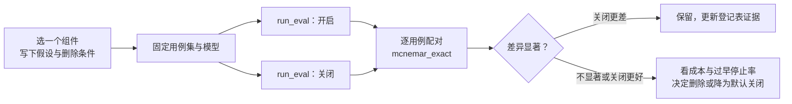

# 28 可删减的 Harness

harness 里的每个组件都隐含着一个判断：“模型自己做不到这件事”。模型会升级，这些判断会过期。
本章给出一个框架，用来区分哪些组件会被更强的模型“吞掉”、哪些永远不该删，并把 flywhl-harness 的组件逐个归类，最后给出用评测数据做删除决策的具体流程。

## 判断框架：harness 会不会被模型吞掉

几份公开材料指向同一个结论：

- Anthropic《Harness design for long-running application development》（2026-03）：每个 harness 组件都编码了一个关于模型局限的假设；模型升级后应逐个移除组件做消融。文中记录，到 Opus 4.6 时去掉了 sprint 拆分与上下文重置，保留了 planner。
- Anthropic《Scaling Managed Agents》（2026-04）：不要把“模型做不到什么”写死在 harness 里——某一代模型需要的上下文重置，到下一代成了累赘。
- LangChain（2026-02）：模型固定、只改 harness，Terminal Bench 2.0 从 52.8 提升到 66.5；同时提醒，很多护栏只是在绕开当前模型的缺陷，可能过拟合，换模型后需要分别迭代。
- OpenAI《Harness engineering》（2026 年初）：Agent 卡住时，问的是“缺了什么能力、怎样让它对 Agent 可读、可强制执行”，而不是“再加一条提示”。

把它们合起来，可以对每个组件问三个问题：

| 问题 | 若答案是…… | 说明组件属于 |
|---|---|---|
| 这个组件服务的是谁？ | 模型（帮它记住、帮它不跑偏） | 能力补偿层——会随模型升级而贬值 |
| | 成本与延迟 | 效率优化层——随 API 与价格演化，不随模型智能演化 |
| | 用户、运维、组织（安全、审计、可恢复） | 治理基础设施层——与模型强弱无关 |
| 假设能被测量吗？ | 能（有可观测指标） | 可以纳入消融评测 |
| | 不能 | 先补观测，再谈删除 |
| 删错了的代价对称吗？ | 删了最多是成功率掉几个点 | 可以大胆实验 |
| | 删了可能造成不可逆的副作用 | 不进入消融范围 |

**模型能吞掉的只有第一层。** 第三层的需求方根本不是模型：模型再聪明，也不能替组织决定“这个命令需要人审”，也不能让崩溃的进程自己恢复。

## 三层划分

| 层 | 典型组件 | 随模型升级的趋势 | 删除的风险 |
|---|---|---|---|
| 能力补偿 | 强制规划、计划复述、固定任务拆解、激进摘要、格式修复重试、关键词路由、为上下文不足做的多 Agent 切分、上下文重置 | 贬值；有时从“帮助”变成“干扰”（打断模型自己更好的节奏、浪费上下文） | 可控：成功率可能下降，用评测发现 |
| 效率优化 | 前缀缓存布局、工具结果外置、旧结果清理、并行工具执行 | 取决于窗口大小、缓存定价、API 能力；与模型智能弱相关 | 可控：成本或延迟上升 |
| 治理基础设施 | 权限、审批、审计、幂等、持久化、配额 | 不贬值 | 不可接受：越权、重复扣款、数据丢失 |

## flywhl-harness 的组件逐个归类

| 组件 | 代码位置 | 层 | 隐含的假设 |
|---|---|---|---|
| 计划复述（每 4 轮复述未完成的 todo） | `ContextManager.todo_reminder` | 能力补偿 | 长会话中模型会忘记或偏离自己的计划 |
| Stop 计划验收 | `AgentLoop._stop_gaps` + `verify_todos` | 能力补偿 | 模型会在计划未完成时宣布结束 |
| 验收失败后的“请继续”回灌 | `_body` 中的 `STOP_FEEDBACK` | 能力补偿 | 模型需要外部反馈才会继续 |
| 循环守卫 | `LoopGuard.observe` | 能力补偿 | 模型会原地打转、乒乓、无视连续错误 |
| 子代理拆分 + 回传契约 | `TaskTool`、`check_contract` | 能力补偿（部分是效率） | 单个上下文装不下大范围探索；模型不会自己控制上下文增长 |
| 系统提示中的 `<rules>` 行为指令 | `prompts.SYSTEM_PROMPT` | 能力补偿 | 模型不会主动“先调查再动手”“修改前先 read” |
| 预算软阈值提醒 | `Budget.check` 的 `soft` | 能力补偿 | 模型感知不到自己的资源消耗 |
| 结构化压缩模板 | `prompts.COMPACTION_PROMPT` | 能力补偿 + 效率 | 没有固定结构，摘要会丢失关键信息 |
| 系统提示冻结、提醒以消息追加 | `Harness.create_session`、`_inject_reminders` | 效率 | 前缀缓存与 thinking 签名需要只追加的历史 |
| MCP 工具排序、工具名单钉进会话元数据 | `load_mcp_tools`、`ToolRegistry`、`Harness._build_rc` | 效率 | 同上 |
| 工具结果外置 | `ContextManager.shape_tool_result` | 效率 | 大结果原样进入上下文会浪费窗口 |
| 旧结果清理 | `ContextManager.apply_clearing` | 效率 | 窗口有限且早期大结果不再需要 |
| 自动压缩 | `_maybe_compact` | 效率（窗口不足时是必需） | 窗口会耗尽 |
| 工具并行 | `ToolExecutor.run_batch` + `parallel_tool_limit` | 效率 | 只读工具可以并发 |
| `max_tokens` 截断时整批判失败 | `_body` 中的 `MAX_TOKENS` 分支 | 治理（正确性） | 截断的参数不可信——与模型强弱无关 |
| 权限策略与托管基线 | `PermissionPolicy`、`MANAGED_BASELINE` | 治理 | — |
| 审批与超时默认拒绝 | `ApprovalBroker` | 治理 | — |
| 工具调用预写日志与对账 | `Store.step_started`、`Tool.reconcile` | 治理 | — |
| CAS 状态机 | `RunStateMachine`、`Store.cas_run` | 治理 | — |
| 预算硬上限 | `Budget.check` 的 `hard` | 治理 | — |
| 影子 git 快照 | `ShadowGit` + `snapshots` | 治理（可回滚） | — |
| 污点升级 | `PermissionPolicy.evaluate` 中的 `tainted`（写入会话元数据，子代理污点上传父 Run） | 治理（安全） | — |
| bash 命令分析 | `policy/bash_analyzer.analyze` | 治理（安全） | —（剥包装命令、递归分析 `sh -c`；`catastrophic` 在任何模式下都拒绝，`bypass` 也不例外） |
| 熔断与探测名额归还 | `CircuitBreaker`（`allow` / `release`） | 治理（可用性） | — |
| DAG 调度的租户 / 全局名额 | `DagScheduler`（先租户后全局） | 治理（配额） | — |
| 端侧在途去重 | `EdgeExecutor._inflight` | 治理（幂等） | — |
| 事件审计流 | `events` 表 + `EventHub` | 治理 | — |
| 换模型留痕 | `Harness._note_model_switch`（`model_switched` 事件） | 治理（可追溯） | — |
| 回放指纹 | `llm/replay.context_fingerprint` | 治理（评测可信度） | — |

两点观察：

- **能力补偿组件集中在 Loop 的“软”部分**：提醒、回灌、阈值告警，它们的输出都是一条 system-reminder；治理组件集中在执行器与运行时，输出是“允许 / 拒绝 / 状态迁移”。这个分布本身就是好的设计——能力补偿以“建议”的形式出现，删掉它不会让任何不变式失效。
- **`max_tokens` 截断判失败看起来像能力补偿，其实不是**：它保护的是“只执行完整参数”的正确性，模型再强，被截断的 JSON 也不能执行。
- **回放指纹是消融的配套设施。** `context_fingerprint` 对 system、工具（名字 + 描述哈希 + 参数 schema 哈希）与消息取哈希；删掉一条提醒、改一句工具描述，旧轨迹回放都会在第一处变化的请求上报分叉。所以做完消融后，用旧轨迹做回归回放会立刻停在被删组件的位置——这是预期的，应当重新录制，而不是把分叉当成回归。

## 假设登记表

把隐含的假设写下来，是删除它们的前提。建议在仓库里维护一张登记表（下表为模板与示例；“引入证据”一列应填你自己的轨迹或评测记录）：

| 组件 | 假设内容 | 引入证据 | 适用模型 | 观测指标 | 删除条件 | 开关 |
|---|---|---|---|---|---|---|
| 计划复述 | 超过 4 轮未更新 todo 时，模型会偏离计划 | 轨迹中“计划写了却没按计划推进”的案例 | 引入时使用的模型 | 复述注入次数；复述后下一轮是否调用 `todo_write` | 关闭后成功率差异不显著，且过早停止率不上升 | 需要扩展（间隔写死为 4） |
| Stop 计划验收 | 模型会在计划未完成时宣布结束 | `stop_blocked` 通知中“计划中仍有未完成项”的出现频率 | 同上 | 每个 Run 的 `stop_blocked` 次数；`premature_stop_rate` | 连续若干个评测版本中，该缺口触发率接近零 | `verify_todos` |
| 循环守卫告警 | 模型会以相同参数重复调用并得到相同结果 | `loop_guard` 通知、`loop_detected` 状态的历史数量 | 同上 | 告警次数；告警后行为是否改变 | 告警触发率趋零，或告警后模型行为不变（提醒无效，只剩成本） | `loop_guard.*` 阈值 |
| 子代理拆分 | 主上下文装不下大范围探索 | 主会话压缩次数、上下文峰值 | 窗口较小的模型 | 子代理调用次数与成本占比；主会话压缩次数 | 换用大窗口模型后，关闭子代理成功率无显著差异且成本下降 | `subagent_max_depth`（见下文的注意事项） |
| 旧结果清理 | 早期的大工具结果不再需要，却占着窗口 | 水位曲线中工具结果占比 | 非 `append_only` 模型 | `clear_tool_results` 通知次数；缓存读取 token 占比 | 清理带来的窗口收益小于缓存命中下降的成本 | `context.clear_old_tool_results` |

“适用模型”一列很关键：同一个组件可能对 A 模型有用、对 B 模型有害。登记表应当按模型分别记录结论，而不是一个全局的“有用 / 没用”。

## 特性开关现状

能做消融的前提是组件可以被单独关掉。flywhl 当前的情况：

| 组件 | 开关（`HarnessConfig`） | 默认 | 关闭后的行为 |
|---|---|---|---|
| Stop 计划验收 | `verify_todos` | `True` | 不再因未完成的 todo 阻止结束 |
| 验收命令 | `verify_command` | `None` | 默认即关闭 |
| Stop 阻止次数 | `max_stop_blocks` | `3` | 见下方注意事项 |
| 旧结果清理 | `context.clear_old_tool_results` | `True` | 不再改写旧消息；`append_only` 模型上本来就不生效 |
| 自动压缩 | `context.auto_compact` | `True` | 只在上下文溢出时强制压缩（`_ContextOverflow` 分支仍然会触发） |
| 工具结果外置阈值 | `context.tool_result_max_tokens` | `6000` | 调大即近似关闭 |
| 影子 git 快照 | `snapshots` | `True` | 写操作前不再打快照，无法回滚 |
| 循环守卫 | `loop_guard.warn_repeats` / `stop_repeats` / `max_consecutive_errors` / `same_file_edit_warn` | 3 / 5 / 6 / 6 | 调大即近似关闭；没有单独的启用开关 |
| 预算软提醒 | `budget.soft_ratio` | `0.8` | 设为 `1.0` 时软阈值与硬阈值重合，软提醒不再出现 |
| 预算收尾 | `budget.wrap_up_on_exhaust` | `True` | 耗尽时直接结束，不做总结 |
| AGENTS.md / 技能清单 | `load_agents_md` / `load_skills` | `True` | 系统提示不再包含对应段落 |
| 子代理 | `subagent_max_depth` | `2` | 见下方注意事项 |
| 并行工具 | `parallel_tool_limit` | `8` | 设为 `1` 即串行 |

::: warning 两个“看起来能关、其实不是”的开关
- **`max_stop_blocks=0` 不是关闭验收。** `_body` 中的判断是 `if rc.stop_blocks < rc.config.max_stop_blocks`，设为 0 时任何缺口都会让 Run **立即以 `incomplete` 结束**，而不是放行。要关闭验收，应关闭各个验收来源（`verify_todos=False`、不设 `verify_command`、不注册 Stop hook）。
- **`subagent_max_depth=0` 不会移除 `task` 工具。** 这个开关只裁剪子代理的工具集：`Harness.run_subagent` 在子代理已到最深一层时把 `task` 排除在外（孙代理没有 `task`）。主代理的工具集不受影响，`TaskTool.execute` 只会返回“嵌套深度已达上限”的错误，模型仍可能尝试调用它。做“无子代理”消融时，应构造不含 `task` 的工具集（例如 `ToolRegistry.subset`），这样模型从一开始就看不到它。
:::

需要扩展才能单独关闭的组件：

| 组件 | 现状 | 建议的扩展 |
|---|---|---|
| 计划复述 | `todo_reminder(messages, every_turns=4)` 由 `_inject_reminders` 以默认参数调用 | 增加 `context.todo_reminder_turns`，`0` 表示关闭 |
| 乒乓检测、连续错误提醒 | 窗口 6、`max(3, max_consecutive_errors // 2)` 写死在 `LoopGuard.observe` 中 | 并入 `LoopGuardConfig` |
| `<rules>` 中的单条行为指令 | 只能整体替换（`system_prompt`）或追加（`append_system_prompt`） | 把规则拆成可开关的条目，便于逐条消融 |
| 压缩模板 | 常量 `COMPACTION_PROMPT` | 允许配置模板，或通过 `pre_compact` hook 追加指令（已支持追加） |

## 消融评测流程



`observe/evals.py` 提供了需要的全部零件：`run_eval` 为每个用例新建临时工作区、执行、按产物判定；`EvalReport.summary()` 给出成功率的 Wilson 区间与过早停止率；`mcnemar_exact` 对同一批用例上的两组结果做精确配对检验。

```python
# 示意代码：消融 verify_todos（需要真实模型；脚本化模型是确定性的，消融没有意义）
from flywhl_harness import Harness, HarnessConfig
from flywhl_harness.observe.evals import EvalCase, run_eval, mcnemar_exact

def has_tests_passing(ws, res):
    import subprocess
    r = subprocess.run(["python", "-m", "pytest", "-q"], cwd=ws, capture_output=True)
    return r.returncode == 0, r.stdout.decode()[-200:]

cases = [EvalCase("fizzbuzz", "实现 fizzbuzz.py 并补齐测试", has_tests_passing, setup=seed_repo), ...]

def factory(verify_todos: bool):
    async def make(ws):
        cfg = HarnessConfig.load(workspace=str(ws), verify_todos=verify_todos)
        cfg.permissions.mode, cfg.permissions.on_ask = "bypass", "allow"   # 评测在隔离的临时目录中进行
        return Harness(cfg)                                                # run_eval 会调用幂等的 start()，MCP 工具照常加载
    return make

on = await run_eval(cases, factory(True))
off = await run_eval(cases, factory(False))
print(on.summary(), off.summary())
print(mcnemar_exact([r.passed for r in on.results], [r.passed for r in off.results]))
```

读结果时的几条纪律：

1. **只看不一致的用例。** McNemar 检验只使用“一组通过、另一组失败”的用例对（`a_only` / `b_only`）。`tests/test_runtime.py::test_wilson_and_mcnemar` 里有一个例子：3:0 的不一致，双侧 p 值是 0.25，并不显著。按精确二项检验计算，不一致全部偏向一边时，至少需要 6 对才能达到 p < 0.05（5 对时 p = 0.0625）。
2. **`trials > 1` 时注意配对单位。** `run_eval` 按“用例 × 重复次数”展开结果，同一用例的多次重复彼此相关，直接把它们当作独立配对会高估显著性。更稳妥的做法是先按用例聚合（例如多数票），再做配对检验。
3. **成功率之外看两个指标。** `premature_stop_rate`（Run 说完成了但产物检查失败）是删除 Stop 验收类组件时最该盯住的指标；`avg_tokens` 与 `total_cost_usd` 衡量组件本身的开销——能力补偿组件“没坏处”时，往往还有成本上的坏处。
4. **按模型分别得出结论。** 换模型就重跑消融，结论写回假设登记表的“适用模型”列。

轨迹层面的分析（哪些用例因为删除组件而失败、失败在哪一步）见 [22 轨迹回放评测](/multi-agent/trajectory-eval)。

## 不能删的东西

| 组件 | 不能删的原因 |
|---|---|
| 权限与托管基线 | 需求来自用户与组织；模型无法替人决定授权边界，提示注入还可能让模型主动越权 |
| 审批与超时默认拒绝 | 不可逆操作需要人的意志参与；超时放行等于没有审批 |
| 预写日志与对账 | 进程崩溃与模型能力无关；没有 intent 记录，就无法判断“扣款做没做过” |
| CAS 状态机 | 取消与完成、两个 Worker 接管之间的竞态是并发问题，不是智能问题 |
| 预算硬上限 | 防止失控成本；也是“模型陷入死循环”时的最后防线 |
| 截断参数不执行 | 不完整的输入不可执行，是协议层的正确性 |
| 灾难性命令拒绝 | 删家目录、格式化磁盘不可逆，所以连 `bypass` 模式也拒绝——“信任模型”的模式切换不应触及这条线 |
| 事件审计 | 事后追责与回放评测都依赖它 |

这一层的组件可以优化（更细的规则、更少的审批疲劳），但不应以“模型变强了”为理由删除。

## 保持接口稳定，以便整体替换 harness 逻辑

组件会被删，Loop 的写法也可能被整体推翻（比如未来改为模型原生的长时运行能力）。让替换成本低的关键是：**易变的部分只依赖稳定的接口**。flywhl 中已经稳定的几个接口：

| 接口 | 稳定的契约 | 替换时的意义 |
|---|---|---|
| `Tool`（`execute` / `reconcile` / `effect` …） | 工具只知道参数与 `ToolContext` | “双手”可以换（本地、远程沙箱、MCP），大脑不受影响 |
| `Provider.stream(req, cancel)` | 产出 `StreamEvent`，以 `done` 结束 | 模型可以换，Loop 不受影响 |
| 会话条目（`entries`，只追加） | 上下文的事实源 | 相当于 Managed Agents 中“会话事件日志作为持久上下文对象”——Loop 换了，历史仍然可用 |
| 事件流（`Event(type, data, seq)`） | 消费者只认事件 | CLI、Web UI、测试、监控不随 Loop 改写 |
| `RunContext` | Loop 的所有依赖显式集中 | 替换任何一个零件只需换构造参数 |

一个尚未开放的扩展点：`Harness._launch` 中直接写的是 `AgentLoop(rc)`。如果想并排比较两套完全不同的 Loop 实现，可以把它改为可注入的工厂（例如构造参数 `loop_factory`），只要新的 Loop 同样以 async generator 产出事件、并设置 `outcome`，运行时的其余部分（状态机、持久化、恢复、订阅）都无需改动。

偏好通用机制，是让 harness 经得起模型升级的另一条原则：hooks、工具、上下文管理、验证命令这些机制不对模型能力做假设；具体的“补偿策略”写成 hook 或配置，而不是写进 Loop 的主干——这样删除一个补偿只是删除一个 hook。上一章的长时任务模式（[24 长时任务 Harness](/advanced/long-running)）就是这样实现的。

下一章拿一个刻意极简的 harness 做对照：[29 对照 pi：极简 Harness 的取舍](/advanced/pi-comparison)。
