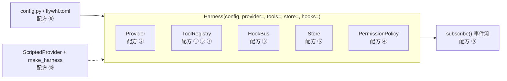

# 30 扩展指南

这一章是配方集：新增工具、接入新模型、写 hook、配权限、接 MCP、换存储、换执行环境、消费事件、查配置、写测试。
每个配方都基于真实的 API；标注“示意代码”的部分是本项目未内置、给出设计思路的实现。配方 ①～⑤ 的代码在 flywhl 当前版本上实际跑通过。

## 扩展点总览



`Harness.__init__` 的签名决定了扩展方式：`Harness(config, *, provider=None, model=None, tools=None, store=None, hooks=None, approval_resolver=None, worker_id=None)`。
所有零件都通过构造参数注入；不传就用默认实现（`create_provider`、`default_tools`、SQLite `Store`、空的 `HookBus`）。

## ① 新增工具

### 用 `@tool` 装饰器定义只读工具

```python
from typing import Annotated, Literal
from flywhl_harness import Effect, default_tools, tool, HarnessConfig

@tool(effect=Effect.READ, idempotent=True)
async def word_count(text: Annotated[str, "要统计的文本"], unit: Literal["char", "word"] = "char") -> str:
    """统计文本长度：unit=char 按字符计数，word 按空白分词计数。"""
    return str(len(text) if unit == "char" else len(text.split()))

reg = default_tools(HarnessConfig.load())
reg.register(word_count)
```

`FunctionTool` 从函数推导出全部规格：名字取函数名，描述取 docstring，参数 schema 由 `schema_from_signature` 从签名推导——`Annotated[类型, "描述"]` 写参数说明，`Literal` 变成 `enum`，有默认值的参数是可选的，并自动加上 `additionalProperties: false`。上面的函数推导出：

```json
{"type": "object",
 "properties": {"text": {"type": "string", "description": "要统计的文本"},
                "unit": {"enum": ["char", "word"], "type": "string", "default": "char"}},
 "additionalProperties": false, "required": ["text"]}
```

函数签名中有名为 `ctx` 的参数时会注入 `ToolContext`（不进入 schema）；返回 `str` 会被包装成 `ToolResult`，也可以直接返回 `ToolResult`。

### 继承 `Tool`：有外部副作用、需要对账的工具

```python
from flywhl_harness import Effect, Tool, ToolResult

class CreateTicketTool(Tool):
    name = "create_ticket"
    description = "在工单系统中创建一张工单（外部系统，不可撤回）。相同幂等键不会重复创建。"
    parameters = {"type": "object", "properties": {"title": {"type": "string", "description": "工单标题"}},
                  "required": ["title"], "additionalProperties": False}
    effect = Effect.EXTERNAL
    interruptible = False      # 请求发出后不能半途打断
    idempotent = True          # 外部系统按幂等键去重

    def __init__(self, svc):
        self.svc = svc

    def permission_target(self, args):          # 权限规则匹配的目标串：create_ticket(<title>)
        return str(args.get("title", ""))

    async def execute(self, args, ctx):
        tid, fresh = self.svc.create(ctx.idempotency_key, args["title"])
        return ToolResult(f"已创建工单 {tid}" + ("" if fresh else "（重复请求，未重复创建）"),
                          details={"ticket_id": tid})

    async def reconcile(self, args, ctx):       # 崩溃恢复时：凭幂等键查询外部系统的真实状态
        tid = self.svc.find(ctx.idempotency_key)
        return ToolResult(f"对账：工单 {tid} 已存在") if tid else None
```

`ctx.idempotency_key` 是 `run_id:call_id`，跨崩溃重启保持不变。恢复时执行器对 `steps` 中“有 intent 无结果”的调用先调 `reconcile`：返回结果就直接采用；返回 `None` 时，只读或 `idempotent=True` 的工具用同一幂等键重做，其它工具以 `unknown` 状态报告给模型，不盲目重试（见 [14 幂等](/reliability/idempotency)）。

### 属性与可覆盖方法怎么选

| 属性 / 方法 | 取值依据 | 影响 |
|---|---|---|
| `effect` | 只读 → `READ`；只改工作区文件 → `WRITE`；改变外部世界 → `EXTERNAL` | 并发（只有 `READ` 进并行批）、默认审批、执行前快照、恢复时能否重做 |
| `effect_for(args)` | 副作用随参数变化时覆盖（如“查询”与“删除”共用一个工具） | 权限判定与快照按动态等级进行 |
| `interruptible` / `interruptible_for(args)` | 中途打断会留下不一致状态时设 `False`；随参数变化时覆盖方法（bash 对外部操作返回 `False`） | 取消时不中止，给宽限期，仍未完成则报告“结果未知” |
| `cancel_grace` | 不可中断工具的典型收尾时长；`None` 用全局 `cancel_grace_seconds` | 取消后最多再等这么久 |
| `idempotent` | 外部系统能按幂等键去重时设 `True` | `TransientToolError` 自动重试；恢复时可安全重做；`EXTERNAL` 工具超时按普通 `timeout` 而不是 `unknown` 报告 |
| `timeout` | 工具自身的典型耗时上限；`None` 用全局 `tool_timeout` | 超过即中止；同时不超过 Run 剩余的墙钟预算。`EXTERNAL` 且不幂等的工具超时报 `unknown`（请求可能已生效），其余报 `timeout` |
| `manages_timeout` | 工具自己处理超时（清理并返回部分结果）时设 `True`，如 bash 杀进程组并保留已有输出 | 执行器按 `args["timeout"]`（或工具的 `default_timeout`）再加 10 秒兜底，不抢先打断 |
| `untrusted_output` / `untrusted_for(args)` | 输出来自网页、邮件、工单、第三方 Agent 时设 `True`；随参数变化时覆盖方法（bash 对 `curl`、`git pull` 等带 `network` 标记的命令返回 `True`） | 读入后会话被标记为污点，后续副作用操作升级为人审；污点写入会话元数据，恢复后仍有效 |
| `preview(args, ctx)` | 审批人需要看到“会改成什么样”时实现，如 `write` / `edit` 返回 diff | 随 `approval_request` 事件的 `preview` 字段下发（截断到 8000 字符） |
| `permission_target` / `describe_call` | 规则要匹配什么、审批卡片显示什么 | 决定规则能写多细（默认取 `path` / `command` / `url` / `to` 参数） |

失败一律用 `ToolResult.error(...)` 或 `is_error=True` 返回，而不是抛异常：执行器虽然会兜住异常，但精心写的错误信息（下一步该怎么做）对模型自我修正的帮助大得多。

## ② 新增模型 provider

**先看是不是 Chat Completions 兼容服务。** 大多数国内与开源推理服务都是：这时不用写代码，在 `llm/profiles.py` 加一行档案即可——

```python
ProviderProfile("myllm", "我的推理服务", base_url="https://llm.example.com/v1", key_env=("MYLLM_API_KEY",),
                default_model="my-model-1",
                reasoning_echo="field",       # 思考模型要求回传 reasoning_content 时；内联 <think> 的用 "inline"
                thinking_param="type"),       # 思考开关字段的写法；没有就省略
```

然后 `flywhl doctor myllm:my-model-1` 验证流式文本与工具往返，再用 `FLYWHL_LIVE_MODEL=myllm:my-model-1 pytest -m live tests/live` 跑完整回归。
档案里每个字段的含义与各家实测差异见 [05 消息模型与模型接入层](/core/messages-and-models)。

协议完全不同时，才需要实现 `Provider.stream(req, cancel)`：产出 `StreamEvent`，最后一个必须是携带完整消息的 `done`。用 `MessageBuilder` 拼装增量，错误映射为带分类的 `ProviderError`。

```python
from flywhl_harness.llm.base import (ErrorKind, MessageBuilder, ModelRequest, Provider, ProviderError,
                                     StreamEvent, classify_http_error, prepare_history)
from flywhl_harness.llm.models import compute_cost
from flywhl_harness.types import StopReason, Usage

class MyProvider(Provider):
    name = "myllm"

    async def stream(self, req: ModelRequest, cancel):
        b = MessageBuilder(self.name, req.model)
        history = prepare_history(req.messages)          # 统一修补：tool_call / tool_result 严格配对
        async with self.client.stream("POST", self.url, json=self._payload(req, history)) as resp:
            if resp.status_code >= 400:
                body = (await resp.aread()).decode("utf-8", "replace")
                raise classify_http_error(resp.status_code, body, dict(resp.headers), self.name)
            yield StreamEvent("start")
            async for chunk in cancel.iterate(self._chunks(resp)):   # 取消时尽快断开
                if chunk.text:
                    b.text(0, chunk.text)
                    yield StreamEvent("text_delta", chunk.text, 0)
                # 工具调用：b.tool_start(i, id, name) → b.tool_delta(i, partial_json) → 结束时 toolcall_end
        usage = Usage(input_tokens=..., output_tokens=...)
        usage.cost_usd = compute_cost(self.model_info(req.model), usage)  # 成本由 provider 计算
        yield StreamEvent("done", message=b.build(StopReason.END_TURN, usage))
```

上面是骨架（`self.client`、`_payload`、`_chunks` 需按目标 API 实现），完整参照 `llm/openai_compat.py` 的 `OpenAICompatProvider.stream`。几条约定：

| 约定 | 原因 |
|---|---|
| provider 自己**不做重试** | 重试只在 `ResilientProvider` 一层发生，避免多层叠加放大（见 `llm/base.py` 模块注释） |
| 错误必须分类（`ErrorKind`） | 分类决定策略：限流退避、过载降级、上下文超长先压缩、鉴权失败不重试 |
| 半截工具调用不能执行 | `MessageBuilder.build(..., partial=True)` 会丢弃未完成的 thinking 与 tool_call |
| 输出被截断映射为 `StopReason.MAX_TOKENS` | Loop 据此把整批工具调用判为失败，不执行可能不完整的参数 |
| 自己计算 `cost_usd` | 不计算时用量正常、成本为 0，费用预算 `max_cost_usd` 形同虚设 |

注册能力表与包装降级链：

```python
from flywhl_harness import Harness, HarnessConfig
from flywhl_harness.llm.models import MODELS, ModelInfo
from flywhl_harness.llm.resilient import ResilientProvider
from flywhl_harness.runtime.retry import RetryPolicy

MODELS["my-model-1"] = ModelInfo("my-model-1", "myllm", context_window=128_000, max_output=8_192,
                                 input_price=1.0, output_price=2.0)   # 官方按人民币计价时加 currency="CNY"
p = MyProvider()
rp = ResilientProvider([(p, "my-model-1"), (p, "my-model-mini")], RetryPolicy(max_attempts=4))
h = Harness(HarnessConfig.load(), provider=rp, model="my-model-1")
```

- `Provider.model_info` 默认按模型名查 `MODELS`，查不到时使用保守默认值（128K 窗口、成本 0）；也可以在子类里覆盖 `model_info`。窗口大小决定压缩时机，价格决定成本与费用预算。
- 显式传入 `provider=` 时 `create_provider` 不会被调用，**也就不会自动包装** `ResilientProvider`，需要自己包。降级链中每一项是 `(provider, model)`，可以跨 provider。
- 历史必须严格只追加的模型（例如 thinking 签名绑定完整前缀的模型），在 `ModelInfo` 中设 `append_only=True`，harness 会关闭改写历史的“旧结果清理”。

## ③ 新增 hook

### 进程内：`HookBus.on`

```python
from flywhl_harness import HookEvent, HookOutput

@h.hooks.on(HookEvent.POST_TOOL_USE, matcher="create_ticket", priority=50)
async def audit(inp):
    log_to_audit(inp.run_id, inp.tool_name, inp.tool_input, inp.tool_result["content"])

@h.hooks.on(HookEvent.PRE_TOOL_USE, matcher="write|edit", fail_closed=True)
async def protect_migrations(inp):
    if str(inp.tool_input.get("path", "")).startswith("migrations/"):
        return HookOutput(decision="deny", reason="迁移脚本只能由人工编写")
```

| 字段 / 返回值 | 说明 |
|---|---|
| `matcher` | 工具名 glob，可用竖线分隔多个（如上例的 write 与 edit）；只对工具类事件生效 |
| `priority` | 升序串行执行；`updated_input` 会链式传给下一个 hook；`pre_tool_use` 遇到 deny 短路 |
| `fail_closed` | 守卫类 hook 设 `True`：hook 自己出错或超时按阻断处理；观测类保持默认的 fail-open |
| `inp.context` | 进程内 hook 可直接访问 `RunContext`（工作区、存储、消息历史） |
| `HookOutput.decision` | `pre_tool_use`：allow / ask / deny（**只能收紧**，hook 说 allow 绕不过规则的 ask / deny）；其它事件只有 block 有意义。取值由 `normalize_decision` 统一：`pre_tool_use` 的 `block` 等同 deny、`approve` 等同 allow，其它事件的 `deny` 视同 block；无法识别的取值被忽略并记入 `HookOutput.warnings`，所有事件的警告都会作为 `hook_warning` 通知发出，而不是静默失效 |
| `updated_input` / `updated_result` | 改写参数（会重新做 schema 校验与权限判定）/ 改写给模型看的结果（如脱敏） |
| `additional_context` | 以 system-reminder 的形式注入；`stop` hook 不 block 时，这段文字作为提醒落盘，留给本会话的下一次 Run |
| `stop_run` | 立即终止整个 Run |

审批人在批准时改了参数，执行器会用新参数重新做权限判定、**再跑一遍** `pre_tool_use`——守卫类 hook 表达的是不变量，人工批准也绕不过它。

各挂载点的触发时机见 [16 Hooks](/governance/hooks)。

### 进程外：`flywhl.toml` 的 `[[hooks]]`

```toml
[[hooks]]
event = "pre_tool_use"
matcher = "bash"
command = "python3 scripts/guard_push.py"
timeout = 30
fail_closed = true
```

```python
# scripts/guard_push.py：stdin 收到 JSON，退出码 2 表示阻断，stderr 作为原因回给模型
import json, sys
inp = json.load(sys.stdin)
if "git push" in (inp.get("tool_input") or {}).get("command", ""):
    print("禁止在 Agent 中直接 git push，请提交 PR", file=sys.stderr)
    sys.exit(2)
```

`Harness.__init__` 把每条 `HookConfig` 包装成 `CommandHook` 注册（`source="project"`，工作目录为工作区根，环境变量 `FLYWHL_HOOK_EVENT` 为事件名）。协议与 Claude Code 兼容：退出码 0 放行（stdout 可以返回 JSON 决策，如 `{"hookSpecificOutput": {"permissionDecision": "ask"}}`），2 阻断，其它为非阻断错误。stdin 的 JSON 字段名是 `hook_event_name`、`tool_name`、`tool_input`、`tool_response` 等（见 `HookInput.to_json`）；空字段会被去掉，但工具类事件的 `tool_input` 总会保留，无参工具也传 `{}`，脚本可以直接取。

两个运行细节：hook 进程以新会话启动，超时（`timeout`）时整个进程组被 `SIGKILL`，脚本派生的子进程不会残留在后台；hook 进程继承 harness 的**完整**环境变量，不像 bash 工具那样剥离密钥类变量，脚本来源要与代码一样审查。

## ④ 权限规则与模式

```toml
[permissions]
mode = "default"            # default | accept_edits | plan | bypass
on_ask = "wait"             # wait（人审）| allow | deny（无人值守，如 CI）
approval_timeout = 600
rules = [
  "allow:bash(git status*)", "allow:bash(pytest*)",
  "ask:write(src/**)",
  "deny:bash(git push*)", "deny:create_ticket(*生产*)",
  "deny:mcp__github__*",
]
```

| 规则要点 | 说明 |
|---|---|
| 语法 | `决策:工具(模式)`，工具名与模式都是 glob（`fnmatch`，`*` 可以跨越 `/`） |
| 评估顺序 | deny → ask → allow，先命中者生效；任何来源的 deny 都不能被 allow 推翻 |
| 托管基线 | `MANAGED_BASELINE` 总是排在最前：密钥文件禁读，`.env` 需确认，harness 数据目录禁写、项目配置需确认，最危险的几条命令直接拒绝 |
| 灾难性命令 | 命令分析标记 `catastrophic`（删根目录 / 家目录、格式化磁盘、写块设备、fork 炸弹）时，在任何规则与模式之前直接 deny，`bypass` 也不例外 |
| bash 命令分析 | 先剥掉 `env` / `timeout` / `nice` / `xargs` / `sudo` 等包装命令，按真正执行的命令分级；`sh -c '...'` 与 `eval` 的字符串递归分析；命令替换、解释器内联代码等无法静态分析的结构按 `external` 处理 |
| 工作区外路径 | bash 参数或重定向指向工作区之外（含 `~`、`$HOME`）→ 至少 `external`，需确认；文件工具读工作区外路径同样转为 ask |
| bash 复合命令 | allow 规则要求**每一段**都被 allow 覆盖：`git status && rm -rf x` 不会因为 `allow:bash(git status*)` 被放行 |
| 文件工具 | 目标同时匹配原始路径、绝对路径与相对工作区的路径 |
| 只升不降 | 命令分析为高危 → 至少 ask；会话被污点标记 → 非只读的 allow 升级为 ask（bypass 模式除外） |
| 污点来源与范围 | 工具的 `untrusted_for(args)` 为真即标记污点（bash 下载类命令带 `network` 标记）；污点写入会话元数据，暂停恢复、崩溃接管后保留；子代理的污点在返回时上传到父 Run |

模式可以按会话切换：`h.set_mode(session_id, "accept_edits")`。审批时选择“本会话总是允许”会生成一条窄粒度的会话级授权（`grant_for`），例如 bash 只取命令的前两个词加 `*`。完整语义见 [17 权限与人审](/governance/permissions-hitl)。

## ⑤ 接入 MCP 服务器

```toml
[mcp_servers.demo]
command = "python"
args = ["examples/mcp_echo_server.py"]
```

工具以 `mcp__<server>__<tool>` 命名注册，副作用等级由 annotations 保守推导（未声明 `openWorldHint` 的工具输出视为污点）。必须通过 `async with Harness(...)` 或 `await h.start()` 才会连接服务器并注册工具；`start()` 是幂等的，`run_eval` 也会自动调用。服务器子进程拿不到 harness 进程里的密钥类环境变量，凭证要写在该服务器的 `env` 里。协议细节、未实现的部分与安全注意事项见 [27 协议生态](/advanced/protocols)。

## ⑥ 替换存储后端为 PostgreSQL

`Store` 是一个具体类而不是抽象接口，替换它需要实现同名方法、返回相同的记录类型（`SessionRecord`、`Entry`、`RunRecord`、`StepRecord`、`ApprovalRecord`、`Event`），然后 `Harness(config, store=PgStore(dsn))` 注入。以下是需要实现的方法与**必须保持的语义**（示意，本项目未实现）：

| 方法 | 语义要求 | PostgreSQL 实现要点 |
|---|---|---|
| `tx()` | 可嵌套事务：只有最外层提交 / 回滚。执行器用它把“tool 结果消息 + step 完成”写在同一个事务里 | 连接级的深度计数，或内层用 SAVEPOINT |
| `append_entry` | 读 head → 插入条目 → 移动 head，三步原子完成 | SQLite 的 `BEGIN IMMEDIATE` 天然串行化了写者；PostgreSQL 需要 `SELECT head FROM sessions WHERE id=%s FOR UPDATE`，否则两个并发追加会读到同一个 head，在树上分叉 |
| `entries.id` 唯一 | `SessionLog.append_message` 用 `e_{msg.id}` 作条目 ID，重复写入必须报错而不是静默产生两条 | `UNIQUE` 约束；`seq` 用 identity 列保证顺序 |
| `path(session_id, head)` | 从根走到 head 的路径，根在前 | `WITH RECURSIVE` 写法与 SQLite 基本一致 |
| `cas_run` | `UPDATE ... WHERE id=? AND status=? AND version=?`，`version+1`，返回是否恰好更新一行 | 同样写法；不要用“先 SELECT 再 UPDATE” |
| `update_run` | 只更新非状态字段（断言不含 `status`） | — |
| `heartbeat(rid, worker_id)` | **条件更新**：只在 `worker_id` 仍是自己（或为空）时写心跳时间，返回是否成功；返回 `False` 时 Worker 自我 fencing：按崩溃中止该 Run、不再写入 | `UPDATE ... WHERE id=%s AND (worker_id IS NULL OR worker_id=%s)`，按影响行数返回；不要先查后写，否则会覆盖新主人的租约 |
| `stale_runs` | 扫描指定状态中心跳过期的 Run | 多机部署时用数据库时间（`now()`）而不是各 Worker 的本地时钟，避免时钟漂移导致误判 |
| `runs_with_status(*statuses)` | 按状态列出 Run（`recover` 用它找 `queued` 孤儿与关闭时暂停的 Run） | `status` 列建索引 |
| `child_runs(parent_run_id)` | 按创建时间列出子 Run（轨迹导出用） | `parent_run_id` 建索引 |
| `step_started` | 插入 intent；同一 `(run_id, call_id)` 重复写入时 `attempt + 1` | `INSERT ... ON CONFLICT (run_id, call_id) DO UPDATE SET attempt = steps.attempt + 1` |
| `step_finished` / `get_step` / `list_steps` | 写结果、查询 | — |
| `append_events` | 按 `(run_id, seq)` 去重插入（重复写入静默忽略） | `ON CONFLICT DO NOTHING` |
| `append_event_next(run_id, type, data)` | 没有活动 `EventHub` 时追加一条事件（离线状态迁移、`model_switched` 通知），序号在**同一事务内**取 `max(seq) + 1`，返回序号 | READ COMMITTED 下两个事务会读到同一个 `max(seq)`：先 `SELECT ... FROM runs WHERE id=%s FOR UPDATE` 锁住该 Run 行再取号，或在 `(run_id, seq)` 主键冲突时重试 |
| `list_events` / `max_event_seq` | 按 `seq` 升序；`after_seq` 用于断线续传 | 主键索引覆盖 |
| `resolve_approval` | `WHERE status='pending'` 的 CAS：批准、超时、取消只有一个生效 | 同样写法 |
| 其余 CRUD | `create/get/list/update_session`、`get_entry`、`list_entries`、`create/get/list_run(s)`、`create/get/list_approval(s)`、`close` | JSON 列（`_JSON_COLS` 中的 meta、payload、config、usage、result、checkpoint、output、args、edited_args，以及 events.data）用 JSONB |
| `blobs` 属性 | `put(scope, text, ttl)` 内容寻址（ref = sha256 前缀）、`get(scope, ref)` 按会话隔离、`purge_expired()` | 大载荷可以改存对象存储，表里只留引用 |

另一个需要注意的点：`Store` 的方法是**同步**的，在 asyncio 事件循环里直接调用。SQLite 本地写入很快，可以接受；换成网络数据库后，每次调用都会阻塞事件循环，应使用连接池并控制单次查询耗时，或者把整个存储层改为异步接口（这会牵动 `SessionLog`、`EventHub`、执行器等调用方）。

## ⑦ 把 bash / 文件工具换成远程沙箱执行器

“大脑 / 双手解耦”：Loop、权限、hooks、journal 都只认识 `Tool` 接口，所以执行环境可以整体搬走，而不改动大脑。

```python
# 示意代码：在远程沙箱中执行 bash（sandbox 客户端为假设）
from flywhl_harness import Effect, Tool, ToolResult
from flywhl_harness.policy.bash_analyzer import analyze

class RemoteBashTool(Tool):
    name = "bash"                    # 保持名字：权限策略对 bash 的命令分析、规则匹配照常生效
    description = "在远程沙箱的工作目录执行 bash 命令，返回合并后的输出与退出码。"
    parameters = {"type": "object", "properties": {"command": {"type": "string"},
                  "timeout": {"type": "number"}}, "required": ["command"]}
    effect = Effect.WRITE
    manages_timeout = True           # 沙箱自己执行超时并返回部分输出；执行器只做兜底
    default_timeout = 120.0

    def __init__(self, sandbox):
        self.sandbox = sandbox

    # 以下三个方法是本地 BashTool 的行为，换实现时要一并带上
    def effect_for(self, args):
        level = analyze(str(args.get("command", ""))).level
        return {"read": Effect.READ, "write": Effect.WRITE}.get(level, Effect.EXTERNAL)

    def untrusted_for(self, args):   # curl / git pull 取回的内容是污点
        return analyze(str(args.get("command", ""))).network

    def interruptible_for(self, args):
        return self.effect_for(args) != Effect.EXTERNAL

    async def execute(self, args, ctx):
        job = await self.sandbox.exec(args["command"], timeout=args.get("timeout", self.default_timeout),
                                      idempotency_key=ctx.idempotency_key)
        async for chunk in job.stream():                 # 部分输出 → tool_update 事件
            ctx.cancel.raise_if_cancelled()
            ctx.emit({"output": chunk})
        r = await job.result()
        return ToolResult(r.tail(400) + f"\n[退出码 {r.exit_code}]", is_error=r.exit_code != 0,
                          details={"sandbox_job": job.id})

reg = default_tools(cfg)
reg.register(RemoteBashTool(sandbox), replace=True)     # 同名替换：保持工具在列表中的位置，前缀稳定
h = Harness(cfg, tools=reg)
```

保持 `name = "bash"` 只保住了权限层：`PermissionPolicy.evaluate` 按 `tool.name == "bash"` 做命令分析。并行分批、超时是否算“结果未知”、取消时能否打断、输出是否带污点，这些都由工具自己的 `effect_for` / `interruptible_for` / `untrusted_for` 决定；直接继承 `Tool` 而不覆盖它们，`curl` 的输出就不会再标记污点。

需要同步考虑的边界：

| 方面 | 本地实现 | 远程沙箱时 |
|---|---|---|
| 路径约束 | `Workspace.resolve` 检查本地路径，权限策略对文件工具也按本地工作区解析 | 文件工具若改为读写远程文件系统，本地的路径解析与“工作区之外”判断不再成立，应在沙箱侧做约束 |
| 快照回滚 | `ShadowGit` 对本地工作区打快照 | 本地快照对远程文件无效；用沙箱自己的快照能力，或设 `snapshots=False` 避免误导 |
| 漂移检测 | `Workspace.manifest()` 扫描本地文件 | 需要沙箱提供清单接口 |
| 取消 | 杀本地进程组 | 把取消转发给沙箱的作业接口 |
| 崩溃恢复 | `reconcile` 默认返回 `None` | 用幂等键向沙箱查询作业状态，实现 `reconcile` |

## ⑧ 自定义事件消费者

`Harness.subscribe(run_id, after_seq=0)` 先从库里补齐 `seq > after_seq` 的事件，再接上实时流，按 `seq` 去重；消费太慢被踢出时会自动从库里补齐。消费者因此不需要自己处理断线与积压。

```python
# 示意代码：Slack 通知与指标上报（slack / metrics 客户端为假设）
import asyncio
from flywhl_harness.events import E

async def watch(h, run_id):
    async for ev in h.subscribe(run_id):
        d = ev.data
        if ev.type == E.APPROVAL_REQUEST:
            await slack.post(f"待审批：{d.get('summary')}（风险 {d.get('risk')}）")
        elif ev.type == E.TOOL_END:
            metrics.histogram("tool.duration_ms", d.get("duration_ms", 0), tags={"tool": d["name"], "status": d["status"]})
        elif ev.type == E.RUN_END:
            await slack.post(f"Run {run_id} 结束：{d['status']}（{d['reason']}）")

run = await h.start_run(session_id, "修复失败的测试")
asyncio.create_task(watch(h, run.id))
```

`subscribe` 是按 Run 订阅的，没有“所有 Run 的全局事件流”。需要覆盖所有 Run 时有两种做法：包装 `start_run` / `resume`，每启动一个 Run 就挂一个消费者；或者注册进程内的 `run_end` hook，在 Run 结束时从 `rc.store` 读取状态与用量后上报。后者只能拿到结束时的信息，拿不到过程中的审批请求。

## ⑨ 配置参考速查

以 `config.py` 为准；加载顺序为 默认值 → `flywhl.toml`（或 `.flywhl/config.toml`）→ 环境变量 → 显式参数，**未知键直接报错**。

| 字段 | 默认值 | 说明 |
|---|---|---|
| `provider` / `model` / `base_url` | `"auto"` / `None` / `None` | `model` 写成 `<供应商>:<模型>`；auto 按 DeepSeek → Anthropic → OpenAI → 百炼 → Kimi → 智谱 → MiniMax → OpenRouter 选第一个有密钥的，都没有时用 mock |
| `api_key` / `api_key_env` | `None` / `None` | 密钥（不建议写进文件）/ 从指定环境变量读密钥 |
| `fallback_models` | `[]` | 降级链，每项可写 `<供应商>:<模型>`（跨供应商） |
| `max_tokens` / `temperature` | `8192` / `None` | 单次输出上限 |
| `thinking` / `reasoning_effort` | `None` / `None` | 思考开关（`enabled` / `disabled`）与强度，按供应商翻译成各自的字段 |
| `extra_body` | `{}` | 原样并入 OpenAI 兼容请求体的厂商私有参数 |
| `request_timeout` / `max_retries` | `300.0` / `4` | 模型请求超时；`RetryPolicy.max_attempts`（含首次） |
| `system_prompt` / `append_system_prompt` | `None` / `None` | 完全替换 / 追加系统提示 |
| `load_agents_md` / `load_skills` | `True` / `True` | 加载 AGENTS.md（或 CLAUDE.md）/ 技能清单 |
| `workspace` / `data_dir` | `"."` / `".flywhl"` | 工作区；数据目录（相对工作区） |
| `tool_timeout` / `parallel_tool_limit` | `120.0` / `8` | 工具默认超时；只读并行批的并发上限 |
| `cancel_grace_seconds` | `5.0` | 不可中断工具在取消后的宽限期 |
| `heartbeat_seconds` / `stale_after_seconds` | `2.0` / `10.0` | 心跳间隔；超过即视为 Worker 崩溃 |
| `snapshots` | `True` | 写操作前影子 git 快照 |
| `max_stop_blocks` / `verify_command` / `verify_todos` | `3` / `None` / `True` | Stop 验收 |
| `subagent_max_depth` / `enable_demo_tools` | `2` / `True` | 子代理嵌套上限；演示工具 |
| `context.compact_threshold` / `reserve_tokens` / `keep_recent_tokens` | `0.80` / `8192` / `12000` | 压缩触发与保留量 |
| `context.tool_result_max_tokens` | `6000` | 单个结果超过即外置为句柄 |
| `context.clear_old_tool_results` / `clear_threshold` / `keep_tool_results_turns` | `True` / `0.55` / `3` | 旧结果清理 |
| `context.auto_compact` / `context_window` | `True` / `None` | 自动压缩；窗口（`None` 按模型能力表） |
| `budget.max_turns` / `max_tool_calls` | `40` / `200` | Run 级限额 |
| `budget.max_total_tokens` / `max_cost_usd` / `max_wall_seconds` | `None` | 可选限额 |
| `budget.soft_ratio` / `wrap_up_on_exhaust` | `0.8` / `True` | 软阈值提醒；耗尽时无工具收尾 |
| `loop_guard.window` / `warn_repeats` / `stop_repeats` | `12` / `3` / `5` | 重复调用检测 |
| `loop_guard.max_consecutive_errors` / `same_file_edit_warn` | `6` / `6` | 连续错误；同文件反复编辑 |
| `permissions.mode` / `rules` / `on_ask` / `approval_timeout` | `"default"` / `[]` / `"wait"` / `600.0` | 见配方 ④ |
| `permissions.strip_secret_env` | `True` | bash 子进程剥离 `*KEY*` / `*TOKEN*` / `*SECRET*` 等环境变量 |
| `hooks` | `[]` | 每项 `event` / `command` / `matcher` / `timeout`（30.0）/ `fail_closed` |
| `mcp_servers` | `{}` | 每项 `command` / `args` / `env` / `cwd`；服务器子进程总是剥离密钥类环境变量，不受 `strip_secret_env` 影响 |

可识别的环境变量：`FLYWHL_PROVIDER`、`FLYWHL_MODEL`、`FLYWHL_FALLBACK_MODELS`（逗号分隔）、`FLYWHL_BASE_URL`、`FLYWHL_API_KEY_ENV`、
`FLYWHL_THINKING`、`FLYWHL_REASONING_EFFORT`、`FLYWHL_CNY_PER_USD`（人民币计价模型的折算汇率）、`FLYWHL_WORKSPACE`、`FLYWHL_DATA_DIR`、`FLYWHL_PERMISSION_MODE`；
也接受 `LLM_PRIMARY_MODEL` / `LLM_FALLBACK_MODEL`（同样是 `<供应商>:<模型>` 写法），`FLYWHL_*` 优先。
`flywhl` 命令启动时从当前目录的 `.env` 读取密钥与模型选择类变量（其余变量忽略并提示），`--env-file` 指定的文件则完整加载；
两者都不覆盖已存在的环境变量，库代码也不会隐式读取 `.env`。显式参数支持嵌套字典，例如 `HarnessConfig.load(budget={"max_turns": 80})`。

## ⑩ 测试你的扩展

用 `ScriptedProvider` 写确定性测试：脚本条目可以是字符串（文本回复）、字典（`text` / `thinking` / `tool_calls` / `stop_reason` / `usage` / `delay`）、异常（测试重试与降级）或 `callable(req)`（根据请求动态生成）。默认按“请求中已有几条 assistant 消息”选择条目，`ScriptedProvider.requests` 记录了模型每次实际收到的请求。

`tests/conftest.py::make_harness` 在临时工作区里用脚本化模型和内存数据库构造 `Harness`，并支持用 `__` 覆盖嵌套配置：

```python
# tests/test_my_extension.py
from flywhl_harness import HookEvent, HookOutput
from .conftest import make_harness, tool_ends

async def test_ticket_tool_respects_rules(ws):
    h = make_harness(ws, [
        {"tool_calls": [{"name": "create_ticket", "args": {"title": "修复登录"}},
                        {"name": "create_ticket", "args": {"title": "清理生产库"}}]},
        "完成",
    ], permissions__rules=["deny:create_ticket(*生产*)"])
    h.tools.register(CreateTicketTool(FakeTicketService()))   # 测试替身：实现 create / find 即可
    res = await h.run("建两张工单")
    statuses = [e["status"] for e in tool_ends(res.events)]
    assert statuses == ["ok", "denied"] and res.status == "completed"

async def test_guard_hook_fail_closed(ws):
    h = make_harness(ws, [{"tool_calls": [{"name": "write", "args": {"path": "migrations/1.sql", "content": "x"}}]}, "好"])

    @h.hooks.on(HookEvent.PRE_TOOL_USE, matcher="write", fail_closed=True)
    async def broken(inp):
        raise RuntimeError("守卫自身故障")

    res = await h.run("写迁移")
    assert tool_ends(res.events)[0]["status"] == "denied"      # 守卫出错按阻断处理
```

几点经验：

- `make_harness` 默认 `on_ask="allow"`（审批自动放行）且关闭快照，测试关注的是你的扩展而不是审批流程；测试审批时传 `on_ask="wait"` 并用 `h.resolve_approval(...)` 驱动。
- 测试项目已启用 `asyncio_mode = "auto"`，`async def test_...` 不需要额外装饰器。
- 脚本化模型验证的是 harness 的逻辑；协议与模型行为要用真实模型验证。`tests/live/` 的用例用 `pytestmark = pytest.mark.live` 标记，
  默认的 `pytest` 不会运行它们，`tests/live/conftest.py` 的 `live_harness()` 与 `make_harness` 用法相同。
- 断言**事件**而不是打印输出：`tool_ends(res.events)`、`types_of(res.events)` 能精确描述“发生了什么、以什么顺序”。
- 崩溃恢复类扩展（`reconcile`）参考 `tests/test_recovery.py` 与 `examples/02_crash_resume.py` 的做法：用同一个文件型 `Store` 构造两个 `Harness`，第一个在执行中途被取消任务模拟崩溃，第二个调用 `recover()`。优雅关闭、重试、接管 fencing 的写法见 `tests/test_lifecycle.py`（例如 `test_shutdown_pauses_then_restart_resumes`：第一个 `Harness` 在工具执行中 `aclose()`，断言 Run 为 `paused` 且 `paused_by == "shutdown"`，第二个 `recover()` 后副作用只发生一次）。
- 权限、命令分析、hook 协议类扩展参考 `tests/test_security.py`：命令分析用 `pytest.mark.parametrize` 列出“命令 → 等级 → 是否灾难性”的表；进程外 hook 的超时清理用 pid 文件确认子进程已被杀掉（`test_command_hook_is_killed_on_timeout`）。
- 模型 provider 的测试可以像 `tests/test_runtime.py` 中的降级测试那样，直接消费 `ResilientProvider.stream(...)` 的事件，断言出现了 `retry` / `notice` 事件以及最终消息来自哪个模型。

回到全书的地图：[源码地图](/reference/source-map)；动手题见 [动手练习](/reference/exercises)。
