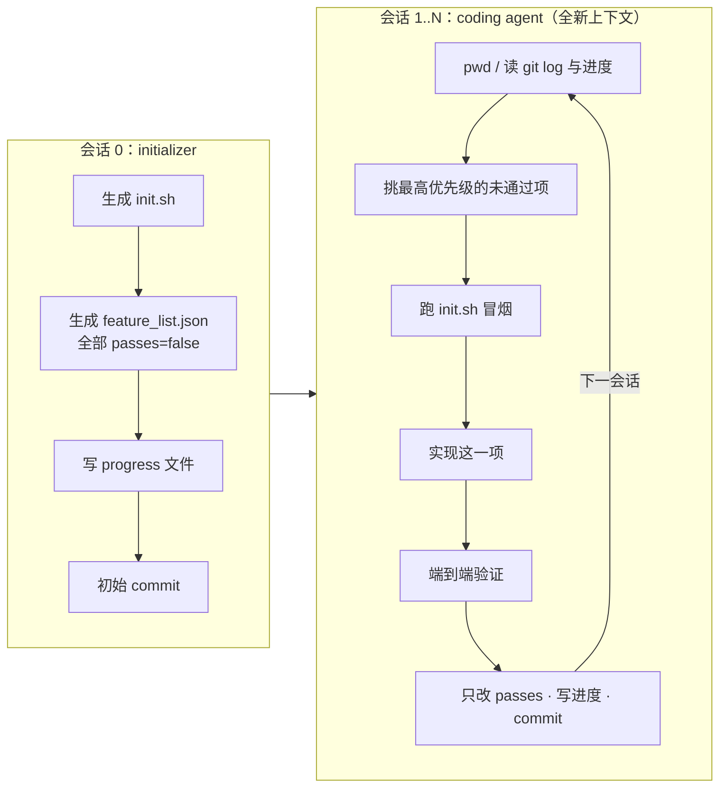

# 24 长时任务 Harness

一个上下文窗口装不下的任务（“把这个应用做完”“迁移整个仓库”），必须拆成许多次会话接力完成。
本章回答三个问题：接力时最常见的失败是什么、业界用什么结构化手段防止它、以及如何只用 flywhl 已有的 hooks 把这套结构搭起来。

## 两类失败模式

Anthropic 在《Effective harnesses for long-running agents》（2025-11）里总结了长任务中最典型的两种失败，它们方向相反，却出自同一个根因：**会话之间没有可靠的“交接物”**。

| 失败模式 | 表现 | 根因 | harness 层面的对策 |
|---|---|---|---|
| 一口气做完 | 第一个会话就试图实现全部功能，上下文耗尽时留下一半能跑、一半报错的代码，下一个会话要先花大量 token 猜“上次做到哪了” | 没有“工作单元”的边界，模型按对话惯性一路往下写 | 每个会话只领取一个单元；结束前必须让代码回到可合并的干净状态 |
| 过早宣布完成 | 后续会话看到仓库里已经有不少代码，就认定“项目基本完成”而结束 | “完成”由模型对对话的感觉判断，而不是由可检验的产物判断 | 结构化验收清单 + 结束前的确定性验收 |

两者合起来指向一个原则——本项目在 `AgentLoop._stop_gaps` 的 docstring 里写的那句话：**完成是产物的属性，不是对话的属性**。
“模型说完成了”不算数；“清单里这一项的验证步骤跑通了”才算数。

## Anthropic 的做法逐条展开



| 要素 | 做法 | 为什么有效 |
|---|---|---|
| 两种角色，同一套 harness | initializer 与 coding agent 用相同的工具、权限和系统提示，**只换首条用户 prompt** | 不需要维护两套 harness；初始化只是“第一个会话的任务不同” |
| 功能清单 | JSON 数组，每项含 `category`、`description`、`steps`（验证步骤）、`passes:false`；原文示例有 200 多项 | 把“完成”拆成可逐项检验的命题；JSON 结构比 Markdown 列表更不容易被模型顺手改写 |
| 只改 `passes` | coding agent 被明确要求不得删改条目，只能翻转 `passes` | 防止“删掉做不出来的功能”这种最省事的作弊路径 |
| 进度文件 + git log | 每个会话结束时写进度笔记并用清晰的 commit message 提交 | 上下文窗口之外的持久记忆；git log 天然是带时间顺序的工作日志 |
| 每会话一个单元 | 只做一个功能，结束时代码处于可合并的干净状态 | 上下文不会在半途耗尽；即使失败，回滚粒度也只有一个功能 |
| 固定开场流程 | `pwd` → 读 git log 与进度文件 → 挑最高优先级未通过项 → 跑 `init.sh` 冒烟 | 先确认环境没坏再动手：上一会话若留下损坏状态，此时就能发现 |
| 端到端验证 | 用浏览器自动化以真实用户视角验证，而不只看单元测试 | 单元测试通过但页面打不开的“假完成”在 Web 应用里非常常见 |

::: tip 这里没有任何新的模型能力
这一整套结构都是文件、约定和验收——它不要求模型更聪明，只要求“交接物是结构化的、验收是确定性的”。这也是它能用 hooks 在任意 harness 上复现的原因。
:::

## 再进一步：planner / generator / evaluator 与 sprint contract

Anthropic 在《Harness design for long-running application development》（2026-03）里把角色进一步拆开：

| 角色 | 职责 | 解决的问题 |
|---|---|---|
| planner | 把一句话需求展开成产品规格与功能拆解 | 需求模糊时 generator 会自己脑补范围 |
| generator | 一次一个 sprint 地实现 | 同上一节的“每会话一个单元” |
| evaluator | 独立评估 generator 的产出（运行应用、按标准打分） | 模型给自己的作品打分普遍偏宽松，自评不可信 |

**sprint contract** 是在动手之前，generator 与 evaluator 先就“这个 sprint 怎样才算完成、用什么方式验证”达成书面约定。它把验收标准从“事后由 evaluator 主观判断”前移为“事前双方确认的可执行检查”。

同一篇文章还记录了一个重要现象：模型升级后，部分组件不再必要（原文提到 Opus 4.6 时去掉了 sprint 拆分与上下文重置，保留了 planner）。每个 harness 组件都隐含着“模型做不到什么”的假设，这部分在 [28 可删减的 Harness](/advanced/evolving-harness) 展开。

## 用 flywhl 的 hooks 实现：精读 examples/10_long_running.py

flywhl 没有内置“长时任务模式”，而是用三个 hook 把上面的结构拼出来。这正是 hooks 的设计意图（`policy/hooks.py` 模块注释）：把“必须发生的事”从提示词移到确定性代码。

| hook | 挂载点 | 职责 | 失败时的表现 |
|---|---|---|---|
| `orient` | `session_start` | 记录会话开始时的基线 `(通过数, 日志行数)`；注入开场流程 | 只是提示，模型不照做也不会被拦 |
| `guard_feature_list` | `pre_tool_use`，matcher 匹配 write、edit 与 bash，`fail_closed=True` | 保证 `feature_list.json` 只能改 `passes` | `deny` → 变成 `is_error` 的工具结果，模型读到原因；守卫自身抛异常也按拒绝处理 |
| `one_unit_done` | `stop`，只装在编码会话上 | 本会话至少把一项翻成 `passes=true`、并在 `progress.md` 日志里新增一行才允许结束 | `block` → 注入缺口继续；超过 `max_stop_blocks` 以 `incomplete` 结束 |

三个 hook 都由 `install_hooks(h, coding_session=True)` 注册；传 `coding_session=False` 时只装前两个——不是来推进功能的会话（例如后文的篡改演示）不应被“必须推进一项”拦住。

### SessionStart：基线与开场流程

```python
# examples/10_long_running.py
def log_lines() -> int:
    return sum(1 for line in (WS / "progress.md").read_text().splitlines() if line.startswith("- "))


def install_hooks(h, *, coding_session: bool = True):
    baseline: dict[str, tuple[int, int]] = {}
    target = (WS / "feature_list.json").resolve()

    @h.hooks.on(HookEvent.SESSION_START)
    async def orient(inp):
        baseline[inp.session_id] = (passes(), log_lines())  # 会话开始时的基线，供 Stop 验收比较
        return HookOutput(additional_context="开场流程：先读 progress.md 与 feature_list.json，选一个 passes=false 的最高优先级功能，只做这一项。")
```

注入发生在 `Harness.start_run()`：

```python
# src/flywhl_harness/runtime/manager.py · Harness.start_run
if not self.store.path(session_id) and self.hooks.has(HookEvent.SESSION_START):
    out = await self.hooks.run(HookEvent.SESSION_START, HookInput(
        event=HookEvent.SESSION_START, run_id="", session_id=session_id, cwd=s.workspace))
    if out.additional_context:
        prompt = f"{prompt}\n\n<system-reminder>\n{out.additional_context}\n</system-reminder>"
```

两个细节：

- `not self.store.path(session_id)` 表示**只有空会话**才触发。同一会话里的第二次 Run 不会再触发，`baseline` 停在首次 Run 开始时的值，第一次 Run 的推进也会算到第二次头上；进程重启、换了 Harness 实例后，`baseline` 干脆取不到值、回退为 `(0, 0)`，Stop 验收变成“历史上通过过任何一项、日志里有过任何一行即可”。两种情况下基线语义都失效了。长任务里“一个会话 = 一个工作单元”，所以示例每次都 `create_session`。
- 开场流程以 `<system-reminder>` 拼到首条用户消息里，随消息一起落盘。它是会话历史的一部分，回放时可见，也享受前缀缓存。

### PreToolUse：清单只能改 `passes`

```python
# examples/10_long_running.py · install_hooks
    # fail_closed：守卫自己出错（例如清单文件损坏）时按拒绝处理——守卫失效不能等于放行
    @h.hooks.on(HookEvent.PRE_TOOL_USE, matcher="write|edit|bash", fail_closed=True)
    async def guard_feature_list(inp):
        if inp.tool_name == "bash":
            # 用 sed -i / perl -pi / 重定向改清单绕过 write 检查：只读命令（cat、jq）放行，其余一律拒绝
            cmd = str(inp.tool_input.get("command", ""))
            if target.name in cmd and analyze(cmd).level != "read":
                return HookOutput(decision="deny", reason="feature_list.json 只能用 write / edit 修改（以便逐项检查）")
            return None
        # 按解析后的真实路径比较：./feature_list.json、子目录/../feature_list.json 都指向同一个文件
        if (WS / str(inp.tool_input.get("path", ""))).resolve() != target:
            return None
        current = target.read_text()
        if inp.tool_name == "edit":  # 先算出“改完之后”的内容，再和 write 走同一套检查
            old_s = inp.tool_input.get("old_string", "")
            if not old_s or old_s not in current:
                return None  # 交给 edit 工具自己报“找不到 old_string”
            new_s = inp.tool_input.get("new_string", "")
            after = current.replace(old_s, new_s) if inp.tool_input.get("replace_all") else current.replace(old_s, new_s, 1)
        else:
            after = inp.tool_input.get("content", "")
        try:
            new = json.loads(after)
        except json.JSONDecodeError:
            return HookOutput(decision="deny", reason="修改后的 feature_list.json 不是合法 JSON")
        strip = lambda items: [{k: v for k, v in f.items() if k != "passes"} for f in items]  # noqa: E731
        if strip(json.loads(current)) != strip(new):
            return HookOutput(decision="deny", reason="只允许修改 passes 字段，不得增删或改写功能描述")
```

判定方法是“去掉 `passes` 字段后，改动前后必须完全相等”：增删条目、改描述、调换顺序都会被拒（列表比较是有序的）。守卫有几处刻意的设计：

| 设计 | 堵住的绕过方式 |
|---|---|
| 用 `resolve()` 后的绝对路径与 `target` 比较 | `./feature_list.json`、`sub/../feature_list.json`、指向清单的符号链接——字符串比较会把它们当成“别的文件”放行 |
| `edit` 先在内存里算出改完之后的全文，再和 `write` 走同一套 JSON 检查 | `edit` 没有 `content` 参数；只看 `content` 会把每次合法的 `edit` 都误拒为“不是合法 JSON” |
| `edit` 的模拟同样读取 `replace_all` | 只模拟第一处替换时，第一处出现落在 `passes` 上、后面的出现落在描述里（例如某条描述含有 `false`），描述会被一并改写而守卫看不见 |
| bash 命令里出现清单文件名、且命令分析不是只读（`sed -i`、`perl -pi`、重定向……）→ 拒绝 | 绕开 write / edit，直接用 shell 改清单；`cat`、`jq` 这类只读命令照常放行 |
| `fail_closed=True` | 默认 `fail_closed=False` 时，hook 抛异常（清单被删、读取失败）会被 `HookBus.run` 忽略，写入照常执行——守卫失效等于放行 |

hook 的决策与权限判定取更严格者（只能收紧、不能放宽），所以示例即使以 `bypass` 模式运行，守卫的 `deny` 依然生效。

`old_string` 为空或不在文件中时守卫直接放行，由 `edit` 工具自己报错：这类调用本来就改不了文件，没必要在守卫里重复一遍工具的校验。

`deny` 在 `ToolExecutor` 里变成一条错误工具结果，模型看到的是：

```text
权限拒绝：[guard_feature_list] 只允许修改 passes 字段，不得增删或改写功能描述。请换一种不需要该权限的方式完成，或向用户说明需要什么权限。
```

若该调用走了人工审批、审批人在批准时改了参数，`ToolExecutor` 会用新参数**再跑一遍** PreToolUse，守卫不会因为“改参后批准”而被跳过。

### Stop：本会话必须推进一项

```python
# examples/10_long_running.py · install_hooks
    if not coding_session:
        return

    @h.hooks.on(HookEvent.STOP)
    async def one_unit_done(inp):
        p0, l0 = baseline.get(inp.session_id, (0, 0))
        if passes() <= p0:
            return HookOutput(decision="block", reason="本会话还没有把任何功能标记为通过（需先实现并跑通测试）")
        if log_lines() <= l0:
            return HookOutput(decision="block", reason="请先在 progress.md 的日志里记录本会话的进展，再结束")
```

两道检查对应交接的两半：`passes` 增加说明“产物推进了”，日志新增一行说明“下一个会话能知道推进了什么”。只翻 `passes` 不写进度，下一个会话就只能从清单 diff 里猜上次做了什么。

它挂进 `AgentLoop._stop_gaps`：模型返回不带工具调用的回复时，Loop 依次检查计划（`verify_todos`）、验收命令（`verify_command`）、Stop hook，把所有缺口汇总。
有缺口且 `rc.stop_blocks < max_stop_blocks`（默认 3）时，以 `MsgKind.STOP_FEEDBACK` 追加一条 system-reminder 让模型继续；超过次数则以 `incomplete` 结束——**绝不伪装成 `completed`**。
Stop hook 若不 block、只返回 `additional_context`，这段文字会作为 reminder 落盘、留给本会话的下一次 Run，而不是被丢弃。

### 运行结果

`python examples/10_long_running.py` 的关键输出（两个编码会话各推进一项，篡改演示中 `write`、`edit` 与 `bash` 都被拒）：

```text
━━ 第 2 个编码会话（全新上下文） ━━
  read   ok      '     1\t# 进度\n     2\t\n     3\t## 日志\n     4\t- F1 完成并通过测试\n'
  read   ok      '     1\t[\n     2\t  {\n     3\t    "id": "F1",\n     4\t    "description": "'
  write  ok      '已创建 F2.py（92 字节，4 行）'
  bash   ok      'F2 ok\n\n[退出码 0]'
  write  ok      '已覆盖 feature_list.json（205 字节，12 行）'
  edit   ok      '已修改 progress.md（替换 1 处）'
» 会话 2 结束：completed
━━ 尝试篡改功能清单（被 hook 拒绝） ━━
  write → denied：权限拒绝：[guard_feature_list] 只允许修改 passes 字段，不得增删或改写功能描述。请换一种不需
  edit  → denied：权限拒绝：[guard_feature_list] 只允许修改 passes 字段，不得增删或改写功能描述。请换一种不需
  bash  → denied：权限拒绝：[guard_feature_list] feature_list.json 只能用 write / edit
» 运行结束：completed；清单逐字未变：True
```

篡改演示里的 `write` 故意用了 `./feature_list.json` 这种写法，`edit` 试图改写 F1 的描述，`bash` 用 `sed -i` 绕开文件工具——前两者落到同一个真实路径、在“改完之后的内容”上被判定，第三个按命令分析被拒。最后一行逐字比较清单文件，而不只是比较通过数。这次运行用 `install_hooks(h, coding_session=False)` 注册，没有 Stop 验收，所以模型说明“清单保持不变”后以 `completed` 结束。

### 示例仍未覆盖的路径

示例是教学用的最小实现。bash 那条规则是按字符串判断的，命令里不直接出现清单文件名的间接写入仍然拦不住：

| 路径 | 原因 | 生产实现的做法 |
|---|---|---|
| `sed -i 's/add/sub/' f*.json`、`git checkout -- .` | glob 与整体还原在命令字符串里看不到文件名 | 清单放到工作区之外、由 hook 读写；或在 Stop 时与会话开始时的快照逐字比对，非 `passes` 字段有变化就判失败 |
| `python3 tools/update.py`（脚本里改清单） | 命令分析看不到脚本内部做了什么 | 同上；或把清单放进只读挂载，只开放一个“标记通过”的专用工具 |

这说明了守卫类 hook 的一般规律：**按工具名和命令字符串拦截，只能覆盖已知的写入通道**。真正的不变量（“非 `passes` 字段不变”）最好在结束时对产物本身再验一次。

## 与本项目已有机制的组合

长任务有两级记忆：**会话内**靠上下文（会被压缩），**会话间**靠文件（进度、清单、git）。flywhl 的通用机制分别服务这两级：

| 机制 | 所在位置 | 在长任务里的作用 |
|---|---|---|
| `todo_write` + 计划复述 | `ContextManager.todo_reminder` | 会话内：距上次 `todo_write` 超过 4 轮且有未完成项时，复述当前计划，防止长会话中途跑偏 |
| 计划验收 | `_stop_gaps` + `verify_todos=True` | 会话内：计划中仍有 `pending/in_progress` 时阻止结束 |
| 验收命令 | `verify_command`（如 `"pytest -q"`） | 会话内：每次想结束都跑一遍全量测试；只对主代理（`rc.role == "main"`）生效 |
| 检查点 / 恢复 | `Harness._checkpoint`、`_resume_note`、`Budget.restore`、`recover()` | 崩溃或暂停后续跑：每轮结束记录预算状态，有写操作的回合再记录工作区清单；恢复时预算接着计数，并把“期间的漂移”告诉模型。`aclose()` 让活动主 Run 在安全点暂停（`paused_by=shutdown`）而非取消，重启后 `recover()` 自动继续；长期运行的 Worker 可再起一个 `recovery_loop()` 周期性接管心跳过期的 Run。详见 [11 检查点与崩溃恢复](/reliability/checkpoint-recovery) |
| 压缩 | `_maybe_compact` + `pre_compact` hook | 会话内：单个功能本身很大时避免溢出；可用 `pre_compact` 要求摘要保留“当前功能 id 与验证步骤” |
| 预算软阈值 | `Budget.check` 的 `soft` 状态 | 达到 80%（`soft_ratio`）时提醒“为未完成的工作留下清晰的进度说明”——**这是写 progress.md 的最后时机** |
| 预算收尾 | `AgentLoop._wrap_up` | 达到硬限额后再做一次 `tool_choice="none"` 的总结（已完成 / 未完成 / 下一步） |

::: warning 收尾总结不会自动进入进度文件
`_wrap_up` 禁止调用工具，所以模型在收尾阶段**无法**写 `progress.md`。那段总结会作为 assistant 消息留在会话历史里，
并且因为 `AgentLoop.run` 在 `Outcome` 没有 `final_text` 时会取最后一条 assistant 文本，它也会出现在 Run 记录的 `result.text` 中——但下一个**新会话**看不到这两处。
要让交接真正落到文件上，可以写一个 `run_end` hook（它的 `HookInput.context` 是 `RunContext`），把这段文本追加到进度文件。
:::

```python
# 示意代码：预算耗尽时把收尾总结写进进度文件
@h.hooks.on(HookEvent.RUN_END)
async def persist_wrap_up(inp):
    rc = inp.context
    run = rc.store.get_run(inp.run_id)
    if run.status not in ("budget_exhausted", "timed_out"):
        return None
    text = (run.result or {}).get("text")
    if text:
        with open(rc.workspace.root / "progress.md", "a", encoding="utf-8") as f:
            f.write(f"\n## 会话 {inp.session_id} 因限额中止\n{text}\n")
```

`run_end` hook 在 `Harness._drive` 的 `finally` 中执行、异常被 `contextlib.suppress` 吞掉，适合做这种“尽力而为”的交接，但不能依赖它做必须成功的事。

## 验证成本很高的领域

浏览器自动化之所以可行，是因为 Web 应用的“真实环境”很便宜。车载、机器人、支付、生产数据库这类领域，真实的端到端验证要么昂贵、要么危险、要么不可重复。可行的做法是**分层构造可信度**：

| 手段 | 验证了什么 | 没验证什么 | 接入 flywhl 的方式 |
|---|---|---|---|
| 仿真 / 模拟器（硬件在环、设备模拟器、本地服务替身） | 逻辑与协议在受控输入下正确 | 真实时序、真实硬件差异 | `verify_command` 或 Stop hook 调起仿真脚本 |
| 录制回放（真实流量 / 日志 / 传感器数据） | 对历史上真实发生过的输入，行为不回归 | 新出现的输入分布 | 把回放集当作清单项的 `steps`；Stop hook 跑回放并比对 |
| 影子环境（镜像流量、只读副本、灰度旁路） | 在真实负载下不出错、输出与旧版一致 | 写路径的副作用 | 单独的外部副作用工具，`effect` 设为 `EXTERNAL`，走审批 |
| 契约测试 | 与外部系统的接口约定没被破坏 | 对方实现本身 | 普通测试命令 |
| 人工签核 | 前面所有自动化覆盖不到的部分 | — | 清单项标记“需人工”，Stop 时转人审（见 [17 权限与人审](/governance/permissions-hitl)） |

三条设计原则：

1. **验证资产必须在 Agent 的写入域之外。** 测试脚本、回放数据、仿真配置一旦能被模型改，“让测试通过”的最短路径就是改测试。用和 `guard_feature_list` 同样的 PreToolUse 守卫保护它们，或者放到工作区之外由 hook 调用。
2. **便宜的每次跑，昂贵的在关口跑。** 单元测试作为每个会话的 Stop 验收；仿真与回放只在“标记为通过”那一刻跑；影子环境与人工签核按里程碑跑。
3. **区分“在哪一层通过”。** 一个 `passes: true` 无法表达“仿真通过、真机未验”。清单可以扩展为多级字段（例如 `verified: {"sim": true, "hil": false}`），每一级由对应的验证器写入，而不是由 Agent 写入。

## 功能清单由谁维护

示例里 `passes` 是 Agent 自己在跑完测试后写的——这意味着“完成”仍然部分依赖模型的自觉。按信任程度从低到高有三种方案：

| 方案 | 谁写 `passes` | 优点 | 风险 |
|---|---|---|---|
| A：Agent 自报（示例的做法） | coding agent 跑完测试后用 `write` 翻转 | 实现最简单 | 模型可能没跑测试或测试本身不充分就翻转 |
| B：验证器写入 | Stop hook 读取本会话涉及的条目，执行其 `steps`，通过后由 hook 自己改文件；Agent 对清单完全只读 | “完成”完全由确定性代码判定 | 每个条目都要有可执行的验证步骤 |
| C：人工确认 | 人审通过后写入 | 适合验证无法自动化的条目 | 吞吐量受限 |

其它字段的归属：

| 字段 | 维护者 | Agent 权限 |
|---|---|---|
| `id`、`description`、`steps`、`category` | initializer 生成，人工审阅 | 只读 |
| `passes` / 多级 `verified` | 方案 A/B/C 之一 | A 可写，B/C 只读 |
| 新发现的需求、拆分建议 | Agent 写入单独的 `proposals.md` 或进度文件的“建议”节 | 可写，但不进入清单；由人或 planner 合并 |

让 Agent 能“提议”但不能“直接改清单”，既保留了它在实现中发现遗漏的价值，又避免了“删掉做不出来的功能”的作弊路径。

## 本项目没做什么，以及如何扩展

| 没做的 | 示例里的替代 | 扩展方向 |
|---|---|---|
| 内置的 initializer 模式 | 由 Python 直接写出清单与进度文件 | 用同一个 `Harness`，换一条首条 prompt 跑一个会话；产物写完后用 PreToolUse 守卫冻结 |
| 会话接力驱动器 | `main()` 里手写 `for` 循环，逐个 `create_session` + `start_run` + `wait` | 外层驱动：读清单 → 有未通过项就开新会话 → 连续 N 个会话无进展则停下报人 |
| 会话结束时的 git commit | 无 | `run_end` hook 中执行 `git add -A && git commit`；注意本项目的 ShadowGit 是**影子仓库**（`data_dir/shadow.git`），用于快照回滚，不替代用户仓库的提交 |
| 每个条目的验证器注册表 | Stop 只比较通过数 | 清单项的 `steps` 映射到命令，Stop hook 逐项执行（即上表方案 B） |
| 浏览器端到端验证工具 | 无 | 以 MCP 服务器接入浏览器自动化（见 [27 协议生态](/advanced/protocols)），或写成 `effect=EXTERNAL` 的工具 |

::: details 动手实验
1. 运行 `python examples/10_long_running.py`，确认两个会话各推进一项、篡改被拒。
2. 在篡改那一步再追加一个 `bash` 调用 `sed -i.bak 's/add/sub/' f*.json`（glob 里看不到文件名），观察守卫没有拦截、F1 的描述被改写，最后一行打印 `清单逐字未变：False`；再思考上文“示例仍未覆盖的路径”里的哪种做法能堵住它。
3. 从 `session_script` 里删掉写 `progress.md` 的那一步，观察 `stop_blocked` 通知（缺口是“请先在 progress.md 的日志里记录本会话的进展”）与最终的 `incomplete` 状态。
4. 用 `harness(..., budget__max_turns=3)` 构造预算耗尽，确认 `_wrap_up` 产生了总结、但 `progress.md` 没有变化；再加上本章的 `run_end` hook 验证交接。
:::

下一章把视角从“文件级交接”转向“执行级持久化”：[25 持久执行引擎映射](/advanced/durable-execution)。
