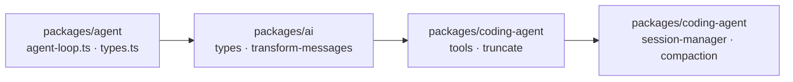

# 29 对照 pi：极简 Harness 的取舍

pi 是一个以“少即是多”著称的开源 coding agent，flywhl 的事件命名、steer/follow-up、压缩切点等设计都直接借鉴了它。
本章把两者逐项对照：哪些设计相同、哪些地方 flywhl 做了不同的选择以及为什么，最后给出阅读 pi 源码的路线。

::: tip 事实来源
本章关于 pi 的描述来自对 pi 主分支的调研（2026-10），细节以 pi 仓库为准。pi 项目在演进中改过仓库与包名：仓库为 `earendil-works/pi`（原 `badlogic/pi-mono`），npm scope 由 `@mariozechner/*` 改为 `@earendil-works/*`。
:::

## pi 的整体架构

pi 是一个 TypeScript monorepo，按职责拆成多个包：

| 包 | 职责 | flywhl 中大致对应 |
|---|---|---|
| ai | 统一的多 provider 消息模型与流式接口 | `llm/`、`types.py` |
| agent | Agent Loop 内核（`agentLoop` / `agentLoopContinue`）与事件 | `agent/loop.py`、`events.py` |
| coding-agent | 面向编码的产品：工具、会话、压缩、系统提示、运行模式 | `tools/`、`runtime/session.py`、`agent/compaction.py`、`prompts.py`、`cli.py` |
| tui | 终端 UI | `cli.py` 的 `TerminalRenderer` |
| mcp、durable、chord、codemode、telemetry、env、evals | 扩展能力（MCP、持久执行、代码模式、遥测、环境、评测等） | 分散在 `tools/mcp.py`、`runtime/`、`observe/` |

pi-web-ui 已于 2026-05-20 从仓库中移除。分层的方式与 flywhl 相同：**内核（loop）不认识具体工具与产品形态**，coding-agent 才把工具、会话文件、系统提示组装起来。

## 逐项对照

| 维度 | pi | flywhl-harness |
|---|---|---|
| 事件模型 | 10 种 `AgentEvent`：agent / turn / message 的 start、end，message_update，tool_execution 的 start / update / end | 沿用同样的 start/update/end 命名，补充运行时特有的 `status`、`approval_*`、`compaction_*`、`model_retry`、`notice`、`usage`、`error`；事件带单调 `seq` 并落库 |
| 循环结构 | 双层 while：内层处理工具轮次与 steering，外层处理 follow-up | 单层 `while True`（`AgentLoop._body`）：每轮开头取 steer；模型不再调用工具时由 `_drain_inbox()` 统一取出排队输入（steer 在前、follow-up 在后），Stop 验收之后再查一次，有则继续 |
| steering 时机 | 开跑前、每轮工具执行完后、`prepareNextTurn` 之后 | 每轮开头的安全点（工具批次全部完成之后、下一次模型调用之前） |
| 队列模式 | one-at-a-time / all | `Inbox` 同样支持 `one_at_a_time` 与 `all`（默认 `all`） |
| 取消 | `AbortSignal` 贯穿 streamFn、transformContext、tool.execute；provider 把 stopReason 标为 aborted | `CancelToken` 协作式传递；流中途取消保留已生成文本并标记 `ABORTED`；不可中断工具有宽限期；运行时先 CAS 到 `cancelling` 决出取消与完成的竞争 |
| 默认工具集 | read / bash / edit / write（只读组 read / grep / find / ls） | read / write / edit / bash / ls / grep / todo_write / read_ref / search_ref / task（+ 演示工具） |
| 截断 | 2000 行或 50KB；read 保头、bash 保尾，完整输出写临时文件并给出路径 | read：2000 行 / 50KB 保头；bash：400 行 / 30KB 保尾，完整输出写入 `BlobStore` 并给出句柄（`full_output_ref`），用 `read_ref` / `search_ref` 回查 |
| edit | 支持多处替换，模糊匹配兜底 | 精确匹配；不唯一时报出所有出现行号；`replace_all`；未命中时提示首行在哪些行附近出现（不做模糊替换） |
| 工具并行 | 默认并行（`Promise.all`），结果按原序发出；`executionMode: "sequential"` 退回串行；同一文件的写入按真实路径串行 | 只有只读工具并行：连续的只读调用组成一批，有界并发（`parallel_tool_limit`）；写工具逐个执行；结果按原序落盘 |
| 输出截断时 | stopReason=length 时整批工具调用判失败 | 相同（`MAX_TOKENS` 分支，状态 `truncated`） |
| 结果分层 | toolResult 分 `content`（给 LLM）与 `details`（给 UI） | `ToolResult.content` 进入上下文，`details` 只进入事件与存储，不发送给模型 |
| 失败表达 | streamFn 不抛异常，失败编码进流 | 可重试错误以流内 `retry` 事件呈现；不可恢复的错误抛出带 `ErrorKind` 的 `ProviderError` |
| 跨 provider 的 thinking | 转为纯文本 | Anthropic provider 只回传本 provider 产生且带签名的 thinking，其它来源的 thinking 丢弃 |
| 孤立 tool call | 补 “No result provided” 错误结果 | `prepare_history` 补一条合成的错误结果（注释注明借鉴 pi） |
| 会话存储 | JSONL v3 树：entry 有 id / parentId，类型含 message、compaction、branch_summary、custom、label 等；只追加 | SQLite `entries` 表：`parent_id` 构成树，`kind` 为 message 或 compaction；只追加 |
| 分支 | 只移动 leaf 指针；可生成 branch_summary | 只移动 `sessions.head`（`SessionLog.branch`）；不生成分支摘要 |
| 压缩触发 | contextTokens > contextWindow − reserveTokens（16384） | tokens > min(窗口 × 0.80, 窗口 − 8192) |
| 保留量 | keepRecentTokens 20000 | `keep_recent_tokens` 12000（且不超过窗口的 30%；强制压缩时 2000） |
| 切点 | 绝不在 toolResult 处切 | 相同：优先切在 user 消息，其次 assistant，绝不切在 tool 结果处（`find_cut_index`） |
| 摘要结构 | Goal / Constraints & Preferences / Progress / Key Decisions / Next Steps / Critical Context + read-files / modified-files；增量更新；作为 `<summary>` user 消息回灌 | 目标 / 约束与偏好 / 进展（已完成、进行中、受阻）/ 关键决策 / 关键上下文 / 下一步；增量更新；另由代码确定性保留原始任务原文、当前 todo、读写文件清单；同样以 `<summary>` user 消息回灌 |
| 系统提示 | 分节 preamble / `<tools>` / `<rules>` / `<project_context>` / `<skills>` / `<cwd>` | `<rules>` / `<environment>` + `<project_context path>` + `<available_skills>`；工具用法写在工具描述里；会话创建时冻结 |
| AGENTS.md | 每个目录 AGENTS.override.md > AGENTS.md > CLAUDE.md，从全局到 cwd 逐级加载 | 每个目录 AGENTS.md > CLAUDE.md，从工作区向上到 git 根，祖先在前，总量上限 32 KiB（UTF-8 字节）；无全局文件 |
| skills | 只放 name / description / location 清单，模型用 read 读 SKILL.md | 相同（`find_skills`） |
| 扩展机制 | extension 可订阅数十种事件：tool_call 可 block、context 可替换消息、before_provider_request 可改请求、session_before_compact 可自定义摘要 | 8 个 hook 挂载点；pre_tool_use 可 allow/deny/ask 与改写参数，post_tool_use 可改写结果，stop 可 block，pre_compact 只能追加指令；另有进程外命令 hook（兼容 Claude Code 协议） |
| 权限 | 默认不做（作者称之为“安全表演”），建议在容器里运行；permission-gate 只是示例扩展 | 默认 `default` 模式：只读放行，写入与命令需审批；托管基线、bash 命令分析、污点升级；灾难性命令在 `bypass` 下也拒绝 |
| 子代理 | 不内置（黑盒），主张用 bash 再起一个 pi 进程；subagent 是示例扩展 | 内置 `task` 工具：隔离上下文、结构化回传契约、预算切分、深度上限、事件透传 |
| plan / todo | 不内置，用文件（PLAN.md / TODO.md）；plan-mode、todo 是示例扩展 | `plan` 权限模式 + `todo_write` 工具 + Stop 计划验收 |
| MCP | 作者最初主张不内置；0.99.0（2026-09-29）起内置 MCP 扩展，并提供 tool search 与 codemode | 内置最小 stdio 客户端（只实现 tools） |
| 运行模式 | 交互 TUI、`--mode rpc`（stdin 命令 / stdout 响应与事件，严格 LF 分帧）、`--mode json`、`-p`、SDK；运行中发 prompt 需指定 steer 或 followUp；`agent_settled` 表示真正空闲 | `flywhl chat`、`flywhl run --json`（JSONL 事件流）、`flywhl serve`（REST + SSE，`Last-Event-ID` 续传）、Python API（`Harness`）；运行中输入走 `steer` / `follow_up` 接口 |
| Web UI | pi-web-ui 已移除 | 内置无构建步骤的极简 UI（`web/`） |
| 崩溃恢复 | coding-agent 的会话文件支持续聊；monorepo 中另有 durable 包（具体机制以 pi 仓库为准） | `steps` 预写日志 + 幂等键对账 + 心跳租约 + CAS 接管；关闭时在安全点暂停、重启后自动继续 |

## 三处差异的细节

### 压缩参数：代入具体窗口算一遍

两者的触发公式看起来只差一个常数，代入不同窗口后差别就出来了（flywhl 取 `ContextManager.thresholds` 与 `Compactor.compact` 的实际计算）：

| 窗口 | pi 触发点（窗口 − 16384） | flywhl 触发点 min(窗口 × 0.80, 窗口 − 8192) | pi 保留 | flywhl 保留 min(12000, 窗口 × 0.3) |
|---|---|---|---|---|
| 24K（`flywhl-demo`） | 7,616 | 15,808 | 20,000（超过触发点） | 7,200 |
| 128K | 111,616 | 102,400 | 20,000 | 12,000 |
| 1M（能力表中的 Claude 模型） | 983,616 | 800,000 | 20,000 | 12,000 |

- **小窗口**：固定的预留量与保留量会和窗口本身冲突（24K 窗口保留 20K 原文，压缩后几乎立刻再次触发），所以 flywhl 把保留量限制在窗口的 30%；
- **大窗口**：比例阈值起主导作用，flywhl 在 80% 处就压缩，而按 pi 的公式要到 98% 以上。flywhl 的取舍是：越接近窗口上限，单次请求越贵、越慢，且留给工具结果的余量越少；
- flywhl 在压缩之前还有一道更轻的手段：水位超过 55% 时清理旧的大工具结果（`apply_clearing`）。能力表中的 Claude 模型标记了 `append_only=True`，这道手段对它们自动关闭，因为改写旧消息会让 thinking 签名与前缀缓存失效。

### 停止时刻的输入合流

两边都遵循“steer 在安全点注入、follow-up 在本该停止时注入”。flywhl 把停止时刻的两种队列交给同一个 `_drain_inbox()`，并在 Stop 验收前后各查一次：

```python
# src/flywhl_harness/agent/loop.py · AgentLoop._body
if not calls:
    if rc.inbox.pending()["steer"] or rc.inbox.pending()["follow_up"]:
        for ev in self._drain_inbox():
            yield ev
        yield self._ev(E.TURN_END, turn=self.turn)
        continue
    gaps = await self._stop_gaps(msg)
    # ...（有缺口时阻止结束或以 incomplete 结束）
    if rc.inbox.pending()["steer"] or rc.inbox.pending()["follow_up"]:
        # 验收（可能要跑测试）期间又有新输入到达：继续处理，而不是丢掉
        for ev in self._drain_inbox():
            yield ev
        yield self._ev(E.TURN_END, turn=self.turn)
        continue
```

```python
# src/flywhl_harness/agent/loop.py · AgentLoop._drain_inbox
def _drain_inbox(self) -> list[Event]:
    """模型准备结束时取出排队的输入：插话（steer）在前，追加任务（follow_up）在后。"""
    evs = [self._append(user_message(t, kind=MsgKind.STEER)) for t in self.rc.inbox.drain_steer()]
    evs += [self._append(user_message(t, kind=MsgKind.FOLLOW_UP)) for t in self.rc.inbox.drain_follow_up()]
    return evs
```

模型最后一次调用期间到达的 steer 来不及在回合开头被取走，这里先注入 steer、再注入 follow-up，然后继续循环——用户的输入一定先于 Stop 验收被处理。第二次检查覆盖的是验收本身耗时的情况：`verify_command` 跑一遍测试可能要几十秒，期间到达的输入如果不查，Run 就会带着它们以 `completed` 结束。
运行时还多做了一步：Run 以暂停结束时，尚未注入的队列随检查点保存、恢复时带回；以其它状态结束时发出 `inbox_dropped` 通知，明确告诉用户哪些输入没有被处理（`Harness._finish`）。

### 工具并行：同一批调用的两种排法

假设模型在一条消息里发出 `read a`、`grep x`、`write b`、`read c`、`read d`：

| | pi（默认并行） | flywhl（`ToolExecutor.run_batch`） |
|---|---|---|
| 执行 | 五个调用同时开始；若有两个写入指向同一真实路径则它们之间串行 | 三批依次执行：`[read a, grep x]` 并发 → `[write b]` → `[read c, read d]` 并发 |
| 结果顺序 | 按原序发出 | 按原序落盘与发出 |
| `read c` 能否看到 `write b` 的结果 | 取决于调度时机 | 一定能 |

flywhl 的分批规则只看相邻调用：`Prepared.parallel` 要求工具存在、参数合法、且按本次参数判定的副作用等级为 `READ`，相邻的可并行调用合成一批，其余调用各自成批。代价是写操作较多时吞吐更低；收益是“模型写的调用顺序”就是“副作用发生的顺序”，journal、快照与审批都可以按顺序推理。

## pi 的极简哲学：每一项“不内置”的理由

pi 作者在 2025-11-30 的博客中系统地解释了这些取舍（以下为转述）：

| 不内置 | 理由 | 替代做法 |
|---|---|---|
| MCP | 工具描述常驻上下文，代价高昂（以 Playwright MCP 为例，约 13.7k token） | 带 README 的命令行工具 + bash，模型需要时才读说明——渐进披露 |
| 子代理 | 子代理内部发生了什么对主代理与用户都是黑盒，难以观察与调试 | 需要时用 bash 再起一个 pi 进程，输入输出都是可见的 |
| plan mode / todo | 计划写进文件就够了，文件比专用工具更透明、更可编辑 | PLAN.md / TODO.md |
| 权限 | 模型能执行任意 bash 时，逐条确认挡不住真正的风险，只会带来疲劳 | 在容器里运行，用隔离代替确认 |

这些理由的共同点是：**能用已有的通用机制（文件、bash、进程）表达的，就不新增专用机制**。系统提示与工具定义保持在很小的规模，留给模型更多上下文，也让模型更少被 harness 的意图“带偏”。

值得注意的是立场的演进：到 0.99.0，pi 内置了 MCP 扩展，同时提供 tool search 与 codemode 来缓解上下文占用——不内置的理由（上下文成本）没有变，但解决方式从“不用”变成了“按需加载”。

## flywhl 为什么做了不同的选择

| 选择 | pi 的做法 | flywhl 的做法 | 原因 |
|---|---|---|---|
| 机制显式化 | 很多能力作为示例扩展或交给 bash | 子代理、计划验收、审批、恢复都在核心里实现 | flywhl 是教学项目：要讲清楚子代理的上下文隔离、回传契约、预算切分，就得把它们写成可读、可测的代码，而不是“用 bash 起个进程” |
| 默认审批 vs 容器 | YOLO + 建议容器 | `default` 模式，写与执行需审批；`bypass` 只建议在沙箱中使用 | 面向的部署形态不同：flywhl 演示的是以服务方式运行的形态（Web UI、REST API），那里“人审 + 审计”往往是需求方的要求；对个人在容器中使用的场景，pi 的判断同样成立，flywhl 也提供 `bypass` 模式 |
| 持久化 | JSONL 会话文件 | SQLite：entries + steps + events + runs + approvals + blobs | 要支持崩溃恢复，就需要“工具调用做没做过”的预写日志、Run 的状态机与租约、事件的单调序号；这些跨表的原子更新用一个事务完成最简单 |
| 工具并行 | 默认并行 + 同路径串行 | 只读并行，写入串行 | 写操作前要打快照、写预写日志，并可能等待审批；串行执行让 journal 的顺序与副作用的顺序一致，恢复时更容易推理 |
| 扩展面 | 数十种事件，可替换上下文与请求 | 8 个 hook 挂载点 | flywhl 选择的挂载点都对应“治理决策”（拦截、改写、阻止、审计）；改写上下文这类能力会影响前缀稳定与回放忠实度，暂未开放 |

两者并不矛盾：pi 证明了核心循环可以非常小，flywhl 在同样小的核心循环外面，显式地加上了运行时与治理层。

## 从 pi 学到、可以直接复用的设计

| 设计 | 在 flywhl 中的位置 |
|---|---|
| steer / follow-up 双队列，安全点注入 | `agent/inbox.py` 的 `Inbox`；`AgentLoop._body` 回合开头的 `drain_steer` 与停止时刻的 `_drain_inbox` |
| start / update / end 的事件命名 | `events.py` |
| 孤立工具调用补合成结果 | `llm/base.py` 的 `prepare_history` |
| 输出截断时整批工具调用判失败 | `AgentLoop._body` 的 `StopReason.MAX_TOKENS` 分支 |
| read 保头、bash 保尾，完整输出外置并给出位置 | `tools/fs.py`（`MAX_LINES`、`MAX_BYTES`）；`tools/shell.py`（`truncate_tail` 与 `full_output_ref`） |
| 工具结果 content / details 分离 | `tools/base.py` 的 `ToolResult` |
| 压缩触发公式、切点规则、增量摘要、读写文件清单 | `agent/compaction.py` 的 `find_cut_index`、`Compactor.compact`；`runtime/session.py` 的 `render_summary` |
| 会话树只追加、分支只移动指针 | `runtime/store.py` 的 `entries.parent_id`；`SessionLog.branch` |
| 精简系统提示，工具用法写在工具描述里 | `prompts.py` 模块注释与 `SYSTEM_PROMPT` |
| 技能清单的渐进披露 | `prompts.find_skills` |

## 如何读 pi 的源码

建议按“从内核到产品”的顺序读，每一步都能在 flywhl 里找到对照物（文件路径以 pi 仓库实际结构为准）：



| 步骤 | 读什么 | 重点关注 | 对照 flywhl |
|---|---|---|---|
| 1 | agent 包的 `agent-loop.ts`、`types.ts` | 双层循环如何安排 steering 与 follow-up；`AgentEvent` 的发出时机；`beforeToolCall` / `afterToolCall` / `prepareNextTurn` 等钩子在循环中的位置；AbortSignal 的传递路径 | `agent/loop.py`、`agent/inbox.py`、`events.py` |
| 2 | ai 包的类型定义与 `transform-messages` | 统一消息模型（system / user / assistant / toolResult）；流事件（text / thinking / toolcall 的 start / delta / end）；跨 provider 时如何处理 thinking 与孤立调用；usage 中的 cacheRead / cacheWrite 与 cost | `types.py`、`llm/base.py`（`MessageBuilder`、`prepare_history`） |
| 3 | coding-agent 的工具与截断实现 | 默认工具的描述写法；截断策略与完整输出的保存方式；edit 的多处替换与模糊匹配 | `tools/fs.py`、`tools/shell.py` |
| 4 | coding-agent 的 session-manager 与 compaction | JSONL 树的 entry 类型；分支与 leaf 指针；压缩触发、切点、摘要模板与增量更新 | `runtime/session.py`、`runtime/store.py`、`agent/compaction.py` |

读的时候带着两个问题效果最好：**这一处为什么没有做成专用机制？** 以及 **如果要做崩溃恢复，这里需要多记录什么？** 前者帮助理解 pi 的极简取舍，后者正好对应 flywhl 多出来的那一层。

下一章：[30 扩展指南](/advanced/extending)。
