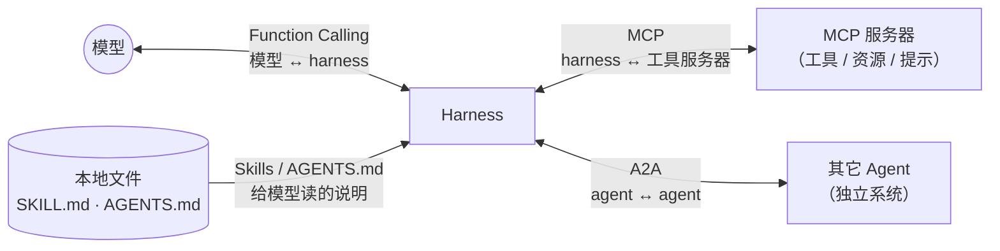

# 27 协议生态：MCP、A2A 与 Skills

Function Calling、MCP、A2A、Agent Skills、AGENTS.md 经常被放在一起讨论，但它们解决的是五个不同层面的问题。
本章先画清分工，再逐个精读 flywhl 中对应的实现（`tools/mcp.py`、`prompts.py`），最后给出本项目尚未实现的 A2A 的接入思路。

## 分工图



| 机制 | 连接的双方 | 承载的内容 | 谁来“执行” | flywhl 中的位置 |
|---|---|---|---|---|
| Function Calling | 模型 ↔ harness | 工具 schema、调用意图、调用结果 | harness | `llm/` 各 provider 的请求与流解析 |
| MCP | harness ↔ 工具服务器 | 可调用的能力（tools）、可读的数据（resources）、提示模板（prompts） | MCP 服务器 | `tools/mcp.py`（只实现了 tools） |
| A2A | agent ↔ agent | 任务委托、状态同步、流式更新、产物 | 远端 Agent（黑盒） | 未实现 |
| Agent Skills | 文件 → 模型 | 可复用的操作说明与附带脚本 | 模型自己读、自己用已有工具执行 | `prompts.find_skills` |
| AGENTS.md | 文件 → 模型 | 项目级指令与约定 | 模型 | `prompts.find_project_context` |

一个容易混淆的点：**MCP 工具最终仍然是通过 Function Calling 交给模型的**。harness 把 MCP 服务器暴露的工具翻译成普通的工具 schema，模型并不知道一个工具来自本地还是 MCP 服务器。MCP 解决的是“工具在哪里、怎么被发现、怎么被调用”，而不是“模型怎么表达想调用工具”。

## MCP 协议要点

| 方面 | 要点 |
|---|---|
| 消息格式 | JSON-RPC 2.0：请求带 `id`，通知不带 `id` |
| 传输 | stdio（本地子进程，按行分帧）与 Streamable HTTP（远程服务） |
| 生命周期 | `initialize`（协商 `protocolVersion` 与能力）→ 客户端发 `notifications/initialized` → 正常交互 |
| 服务器原语 | tools（可调用）、resources（可读取的数据）、prompts（提示模板） |
| 工具发现 | `tools/list`，结果可分页（`nextCursor`） |
| 工具调用 | `tools/call`，结果是 `content` 数组（text / image / resource 等），可附 `structuredContent`；业务失败用 `isError: true` 表达，而不是 JSON-RPC 错误 |
| tool annotations | `readOnlyHint`、`destructiveHint`、`idempotentHint`、`openWorldHint`——都是**提示**，不是保证 |

2025-12，MCP 被捐赠给 Linux 基金会下的 Agentic AI Foundation（公开报道）。

## 精读 tools/mcp.py

flywhl 的 MCP 客户端不到 190 行，只依赖标准库与 asyncio，实现了 stdio 传输上的 tools 子集。

### 握手、环境隔离与请求复用

```python
# src/flywhl_harness/tools/mcp.py · MCPClient.start
self.proc = await asyncio.create_subprocess_exec(
    self.command, *self.args, stdin=asyncio.subprocess.PIPE, stdout=asyncio.subprocess.PIPE,
    stderr=asyncio.subprocess.DEVNULL, env={**_clean_env(True), **self.env}, cwd=self.cwd,
)
self._reader = asyncio.create_task(self._read_loop())
init = await self.request("initialize", {
    "protocolVersion": PROTOCOL_VERSION, "capabilities": {},
    "clientInfo": {"name": "flywhl-harness", "version": "0.1.0"},
})
self.server_info = init.get("serverInfo", {})
await self._send({"jsonrpc": "2.0", "method": "notifications/initialized"})
```

- `PROTOCOL_VERSION = "2025-06-18"`；`capabilities` 为空，表示客户端不提供 sampling、roots 等能力；
- **环境隔离**：子进程环境取自 `tools/shell.py` 的 `_clean_env(True)`——变量名匹配 `KEY|TOKEN|SECRET|PASSWORD|PASSWD|CREDENTIAL|AUTH`（不区分大小写）的一律去掉，再叠加配置里的 `env`。服务器需要的凭证必须在配置中显式给出，harness 进程里的 `ANTHROPIC_API_KEY` 之类不会被顺带继承；
- 一个后台 `_read_loop` 逐行读 stdout，按 `id` 把响应派给 `_pending` 中等待的 future——同一个子进程上可以并发多个请求；
- 解析失败的行被忽略（服务器往 stdout 打了日志也不至于崩溃）；服务器退出时，所有未完成的 future 被置为 `MCPError`；
- `stderr` 被丢弃到 `DEVNULL`：调试服务器时看不到它的错误输出，需要临时改为管道或让服务器写日志文件。

JSON-RPC 是双向的，服务器也可以向客户端发请求。`_read_loop` 用“同时带 `id` 与 `method`”识别它们，并且**一定回复**：

```python
# src/flywhl_harness/tools/mcp.py · MCPClient._read_loop
mid = msg.get("id")
if mid is not None and "method" in msg:
    # 服务器发来的请求（ping、sampling……）：必须回复，否则服务器那边会一直等
    reply = {"result": {}} if msg["method"] == "ping" else \
        {"error": {"code": -32601, "message": f"客户端不支持 {msg['method']}"}}
    with contextlib.suppress(Exception):
        await self._send({"jsonrpc": "2.0", "id": mid, **reply})
    continue
```

`ping` 回空结果，其余（sampling、roots 等）回 `-32601`（Method not found）。依赖这些能力的服务器会立刻得到明确的错误，而不是无限等待。

### 超时与取消：交给执行器统一计时

```python
# src/flywhl_harness/tools/mcp.py · MCPClient.request / call_tool
async def request(self, method: str, params: dict[str, Any] | None = None, *,
                  timeout: float | None | bool = True) -> dict[str, Any]:
    """发送请求并等待响应。``timeout=None`` 表示不设客户端超时（由调用方计时与取消）。"""
    # ...
    try:
        return await asyncio.wait_for(fut, self.timeout if timeout is True else timeout)
    except (asyncio.CancelledError, asyncio.TimeoutError):
        # 告诉服务器“不用做了”（尽力而为：已经发生的副作用不会因此撤销）
        with contextlib.suppress(Exception):
            await self._send({"jsonrpc": "2.0", "method": "notifications/cancelled",
                              "params": {"requestId": mid, "reason": "客户端取消或超时"}})
        raise
    finally:
        self._pending.pop(mid, None)

async def call_tool(self, name: str, arguments: dict[str, Any]) -> dict[str, Any]:
    return await self.request("tools/call", {"name": name, "arguments": arguments}, timeout=None)
```

握手与 `tools/list` 用 `MCPClient.timeout`（默认 30 秒）；`tools/call` 传 `timeout=None`，不设客户端超时。计时由 `ToolExecutor._race` 负责：它按工具超时与 Run 截止时间赛跑，超时或取消时取消正在等待的 `request`，`request` 随即发出 `notifications/cancelled`。
这样 MCP 工具与本地工具共用一套超时语义——尤其是 `effect` 为 `EXTERNAL` 且不幂等的调用超时时，执行器上报 `unknown`（请求可能已经生效），而不是“普通异常”。

分页在 `list_tools` 里用 `nextCursor` 循环取完：

```python
# src/flywhl_harness/tools/mcp.py · MCPClient.list_tools
while True:
    res = await self.request("tools/list", {"cursor": cursor} if cursor else {})
    tools.extend(res.get("tools", []))
    cursor = res.get("nextCursor")
    if not cursor:
        return tools
```

### 翻译成普通 Tool：命名空间与副作用等级

```python
# src/flywhl_harness/tools/mcp.py · MCPTool.__init__
self.remote_name = spec["name"]
self.name = f"mcp__{client.name}__{spec['name']}"
self.description = (spec.get("description") or "")[:2000] + f"（来自 MCP 服务器 {client.name}）"
self.parameters = spec.get("inputSchema") or {"type": "object", "properties": {}}
ann = spec.get("annotations") or {}
read_only = bool(ann.get("readOnlyHint", False))
self.effect = Effect.READ if read_only else Effect.EXTERNAL
self.untrusted_output = bool(ann.get("openWorldHint", True))   # 规范默认值为 true
self.idempotent = read_only or bool(ann.get("idempotentHint", False))
self.interruptible = read_only
```

| 设计 | 作用 |
|---|---|
| `mcp__<server>__<tool>` 命名空间 | 不同服务器的同名工具不冲突；权限规则可以按服务器写 glob，例如 `deny:mcp__github__*` |
| 描述截断到 2000 字符并标注来源 | 限制单个工具描述的上下文占用；让模型知道这是外部工具 |
| `readOnlyHint` → `READ`，否则 → `EXTERNAL` | **保守映射**：没有声明只读的一律按“外部副作用”处理，在 default 模式下需要审批，执行前打快照，崩溃后不会被盲目重做 |
| `openWorldHint` → `untrusted_output`，未声明时取 `True` | 与规范默认值一致：除非服务器明确声明 `false`，输出都被标记为污点，之后的副作用操作从 allow 升级为 ask，污点写入会话元数据、恢复后仍有效（见 [19 安全](/governance/security)） |
| `idempotent = readOnlyHint or idempotentHint` | “结果未知”时可以用同一幂等键重做：崩溃恢复时不再一律标 `unknown`，超时也按普通 `timeout` 而不是 `unknown` 上报 |
| `interruptible = readOnlyHint` | 非只读调用被取消时不会被直接打断，而是给 `cancel_grace_seconds` 宽限期（见 [12 取消语义](/reliability/cancellation)） |

`tests/test_security.py::test_mcp_annotation_defaults_are_conservative` 固定了这组默认值：没有任何 annotations 的工具是 `EXTERNAL`、输出不可信、不幂等；只有同时声明 `readOnlyHint: true` 与 `openWorldHint: false`，才得到“只读且可信”。
`destructiveHint` 目前没有被使用，它可以映射为更高的风险等级（例如在审批摘要里标红）。

annotations 来自服务器自己的声明。对来源不可信的服务器，“声明自己只读”本身就不可信——这是权限规则仍然要能覆盖 MCP 工具的原因。

### 内容转换

```python
# src/flywhl_harness/tools/mcp.py · MCPTool.execute
res = await self.client.call_tool(self.remote_name, args)
parts = []
for c in res.get("content", []):
    if c.get("type") == "text":
        parts.append(c.get("text", ""))
    else:
        parts.append(f"[{c.get('type')} 内容，已省略]")
if res.get("structuredContent") is not None and not parts:
    parts.append(json.dumps(res["structuredContent"], ensure_ascii=False))
return ToolResult("\n".join(parts) or "(空结果)", is_error=bool(res.get("isError")),
                  details={"mcp_server": self.client.name}, tainted=self.untrusted_output)
```

文本块拼接；图片等非文本块只留占位；`structuredContent` 只在没有任何 `content` 时兜底；`isError` 映射为 `is_error`，于是 MCP 的业务错误和本地工具的错误一样，作为工具结果回给模型自行修正。

### 工具顺序稳定与冻结时机

```python
# src/flywhl_harness/tools/mcp.py · load_mcp_tools
for spec in sorted(await c.list_tools(), key=lambda s: s["name"]):  # 排序：保证工具顺序稳定
    tools.append(MCPTool(c, spec))
```

服务器返回工具的顺序没有保证。工具定义位于请求前缀里，顺序一变，前缀缓存就失效（见 [07 上下文工程](/core/context-engineering)）。`ToolRegistry` 按注册顺序输出，加上这里的排序，同一组服务器每次启动生成相同的工具列表。

工具在 `Harness.start()` 中注册（CLI 用 `async with Harness(...)`、Web 服务在 FastAPI 的 `lifespan` 里调用它；`run_eval` 也会对每个评测用的 Harness 调用一次）。`start()` 是幂等的，重复调用不会重复拉起服务器。
冻结发生在会话层面：`create_session` 把当时的工具名单写进会话元数据，`_build_rc` 按这份名单取子集，所以之后注册表再增删工具，已有会话的工具前缀也不变。MCP 规范允许服务器发出“工具列表已变化”的通知，flywhl 不处理它——运行中改变工具集会打碎缓存，这里选择了稳定性。

### 没实现的部分

| 未实现 | 影响 | 扩展方向 |
|---|---|---|
| Streamable HTTP 传输 | 只能接入本地子进程服务器 | 新增一个实现相同 `request()` 接口的 HTTP 客户端 |
| resources / prompts 原语 | 服务器提供的数据与模板用不了 | resources 可包装为只读工具；prompts 可映射为技能 |
| sampling、roots 等客户端能力 | 服务器的这类请求一律得到 `-32601`，依赖它们的服务器功能不可用 | 在 `_read_loop` 中按 `method` 分发；sampling 意味着服务器能借用 harness 的模型额度，需要单独的审批与预算 |
| `reconcile` | 崩溃时在途的、既非只读也未声明 `idempotentHint` 的 MCP 调用，恢复后标为 `unknown` | 服务器若提供查询类工具，可在子类中实现对账 |

## 动手接入：echo 服务器的完整步骤

`examples/mcp_echo_server.py` 是一个只用标准库实现的最小服务器：`echo` 声明 `readOnlyHint: true`，`add_note` 声明 `readOnlyHint: false` 并向 `notes.txt` 追加内容。

**第 1 步：配置。** 在工作目录的 `flywhl.toml` 中加入（`HarnessConfig.load` 默认从当前目录读取 `flywhl.toml`）：

```toml
[mcp_servers.demo]
command = "python"
args = ["examples/mcp_echo_server.py"]
# env = { DEMO_TOKEN = "..." }   # 可选：服务器需要的凭证在这里显式给出
# cwd = "..."                    # 可选：默认是工作区根目录

[permissions]
rules = ["allow:mcp__demo__echo", "ask:mcp__demo__*"]
```

`load_mcp_tools` 识别的键只有 `command`、`args`、`env`、`cwd`。服务器子进程的工作目录默认是工作区根，所以 `add_note` 写的 `notes.txt` 出现在工作区里。`env` 叠加在去掉密钥类变量后的环境之上，是给服务器传凭证的唯一途径。

**第 2 步：确认工具已注册。** `mcp_servers` 会启动子进程，allow 规则会放宽审批，这两项都要先信任这份配置：
第一次运行时 `flywhl` 逐项列出并询问，也可以加 `--trust`（原因见 [19 安全](/governance/security)）。

```text
$ flywhl tools --trust
...
mcp__demo__add_note          external  不可中断   把一条笔记追加到 notes.txt（来自 MCP 服务器 demo）
mcp__demo__echo              read      可中断    原样返回输入的文本（来自 MCP 服务器 demo）
```

两个工具的副作用等级与可中断性正是由 annotations 推出来的。两者都没有声明 `openWorldHint`，所以输出都按默认值视为污点：即使 `echo` 是只读的，调用它之后，会话里后续的副作用操作也会从 allow 升级为 ask（`bypass` 模式除外）。

**第 3 步：确定性测试。** `tests/test_runtime.py::test_mcp_tools` 用脚本化模型调用 `mcp__demo__echo`，同时断言命名空间与副作用映射：

```python
# tests/test_runtime.py · test_mcp_tools
h = make_harness(ws, [
    {"tool_calls": [{"name": "mcp__demo__echo", "args": {"text": "你好 MCP"}}]},
    "完成",
], mcp_servers={"demo": {"command": sys.executable, "args": [str(ROOT / "examples" / "mcp_echo_server.py")]}})
async with h:
    assert "mcp__demo__add_note" in h.tools
    assert str(h.tools.get("mcp__demo__echo").effect) == "read"
    res = await h.run("调用 MCP")
assert tool_ends(res.events)[0]["content"] == "你好 MCP"
```

运行 `pytest tests/test_runtime.py::test_mcp_tools -q`。注意 `async with h:`——`Harness.run` 本身不调用 `start()`，不进入上下文管理器（或手动 `await h.start()`），MCP 工具就不存在。

## 工具描述膨胀与渐进披露

MCP 让接入工具变得容易，副作用是工具定义快速挤占上下文：每个工具的名称、描述、参数 schema 在每次请求中都要发送。pi 的作者在 2025-11-30 的博客中举例，Playwright MCP 的工具描述约 13.7k token；他当时的立场是不内置 MCP，主张“带 README 的命令行工具 + bash”——模型需要时才去读 README，即渐进披露。

业界的几种应对：

| 手段 | 思路 | 代价 |
|---|---|---|
| 工具检索 / 延迟加载（tool search） | 启动时只放少量工具或工具索引，模型通过检索按需加载完整定义 | 多一轮检索；检索不到就用不了 |
| codemode | 把工具暴露成代码 API，让模型写一段代码批量调用，而不是逐个发起工具调用 | 需要代码执行沙箱；错误更难归因到单个工具 |
| CLI + README | 能力以命令行工具提供，说明放在文件里由模型自己读 | 依赖 bash 与沙箱；没有结构化的副作用声明 |
| 按会话裁剪工具集 | 不同任务只挂载需要的服务器 | 需要预先知道任务类型 |

这个话题后来有了演进：pi 在 0.99.0（2026-09-29）起内置了 MCP 扩展，并提供 tool search 与 codemode（以 pi 仓库为准）。可以看到，争论的焦点从“要不要 MCP”转向了“怎样让 MCP 的工具定义按需进入上下文”。

flywhl 目前在这方面只做了两件小事：描述截断到 2000 字符、工具顺序稳定。按需加载需要在“工具集冻结”与“上下文占用”之间重新权衡，是值得做的扩展（工具集变化会影响前缀缓存，建议把“检索工具”本身固定在工具列表中，被检索到的工具以工具结果的形式给出用法）。

## Agent Skills：给模型读的能力包

Skills 以目录组织，入口是 `SKILL.md`，frontmatter 至少包含 `name` 与 `description`；目录里还可以放脚本与参考资料。核心机制同样是渐进披露：**启动时只加载清单，需要时再读全文**。

与 MCP 的区别：

| | Agent Skills | MCP |
|---|---|---|
| 本质 | 给模型读的说明与资源 | 可调用的能力接口 |
| 执行者 | 模型用已有工具（read、bash）照着做 | MCP 服务器 |
| 加载方式 | 本地文件，按需读取 | 连接服务器，启动时列出全部工具 |
| 上下文占用 | 清单每项几十 token | 每个工具的完整 schema |
| 适合 | 流程、规范、组合已有工具的“做法” | 需要独立进程、凭证或远程系统的能力 |

### flywhl 的实现：find_skills 与 `<available_skills>`

```python
# src/flywhl_harness/prompts.py · find_skills
for base in (workspace / ".flywhl" / "skills", workspace / "skills"):
    if not base.is_dir():
        continue
    for skill in sorted(base.glob("*/SKILL.md")):
        head = skill.read_text(encoding="utf-8", errors="replace")[:2000]
        m = re.match(r"^---\s*\n(.*?)\n---", head, re.S)
        meta = dict(re.findall(r"^(\w+):\s*(.+)$", m.group(1), re.M)) if m else {}
        out.append({
            "name": meta.get("name", skill.parent.name).strip(),
            "description": meta.get("description", "").strip(),
            "location": str(skill.relative_to(workspace)),
        })
```

`build_system_prompt` 把清单渲染为：

```text
<available_skills>
需要时先用 read 读取对应 SKILL.md，再按其中的步骤执行：
- release-notes：根据 git log 生成发布说明（.flywhl/skills/release-notes/SKILL.md）
</available_skills>
```

实现边界：

- 只读文件前 2000 字符，用正则解析 `键: 值` 单行格式。YAML 的多行写法（如 `description: >` 后换行）只会得到 `>`；`name` 缺省时退回目录名；
- 只搜索工作区内的两个目录，没有用户级的全局技能目录；
- 清单在会话创建时随系统提示一起冻结；会话中新增的技能要到下一个会话才可见；
- 技能脚本由模型通过 `bash` 执行，因此仍受权限策略约束——技能不是绕过审批的通道。

一个可以直接放进 `.flywhl/skills/release-notes/SKILL.md` 的示例：

```markdown
---
name: release-notes
description: 根据两个 tag 之间的 git log 生成中文发布说明
---

# 生成发布说明

1. 用 `bash` 运行 `git tag --sort=-creatordate | head -2` 找到最近两个 tag。
2. 运行 `git log <旧tag>..<新tag> --pretty=format:'%s'` 取提交标题。
3. 按 feat / fix / docs 分组，忽略 chore 与合并提交。
4. 写入 `CHANGELOG.md` 顶部，格式参考同目录下的 `template.md`。
5. 不要自行创建 tag 或推送。
```

## AGENTS.md 的分层加载

AGENTS.md 是跨工具的项目指令约定。各家实现的共同点是“分层聚合、越具体越靠后”，细节各有不同：

| 维度 | flywhl（`find_project_context`） | pi | Codex |
|---|---|---|---|
| 查找方向 | 从工作区向上，直到 git 根（无 git 则到文件系统根） | 从全局配置到 cwd 逐级加载 | 全局文件 + 从项目根到 cwd |
| 每个目录的文件优先级 | `AGENTS.md` > `CLAUDE.md`（只取一个） | `AGENTS.override.md` > `AGENTS.md` > `CLAUDE.md` | 支持 override 文件与可配置的后备文件名（以官方文档为准） |
| 拼接顺序 | 祖先在前，工作区最后 | 全局在前，cwd 最后 | 根在前，越具体越靠后 |
| 体积上限 | 总计 32 KiB（按 UTF-8 字节计） | 以 pi 仓库为准 | 默认 32 KiB |
| 全局用户级文件 | 无 | 有 | 有 |

```python
# src/flywhl_harness/prompts.py · find_project_context
for d in [cur, *cur.parents]:
    for name in ("AGENTS.md", "CLAUDE.md"):
        f = d / name
        if f.is_file():
            text = f.read_text(encoding="utf-8", errors="replace")
            size = len(text.encode("utf-8"))  # 按字节计：中文一个字 3 字节，按字符数会把上限放大约 3 倍
            if total + size <= max_bytes:
                found.append((f, text))
                total += size
            break
    if (d / ".git").exists():
        break
return list(reversed(found))
```

三个值得注意的细节：

1. **超限时保留近的、丢弃远的。** 遍历从工作区开始向上，预算先分给最近的目录；超出上限的祖先文件被跳过（但更远的小文件仍可能被收入）。最后 `reversed` 只是调整拼接顺序。
2. **上限按 UTF-8 字节计。** 比较的是 `len(text.encode("utf-8"))`，与参数名 `max_bytes` 一致。若按字符数计，中文为主的文件（一个汉字 3 字节）实际能放进约 3 倍的体积；按字节计，32 KiB 大约是一万字的中文。
3. **不在 git 仓库里时会一直走到文件系统根。** 工作区不是 git 仓库时，用户主目录下的 AGENTS.md 也会被加载——这有时符合预期（相当于全局指令），有时是意外。

每个文件以 `<project_context path="...">` 包裹，模型可以知道指令来自哪一层。OpenAI 在《Harness engineering》中的建议值得借鉴：AGENTS.md 只做目录，指向 `docs/` 里的权威文档，而不是把所有规则堆进去——这与 32K 上限是一致的约束。

## A2A：Agent 找 Agent 协作

A2A（Agent-to-Agent）协议解决的是**不同系统中的 Agent 之间**的协作：发现（Agent Card 描述能力、端点与认证方式）、任务委托与状态同步（任务有明确的生命周期状态）、流式更新与推送通知、产物（artifacts）回传。2025-06 进入 Linux 基金会，2026-03 发布 v1.0（公开报道，以官方为准）。

MCP 与 A2A 可以组合：MCP 管“Agent 用工具”，A2A 管“Agent 找 Agent”。区别在于对端是否是一个有自主决策、会长时间运行、可能反过来要求输入的系统。

| | MCP 工具调用 | A2A 任务 |
|---|---|---|
| 对端 | 确定性的能力 | 自主的 Agent |
| 时长 | 通常一次请求-响应 | 可能运行很久，期间推送状态 |
| 中途交互 | 无 | 对端可以要求补充输入 |
| 结果 | 工具结果 | 消息 + 产物 |

### 本项目未实现，接入思路

**作为 A2A 服务端**：把 flywhl 的 Run 暴露为 A2A 任务。flywhl 已有的运行时语义几乎可以一一对应：

| A2A 概念 | flywhl 对应 |
|---|---|
| 发送消息创建任务 | `Harness.create_session` + `start_run` |
| 向进行中的任务追加消息 | `Harness.steer` / `follow_up` |
| 取消任务 | `Harness.cancel` |
| 查询任务 | `store.get_run` |
| 流式订阅与重新订阅 | `Harness.subscribe(run_id, after_seq)`（断线续传） |
| 需要输入（input-required） | `waiting_human`（审批） |
| 进行中（working） | `running` |
| 已完成 / 失败 / 已取消 | `completed` / `failed`、`budget_exhausted`、`incomplete`、`loop_detected` / `cancelled` |
| 产物 | 子代理回传契约中的 `artifacts` 字段的做法可以复用 |

`paused` 在 A2A 中没有直接对应，可按“进行中”对外呈现；`budget_exhausted` 等细分状态映射为失败时，应把原因放进状态消息，避免信息丢失。

**作为 A2A 客户端**：把远端 Agent 包装成一个工具，结构上与子代理的 `task` 工具相似：

```python
# 示意代码：把远端 A2A Agent 包装成 flywhl 工具（本项目未实现，客户端接口为假设）
class RemoteAgentTool(Tool):
    name = "delegate_to_billing_agent"
    description = "把账单相关问题委托给账单 Agent，返回其结论与产物"
    parameters = {"type": "object", "properties": {"request": {"type": "string"}}, "required": ["request"]}
    effect = Effect.EXTERNAL          # 远端可能产生副作用
    untrusted_output = True           # 远端输出一律视为不可信（污点）
    interruptible = False

    async def execute(self, args, ctx):
        task_id = await a2a.send(self.endpoint, args["request"], idempotency_key=ctx.idempotency_key)
        async for update in a2a.stream(task_id):          # 把状态更新转成 tool_update 事件
            ctx.emit({"a2a_state": update.state})
            if update.state == "input-required":
                return ToolResult.error(f"远端需要补充信息：{update.message}")
        return ToolResult(update.final_text, details={"a2a_task_id": task_id})

    async def reconcile(self, args, ctx):
        task = await a2a.find_by_key(ctx.idempotency_key)  # 崩溃恢复：按幂等键找回已创建的远端任务
        return ToolResult(task.final_text) if task and task.done else None
```

## 协议层的安全提醒

协议让“接入”变便宜，同时也让“引入不可信代码与内容”变便宜：

- **MCP 服务器就是在你机器上运行的代码**（`tools/mcp.py` 模块注释）：审查来源、锁定版本；harness 已去掉密钥类环境变量，配置的 `env` 里也只放该服务器必需的凭证；
- **annotations 是服务器的自我声明**，对不可信服务器不能据此放宽权限；用 `deny:mcp__<server>__*` 或 `ask:` 规则兜底；
- **工具描述本身也是输入**：恶意服务器可以在描述里写提示注入；描述截断能限制体积，但不能消除风险；
- **远端 Agent 与开放世界工具的输出是污点**：读入后应升级后续副作用操作的审批级别；
- **Skills 与 AGENTS.md 来自仓库**：克隆来的仓库可能带有恶意的项目指令，应与代码一样审阅。

完整的威胁模型见 [19 安全](/governance/security)。下一章讨论 harness 自身的演进：[28 可删减的 Harness](/advanced/evolving-harness)。
