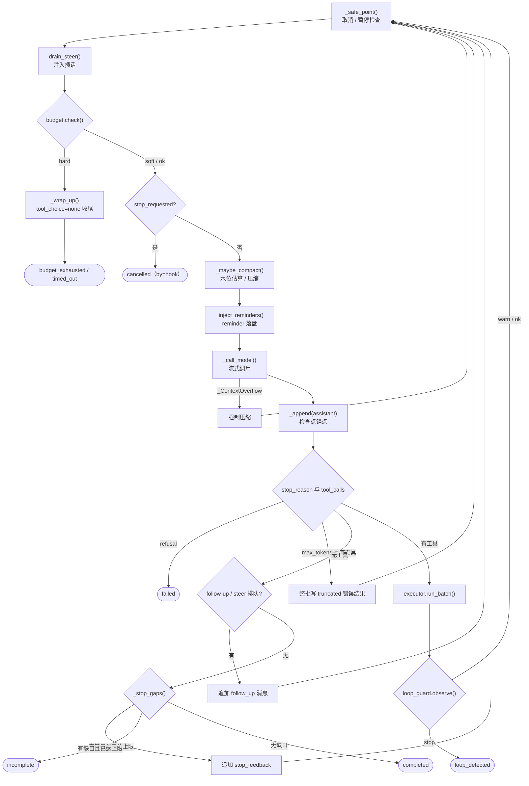
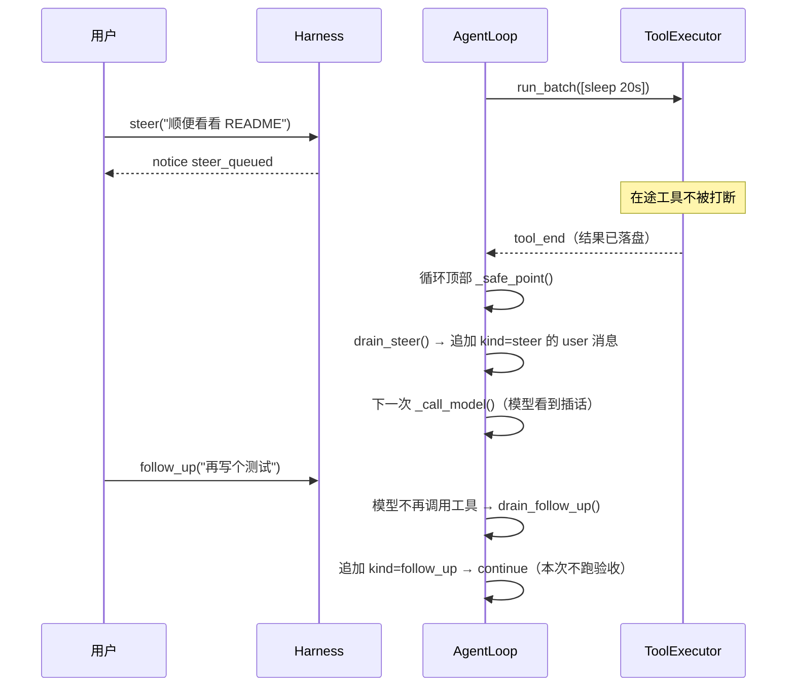

# 04 Agent Loop

“调模型 → 执行工具 → 再调模型”看起来只是一个 `while` 循环，但要让它在取消、崩溃、截断、插话、拒答和异常面前都不留烂摊子，
每一轮必须被切成若干个有明确边界的阶段。本章拆开 `src/flywhl_harness/agent/loop.py` 的 `AgentLoop`：
一轮分几步、为什么写成 async generator、外层如何保证一定以明确状态结束，以及 tool_call / tool_result 配对这条硬不变量在哪些地方被修补。

## 从十行循环说起

几乎所有 Agent 教程的第一版都是这样：

```python
messages = [user(prompt)]
while True:
    resp = llm(system, messages, tools)
    messages.append(resp)
    if not resp.tool_calls:
        break
    for call in resp.tool_calls:
        messages.append(run_tool(call))
```

它能跑通 demo，但一放进真实环境，每一行都会出问题：

| 现实情况 | 十行循环的表现 | flywhl-harness 的对策 | 位置 |
|---|---|---|---|
| 用户点“停止” | 只能 `task.cancel()`，可能留下没有结果的 tool_call，下次请求被 API 以 400 拒绝 | 协作式取消 + 在安全点抛 `RunCancelled` + 补合成结果 | `_safe_point()`、`_pair_dangling()` |
| 进程被 kill | `messages` 在内存里，全部丢失 | 每条消息先落盘再发事件，恢复时从存储重建 | `_append()`、`Harness.recover()` |
| 输出被 `max_tokens` 截断 | 执行一个参数只有一半的 `write` | 整批判失败、不执行 | `_body()` 中的 `MAX_TOKENS` 分支 |
| 用户在 Agent 工作时继续输入 | 没有入口 | steer / follow-up 两个队列，在不同时机注入 | `Inbox`、`_body()` |
| 模型说“完成了” | 立即结束，不管产物是否存在 | Stop 验收：计划、验证命令、Stop hook | `_stop_gaps()` |
| 无限重复同一个调用 | 一直跑到账单爆掉 | 预算 + 循环守卫 | 见 [08 终止条件、预算与循环守卫](/core/termination-budget) |
| 上下文超长 | API 报错，循环崩溃 | 水位估算、压缩、溢出后强制压缩重试 | `_maybe_compact()`，见 [07](/core/context-engineering) |
| 任意未预料的异常 | Run 永远停在 running | 外层兜底，以 `failed` 结束并保留现场 | `run()` |

本章关注 Loop 本身的骨架；预算、压缩、工具执行管线、取消细节各有专章，这里只讲它们在骨架上的“插槽”。

## 先对齐：什么是一个 turn

“turn”在不同系统里粒度不同，直接影响你如何理解预算 `max_turns` 与 `turn_start` 事件：

| 系统 | turn 的含义 | 一个 turn 内的模型调用次数 |
|---|---|---|
| Codex（OpenAI 的 Codex agent loop 文章） | 从一次用户输入到一条最终 assistant 回复；中间可以有多次“推理 ↔ 工具”迭代 | 多次 |
| pi（`pi-agent-core`） | 一次 assistant 响应，加上它引发的工具调用与结果 | 1 次 |
| flywhl-harness | 一次 `_call_model()` 加上随后的工具执行，由 `turn_start` / `turn_end` 包围 | 1 次 |

flywhl-harness 采用与 pi 相同的细粒度定义：`self.turn` 与 `rc.budget.next_turn()` 都在每次模型调用前加一，
所以 `BudgetConfig.max_turns=30` 的意思是“最多调用 30 次模型”，而不是“最多 30 轮对话”。
Codex 意义上的 turn，在本项目里大致对应一次 Run（一个 prompt 加上运行中排队进来的 follow-up）。

## 一轮的阶段拆解

`loop.py` 的模块 docstring 画了一张 ASCII 图，下面是与代码逐分支对应的版本：



每个阶段的职责与边界：

| 阶段 | 代码 | 为什么放在这里 |
|---|---|---|
| 安全点 | `_safe_point()` | 循环顶部是唯一一个“上一批工具已全部有结果、下一次模型调用还没发出”的时刻，在这里停下不会留下半截状态 |
| 注入插话 | `rc.inbox.drain_steer()` | 同理，此时插入一条 user 消息不会夹在 tool_call 与 tool_result 之间 |
| 预算检查 | `rc.budget.check()` | 放在压缩之前：已经超限就不该再为压缩花一次模型调用 |
| hook 终止 | `rc.stop_requested` | Stop hook 返回 `stop_run` 后，在下一轮开始前生效 |
| 上下文整形 | `_maybe_compact()` | 每次调用前按估算水位决定是否压缩；`compact_skipped_at` 防止“无可压缩”时每轮空转 |
| 注入 reminder | `_inject_reminders()` | 预算提醒、循环警告、todo 复述等积攒在 `rc.pending_reminders`，合并成一条 `kind=reminder` 的 user 消息 **落盘** |
| 模型调用 | `_call_model()` | 流式；重试与降级在接入层完成，Loop 只看到 `retry` 事件 |
| assistant 落盘 | `_append(final)` | 这是检查点锚点：之后无论工具执行到哪一步崩溃，恢复时都能从这条消息找出未完成的调用 |
| 无工具分支 | follow-up → `_stop_gaps()` | 排队输入优先；验收只在“真的要结束”时跑 |
| 工具分支 | `run_batch()` → `loop_guard.observe()` | 结果按原序落盘后再观察循环迹象 |

### 精读 `_body()` 主干

下面摘取 `AgentLoop._body()` 的主循环（删去了 prompt 接收与压缩分支的细节）：

```python
while True:
    self._safe_point()
    for text in rc.inbox.drain_steer():
        yield self._append(user_message(text, kind=MsgKind.STEER))

    verdict = rc.budget.check()
    if verdict.state == "hard":
        async for ev in self._wrap_up("；".join(verdict.reasons)):
            yield ev
        self.outcome = Outcome(verdict.status or "budget_exhausted", "达到限额：" + "；".join(verdict.reasons))
        return
    if verdict.state == "soft":
        rc.remind("预算即将用尽（" + "；".join(verdict.reasons) + "）。...")
    if rc.stop_requested:
        self.outcome = Outcome("cancelled", rc.stop_requested, by="hook")
        return

    async for ev in self._maybe_compact():
        yield ev
    async for ev in self._inject_reminders():
        yield ev

    rc.budget.next_turn()
    self.turn += 1
    yield self._ev(E.TURN_START, turn=self.turn)
    try:
        async for ev in self._call_model():
            yield ev
    except _ContextOverflow:
        yield self._ev(E.TURN_END, turn=self.turn, aborted="context_overflow")
        self._overflow_retries += 1
        if self._overflow_retries > 1:
            raise ProviderError(ErrorKind.CONTEXT_OVERFLOW, "压缩后上下文仍然超长")
        async for ev in self._maybe_compact(force=True):
            yield ev
        continue
    self._overflow_retries = 0
    msg = self._last
    rc.budget.charge_model(msg.usage)
    # ...

    if msg.stop_reason == StopReason.REFUSAL:
        yield self._ev(E.TURN_END, turn=self.turn)
        self.outcome = Outcome("failed", "模型基于安全策略拒绝了该请求（refusal）")
        return
    calls = msg.tool_calls
    if calls and msg.stop_reason == StopReason.MAX_TOKENS:
        for c in calls:
            yield self._persist_tool_error(c, "输出被 max_tokens 截断，...未执行。...", "truncated")
        yield self._ev(E.TURN_END, turn=self.turn)
        continue
    if not calls and msg.stop_reason == StopReason.MAX_TOKENS:
        # ... 纯文本回复被截断：追加“请从中断处继续”的 reminder 并 continue（最多 3 次）
    if not calls:
        if rc.inbox.pending()["steer"] or rc.inbox.pending()["follow_up"]:
            for ev in self._drain_inbox():
                yield ev
            yield self._ev(E.TURN_END, turn=self.turn)
            continue
        gaps = await self._stop_gaps(msg)
        # ... 有缺口：未达 max_stop_blocks 则追加 STOP_FEEDBACK 并 continue，否则 incomplete
        if rc.inbox.pending()["steer"] or rc.inbox.pending()["follow_up"]:
            # 验收（可能要跑测试）期间又有新输入到达：继续处理，而不是丢掉
            for ev in self._drain_inbox():
                yield ev
            yield self._ev(E.TURN_END, turn=self.turn)
            continue
        if self._stop_note:  # Stop hook 不阻止结束时给的补充信息：作为提醒落盘，留给下一次 Run
            yield self._append(user_message(reminder(self._stop_note), kind=MsgKind.REMINDER))
            self._stop_note = None
        self.outcome = Outcome("completed", "自然完成", final_text=msg.text)
        yield self._ev(E.TURN_END, turn=self.turn)
        return

    async for ev in self.executor.run_batch(calls):
        yield ev
    rc.budget.charge_tool(len(calls))
    # ... 对每个结果调用 rc.loop_guard.observe()，stop → loop_detected
```

几处值得停下来想的地方：

**1. `refusal` 必须先于 `tool_calls` 检查。** `StopReason.REFUSAL` 的注释写得很直白：拒答时“不能执行其中的工具调用”。
拒答消息照样落盘（`_append` 已在 `_call_model()` 末尾执行），这样审计能看到模型说了什么，但 Run 以 `failed` 结束，而不是被当成“自然完成”。
在 Anthropic provider 开启服务端降级时，拒答可能已经在服务端被备用模型接手，Loop 看到的就不再是 refusal——那部分见 [05 消息模型与模型接入层](/core/messages-and-models)。

**2. `max_tokens` + 工具调用 → 整批不执行。** 截断意味着最后一个调用的 JSON 很可能不完整，但为什么连前面完整的调用也不执行？
因为一条 assistant 消息里的多个调用是模型的一个完整意图，截断后剩下的只是前半段计划；执行前半段（例如先删旧文件）而丢掉后半段（再写新文件）比都不执行更危险。
`_persist_tool_error()` 为每个调用写一条 `status=truncated` 的错误结果，配对依然成立，模型下一轮读到“请减少单次输出”后会分步重来。
`tests/test_loop.py::test_truncated_tool_calls_are_not_executed` 断言 `big.txt` 根本没有被创建。

**3. 无工具分支里，排队输入先于验收，验收之后还要再看一眼。** 如果有排队输入，就由 `_drain_inbox()` 追加进历史然后 `continue`，`_stop_gaps()` 这一次不跑。
验收（可能是一次耗时的 `pytest`）只在 Agent 最终要停下时执行一次，而不是在每个“阶段性停顿”都执行。
但验收本身要花时间：跑测试的几十秒里用户可能又发了一条消息。所以验收通过后、真正返回 `completed` 之前，再检查一次收件箱——
否则这条消息会落进“Run 已结束”的空档，只能以 `inbox_dropped` 通知的形式被丢弃（`tests/test_lifecycle.py::test_follow_up_arriving_during_stop_check_is_processed`）。

**4. 工具分支没有 `return` 之外的出口。** 有工具调用的回合总是回到循环顶部，由下一轮的安全点、预算和守卫决定是否继续——
“是否续跑”的判定被统一放在了循环顶部，而不是散落在工具执行之后的各个 if 里。

### 精读 `_call_model()`：流事件翻译

模型接入层（[05](/core/messages-and-models)）把 OpenAI 兼容与 Anthropic 的原始流统一成 `StreamEvent`；
`_call_model()` 再把它翻译成对外的 `Event`。节选 `AgentLoop._call_model()`：

```python
mid = new_id("m_")
yield self._ev(E.MESSAGE_START, message_id=mid, role="assistant", context=stats.to_dict(),
               fingerprint=context_fingerprint(req), purpose=purpose)
text_acc: list[str] = []
final: Message | None = None
try:
    async for sev in rc.cancel.iterate(rc.provider.stream(req, rc.cancel)):
        t = sev.type
        if t == "text_delta":
            text_acc.append(sev.delta)
            yield self._ev(E.MESSAGE_UPDATE, message_id=mid, kind="text", delta=sev.delta, index=sev.index)
        # ... thinking_delta / toolcall_start / toolcall_delta 同理，只转发不累积
        elif t == "retry":
            if sev.info.get("discard_partial"):
                text_acc.clear()
            yield self._ev(E.MODEL_RETRY, message_id=mid, **sev.info)
        elif t == "notice":
            yield self._ev(E.NOTICE, level="info", **sev.info)
        elif t == "done":
            final = sev.message
except RunCancelled:
    if text_acc:
        partial = Message(role="assistant", content=[TextBlock("".join(text_acc))], id=mid,
                          stop_reason=StopReason.ABORTED, model=rc.model, provider=rc.provider.name)
        yield self._append(partial)
    raise
except ProviderError as e:
    if e.kind == ErrorKind.CONTEXT_OVERFLOW:
        raise _ContextOverflow() from e
    err = Message(role="assistant", content=[], id=mid, stop_reason=StopReason.ERROR, error=str(e), ...)
    yield self._append(err)
    raise
if final is None:
    raise ProviderError(ErrorKind.UNKNOWN, "provider 没有返回最终消息")
final.id, final.ts = mid, now()
self._last = final
yield self._append(final)
```

| StreamEvent | 对外 Event | Loop 自己做什么 |
|---|---|---|
| `text_delta` | `message_update(kind=text)` | 追加到 `text_acc`，仅供取消时保留 |
| `thinking_delta` | `message_update(kind=thinking)` | 只转发 |
| `toolcall_start` / `toolcall_delta` | `message_update(kind=toolcall_start / toolcall)` | 只转发；参数拼装由 provider 的 `MessageBuilder` 负责 |
| `retry` | `model_retry` | `discard_partial=True` 时清空 `text_acc` |
| `notice` | `notice` | 只转发（如服务端降级提示） |
| `done` | —（随后由 `_append` 发 `message_end`） | 拿到完整 `Message` |

几个设计点：

- **Loop 不拼装消息。** 完整的 `Message`（含解析后的工具参数、usage、stop_reason）只来自 `done` 事件。
  `text_acc` 唯一的用途是取消兜底——这样 Loop 不需要知道任何 provider 的协议细节。
- **重试时丢弃半截输出。** `ResilientProvider` 在流中途失败后重试，前一次尝试已经吐出的文本不能与新尝试的输出拼在一起；
  `discard_partial` 同时告诉 UI 清空当前气泡。若不清空 `text_acc`，取消发生在重试之后时，保留的“aborted 文本”会是两次尝试的混合体。
- **取消时保留文本、丢弃其它。** 用户已经在屏幕上看到了这段文字，历史应与所见一致；下一轮模型也需要知道自己说过什么。
  半截 thinking 和半截工具调用则不保留：工具调用从未完整生成，落盘它就必须再补一条合成结果，不如让它“从未发生”。
  `prepare_history()` 对 `aborted` 消息也只保留文本，两边规则一致。
- **`message_start` 携带上下文统计与指纹。** `context_fingerprint(req)` 用于回放时比对“模型看到的东西”是否与录制时一致，
  见 [22 轨迹、回放与评测](/multi-agent/trajectory-eval)。
- **`rc.cancel.iterate()` 包住 provider 流。** 取消请求到达时，`CancelToken.guard()` 立即放弃对下一个 chunk 的等待；
  `iterate()` 的 `finally` 调用底层流的 `aclose()`，释放 HTTP 连接——不再为用户不要的输出付 token 费。
- **错误消息也落盘。** `stop_reason=error` 的空消息记录了失败现场，`prepare_history()` 在构造下一次请求时会跳过它，所以不污染上下文。

### `_append()`：先落盘，再发事件

```python
def _append(self, msg: Message) -> Event:
    """消息落盘（检查点）后再发 message_end：事件永远不会领先于持久化状态。"""
    self.rc.log.append_message(msg, self.rc.run_id)
    return self._ev(E.MESSAGE_END, message=msg.to_dict())
```

`_append` 是同步函数，返回事件让调用方 `yield`。顺序反过来会怎样？UI 已经显示了消息、进程却在写库前崩溃，
恢复后的历史里没有这条消息，用户看到的和模型看到的从此分叉。`_persist_tool_error()` 遵循同一规则：先 `append_message`，再构造 `tool_end`。

## 为什么是 async generator

`AgentLoop.run()` 的签名是 `async def run(self, prompt) -> AsyncIterator[Event]`。对比另外两种常见写法：

| 维度 | 回调 / EventEmitter | 后台 task + `asyncio.Queue` | async generator |
|---|---|---|---|
| 控制流 | 推送式，生产者不知道消费者是否跟得上 | 推送式，靠队列缓冲 | 拉取式：消费者不 `__anext__`，Loop 就停在 `yield` |
| 背压 | 无 | 需要有界队列 + 阻塞 `put` | 天然具备 |
| 提前结束 | 需要额外的取消通道 | 需要 cancel 后台 task | `aclose()` 在挂起的 `yield` 处抛 `GeneratorExit`，`finally` 依次执行 |
| 组合 | 回调嵌套 | 队列串联 | `async for ... yield` 逐层转发 |
| 测试 | 需要收集器 | 需要收集器 | `[e async for e in loop.run(p)]` |

flywhl-harness 里这几个性质分别落在：

- **拉取与背压**：`Harness._drive()` 就是一个 `async for ev in a.loop.run(prompt): a.hub.publish(ev)`。
  背压存在于 Loop 与这个直接消费者之间；`EventHub` 再把事件扇出给多个 SSE 订阅者，慢客户端那一侧依靠
  `EPHEMERAL_EVENTS`（`message_update` / `tool_update` 可丢弃，客户端以 `message_end` 为准）处理，见 [15 流式输出、插话与断线续传](/reliability/streaming)。
- **清理**：`ToolExecutor.run_batch()` 的 `finally` 会取消仍在运行的 driver task；`CancelToken.iterate()` 的 `finally` 会 `aclose()` provider 流。
  消费者中途放弃迭代时，这些 `finally` 负责释放资源。
- **子代理**：子代理的 `AgentLoop` 同样是 generator，由 `Harness.run_subagent()` 消费：每个事件先发布到子 Run 自己的 `EventHub`，
  非 EPHEMERAL 的再经 `emit` 包装成父 Run 中 `task` 工具调用的 `tool_update`。父代理的 **事件流** 能看到子代理在做什么，
  父代理的 **消息历史** 却只收到一条符合回传契约的工具结果——透传与上下文隔离是两条不同的通道，见 [20 子代理与回传契约](/multi-agent/subagents)。
- **测试**：`tests/conftest.py` 的 `make_harness()` 注入 `ScriptedProvider`，测试直接断言事件序列。
  例如 `test_parallel_read_batch_preserves_order` 检查 3 个 `tool_start` 都出现在第一个 `tool_end` 之前（并发），且 `write` 在只读批之后。

::: warning 嵌套 generator 的清理不是同步的
`run()` 用 `async for ev in self._body(prompt)` 消费内层 generator。外层被 `aclose()` 时，`GeneratorExit` 只抛进 **外层** 挂起的 `yield`；
内层 `_body()` 并不会被立即关闭，而是在失去引用后由 asyncio 的 async generator finalizer 钩子调度一个 `aclose()` 任务。
也就是说内层的 `finally` 会“稍后”执行。需要确定性清理时，可以用 Python 3.10+ 的 `contextlib.aclosing()` 包住内层 generator。
本项目把真正需要及时释放的资源（HTTP 流、工具 task）都放在最内层的 `finally` 里，并且有协作式取消先一步把它们停下，所以这个延迟不造成泄漏。
:::

## 外层 `run()`：一定以明确状态结束

```python
async def run(self, prompt: str | None = None) -> AsyncIterator[Event]:
    rc = self.rc
    yield self._ev(E.RUN_START, prompt=prompt, resume=rc.resume, model=rc.model, role=rc.role, depth=rc.depth)
    try:
        async for ev in self._body(prompt):
            yield ev
    except RunCancelled as c:
        for ev in self._pair_dangling(f"已取消：{c.reason}"):
            yield ev
        self.outcome = Outcome("cancelled", c.reason, by=c.by)
    except RunPaused:
        self.outcome = Outcome("paused", "已在安全点暂停")
    except ProviderError as e:
        self.outcome = Outcome("failed", f"模型调用失败：{e}", error=str(e))
    except Exception as e:  # 防御性兜底：任何异常都以 failed 结束，并保留现场
        self.outcome = Outcome("failed", f"{type(e).__name__}: {e}", error=traceback.format_exc())
    if self.outcome is None:
        self.outcome = Outcome("failed", "Loop 未给出结束状态")
    if self._last is not None and not self.outcome.final_text:
        self.outcome.final_text = self._last.text
    yield self._ev(E.USAGE, **rc.budget.snapshot())
    yield self._ev(E.RUN_END, status=self.outcome.status, ...)
```

职责划分很清楚：`_body()` 只负责“正常路径上设置 `self.outcome` 并 `return`”，所有异常路径的收尾都在 `run()`。
`Harness._finish()` 再把 `Outcome.status` 映射为状态机迁移（例如取消请求先一步 CAS 到 `cancelling` 时，即使 Loop 恰好完成也以取消为准），见 [10 Run 生命周期状态机](/reliability/run-lifecycle)。

| 异常 / 情形 | Outcome | 补配对 | 说明 |
|---|---|---|---|
| `RunCancelled`（协作式取消） | `cancelled` | `_pair_dangling()` | 携带 `reason` 与 `by` 用于审计 |
| `RunPaused` | `paused` | 不需要 | 只在 `_safe_point()` 抛出，此时上一批工具必然已全部有结果 |
| `ProviderError` | `failed` | 不需要 | 失败消息已由 `_call_model()` 落盘 |
| 其它 `Exception` | `failed` | 不需要 | `error` 字段保存完整 traceback |
| `_body()` 正常返回但没设置 outcome | `failed` | — | 防御编程，正常不应出现 |
| `GeneratorExit` / `CancelledError` | 不设置 | **故意不补** | 见下文 |

### 为什么 `except Exception` 不会吞掉 `GeneratorExit` 和 `CancelledError`

两者都继承自 `BaseException` 而非 `Exception`（`asyncio.CancelledError` 从 Python 3.8 起如此），所以兜底分支捕获不到它们。这正是想要的效果：

- **`GeneratorExit`**：消费者 `aclose()` 了 generator。如果捕获它之后继续 `yield`（例如照常发 `run_end`），Python 会抛
  `RuntimeError: async generator ignored GeneratorExit`。消费者已经不听了，此时唯一正确的做法是让它传播。
- **`CancelledError`**：这是抢占式取消（进程关闭、外层 task 被强制 cancel），语义上等同于崩溃——在途工具“到底执行了没有”是未知的。
  如果在这里把 Run 记为 `failed` 并补“未执行”结果，就是在对一个可能已生效的副作用撒谎。
  `ToolExecutor.run_batch()` 的 driver 对此有专门处理：`except asyncio.CancelledError: abrupt = True; raise`，保留 step journal 的 `started` 状态，
  交给恢复流程按幂等键对账，见 [11 检查点与崩溃恢复](/reliability/checkpoint-recovery) 与 [14 幂等与副作用](/reliability/idempotency)。

::: tip 常见错误写法
`except BaseException:` 或裸 `except:` 再“优雅地”发一个 `run_end` 事件。在同步代码里这只是坏习惯，
在 async generator 里它要么触发上面的 `RuntimeError`，要么破坏 asyncio 的取消语义，让 `task.cancel()` 看起来“没生效”。
:::

## 配对不变量：tool_call 与 tool_result 一一对应

两家主流 API 都要求：带工具调用的 assistant 消息之后，必须有每个调用 id 对应的结果，否则直接拒绝请求。
所以这不是“最好遵守”的约定，而是“违反就无法继续会话”的硬约束。检查函数在 `src/flywhl_harness/types.py` 的 `unpaired_tool_calls()`：

```python
def unpaired_tool_calls(messages: list[Message]) -> list[ToolCall]:
    """返回最后一条 assistant 消息中尚未得到结果的工具调用。"""
    for i in range(len(messages) - 1, -1, -1):
        m = messages[i]
        if m.role == "assistant":
            answered = {x.tool_call_id for x in messages[i + 1 :] if x.role == "tool"}
            return [c for c in m.tool_calls if c.id not in answered]
    return []
```

它只检查 **最后一条** assistant 消息，这依赖另一条 Loop 自身保证的性质：只要还有未配对的调用，Loop 就不会发起下一次模型调用，
所以缺口只可能出现在末尾。万一历史因为其它原因在中间出现缺口，`prepare_history()` 构造请求时还会补一层合成结果作为安全网（见 [05](/core/messages-and-models)）。

修补点分布在整条链路上：

| 场景 | 修补位置 | 做法 | 合成结果的 status |
|---|---|---|---|
| 工具名未知、参数非法 JSON、不合 schema | `ToolExecutor._prepare()` | 不执行，返回可读错误 | `invalid` |
| 协作式取消发生在工具批中途 | `run_batch()` driver 的 `finally` | 尚未执行的调用补“未执行：{原因}” | `skipped` |
| 取消后外层兜底 | `AgentLoop._pair_dangling()` | 补“已取消：…”，同时把 step 标记 `cancelled` | `cancelled` |
| 离线取消 paused / queued / interrupted 的 Run | `Harness.cancel()` → `_pair_dangling_offline()` | 不经过 Loop 直接补 | — |
| 崩溃后恢复 | `_body()` 开头 `unpaired_tool_calls()` → `run_batch(recovering=True)` | 按 journal 与幂等键对账，必要时补执行 | — |
| `max_tokens` 截断 | `_body()` | 整批不执行 | `truncated` |
| 收尾时模型无视 `tool_choice=none` | `_wrap_up()` | 不执行，只补结果 | `skipped` |
| 流式中途取消 | `_call_model()` | 半截调用不落盘，自然无需配对 | — |
| 抢占式取消（`CancelledError`） | `run_batch()` | **故意不补**，留给恢复对账 | — |

注意恢复路径的位置：`_body()` 在进入 `while True` **之前** 先处理 `pending`。如果先发一次模型调用，请求本身就会因为配对缺失被拒绝。

## steer 与 follow-up：用户在 Agent 工作时继续输入

`src/flywhl_harness/agent/inbox.py` 的 `Inbox` 只是两个 `deque`，语义全在注入时机上：

```python
class Inbox:
    def __init__(self, mode: str = "all"):
        self.mode = mode
        self._steer: deque[str] = deque()
        self._follow: deque[str] = deque()

    def _drain(self, q: deque[str]) -> list[str]:
        if not q:
            return []
        if self.mode == "one_at_a_time":
            return [q.popleft()]
        items = list(q)
        q.clear()
        return items
```



| | steer（插话） | follow-up（排队） |
|---|---|---|
| 语义 | “顺便调整一下方向” | “做完这个再做那个” |
| 注入时机 | 每次循环顶部（开跑后第一轮之前、每批工具完成之后） | 只在模型本该停止（无工具调用）时 |
| 是否打断在途工具 | 否 | 否 |
| 消息 `meta.kind` | `steer` | `follow_up` |
| 对比 pi | steering 在开跑前与每轮工具完成后取，时机相同 | 同样只在本该停止时取 |

无工具分支里同时取出 steer 与 follow-up 值得注意：最后一次模型调用流式输出期间到达的插话，
如果模型这一轮恰好不再调用工具，就没有“下一个循环顶部”了——不在这里顺带取出，它会被静默丢掉。取出统一由 `_drain_inbox()` 完成：

```python
def _drain_inbox(self) -> list[Event]:
    """模型准备结束时取出排队的输入：插话（steer）在前，追加任务（follow_up）在后。"""
    evs = [self._append(user_message(t, kind=MsgKind.STEER)) for t in self.rc.inbox.drain_steer()]
    evs += [self._append(user_message(t, kind=MsgKind.FOLLOW_UP)) for t in self.rc.inbox.drain_follow_up()]
    return evs
```

两类消息分别以各自的 `kind` 落盘，回放与 UI 都能区分“插话”和“排队”。

两条边界：

- **插话会等在途工具执行完。** 如果当前工具是一个 20 分钟的构建，插话就要等 20 分钟。想立刻改变方向只能走取消（[12 取消语义](/reliability/cancellation)），
  这是有意为之：插话不该有破坏配对或打断副作用的能力。
- **Inbox 在内存里，但不会静默丢消息。** Run 暂停时，尚未注入的消息写进检查点（`checkpoint["inbox"]`），恢复时随之带回；
  Run 以 `budget_exhausted`、`loop_detected`、`cancelled` 等方式结束时，harness 发出一条 `notice(code=inbox_dropped)` 列出未处理的消息，
  让调用方决定是否用它们发起新 Run（`tests/test_cancel.py::test_budget_and_inbox_survive_pause`）。
  `Harness.steer()` / `follow_up()` 在 Run 不活跃时返回 `False`，调用方应改为发起新 Run。

## 设计取舍与常见坑

| 取舍 | flywhl-harness 的选择 | 代价 |
|---|---|---|
| reminder 是临时拼接还是落盘 | 落盘为 `kind=reminder` 的 user 消息 | 历史多出若干条消息；换来前缀稳定与忠实回放（`test_prefix_stability_append_only`） |
| 截断时执行完整的那部分调用吗 | 整批不执行 | 多花一轮模型调用 |
| 取消时保留半截文本吗 | 保留文本、丢弃 thinking 与工具调用 | 历史中出现 `aborted` 消息，需要 `prepare_history()` 配合 |
| 验收在何时跑 | 只在最终要停止时 | 中间阶段的错误要等到最后才被发现 |
| “是否续跑”在哪里判定 | 统一在循环顶部 | 某些终止要多等一个安全点才生效（如 `stop_requested`） |

常见坑：

1. **在工具执行中途插入 user 消息。** 插话被放在 tool_call 与 tool_result 之间，下一次请求直接 400。所有注入都必须发生在安全点。
2. **把 `max_tokens` 当成普通的 `tool_use`。** 截断的 JSON 有时恰好能被“修复”成合法 JSON（例如补一个右括号），于是一个内容只写了一半的文件被成功写入。
3. **`max_tokens` 且没有工具调用。** 若把它当作自然停止，一个被截断的最终回答就会以 `completed` 结束。
   本项目在这个分支追加一条“请从中断处继续”的 reminder 让模型续写，最多 3 次，之后发出 `notice(code=truncated)` 再进入验收
   （`tests/test_loop.py::test_truncated_text_reply_is_continued`）。
4. **在 async generator 里吞掉 `BaseException`。** 见上文。
5. **用 `task.cancel()` 实现“停止”按钮。** 它会在任意 `await` 处抛出，可能正好打断一个已发出、尚未回包的外部写操作。

## 动手验证

::: code-group

```bash [单元测试]
.venv/bin/python -m pytest -q \
  tests/test_loop.py::test_basic_tool_loop \
  tests/test_loop.py::test_truncated_tool_calls_are_not_executed \
  tests/test_loop.py::test_steer_injected_at_safe_point \
  tests/test_loop.py::test_follow_up_runs_after_natural_stop \
  tests/test_loop.py::test_prefix_stability_append_only
```

```bash [示例]
# 最小循环：并行只读批、五种异常变成可读错误、配对完整的消息历史
.venv/bin/python examples/01_minimal_loop.py
# 取消语义：流式中途取消后保留已生成文本（aborted），以及状态迁移轨迹
.venv/bin/python examples/03_cancel_semantics.py
```

:::

**实验：观察三种结局的事件序列。** 在仓库根目录保存为任意脚本并用 `.venv/bin/python` 运行：

```python
import asyncio, tempfile
from pathlib import Path
from flywhl_harness import Harness, HarnessConfig, Store, ScriptedProvider

async def main():
    ws = Path(tempfile.mkdtemp())
    for name, script in [
        ("refusal", [{"text": "不能帮你", "stop_reason": "refusal"}]),
        ("max_tokens_text", [{"text": "答案的前半段……", "stop_reason": "max_tokens"}, "答案的后半段。"]),
        ("tool", [{"text": "看看", "tool_calls": [{"name": "ls", "args": {"path": "."}}]}, "完成"]),
    ]:
        c = HarnessConfig.load(workspace=str(ws)); c.permissions.mode = "bypass"
        h = Harness(c, provider=ScriptedProvider(script), model="scripted", store=Store(":memory:"))
        res = await h.run("测试")
        print(name, res.status, [e.type for e in res.events])
        await h.aclose()

asyncio.run(main())
```

你会看到：`refusal` 以 `failed` 结束，且 `turn_start` 与 `turn_end` 依然成对；`max_tokens_text` 多出一轮续写，最终文本是“答案的后半段。”（对应常见坑 3）；
`tool` 中 `message_end` 总是先于 `tool_start`，`tool_end` 之后才是下一轮的 `turn_start`。

**Web UI。** 运行 `.venv/bin/flywhl serve -w playground`（未设置任何模型 API Key 时，auto 模式使用内置演示模型 `flywhl-demo`）：

1. 输入“等待 20 秒”，在等待期间保持输入区左下角选中“插话”，发送“列出目录”。在检查器的“事件”页签里依次看到 `notice(steer_queued)` →
   `tool_end` → 一条 `kind=steer` 的 `message_end` → `turn_start`：插话没有打断工具。
2. 再点一次“等待 20 秒”，这次在等待期间改用“排队”发送，观察它直到模型回复“完成”后才被注入。
3. 输入“错误演示”，观察工具错误以 `is_error=True` 的结果回到模型，Loop 没有中断。

## 小结与延伸思考

- 一轮被切成“安全点 → 插话 → 预算 → 压缩 → reminder → 模型 → 落盘 → 分支”，每个边界都已持久化；“是否续跑”统一在循环顶部判定。
- async generator 带来拉取式控制流与 `finally` 清理；外层 `run()` 只捕获 `Exception` 及其子类，让 `GeneratorExit` 与 `CancelledError` 按原语义传播。
- tool_call / tool_result 配对是硬不变量，修补点覆盖校验失败、取消、截断、收尾、恢复；唯一故意不补的是抢占式取消。

延伸思考：

1. **取消发生在模型流式输出一半时。** 当前策略是保留文本、丢弃半截工具调用。如果模型已经完整输出了第一个工具调用（`toolcall_end` 已到达），
   正在输出第二个时被取消，第一个调用要不要保留？保留意味着要为它补一条“已取消”的结果，模型下一轮会知道“我曾打算做这件事”；
   不保留则更简单。两种做法都满足配对，差别在于给模型留下多少意图信息。
2. **子代理事件如何透传又不污染父上下文。** 本项目用 `tool_update` 包装子 Run 的事件，并在 `run_subagent()` 里过滤掉 EPHEMERAL 事件。
   如果子代理嵌套三层，父 Run 的事件流会被包几层？UI 如何折叠？见 [20 子代理与回传契约](/multi-agent/subagents)。
3. **turn 粒度的选择。** 如果把 `max_turns` 改成 Codex 意义上的 turn（每个用户输入算一次），预算还能约束住“模型连续调用 200 次工具”吗？
   本项目为什么同时限制轮次、工具调用数、token、费用与墙钟，见 [08 终止条件、预算与循环守卫](/core/termination-budget)。
