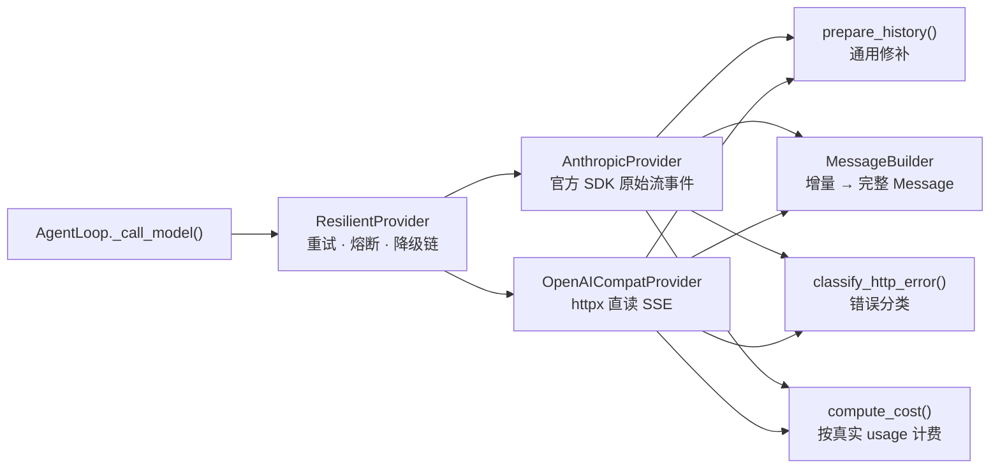

# 05 消息模型与模型接入层

Agent Loop 不应该知道 OpenAI 的 `finish_reason` 和 Anthropic 的 `stop_reason` 有什么区别，也不应该关心 tool 结果是独立消息还是 user 消息里的一个块。
本章讲两件事：一套 provider 无关的消息模型（`src/flywhl_harness/types.py`），以及把各家协议差异挡在外面、同时承担错误分类、成本计量、前缀稳定等职责的模型接入层（`src/flywhl_harness/llm/`）。

## 统一消息模型

### 三种角色，system 不进消息列表

```python
Role = Literal["user", "assistant", "tool"]

@dataclass
class Message:
    role: Role
    content: list[Block]          # TextBlock | ThinkingBlock | ToolCall
    id: str = ...
    ts: float = ...
    # ---- assistant 专属 ----
    stop_reason: str | None = None
    usage: Usage | None = None
    model: str | None = None
    provider: str | None = None
    error: str | None = None
    # ---- tool 专属 ----
    tool_call_id: str | None = None
    tool_name: str | None = None
    is_error: bool = False
    details: dict[str, Any] | None = None  # 只给 UI/审计，绝不送进模型
    # ---- 通用 ----
    meta: dict[str, Any] = field(default_factory=dict)
```

system 提示放在 `ModelRequest.system` 里单独传。如果它是消息列表的第一项，任何“刷新系统提示”的操作都等于改写历史的开头，整个前缀缓存随之失效；
单独存放后，消息列表就能做到严格只追加。

`ToolCall` 除了 `id / name / arguments`，还保留 `raw_arguments` 与 `parse_error`：参数 JSON 解析失败时，harness 要把“原文是什么、错在哪”告诉模型，而不是吞掉。
`ThinkingBlock` 带一个可选的 `signature`，用于 Anthropic 的思考签名回传（后文详述）。

### content 与 details 分离

这条设计借鉴自 pi：`tool` 消息的 `content` 给模型看，`details` 只给 UI 与审计。以 `src/flywhl_harness/tools/fs.py` 里 `write` 工具的返回为例：

```python
return ToolResult(
    content=f"已{'创建' if created else '覆盖'} {rel}（{n} 字节，{...} 行）",
    details={"path": rel, "created": created, "bytes": n, "diff": _diff(old, args["content"], rel)},
)
```

模型只需要知道“写成功了、多少行”，UI 却要展示完整 diff。如果 diff 进了 `content`，每写一次文件上下文就多出一份文件全文；
如果 UI 只能看 `content`，又无法展示丰富信息。两个 provider 的转换函数（`to_openai_messages`、`to_anthropic_messages`）都只读 `m.text`，`details` 从结构上就送不进模型。
Loop、执行器写入的状态信息（`status`、`duration_ms`、`idempotency_key`、`snapshot`）也都放在 `details` 里，Web UI 的 `setToolResult()` 据此渲染状态标签与差异视图。

### meta.kind：消息从哪来

同样是 `role=user`，来源可能完全不同。`MsgKind` 把来源记录在 `meta.kind` 中：

| kind | 写入者 | 用途 |
|---|---|---|
| `prompt` | `_accept_prompt()` | 发起本次 Run 的用户输入 |
| `steer` / `follow_up` | `_body()` 从 `Inbox` 取出 | 运行中插话 / 排队输入，见 [04](/core/agent-loop) |
| `reminder` | `_inject_reminders()` | harness 注入的 `<system-reminder>`；`prepare_history()` 对它有特殊处理 |
| `compaction` | `Compactor` | 压缩摘要，见 [07](/core/context-engineering) |
| `resume_note` | `_body()` | 暂停 / 崩溃期间发生了什么 |
| `stop_feedback` | `_body()` | Stop 验收未通过时给出的缺口 |
| `wrap_up` | `_wrap_up()` | 预算耗尽时的收尾指令 |

它对模型不可见（转换函数不读 `meta`），但上下文构建、UI 渲染（`app.js` 的 `SYS_TAGS` 把这些 kind 折叠成“harness 注入”卡片）和回放都依赖它。
内置的 `DemoProvider` 就是靠 kind 找“最近一次真实用户输入”，从而忽略 reminder。

### stop_reason：一条消息为什么结束

`StopReason` 统一了两家的叫法，每个值都对应 Loop 与历史修补的一种处理：

| StopReason | 含义 | Loop 的处理 | `prepare_history()` 的处理 |
|---|---|---|---|
| `end_turn` | 自然结束 | 进入 follow-up / Stop 验收 | 原样保留 |
| `tool_use` | 请求调用工具 | 执行工具 | 原样保留 |
| `max_tokens` | 输出被截断，工具参数可能不完整 | 有工具调用时整批写 `truncated`，不执行 | 原样保留 |
| `aborted` | 流式中途被取消 | 只落盘已生成的文本 | 保留（构造时已只剩文本） |
| `error` | 调用失败 | Run 以 `failed` 结束 | **跳过** |
| `refusal` | 安全策略拒答 | Run 以 `failed` 结束，绝不执行其中的工具调用 | **跳过** |

`error` 与 `refusal` 消息仍然落盘（留作审计），只是在构造下一次请求时被跳过——这样历史保持只追加，请求里也不出现没有可复用内容的消息。

## 模型接入层：防腐层 + 治理层



| 职责 | 属于 | 实现 |
|---|---|---|
| 统一流事件与消息结构 | 防腐 | `StreamEvent`、`MessageBuilder` |
| 消息格式转换 | 防腐 | `to_openai_messages()`、`to_anthropic_messages()` |
| 历史合法性修补 | 防腐 | `prepare_history()` |
| 错误分类 | 治理 | `ErrorKind`、`classify_http_error()`、`AnthropicProvider._map_error()` |
| 重试只在一层 | 治理 | provider 不重试；`ResilientProvider` 统一重试 |
| 成本计量 | 治理 | `ModelInfo` 价格表 + `compute_cost()` |
| 取消传播 | 治理 | `cancel.guard()` / `cancel.iterate()` 包住网络等待 |
| 前缀稳定 | 治理 | 冻结 system、确定性修补、顶层 `cache_control` |

### 统一流事件

`src/flywhl_harness/llm/base.py` 的模块 docstring 规定了事件序列：

```
start → (text_delta | thinking_delta | toolcall_start | toolcall_delta | toolcall_end)* → done
```

外加 `notice`（例如服务端降级提示）与 `retry`（由 `ResilientProvider` 插入）。契约只有三条：最后一个事件必须是携带完整 `Message` 的 `done`；
可恢复的失败以带 `ErrorKind` 的 `ProviderError` 抛出；provider 自己不做重试。第三条的理由写在注释里：每层都重试 3 次，三层叠加就是 27 倍放大。

### MessageBuilder：partial JSON 只在块完整后解析

工具参数是以 JSON 片段增量到达的（OpenAI 的 `tool_calls[i].function.arguments`、Anthropic 的 `input_json_delta`）。
`MessageBuilder` 按块序号累积片段，**只在块结束时** 解析：

```python
def tool_call(self, index: int) -> ToolCall | None:
    b = self._blocks.get(index)
    if b is None or b["type"] != "tool_call":
        return None
    args, err = safe_json_loads(b["json"])
    if err is None and not isinstance(args, dict):
        err, args = "工具参数必须是 JSON 对象", None
    return ToolCall(b["id"], b["name"], args or {}, raw_arguments=b["json"] if err else None, parse_error=err)

def build(self, stop_reason, usage=None, *, error=None, partial=False) -> Message:
    for idx in sorted(self._blocks):
        b = self._blocks[idx]
        if b["type"] == "text" and b["text"]:
            content.append(TextBlock(b["text"]))
        elif b["type"] == "thinking" and not partial:
            # 半截 thinking 没有签名，回传会被拒：被中断的消息只保留文本
            content.append(ThinkingBlock(b["thinking"], b.get("signature")))
        elif b["type"] == "tool_call" and not partial:
            # 半截 tool_use 必须丢弃：参数不完整，执行它是危险的
            ...
```

解析失败不会抛异常：`ToolCall` 带着 `parse_error` 进入历史，`ToolExecutor._prepare()` 看到它就生成一条
“参数不是合法 JSON……原始参数片段：……请重新生成完整、合法的 JSON 参数”的错误结果。UI 可以边收边展示参数片段，但执行永远只看完整块。

### classify_http_error：分类决定策略

| HTTP | ErrorKind | 策略 |
|---|---|---|
| 429 | `rate_limit` | 遵守 `Retry-After` 退避重试 |
| 529 / 503 / 正文含 overloaded | `overloaded` | 有限次重试后降级 |
| 其它 5xx | `server` | 重试 |
| 408 / 连接或读取超时 | `timeout` | 重试 |
| 连接断开 | `network` | 重试 |
| 400 / 413 / 422 且正文含超长提示词 | `context_overflow` | **不能原样重试**：Loop 强制压缩后再试 |
| 其它 4xx | `bad_request` | 不重试 |
| 401 / 403 | `auth` | 不重试，告警 |
| 404 | `not_found` | 可沿降级链换模型 |

上下文超长没有统一的状态码，只能靠正文里的 `context_length`、`prompt is too long` 等关键词识别（`_OVERFLOW_HINTS`）。
`RETRYABLE_KINDS` 与 `ResilientProvider` 的 `_FALLBACK_KINDS` 是两张不同的表：上下文超长换模型也没用，交给 Loop 去压缩。重试与降级的细节见 [13 重试、熔断与降级](/reliability/retry-fallback)。

### prepare_history：每次都完全一致的修补

```python
def prepare_history(messages: list[Message]) -> list[Message]:
    out: list[Message] = []
    pending: dict[str, ToolCall] = {}

    def flush_pending() -> None:
        for call in pending.values():
            out.append(Message(role="tool", content=[TextBlock("[没有返回结果：该调用被中断或丢失]")],
                               tool_call_id=call.id, tool_name=call.name, is_error=True))
        pending.clear()

    for m in messages:
        if m.role == "assistant":
            if m.stop_reason in (StopReason.ERROR, StopReason.REFUSAL):
                continue
            if not m.content:
                continue
            flush_pending()
            out.append(m)
            pending = {c.id: c for c in m.tool_calls}
        elif m.role == "tool":
            if m.tool_call_id in pending:
                pending.pop(m.tool_call_id)
                out.append(m)
        else:
            if pending and m.kind not in ("reminder",):
                flush_pending()
            out.append(m)
    # 末尾仍未配对的调用：由 Loop 负责执行或修补，这里不合成
    return out
```

| 规则 | 防止的问题 |
|---|---|
| 跳过 `error` / `refusal` 与空 content 的 assistant | 把没有内容的消息发给 API |
| 丢弃找不到对应调用的 tool 结果 | 孤立 `tool_result` 导致 400 |
| 不在末尾却缺结果的调用，补合成错误结果（pi 的做法） | 中间出现配对缺口导致 400 |
| 末尾缺结果的调用不补 | 那是 Loop 正在处理的调用，补了就是撒谎 |

为什么这样的修补不破坏前缀缓存？因为每条规则只依赖消息本身和它 **之前** 的消息：对历史前缀 P，`prepare_history(P)` 的结果永远是
`prepare_history(P + 新消息)` 的前缀。修补是一个确定性的纯函数，不是“这次请求临时改一下”。

## 两种协议对照

下面这段输入，分别经 `to_openai_messages()` 与 `to_anthropic_messages()` 转换（本章末尾的实验可以复现）：
一条带 thinking、文本和两个并行 `read` 调用的 assistant 消息，两条 tool 结果（第二条出错），以及一条插话。

| 维度 | OpenAI Chat Completions 兼容 | Anthropic Messages |
|---|---|---|
| 系统提示 | 消息列表首条 `role: system` | 顶层 `system` 字段 |
| 工具定义 | `{"type":"function","function":{name, description, parameters}}` | `{name, description, input_schema}`，本项目额外加 `eager_input_streaming` |
| `tool_choice` | 字符串 `"auto"` / `"none"` | 对象 `{"type": "auto" / "none"}` |
| 工具调用 | assistant 的 `tool_calls[].function.arguments`（JSON **字符串**） | assistant content 里的 `tool_use` 块，`input` 是对象 |
| 工具结果 | 每个结果一条独立的 `role: tool` 消息 | 同一轮的所有 `tool_result` 合并进 **同一条** user 消息，且排在文本之前 |
| 出错的结果 | 本项目在正文前加 `[工具执行出错]` | `is_error: true` |
| 推理过程 | `delta.reasoning_content`（DeepSeek 等），本项目不回传 | 带 `signature` 的 `thinking` 块（或 `redacted_thinking`），必须原样回传 |
| 结束原因 | `finish_reason`：`stop` / `tool_calls` / `length` / `content_filter` | `stop_reason`：`end_turn` / `tool_use` / `max_tokens` / `refusal` / `pause_turn` 等 |
| 用量 | `prompt_tokens` **包含** 缓存命中部分；命中数在 `prompt_tokens_details.cached_tokens`（DeepSeek 为 `prompt_cache_hit_tokens`） | `input_tokens` **不含** 缓存；另有 `cache_read_input_tokens`、`cache_creation_input_tokens` |
| 流式格式 | `data:` 行，`choices[].delta` 增量，`[DONE]` 结束 | 类型化事件：`message_start` → `content_block_start/delta/stop` → `message_delta` → `message_stop` |

几条差异在代码里的落点：

- **tool 结果合并与排序。** `to_anthropic_messages()` 的 `push()` 把相邻同角色消息合并；遇到 `tool_result` 时把已有的结果放前、文本放后：

  ```python
  if out and out[-1]["role"] == role:
      prev = out[-1]["content"]
      if role == "user" and blocks[0]["type"] == "tool_result":
          # tool_result 必须排在同一条 user 消息的文本之前
          texts = [b for b in prev if b["type"] != "tool_result"]
          results = [b for b in prev if b["type"] == "tool_result"]
          out[-1]["content"] = results + blocks + texts
      else:
          prev.extend(blocks)
  ```

  于是“两条 tool 结果 + 一条插话”变成一条 user 消息：两个 `tool_result` 在前，插话文本在后。模块注释还提到，把结果拆成多条 user 消息会让模型逐渐不再并行调用工具。
- **用量对齐。** `OpenAICompatProvider.stream()` 用 `input_tokens = prompt_tokens - cached` 把命中部分移到 `cache_read_tokens`，
  否则按缓存价与原价各算一次，成本会被重复计算。Anthropic 的输入用量在 `message_start` 里，输出用量在 `message_delta` 里。
- **结束原因映射。** OpenAI 侧见 `_FINISH`（`content_filter → refusal`，`length → max_tokens`）；Anthropic 侧见 `_STOP`，其中 `pause_turn` 被映射为 `end_turn`。
  `pause_turn` 主要出现在服务端工具的长回合中，本项目没有使用服务端工具；如果你加入它们，这个映射需要改成“继续请求”。

## 为什么 Anthropic provider 用官方 SDK，且 `max_retries=0`

OpenAI 兼容 provider 用 httpx 直读 SSE，是为了让读者看清协议；Anthropic provider 改用官方 `anthropic` SDK，但只用它的 **原始流事件**
（`messages.create(stream=True)` 返回的事件迭代器），不用 SDK 自带的消息累积辅助。这样 SSE 解析、类型化事件、beta 头、异常类型交给 SDK，
消息拼装仍然只在 `MessageBuilder` 一处发生，两个 provider 的行为可以逐事件对照。

```python
self.client = anthropic.AsyncAnthropic(
    api_key=api_key or os.environ.get("ANTHROPIC_API_KEY"),
    base_url=base_url or os.environ.get("ANTHROPIC_BASE_URL"),
    timeout=timeout,
    max_retries=0,  # 关键：重试只在 harness 一层做
)
```

SDK 默认会自动重试部分错误（次数以 SDK 文档为准）。保留它会有两个问题：一是与 `ResilientProvider` 的重试相乘；
二是 SDK 内部的重试对 harness 不可见——不会发出 `retry` 事件让 UI 丢弃半截输出，不消耗重试预算，不触发熔断，也不响应 `CancelToken`。
`_map_error()` 再把 SDK 的异常类映射成 `ErrorKind`，上层看到的错误与 OpenAI 兼容 provider 完全同构：

| SDK 异常 | `ErrorKind` | 可重试 |
|---|---|---|
| `APITimeoutError` | `TIMEOUT` | 是 |
| `APIConnectionError` | `NETWORK` | 是 |
| `APIStatusError` | 交给 `classify_http_error()`：429 / 529 / 5xx / 400 上下文超长 / 401…… | 按状态码 |
| 其它 `AnthropicError`，消息里提到 `api_key` | `AUTH` | 否 |
| 其它异常（响应解析失败、流被截断……） | `UNKNOWN` | 否 |

最后一行刻意保守：原因不明的错误不冒充“鉴权失败”（那会误导排查方向），也不自动重试（不知道失败在哪一步，重试可能重复副作用或掩盖 bug），
而是作为 `failed` 如实上报，需要时由用户 `retry`。

## thinking 签名与“只追加”约束

Anthropic 的 thinking 块带有服务端签名，续写时必须原样回传。`to_anthropic_messages()` 中的处理：

```python
if isinstance(c, ThinkingBlock):
    # 只回传带签名的 Anthropic thinking；其它 provider 的思考无法被校验，丢弃
    if m.provider == "anthropic" and c.signature:
        if c.signature.startswith(_REDACTED):
            blocks.append({"type": "redacted_thinking", "data": c.signature[len(_REDACTED):]})
        else:
            blocks.append({"type": "thinking", "thinking": c.thinking, "signature": c.signature})
```

| 情况 | 处理 | 原因 |
|---|---|---|
| 同一 provider、带签名 | 原样回传 | 签名用于校验思考内容未被篡改 |
| `redacted_thinking` | 以 `redacted:` 前缀存在 `signature` 字段里，回传时还原 | 不为罕见块型扩展统一消息模型，三种块型保持不变 |
| 来自 OpenAI 兼容服务的推理 | `OpenAICompatProvider` 生成消息时就清掉签名；转换时不回传 | 兼容服务大多不接受回传（具体以各服务文档为准） |
| 跨 provider（历史里有别家的思考） | 丢弃 | 没有签名就无法校验 |
| 被中断的半截 thinking | `build(partial=True)` 与 Loop 的取消分支都不保留 | 没有完整签名，回传会被拒 |

更强的约束来自“只追加”：按本项目的设计假设（见 `ModelInfo.append_only` 与 `anthropic.py` 模块注释），新一代 Claude 模型的 thinking 与生成它时的完整前缀绑定，
编辑早先的轮次会让之后的 thinking 失效，甚至直接返回 400。因此 Claude 模型在 `MODELS` 中都标记了 `append_only=True`，
`src/flywhl_harness/agent/context.py` 的 `ContextManager` 据此 **关闭** 客户端清理旧工具结果这类改写历史的优化，只保留压缩这一种（显式、整体替换）的上下文缩减手段。

## 前缀缓存与稳定性设计

服务端前缀缓存（KV-cache）只在请求的开头 **逐字节一致** 时命中。业界的两条经验：

- Manus 在其上下文工程文章中把 KV-cache 命中率称为生产阶段 Agent 最重要的单一指标；按他们当时引用的 Claude Sonnet 价格，缓存与未缓存输入的价差达 10 倍。
  Agent 的输入远多于输出，这个价差几乎直接决定成本。
- OpenAI 介绍 Codex agent loop 的文章强调，旧 prompt 必须是新 prompt 的精确前缀；会话中途改变工具、模型、沙箱配置或工作目录都会导致未命中。
  他们还提到早期 MCP 工具支持里有一个工具枚举顺序不稳定的 bug，造成缓存未命中。

flywhl-harness 的对应措施：

| 破坏前缀的因素 | 对策 | 位置 |
|---|---|---|
| 系统提示含日期、平台，每次重新生成 | 会话创建时生成一次，存入 session meta；Run 启动时读取 | `prompts.py` 冻结原则、`Harness.create_session()`、`Harness._build_rc()` |
| 工具顺序不稳定 | 注册表按插入顺序输出；MCP 工具按名称排序后注册 | `ToolRegistry.specs()`、`load_mcp_tools()` |
| 收尾时删除工具定义 | 保留 tools，只改 `tool_choice="none"` | `ModelRequest` 注释、`AgentLoop._wrap_up()` |
| 每次请求临时拼接 reminder | reminder 作为消息落盘 | `AgentLoop._inject_reminders()` |
| 历史修补每次不同 | 修补是确定性纯函数 | `prepare_history()` |
| 改写旧工具结果 | `append_only` 模型关闭清理；其它模型的清理用单调推进的水位线 | `ContextManager`，见 [07](/core/context-engineering) |
| 序列化不稳定 | 签名、哈希用 `canonical_json()`（键排序、紧凑分隔符）；消息从存储按原样重建 | `_utils.canonical_json()` |
| 缓存断点放错位置 | 请求顶层 `cache_control: {"type": "ephemeral"}`，由服务端缓存最后一个可缓存块（细节以官方文档为准） | `AnthropicProvider._kwargs()` |

`tests/test_loop.py::test_prefix_stability_append_only` 把这条性质写成断言：相邻两次请求的 `system` 与 `tools` 相同，后一次的消息列表以前一次为前缀。

::: warning 冻结的代价与边界
- 日期在会话创建时冻结。跨天的长会话里，模型看到的“今天”是过去的日期；需要真实时间时，应追加一条 reminder，而不是重写系统提示。
- 系统提示与 **工具集** 都钉在会话 meta 上：`_build_rc()` 用 `self.tools.subset(meta["tools"])` 构造本会话可用的工具，
  之后 Harness 新增的工具不会出现在老会话里（已不存在的工具自然跳过）。早期版本只钉住了系统提示，用不同配置重启后继续旧会话，前缀会悄悄变化。
- **模型** 以当前 Harness 为准：meta 里记录的是创建时的模型，实际服务的模型记录在每条 assistant 消息的 `model` 字段。
  换模型必然让前缀缓存失效（缓存按模型隔离），也可能让旧的 thinking 块不可读——这是有意识的取舍，而不是“钉住”的漏洞。
:::

## ModelInfo：能力矩阵与价格

`src/flywhl_harness/llm/models.py` 的 `ModelInfo` 告诉 harness 每个模型“能做什么、多大、多贵”：

| 字段 | 谁在用 | 影响 |
|---|---|---|
| `context_window` | `ContextManager` | 清理与压缩阈值 |
| `max_output` | 配置参考 | 单次输出上限 |
| `input_price` / `output_price` / `cache_read_price` / `cache_write_price` | `compute_cost()` | 每条 assistant 消息的 `usage.cost_usd`，进而驱动费用预算 |
| `supports_thinking` | `AnthropicProvider._kwargs()` | 开启 adaptive thinking；此时不传 `temperature` |
| `append_only` | `ContextManager` | 关闭改写历史的清理 |
| `server_fallback` | `AnthropicProvider._kwargs()` | 是否附加服务端降级参数 |

```python
def compute_cost(info: ModelInfo, usage: Usage) -> float:
    m = 1_000_000
    return round(
        usage.input_tokens * info.input_price / m
        + usage.output_tokens * info.output_price / m
        + usage.cache_read_tokens * info.cache_read_price / m
        + usage.cache_write_tokens * info.cache_write_price / m,
        8,
    )
```

表中价格是示例，**以各家官方价格页为准**。两个要点：

- **计量以真实 usage 为准。** `Usage` 的 docstring 写明“以 provider 返回值为准，本地 tokenizer 只做预估”。
  `ContextManager.estimate()` 也是这样做的：以最后一条带真实 usage 的 assistant 消息为基数，只对其后新增的消息做本地估算（中日韩字符按 1 token，其它按约 4 字符 1 token）。
  压缩之前产生的 usage 反映的是更大的旧上下文，会被忽略。
- **未知模型的默认值是保守窗口 + 零成本。** `get_model_info()` 对不在表里的模型返回 128K 窗口、价格 0。这意味着换用一个新模型而不补价格，
  费用预算 `max_cost_usd` 永远不会触发——只剩 token 预算在起作用。

## Function Calling 与结构化输出

让工具参数“几乎不出错”靠的是几层机制的组合，而不是某一个开关：

| 层 | 机制 | 保证什么 | 不保证什么 |
|---|---|---|---|
| 1. Schema 设计 | 清晰的 description、enum、required；本项目从函数签名推导 | 降低模型理解偏差 | 任何格式保证 |
| 2. 约束解码 / strict | 服务端按 JSON Schema 约束采样（如 OpenAI Structured Outputs 的 `strict: true`；Anthropic 也提供 strict 工具定义，以官方文档为准） | 语法合法、结构符合 schema | 语义正确（路径存在、数值合理）；且通常只支持 schema 的子集 |
| 3. 流式拼装 | `MessageBuilder` 只在块完整后解析 | 不执行半截参数 | — |
| 4. 执行层校验 | `tools/schema.py` 的 `validate()` + 宽容类型转换 | 任何 provider、任何模式下都有兜底 | — |
| 5. 可读的错误回传 | `ToolExecutor._prepare()` 生成“哪个字段、期望什么” | 模型能自我修正 | — |

本项目在 Anthropic 侧开启了 `eager_input_streaming`：大参数（例如要写入的文件内容）边生成边到达，UI 可以实时展示；
代价是服务端不再校验参数，第 4 层就成了唯一的格式保障。OpenAI 兼容服务各家对 strict 的支持不一，同样依赖第 4 层。

宽容转换（`_coerce()`，pi 用 TypeBox 的 `Value.Convert` 做同样的事）只做无歧义的转换：

| 模型给的 | schema 要求 | 转换结果 |
|---|---|---|
| `"5"` | integer | `5` |
| `"true"` / `"False"` | boolean | `True` / `False` |
| `3` | string | `"3"` |
| `"a.py"` | array | `["a.py"]`（模型常见的“只给一个”） |
| `"abc"` | integer | 不转换，报错 |

`tests/test_loop.py::test_five_failure_modes_become_readable_errors` 覆盖了未知工具、缺必填参数、非法 JSON、工具抛异常四类失败，它们全部变成 `invalid` / `error` 结果，Loop 照常继续。

## 非确定性是常态

`temperature=0` 并不等于“同样的输入一定得到同样的输出”。推理服务为了吞吐会动态拼批，而 GPU 上的浮点加法不满足结合律，
同一请求在不同批大小下可能走不同的归约顺序，从而得到不同的 logits（Thinking Machines 2025 年的文章专门分析了这个“批不变性”问题）；
此外还有 MoE 路由、硬件与推理后端版本、服务端静默升级等因素。本项目的 Anthropic provider 在开启 thinking 时干脆不传 `temperature`。

对 Agent 系统而言，正确的姿势是把非确定性当常态：

- **记录**：每条 assistant 消息记下实际服务的 `provider` / `model` 与 `usage`；`message_start` 事件带上下文指纹 `context_fingerprint()`。
- **回放**：`src/flywhl_harness/llm/replay.py` 的 `ReplayProvider` 用录制的轨迹代替真实模型，指纹不一致的位置就是分叉点。
- **统计**：评测跑多次，用置信区间而不是单次结果下结论。

细节见 [22 轨迹、回放与评测](/multi-agent/trajectory-eval)。

## Anthropic 服务端降级（server-side fallback）

客户端降级链（`ResilientProvider`）解决的是“服务不可用”；服务端降级解决的是“主模型基于安全策略拒答”。
`AnthropicProvider._kwargs()` 对支持的模型附加 beta 参数：

```python
betas: list[str] = []
if self.server_fallback and info.server_fallback:
    betas.append("server-side-fallback-2026-07-01")
    kw["fallbacks"] = "default"
```

拒答发生时，服务端在同一次调用里改用推荐的备用模型继续，流中会出现一个 `fallback` 内容块。`stream()` 的处理：

```python
elif cb.type == "fallback":
    # 服务端拒答后切换到备用模型：边界之前的 thinking / tool_use 不能回传
    b.drop_non_text()
    yield StreamEvent("notice", info={"code": "server_fallback", "text": "主模型拒答，服务端已切换到备用模型继续"})
```

| | 客户端降级链 | 服务端降级 |
|---|---|---|
| 触发 | 限流、过载、5xx、超时、网络、模型不存在 | 安全策略拒答 |
| 发生在 | 两次请求之间 | 同一次请求的流中 |
| 实现 | `ResilientProvider` 沿 `fallback_models` 切换 | 请求参数 `fallbacks: "default"` |
| 半截输出 | `retry` 事件 + `discard_partial` | `drop_non_text()`：保留文本，丢弃边界前的 thinking / tool_use |
| Loop 看到的 | 一次 `model_retry` | 一条 `notice`；通常最终 `stop_reason` 不再是 `refusal`（备用模型也可能拒答，此时仍以 `refusal` 结束） |

模型支持情况记录在 `ModelInfo.server_fallback`：表中 Opus、Sonnet、Fable 为 `True`，Haiku 5.5 为 `False`。不支持或关闭时，拒答照常以 `refusal` 返回，Loop 以 `failed` 结束 Run。
这是一个 beta 能力，参数名与行为以 Anthropic 官方文档为准。

## create_provider：auto 选择与弹性包装

```python
DEFAULT_MODELS = {"anthropic": "claude-opus-5-5", "openai": "deepseek-chat", "mock": "flywhl-demo"}

def detect_provider() -> str:
    if os.environ.get("ANTHROPIC_API_KEY"):
        return "anthropic"
    if os.environ.get("OPENAI_API_KEY") or os.environ.get("DEEPSEEK_API_KEY"):
        return "openai"
    return "mock"

def create_provider(cfg: HarnessConfig) -> tuple[Provider, str]:
    kind = detect_provider() if cfg.provider == "auto" else cfg.provider
    model = cfg.model or DEFAULT_MODELS.get(kind, "flywhl-demo")
    base = _make(kind, cfg)
    if kind == "mock":
        return base, model
    chain = [(base, model)] + [(base, m) for m in cfg.fallback_models]
    return ResilientProvider(chain, RetryPolicy(max_attempts=cfg.max_retries)), model
```

- 没有任何 Key 时落到内置 `DemoProvider`，保证开箱即用；只设置了 `DEEPSEEK_API_KEY` 时，`_make()` 自动把 base URL 指向 DeepSeek。
- mock 不包装（演示模型不需要重试）；真实 provider 一律包上 `ResilientProvider`。
- 降级链里所有条目共用同一个底层 provider，只换模型名——不做跨 provider 降级，因此也不会碰到跨 provider 的 thinking 回传问题。

## 设计取舍与常见坑

| 取舍 | 选择 | 代价 |
|---|---|---|
| 统一消息模型的块型数量 | 只有 text / thinking / tool_call 三种 | `redacted_thinking` 需要借 `signature` 字段编码 |
| 修补放在哪一层 | provider 内 `prepare_history()`，每次请求执行 | 每次请求多一次线性扫描；Loop 与修补规则必须对齐 |
| 参数校验放在哪 | 执行层，不依赖服务端 | 自己维护一个迷你 JSON Schema 校验器 |
| 推理内容是否回传 | 只回传同 provider 且带签名的 | 换 provider 后丢失推理上下文 |

常见坑：

1. **把 `details` 塞进 `content`。** 上下文膨胀，且每次 UI 需求变化都会改变模型输入。
2. **在两层同时重试。** SDK 默认重试 + 自己的重试，故障时请求量成倍放大，且部分重试对上层不可见。
3. **测试只用脚本化模型。** `ScriptedProvider` 不经过 `prepare_history()` 与协议转换，所以“消息顺序合法吗”“修补会不会吞掉真实结果”这类问题在单元测试里看不出来，
   需要单独针对转换函数写测试（见下面的实验）。
4. **在 tool_call 与 tool_result 之间插入 user 消息。** `prepare_history()` 会认为这些调用的结果“丢失了”，立即补合成错误结果，之后到达的真实结果因为找不到 pending 调用被当成孤立结果丢弃。

::: details 案例：恢复说明的插入位置（已修复）
早期版本的 `AgentLoop._body()` 在恢复路径上先追加 `kind=resume_note` 的消息，再对上一次中断遗留的未配对调用做对账，
于是历史顺序是 `assistant(tool_call) → user(resume_note) → tool(对账结果)`。`prepare_history()` 只对 `reminder` 豁免 flush，
`resume_note` 会触发补合成结果，真实的对账结果随后被丢弃——发给真实模型的请求里，那次调用显示为“没有返回结果”。
用 `ScriptedProvider` 跑的恢复测试只断言最终状态与对账标记，没有发现这一点；它是在逐行对照 `prepare_history()` 的规则时被发现的。

现在的顺序是 **先补齐未配对调用的结果，再追加恢复说明**，回归测试 `tests/test_recovery.py::test_recovered_result_precedes_resume_note`
直接把恢复后的历史交给 `prepare_history()`，断言真实的对账结果被原样发送。教训：凡是“协议合法性”相关的不变量，都要在协议转换这一层单独测试。
:::

## 动手验证

::: code-group

```bash [单元测试]
.venv/bin/python -m pytest -q \
  tests/test_loop.py::test_prefix_stability_append_only \
  tests/test_loop.py::test_five_failure_modes_become_readable_errors \
  tests/test_runtime.py::test_schema_validation_and_coercion \
  tests/test_runtime.py::test_resilient_provider_retry_then_fallback \
  tests/test_runtime.py::test_deterministic_replay
```

```python [协议转换实验]
# 保存为任意 .py 文件，用 .venv/bin/python 运行
import json
from flywhl_harness.types import Message, TextBlock, ThinkingBlock, ToolCall, StopReason, user_message, tool_result_message
from flywhl_harness.llm.openai_compat import to_openai_messages
from flywhl_harness.llm.anthropic import to_anthropic_messages
from flywhl_harness.llm.base import prepare_history

c1, c2 = ToolCall("call_1", "read", {"path": "a.py"}), ToolCall("call_2", "read", {"path": "b.py"})
msgs = [
    user_message("看看 a.py 和 b.py"),
    Message("assistant", [ThinkingBlock("先读两个文件", signature="sig-xyz"), TextBlock("我来读取"), c1, c2],
            stop_reason=StopReason.TOOL_USE, provider="anthropic"),
    tool_result_message(c1, "print('a')"),
    tool_result_message(c2, "文件不存在", is_error=True),
    user_message("顺便看看 README", kind="steer"),
]
print(json.dumps(to_openai_messages("SYS", msgs), ensure_ascii=False, indent=1))
print(json.dumps(to_anthropic_messages(msgs), ensure_ascii=False, indent=1))

# 把插话挪到两条结果之间，观察 prepare_history 如何处理
bad = msgs[:3] + [msgs[4], msgs[3]]
print([(m.role, m.text[:20]) for m in prepare_history(bad)])
```

:::

协议转换实验的预期：OpenAI 侧是 `system → user → assistant(tool_calls) → tool → tool → user`，thinking 消失，出错结果带 `[工具执行出错]` 前缀；
Anthropic 侧是三条消息，最后一条 user 消息里两个 `tool_result` 在前、插话文本在后，thinking 带签名原样保留。
最后一行会显示 `call_2` 被补了一条“没有返回结果”的合成结果，真实的“文件不存在”被丢弃——这正是常见坑 4。

在 Web UI（`.venv/bin/flywhl serve -w playground`）中输入“创建 hello.py”：工具卡片里能看到来自 `details` 的差异视图；
切到检查器的“上下文”页签，“模型此刻看到的消息”里只有简短的 `content`，系统提示标注为“会话创建时冻结”。

## 小结与延伸思考

- 统一消息模型的核心是三种角色、三种块、`content` / `details` 分离与 `meta.kind`；`stop_reason` 的每个取值都对应一条明确的处理路径。
- 接入层是防腐层（统一事件、拼装、协议转换、历史修补）加治理层（错误分类、单层重试、成本计量、取消、前缀稳定）。
- 前缀稳定不是某一个技巧，而是一组约束：冻结系统提示、稳定工具顺序、只追加、确定性修补、正确的缓存断点。

延伸思考：

1. 如果要支持“会话中途切换到另一家 provider”，历史里的 thinking、tool_call id 格式、`details` 分别需要怎样处理？前缀缓存还能保住多少？
2. `prepare_history()` 目前只豁免 `reminder`。在 OpenAI 兼容协议下，tool 结果之间出现任何 user 消息都不合法；如果要让“结果之间插入 harness 消息”成为合法操作，修补规则应该怎么改，才能同时满足两种协议并保持前缀性质？
3. 约束解码保证了格式，执行层校验保证了兜底，那么“语义错误”（例如路径不存在）应该在哪一层发现？参考 [06 工具系统（ACI）](/core/tools)。
