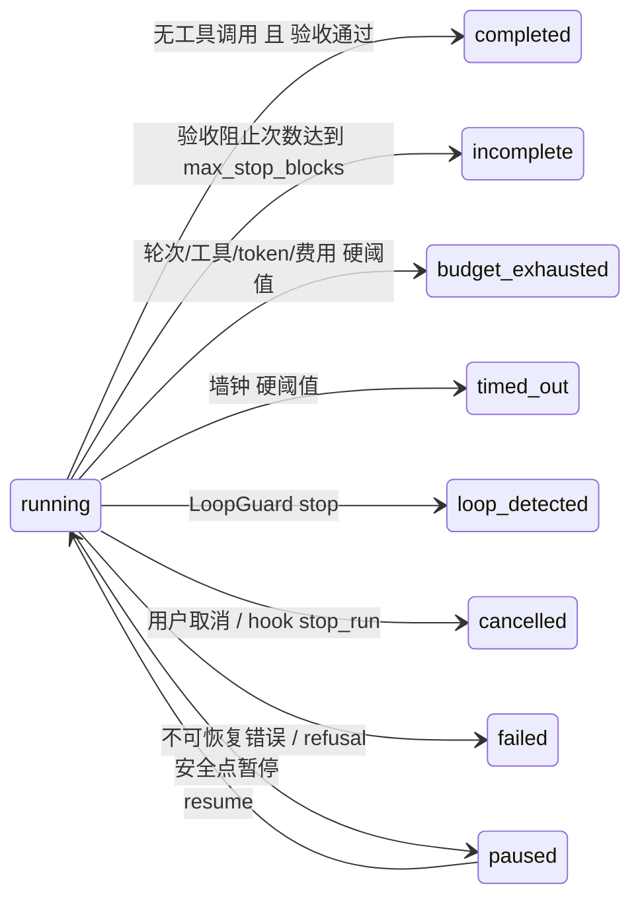
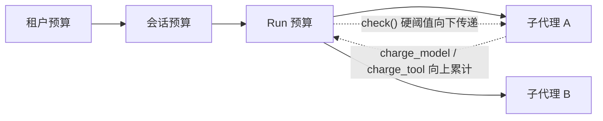

# 08 终止条件、预算与循环守卫

让 Agent 停下来不难，难的是 **停得诚实**：该停的时候能停住（不烧光预算、不原地打转），不该停的时候不提前收工，
停下时如实说明是“做完了”“没做完”“被限额截停”还是“出错了”。本章讲 `src/flywhl_harness/agent/budget.py` 的 `Budget` 与 `LoopGuard`，
以及 `AgentLoop` 中的 `_wrap_up()`、`_stop_gaps()` 如何把这几种结局区分开。

## 终止的四类来源

`budget.py` 的模块 docstring 把终止原因分成四类。对照 `AgentLoop._body()` 与 `run()` 中设置 `Outcome` 的位置：

| 来源 | 触发条件 | 结束状态 | 设置位置 |
|---|---|---|---|
| 自然完成 | 模型不再调用工具，且没有排队输入 | 验收通过 → `completed`；验收多次不通过 → `incomplete` | `_body()` 无工具分支 |
| 限额 | 轮次 / 工具调用 / token / 费用达到上限 | `budget_exhausted` | `_body()` 顶部 `budget.check()` |
| | 墙钟时间达到上限 | `timed_out` | 同上 |
| | 循环守卫判定无进展 | `loop_detected` | `_body()` 工具分支之后 |
| 外部 | 用户取消；hook 返回 `stop_run`（Claude Code 的 `continue: false`） | `cancelled`（`by` 记录发起人） | `run()` 的 `except RunCancelled`；`_body()` 的 `stop_requested` 检查 |
| 不可恢复错误 | 不可重试的模型错误、重试耗尽、拒答、未预料的异常 | `failed` | `run()` 的 `except ProviderError / Exception`；`_body()` 的 refusal 分支 |

另有 `paused`：它不是终止，Run 可以从检查点恢复。审批拒绝在本项目中 **不直接** 终止 Run——`ToolExecutor` 把它变成一条 `status=rejected` 的工具结果，
提示模型“调整方案或询问用户”；审批超时默认按拒绝处理。如果你的场景需要“拒绝即停止”，可以在 hook 中返回 `stop_run`。



### 为什么要如实区分

状态不是给人看的标签，而是下游决策的输入：

| 状态 | 调用方应当怎么做 |
|---|---|
| `completed` | 采纳产物；评测按产物判分 |
| `incomplete` | 阅读最后一次验收缺口，人工介入或带着缺口重新发起 |
| `budget_exhausted` | 阅读收尾总结；判断是加预算还是拆任务 |
| `timed_out` | 同上，另需检查是否有慢工具或卡住的外部依赖 |
| `loop_detected` | 换提示、换工具或补充信息；它通常意味着模型缺少某种能力或信息 |
| `cancelled` | 无需处理；`by` 字段用于审计 |
| `failed` | 查看 `error`（含 traceback 或模型错误分类），决定是否重跑 |

如果把 `budget_exhausted` 记成 `completed`，自动化流水线会把半成品当成交付物；如果把 `incomplete` 记成 `failed`，又会丢掉“已经做到哪一步”的信息。
`tests/test_loop.py::test_stop_hook_blocks_then_gives_up_honestly` 的注释说得直接：被阻止多次后仍未满足，就以 `incomplete` 结束，绝不伪装成 `completed`。

## Budget：五个维度的并联限额

```python
@dataclass
class BudgetConfig:
    max_turns: int = 40
    max_tool_calls: int = 200
    max_total_tokens: int | None = None
    max_cost_usd: float | None = None
    max_wall_seconds: float | None = None
    soft_ratio: float = 0.8                # 软阈值：80% 时提醒“请收尾并写进度”
    wrap_up_on_exhaust: bool = True        # 耗尽时让模型做一次无工具的总结性收尾
```

| 维度 | 计数方式 | 记账位置 | 需要注意 |
|---|---|---|---|
| 轮次 | 每次模型调用前 +1 | `_body()` 的 `rc.budget.next_turn()` | 收尾调用不计入 |
| 工具调用 | 每批执行后加上本批调用数 | `_body()` 的 `rc.budget.charge_tool(len(calls))` | 参数非法、被跳过的调用也计入——它们同样消耗了一轮模型输出 |
| token | `usage.total_tokens`，即输入 + 输出 + 缓存读 + 缓存写 | `charge_model(msg.usage)` | 缓存命中的 token 也计入：命中率很高的长会话，钱花得少，token 预算却照样消耗 |
| 费用 | `usage.cost_usd`（由 `compute_cost()` 按价格表算出） | 同上 | 价格表里没有的模型成本记 0，费用预算形同虚设，见 [05](/core/messages-and-models) |
| 墙钟 | `time.monotonic()` 自 `Budget` 创建起的秒数 | `elapsed` 属性 | 用单调时钟，不受系统时间调整影响 |

五个维度是“并联”的：任意一个达到上限都会触发。判定在 `Budget.check()`：

```python
def hard_verdict(self) -> BudgetVerdict | None:
    """只判断硬阈值（无副作用）。子预算用它检查上层预算，不会“消耗”上层的软提醒。"""
    hard = [(k, d) for k, (r, d) in self._ratios().items() if r >= 1.0]
    if hard:
        status = "timed_out" if any(k == "wall" for k, _ in hard) else "budget_exhausted"
        return BudgetVerdict("hard", [d for _, d in hard], status)
    if self.parent is not None:
        pv = self.parent.hard_verdict()
        if pv is not None:
            return BudgetVerdict("hard", [f"上层预算：{r}" for r in pv.reasons], pv.status)
    return None

def check(self) -> BudgetVerdict:
    """回合开始前调用：hard 表示必须停止；soft 表示应提醒模型收尾（每种原因只提醒一次）。"""
    hv = self.hard_verdict()
    if hv is not None:
        return hv  # 原因里只列真正超限的维度
    v = BudgetVerdict()
    for key, (ratio, desc) in self._ratios().items():
        if ratio >= self.limits.soft_ratio and key not in self._soft_warned:
            self._soft_warned.add(key)
            v.state = "soft"
            v.reasons.append(desc)
    return v
```

把判定拆成两步有两个原因：一是 **无副作用的硬阈值判断** 可以安全地沿上层链调用；二是硬阈值的原因列表里只出现真正超限的维度，
不会混进“只是越过软阈值”的维度。墙钟超限时状态为 `timed_out`，其余为 `budget_exhausted`。

::: warning 限额是在回合边界检查的
`check()` 只在 `_body()` 每轮开头调用一次，所以限额不是“精确到每个 token”的：
一批 10 个工具调用可以让 `tool_calls` 从 199 越过 200；一次长输出可以让费用越过上限；一次很慢的流式模型调用也不会被墙钟预算中途打断（那由 `request_timeout` 管）。
工具执行是例外：墙钟剩余时间会压缩工具超时（见下文 `deadline_left`）。把限额理解为“越过之后最多再多付一轮”的软上限，设置时留出余量。
:::

### 软阈值：提醒一次

比例达到 `soft_ratio`（默认 0.8）时返回 `soft`，`_body()` 登记一条 reminder：

```python
if verdict.state == "soft":
    rc.remind("预算即将用尽（" + "；".join(verdict.reasons) + "）。请优先完成最关键的部分，并为未完成的工作留下清晰的进度说明。")
```

它随后被 `_inject_reminders()` 作为 `kind=reminder` 的消息 **落盘**。每种原因只提醒一次（`_soft_warned`），原因有二：
历史只追加，这条提醒在之后的每次请求里都还在，重复发送没有新信息；反复催促“快结束”还会把模型推向过早停止。
提醒的措辞也有讲究：要求“优先完成最关键的部分并留下进度说明”，而不是“立即停止”。

### 硬阈值：`_wrap_up()` 收尾而不是截断

```python
async def _wrap_up(self, reason: str) -> AsyncIterator[Event]:
    """预算耗尽：不直接截断，而是让模型做一次 **无工具** 的总结性收尾，留下可交接的产物。"""
    rc = self.rc
    if not rc.config.budget.wrap_up_on_exhaust:
        return
    yield self._ev(E.NOTICE, level="warn", code="budget_exhausted", text=f"达到限额（{reason}），进入收尾")
    yield self._append(user_message(WRAP_UP_PROMPT.format(reason=reason), kind=MsgKind.WRAP_UP))
    self.turn += 1
    yield self._ev(E.TURN_START, turn=self.turn, wrap_up=True)
    try:
        async for ev in self._call_model(purpose="wrap_up", tool_choice="none"):
            yield ev
    except (ProviderError, _ContextOverflow):
        return
    if self._last is not None:
        rc.budget.charge_model(self._last.usage)
        for c in self._last.tool_calls:  # 模型无视了 tool_choice=none：不执行，只补结果保证配对
            yield self._persist_tool_error(c, "未执行：已达到限额，收尾阶段不允许调用工具。", "skipped")
    yield self._ev(E.TURN_END, turn=self.turn)
```

`src/flywhl_harness/prompts.py` 的 `WRAP_UP_PROMPT` 要求模型总结三件事：已完成什么（附文件路径等证据）、还没完成什么、建议的下一步。设计要点：

| 决策 | 原因 |
|---|---|
| 再花一次模型调用做总结 | 直接截断时，最后一条消息可能是一个工具调用，人拿到的只有一堆中间状态；多付一次调用换一份可交接的进度说明 |
| 保留 tools 定义，只设 `tool_choice="none"` | 删除工具会改变请求前缀、打碎缓存；部分 provider 还要求历史里出现过的工具必须有定义（见 `ModelRequest` 注释） |
| 模型无视 `none` 时不执行，只补 `skipped` 结果 | 限额就是限额；补结果是为了保持配对，会话以后还能继续 |
| 收尾失败时静默返回 | Run 的主因是限额，不应被收尾阶段的模型错误改写成 `failed` |
| 收尾调用不计轮次，但计用量 | 最终用量可能略超上限，这是有意的取舍 |

`tests/test_loop.py::test_budget_exhausted_wraps_up` 用 `max_turns=2` 验证：结束状态是 `budget_exhausted`，历史里有一条 `kind=wrap_up` 的消息，
最后一次请求的 `purpose == "wrap_up"`、`tool_choice == "none"` 且 `tools` 非空。

### 分层预算：`child()` 切出、消耗向上累计

```python
def charge_model(self, usage: Usage | None) -> None:
    if usage is None:
        return
    self.usage = self.usage + usage
    if self.parent is not None:
        self.parent.charge_model(usage)

def child(self, limits: BudgetConfig | None = None) -> "Budget":
    """为子代理切出预算：不超过父预算的剩余额度。"""
    lim = limits or BudgetConfig(max_turns=20, max_tool_calls=60)
    if self.limits.max_cost_usd is not None:
        remain = max(0.0, self.limits.max_cost_usd - self.usage.cost_usd)
        lim.max_cost_usd = min(lim.max_cost_usd or remain, remain)
    if self.limits.max_total_tokens is not None:
        remain_t = max(0, self.limits.max_total_tokens - self.usage.total_tokens)
        lim.max_total_tokens = min(lim.max_total_tokens or remain_t, remain_t)
    return Budget(lim, parent=self, clock=self.clock)
```



三条规则：

1. **切出**：费用与 token 上限取“子代理自己的配置”与“父预算剩余额度”中较小者；轮次与工具调用数是子代理自己的（`Harness.run_subagent()` 传入 `max_turns` 与 `max_turns * 4`）。
2. **累计**：`charge_model()` / `charge_tool()` 沿 `parent` 链向上加；`next_turn()` 不向上传——父 Run 的“轮次”指的是父 Loop 的模型调用次数。
3. **传递**：子预算 `check()` 时通过 `hard_verdict()` 检查上层（只看硬阈值、无副作用），上层超限则子代理以 `上层预算：...` 为原因停止。

于是“租户 → 会话 → Run → 子代理”的层级上限天然成立。不过要注意，本项目只实际搭了 Run → 子代理这两层：`Harness._build_rc()` 为每个 Run 新建 `Budget(cfg.budget)`，没有父级。
租户与会话层是这个机制的扩展点——构造 Run 预算时传入 `parent` 即可。

两个值得留意的边界：

- 早期版本里子预算检查父预算调用的是 `parent.check()`，会在父预算上登记 `_soft_warned`：父预算恰好在子代理运行期间越过软阈值时，
  这条软提醒被子代理“消耗”掉，父 Loop 再也收不到。拆出无副作用的 `hard_verdict()` 之后问题消失（`tests/test_loop.py::test_child_budget_does_not_consume_parent_soft_warning`）。
  有副作用的“检查”函数被复用到另一个调用方时，副作用往往就成了 bug。
- 剩余额度为 0 时，子预算的 `max_cost_usd` 被设为 `0.0`，而 `_ratios()` 用 `if lim.max_cost_usd:` 判断是否启用该维度，0 会被当作“不限”。
  这里不会出事，因为父预算已经超限，第 3 条规则会让子代理停下；但如果你改写了传递逻辑，这个隐含依赖就会暴露。

### `deadline_left()`：截止时间沿调用链传递

```python
def deadline_left(self) -> float | None:
    """剩余墙钟时间：沿调用链传给工具超时，“剩余时间不够就不重试”。子预算取自身与上层的较小值。"""
    own = max(0.0, self.limits.max_wall_seconds - self.elapsed) if self.limits.max_wall_seconds else None
    up = self.parent.deadline_left() if self.parent is not None else None
    vals = [x for x in (own, up) if x is not None]
    return min(vals) if vals else None
```

`ToolExecutor._invoke()` 用它压缩工具超时：`timeout = max(1.0, min(timeout, left))`。这与 gRPC deadline、Go 的 `context.WithDeadline` 是同一个思路：
往下传的是“绝对截止时间”，而不是每层各自独立的超时——否则 Run 只剩 10 秒，一个 120 秒超时的工具仍会把 Run 拖到 130 秒。

截止时间在三处向下传递：

- **子代理**：`deadline_left()` 取自身与上层的较小值，子代理里的工具同样受父 Run 截止时间约束；
- **自管超时的工具**（`Tool.manages_timeout`，如 bash）：执行器把剩余时间放进 `ctx.time_left`，bash 用它收紧自己的超时，执行器只在其外留 10 秒兜底；
- **瞬时重试**：`_invoke()` 在重试前检查剩余时间，不够再等一次退避就不重试。

早期版本这三处都有缺口（子代理不继承父级墙钟、bash 的命令超时覆盖截止时间、瞬时重试不看剩余时间）——“截止时间传递”只要有一层漏掉，整条链就会被拖长。

## LoopGuard：区分“死循环”与“合理轮询”

```python
@staticmethod
def signature(name: str, args: dict) -> str:
    return short_hash(name + canonical_json(args))

def observe(self, name: str, args: dict, result_text: str, is_error: bool) -> LoopVerdict:
    sig = self.signature(name, args)
    self.recent.append((sig, short_hash(result_text)))
    self.consecutive_errors = self.consecutive_errors + 1 if is_error else 0
    if name in ("edit", "write") and not is_error and args.get("path"):
        self.edit_counts[str(args["path"])] += 1

    dup = sum(1 for x in self.recent if x == self.recent[-1])
    if dup >= self.cfg.stop_repeats:
        return LoopVerdict("stop", f"相同调用 {name} 已连续 {dup} 次得到相同结果，判定为死循环。")
    if dup >= self.cfg.warn_repeats and f"dup:{sig}" not in self._warned:
        self._warned.add(f"dup:{sig}")
        return LoopVerdict("warn", f"你已经 {dup} 次以相同参数调用 {name} 且结果相同。...")
    # ... 乒乓、连续错误、同一文件反复编辑
```

签名用 `canonical_json()`（键排序、紧凑分隔符），所以 `{"a":1,"b":2}` 与 `{"b":2,"a":1}` 是同一个调用。真正关键的是 **签名 + 结果哈希** 一起比较：

| 模式 | 判定依据 | 默认阈值（`LoopGuardConfig`） | 动作 |
|---|---|---|---|
| 重复调用 | 最近 `window=12` 次中，(签名, 结果哈希) 与最新一次相同的次数 | `warn_repeats=3`、`stop_repeats=5` | 先提醒，后 `loop_detected` |
| 乒乓 A-B-A-B | 最近 6 次签名两两交替 | 固定 6 次 | 只提醒（全局一次） |
| 连续错误 | 连续 `is_error` 次数 | 达到 `max(3, N//2)` 提醒，达到 `max_consecutive_errors=6` 停止 | 先提醒，后 `loop_detected` |
| 同一文件反复编辑 | 成功的 `edit` / `write` 按路径计数 | `same_file_edit_warn=6` | 只提醒（每个文件一次） |

最后一条在 `LoopGuard` 的 docstring 里注明借鉴自 LangChain LoopDetectionMiddleware 的做法：同一个文件改了六次还没改好，通常是方案本身有问题，而不是“再改一次就好”。

用同一组观测喂给 `LoopGuard`（实验代码见本章末尾）得到：

| 场景 | 每次观测的结果 |
|---|---|
| 同一 `ls`、结果相同，5 次 | ok, ok, **warn**, ok, **stop** |
| 轮询 `bash status`，结果依次为 `progress 0%`…`5%` | 全部 ok |
| 轮询 `bash status`，结果一直是 `running` | ok, ok, **warn**, ok, **stop** |
| `ls` 与不同的 `read` 交替，`ls` 结果相同 | 第 3 次 `ls` 时 warn，第 5 次 `ls` 时 stop |
| `read a` / `read b` 交替 6 次，结果各不相同 | 第 6 次 warn（乒乓只看签名） |

第三行说明了为什么“轮询应做成带超时的专用工具”：结果不变的轮询在守卫看来与死循环无法区分，而且每次轮询都要付一轮模型调用。
把“等到条件满足或超时”放进一个工具内部（例如在工具里循环检查构建状态，最长等 N 秒后返回），模型只需调用一次，守卫也不会误判。
第四行则说明重复次数是在窗口内统计的，并不要求严格连续——穿插其它调用不能绕过检测，提示文案也据此写成“最近 N 次调用中出现了 M 次”。

`warn` 时 `_body()` 同时做两件事：`rc.remind(v.message)` 让模型在下一轮看到提醒（落盘为 reminder），并发出 `notice(code=loop_guard)` 事件给 UI。
`tests/test_loop.py::test_loop_guard_stops_dead_loop` 断言停止之前一定先提醒过一次，且历史里有提到“相同参数”的 reminder。

::: tip 预算跨暂停与崩溃延续，守卫状态不延续
`Budget` 的计数（轮次、工具调用、usage、已用墙钟）每轮都写进 Run 的检查点（`checkpoint["budget"]`），
`resume()` / `recover()` 重建 RunContext 时用 `Budget.restore()` 接着计数，暂停期间不计入墙钟——否则反复“暂停 → 恢复”就能绕过限额
（`tests/test_cancel.py::test_budget_and_inbox_survive_pause`）。`LoopGuard` 的滑动窗口则不延续：恢复后从零观察，
最坏情况是多容忍几次重复调用，属于可以接受的宽松。
:::

## Stop 验收：完成是产物的属性

`AgentLoop._stop_gaps()` 的 docstring 只有一句话：“完成是产物的属性，不是对话的属性”。模型说“完成了”只是一个 **停止请求**，harness 要检查产物：

```python
async def _stop_gaps(self, msg: Message) -> list[str]:
    rc = self.rc
    gaps: list[str] = []
    if rc.config.verify_todos:
        todos = latest_todos(rc.log.context().messages)
        if todos and any(t.get("status") in ("pending", "in_progress") for t in todos):
            gaps.append("计划中仍有未完成项：\n" + render_todos([...]))
    if rc.config.verify_command and rc.role == "main":
        ok, out = await _run_verify(rc.config.verify_command, str(rc.workspace.root))
        if not ok:
            gaps.append(f"验收命令 `{rc.config.verify_command}` 未通过：\n{out}")
    event = HookEvent.STOP if rc.role == "main" else HookEvent.SUBAGENT_STOP
    if rc.hooks.has(event):
        out = await rc.hooks.run(event, HookInput(..., stop_blocks=rc.stop_blocks, last_message=msg.text, context=rc))
        if out.decision == "block":
            gaps.append(out.reason or "Stop hook 阻止结束")
            if out.additional_context:
                gaps.append(out.additional_context)
        elif out.additional_context:
            self._stop_note = out.additional_context  # 不阻止结束：作为提醒落盘，留给本会话的下一次 Run
        if out.stop_run:
            rc.stop_requested = out.reason
    return gaps
```

| 验收项 | 配置 | 判定 | 适用 |
|---|---|---|---|
| 计划 | `verify_todos=True` | 最近一次 `todo_write` 中仍有 `pending` / `in_progress` | 模型用过 todo 时 |
| 验证命令 | `verify_command`，如 `"pytest -q"` | 退出码非 0；超时 300 秒；取输出最后 30 行作为缺口说明 | 仅主 Run（`_no_verify()` 也为子代理清空了它） |
| Stop hook | `HookEvent.STOP` / `SUBAGENT_STOP` | hook 返回 `decision="block"`（`additional_context` 并入缺口）；不阻止时给的 `additional_context` 在完成时作为一条 reminder 落盘 | 任意自定义条件 |

有缺口时，`_body()` 的处理是“有限次阻止，然后如实上报”：

```python
gaps = await self._stop_gaps(msg)
if gaps:
    if rc.stop_blocks < rc.config.max_stop_blocks:
        rc.stop_blocks += 1
        # ... notice(code=stop_blocked)
        yield self._append(user_message(reminder(
            "你准备结束，但验收尚未通过：\n" + "\n".join(f"- {g}" for g in gaps)
            + "\n请继续完成；如果确实无法完成，请如实说明原因。"), kind=MsgKind.STOP_FEEDBACK))
        continue
    self.outcome = Outcome("incomplete", "多次验收未通过：" + "；".join(gaps))
    return
```

- **为什么要有上限。** 没有 `max_stop_blocks`（默认 3），一个永远无法满足的验收会让 Loop 一直跑到预算耗尽，最终状态是 `budget_exhausted`，掩盖了真正的原因“验收不通过”。
- **为什么给模型一个诚实的出口。** 反馈里明确写着“如果确实无法完成，请如实说明原因”。只施压不给出口，模型更可能编造一个“完成了”的说法或做表面修改来通过检查。
- **`stop_blocks` 在整个 Run 内累计**，follow-up 进来的新任务不会重置它。
- **验收期间到达的输入不会丢。** 验收通过后、返回 `completed` 前，Loop 再检查一次收件箱，有新输入就继续处理（见 [04 Agent Loop](/core/agent-loop)）。
- **验证命令只在模型想停下时执行**，而不是每次编辑后。配置了 `pytest -q` 的 Harness，连一个纯问答 Run 也会在结束时跑一遍测试——这正是限额与验收要按任务类型配置的原因之一。

`tests/test_loop.py::test_todo_verification` 演示了计划验收：模型第一次说“好了”时计划里还有 `pending` 项，被阻止；更新计划后才以 `completed` 结束。

## 过早停止与虚报完成

“Agent 说做完了，其实没做完”是长任务里最常见的失败之一。它很少是单一原因造成的：

| 根因 | 表现 | harness 层面的解法 | 本项目的对应 |
|---|---|---|---|
| 训练偏好简洁地结束回合 | 做完一部分就总结，或把“下一步建议”当作完成 | 显式的停止验收，不以模型自述为准 | `_stop_gaps()`、`max_stop_blocks` |
| 上下文压力 | 窗口接近上限、提醒频繁时急于收尾 | 压缩与外置降低水位；提醒只发一次，措辞要求“留进度”而非“停止” | [07](/core/context-engineering)、软阈值提醒 |
| 缺少显式验收 | “完成”的标准只存在于对话里 | 验收数据化：计划是结构化数据，验证命令有退出码 | `todo_write` + `verify_todos`、`verify_command` |
| 评测只看文本 | 最终回复写着“已完成”就判通过 | 按产物判分；把过早停止率单独统计 | [22 轨迹、回放与评测](/multi-agent/trajectory-eval) |
| Mock 掩盖真实行为 | 脚本化模型永远按剧本走，测试全绿，真实模型却提前停 | 用真实轨迹录制回放；在真实模型上跑评测 | `ReplayProvider` |

在此之上还有两种更强的手段：

- **完成工具强制附证据。** 让“声明完成”本身是一次结构化的工具调用或契约，必须附上产物路径与证据，并由 harness 核验。
  本项目的子代理回传契约就是这样：`src/flywhl_harness/agent/subagent.py` 的 `check_contract()` 校验 JSON 结构，并检查 `artifacts` 中声明的文件是否真实存在，
  不存在时把 `status` 从 `ok` 降为 `partial`，见 [20 子代理与回传契约](/multi-agent/subagents)。
- **独立验证者。** 由另一个上下文（另一个子代理或另一个模型）只看产物与验收标准做判定，避免“自己批改自己的作业”。本项目没有内置，可以用 Stop hook 调用一个验证子代理来实现。

## 限额按任务类型配置

`config.py` 的 docstring 给了一个对比：交互式问答 `max_turns=20` 足够，迁移整个仓库可能需要 200 轮。可以按下面的思路准备多份配置（数值是起点，需要按自己的任务分布调整）：

| 任务类型 | 主导维度 | 配置思路 |
|---|---|---|
| 交互式问答 / 小修改 | 轮次、墙钟 | 轮次低、墙钟短，用户在场随时可以 steer；不配置 `verify_command` |
| 无人值守的修复任务（CI） | 费用、墙钟、验收 | 费用上限是硬约束；配置 `verify_command`；`max_stop_blocks` 适当提高 |
| 大规模重构 / 迁移 | 费用、token | 轮次与工具调用放宽；依赖压缩与软阈值留进度；配合 [24 长时任务 Harness](/advanced/long-running) 分段执行 |
| 探索型子代理 | 轮次 | 由 `task` 工具的 `max_turns` 参数（1–60，默认 15）逐次指定，工具调用上限自动设为 4 倍 |

本项目中限额来自 `HarnessConfig`（默认值 → `flywhl.toml` → 环境变量 → 显式参数），CLI 用 `-c/--config` 指定配置文件：

```toml
# 顶层字段必须写在任何 [table] 之前，否则会被归入上一个表
max_stop_blocks = 5
verify_command = "pytest -q"

[budget]
max_turns = 120
max_cost_usd = 3.0
max_wall_seconds = 3600

[loop_guard]
stop_repeats = 6
```

`Harness.start_run()` 目前不接受逐 Run 的预算参数，同一个 Harness 内的所有主 Run 共享一套限额；需要逐任务区分时，可以为不同任务类型准备不同的 Harness 实例，或扩展 `start_run()`。

## 动手验证

::: code-group

```bash [单元测试]
.venv/bin/python -m pytest -q \
  tests/test_loop.py::test_budget_exhausted_wraps_up \
  tests/test_loop.py::test_loop_guard_stops_dead_loop \
  tests/test_loop.py::test_stop_hook_blocks_then_gives_up_honestly \
  tests/test_loop.py::test_todo_verification \
  tests/test_runtime.py::test_subagent_contract
```

```python [守卫与预算实验]
# 保存为任意 .py 文件，用 .venv/bin/python 运行
from flywhl_harness.agent.budget import Budget, LoopGuard
from flywhl_harness.config import BudgetConfig, LoopGuardConfig
from flywhl_harness.types import Usage

def run(title, seq):
    g = LoopGuard(LoopGuardConfig())
    print(title, [g.observe(n, a, r, e).action for n, a, r, e in seq])

run("死循环", [("ls", {"path": "."}, "a b", False)] * 5)
run("轮询(结果变化)", [("bash", {"command": "status"}, f"progress {i}%", False) for i in range(6)])
run("轮询(结果不变)", [("bash", {"command": "status"}, "running", False)] * 5)
run("间隔重复", [x for i in range(5) for x in [("ls", {"path": "."}, "a b", False),
                                              ("read", {"path": f"f{i}"}, "x", False)]])

# 分层预算：消耗向上累计；子预算检查上层时只看硬阈值，不会“消耗”上层自己的软提醒
parent = Budget(BudgetConfig(max_turns=10, max_tool_calls=10, max_cost_usd=1.0))
parent.charge_model(Usage(cost_usd=0.5))
child = parent.child(BudgetConfig(max_turns=5, max_tool_calls=20))
print("子代理费用上限", child.limits.max_cost_usd)        # 0.5：父预算剩余额度
child.charge_tool(9)
print("父预算工具调用", parent.tool_calls)                # 9：向上累计
print("子预算判定", child.check().state)                 # ok
print("父预算判定", parent.check().state)                # soft：9/10 越过软阈值，提醒留给父 Loop 自己
```

:::

**Web UI。** 运行 `.venv/bin/flywhl serve -w playground`，使用内置演示模型：

1. 输入“循环测试”：演示模型连续 7 次调用同一个 `ls`。事件页签里先出现 `notice(code=loop_guard)` 的提醒，第 5 次后 Run 以 `loop_detected` 结束，剩下的调用不会再发出。
2. 输入“制定计划”：观察 `todo_write` 逐步把计划项更新为 `completed`；模型在计划完成之后才停止，Run 以 `completed` 结束。
3. 在检查器的“概览”页签观察预算快照（`usage` 事件）：轮次、工具调用数随每轮增长。

## 小结与延伸思考

- 终止来源分四类：自然完成（需过验收）、限额、外部、不可恢复错误；结束状态逐一区分，`incomplete` 与 `budget_exhausted` 绝不记成 `completed`。
- `Budget` 是五个维度的并联限额：软阈值提醒一次并要求留进度，硬阈值用 `tool_choice="none"` 做一次可交接的收尾；分层预算切出、累计、传递。
- `LoopGuard` 用“签名 + 结果哈希”区分死循环与轮询，先提醒后停止；结果不变的轮询应改成带超时的专用工具。
- Stop 验收把“完成”定义为产物的属性，有限次阻止后如实上报 `incomplete`。

延伸思考：

1. 软阈值提醒会不会反过来诱发过早停止？如何在评测中把“被提醒后提前收尾”的比例单独统计出来？
2. `LoopGuard` 只观察工具调用。如果模型连续几轮只输出文字、不调用工具也不结束（例如反复向自己提问），哪一种机制会兜住它？
3. 如果要让预算在暂停 / 恢复与崩溃接管后继续累计，应该把哪些计数放进检查点？墙钟时间应该按“实际运行时长”还是“自创建起的时长”计算？参考 [11 检查点与崩溃恢复](/reliability/checkpoint-recovery)。
