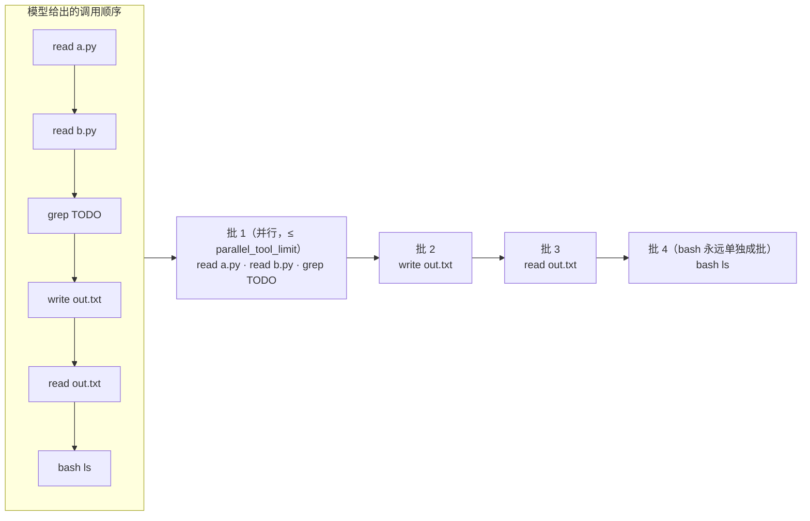

# 06 工具系统（ACI）

模型自己什么也做不了，它对世界的每一次读写都要经过工具。工具定义写得好不好、harness 怎么执行一轮里的多个调用、
失败和超大结果怎么回给模型，这三件事基本决定了 Agent 能做到什么程度。本章先讲设计原则，再逐段精读
`tools/` 与 `agent/executor.py` 的实现。

## 工具是给模型用的界面

SWE-agent 论文把这层叫作 **ACI（Agent-Computer Interface）**：人用 IDE 和终端，模型用一组为它设计的命令。
它和给人用的 API 不一样：

| 维度 | 给程序员的 API | 给模型的工具（ACI） |
|---|---|---|
| 怎么读文档 | 查文档、看源码、试错 | 只能看 `name` / `description` / 参数 schema，而且每轮都要重新读 |
| 出错后怎么办 | 读堆栈、打断点 | 只能读你返回的那段文字，然后再试一次 |
| 返回值有什么代价 | 几乎没有 | 每个字节都占上下文窗口，后面每一轮都要再付一次钱 |
| 调用粒度 | 越正交越好 | 应围绕任务意图；能一次做完的事别拆成五步 |
| 副作用 | 调用方自己负责 | harness 必须知道副作用多大，才能决定并发、重试、审批、取消 |

`tools/base.py` 的模块注释把一个工具定义归纳成五个问题，后面整章基本都在展开这张表：

| 问题 | 对应字段 | 谁消费它 |
|---|---|---|
| 叫什么、干什么 | `name` / `description` | 模型（工具选择） |
| 参数长什么样 | `parameters`（JSON Schema） | 模型（生成参数）+ `validate()`（防呆） |
| 副作用多大 | `effect` / `effect_for()` | 执行器（并发、重试）、权限层（审批）、恢复（对账） |
| 能不能中途打断 | `interruptible` / `interruptible_for()` | `_race()`（取消时中止还是等完成） |
| 结果给谁看 | `ToolResult.content` / `details` | `content` 给模型，`details` 只给 UI |

## 设计原则：每一条都有反例

| 原则 | 反例 | 正例（本项目中的体现） |
|---|---|---|
| 粒度围绕任务意图 | `list_files` + 逐个 `read` 去找一个函数定义 | `grep` 的描述直接写“先用 grep 定位，再用 read 查看上下文，比整文件读取省得多” |
| 命名用动词_名词，必要时加命名空间 | `helper`、`do_it`；两个 MCP 服务器都有 `search` | `todo_write`、`read_ref`、`search_ref`；MCP 工具统一命名为 `mcp__{server}__{name}` |
| 防呆写进 schema 而不是只写在描述里 | `status: string`，描述里写“可选 pending/done…” | `todo_write.status` 用 `enum`；`read.limit` 限定 `1..5000`；全部 `additionalProperties: false` |
| 单位、格式、默认值写进 description | `timeout: integer` | bash 的 `timeout`：“超时秒数，默认 120”，并且 `minimum: 1, maximum: 1800` |
| 只返回高信号内容 | 返回整个 JSON 对象、内部 UUID | grep 返回 `路径:行号: 内容`；read 带行号，便于后续 `edit` 精确定位 |
| 告诉模型还有多少 | 静默截断 | read：“已显示第 1–2000 行，共 5310 行。继续读取请使用 offset=2001” |
| 错误要说清哪里错、为什么、怎么改 | `Error: invalid input` | edit：“old_string 在文件中出现 3 次（第 [4, 18, 40] 行）。请补充更多上下文使其唯一，或设置 replace_all=true” |
| 写操作接受幂等键 | 重试一次发两封邮件 | `ToolContext.idempotency_key = run_id:call_id`，跨崩溃重启也不变（见 [14 幂等与副作用](/reliability/idempotency)） |
| 给模型的和给人的分开 | 把整段 diff 塞回上下文 | write/edit 的 `content` 只有一句话，unified diff 放在 `details` 里给 UI 渲染 |

这几条大多能在 Anthropic 的《Writing effective tools for agents》里找到对应：合并成任务级工具、命名空间前缀、
用有语义的名字代替 UUID、分页/过滤/截断要有合理默认值并附带引导语、错误信息要具体到能照着改。
那篇文章还建议提供 `response_format`（concise / detailed）开关，本项目的内置工具没有实现，扩展时可以参考。

::: tip 描述是写给模型的提示词
工具描述和参数说明每轮都会随请求发出，相当于系统提示的一部分。写描述时应当像给一位刚入职的同事写交接文档：
什么时候该用这个工具、什么时候不该用、和相邻工具的分工（`write` 的描述就写了“修改已有文件的局部内容请优先使用 edit”）。
:::

## 工具抽象：Tool / ToolResult / ToolContext

```python
# src/flywhl_harness/tools/base.py
class Tool:
    name: str = ""
    description: str = ""
    parameters: dict[str, Any] = {"type": "object", "properties": {}}
    effect: Effect = Effect.READ
    interruptible: bool = True       # 取消时能否直接中止
    idempotent: bool = False         # 用同一幂等键重复执行是否安全
    timeout: float | None = None     # None = 使用全局 tool_timeout
    untrusted_output: bool = False   # 输出是否天然不可信（污点来源）
    manages_timeout: bool = False    # 工具自己管理超时（如 bash），执行器只在其外留余量兜底
    cancel_grace: float | None = None  # 不可中断时的取消宽限期；None = 使用全局 cancel_grace_seconds

    async def execute(self, args, ctx: ToolContext) -> ToolResult: ...
    async def reconcile(self, args, ctx) -> ToolResult | None:  # 崩溃后凭幂等键对账
        return None
    def interruptible_for(self, args, workspace=None) -> bool:  # 按参数判定可中断性
        return self.interruptible
    def effect_for(self, args, workspace=None) -> Effect:       # 动态副作用等级（workspace：工作区根目录）
        return self.effect
    def untrusted_for(self, args) -> bool:                      # 这次输出是否不可信（bash 下载网页时为 True）
        return self.untrusted_output
    def preview(self, args, ctx) -> str | None:                 # 审批前的变更预览（write / edit 返回 diff）
        return None
    def permission_target(self, args) -> str: ...               # 权限规则匹配目标：path / command / url / to
    def describe_call(self, args) -> str: ...                   # 审批弹窗与 UI 卡片标题

    @property
    def concurrency_safe(self) -> bool:
        return self.effect == Effect.READ
```

这些属性都是**声明式**的：工具只说明“我是什么”，并发、重试、审批、取消、恢复这些决策全部由 harness 统一做。
新增一个工具时只要把属性填对，整套策略就自动生效；反过来，如果每个工具自己实现重试和权限，策略很快就会各不相同。

`ToolResult` 有四个字段：`content`（给模型）、`is_error`、`details`（给 UI，不送模型）、`tainted`（结果来自不可信来源，
后续副作用操作的审批会提级，见 [19 安全](/governance/security)）。`ToolContext` 是工具接触外界的唯一入口：

| 字段 | 用途 |
|---|---|
| `workspace` | 路径解析与越界检查（`resolve()` 抛 `PathEscape`） |
| `cancel` | 协作式取消令牌；长循环里调用 `raise_if_cancelled()` |
| `blobs` + `session_id` | 外置大结果；`session_id` 实际传入的是 `rc.scope`，子代理与根会话共享同一范围 |
| `idempotency_key` | `run_id:call_id`，交给外部系统去重 |
| `emit` | 推送 `tool_update` 事件（bash 的实时输出） |
| `state` | Run 级共享字典（文件 mtime 表、edit 次数、todo） |

工具只通过 `ctx` 接触外界，所以测试时换一个临时工作区、内存存储，工具代码一行都不用改。

### `@tool` 装饰器与 `schema_from_signature`

写自定义工具最快的方式是装饰一个 async 函数：

```python
# examples/01_minimal_loop.py
@tool(effect=Effect.READ)
async def weather(city: Annotated[str, "城市名，如 上海"], unit: Annotated[str, "温度单位"] = "C") -> str:
    """查询城市当前天气（演示用的假数据）。"""
    if city == "火星":
        raise RuntimeError("火星气象站离线")
    return f"{city}：晴，23°{unit}"
```

`FunctionTool` 用函数名做 `name`，docstring 做 `description`，签名推导出 `parameters`；
如果函数签名里有 `ctx` 参数就注入 `ToolContext`；返回值不是 `ToolResult` 时转成字符串。推导规则在 `tools/schema.py::_annotation_schema`：

| Python 注解 | 生成的 schema |
|---|---|
| `Annotated[T, "描述"]` | `T` 的 schema + `description`；元数据是 dict 时直接合并（可写 `{"minimum": 1}`） |
| `Literal["a", "b"]` | `{"enum": ["a", "b"], "type": "string"}`（全为字符串时才加 type） |
| `X \| None` | 去掉 None，等同于 `X` |
| `int \| str` | `{"anyOf": [...]}` |
| `list[str]` | `{"type": "array", "items": {"type": "string"}}` |
| 无默认值 / 有默认值 / 默认 `None` | 必填 / 可选并写入 `default` / 可选但不写 `default` |

`schema_from_signature()` 最后统一加上 `additionalProperties: False`。这样模型编造出不存在的参数名时会立刻得到
“存在未知参数 […]，允许的参数为 […]”，而不是参数被悄悄忽略、模型以为它生效了。

## 副作用三级：整个策略体系的“主键”

| Effect | 示例 | 并发 | 自动重试 | 默认审批 | 取消时 |
|---|---|---|---|---|---|
| `READ` | 读文件、搜索、查询 | 可并发 | 可 | 放行 | 立即中止 |
| `WRITE` | 写工作区文件（可快照回滚） | 串行 | 带幂等键 | 按权限模式 | 中止，可回滚 |
| `EXTERNAL` | 发通知、下发指令、改生产数据 | 串行 | 否 | 必须确认 | 等待完成或标记未知 |

这张表的每一列都对应一处代码：

| 列 | 实现位置 |
|---|---|
| 并发 | `Tool.concurrency_safe` + `Prepared.parallel`（要求 `effect_for(args) == READ`） |
| 自动重试 | `ToolExecutor._invoke`：`TransientToolError` 只在 `effect_for(args) == READ or tool.idempotent` 时重试 |
| 默认审批 | `policy/permissions.py`，按模式与等级裁决（见 [17 权限与人审](/governance/permissions-hitl)） |
| 取消时 | `ToolExecutor._race`：看 `interruptible_for(args)`，不看 `effect` |
| 超时时 | `ToolExecutor._race`：`EXTERNAL` 且非幂等记为 `unknown`（请求可能已经生效），其余记为 `timeout` |

注意最后一行：**副作用等级和可中断性是两个独立的维度**。`send_notification`（`tools/demo.py`）是 `EXTERNAL`、
不可中断、幂等并实现了 `reconcile`；一个调用外部只读 API 的工具可以是 `READ` 但请求一旦发出就不该中断。
MCP 工具的映射就是例子：`readOnlyHint` 为真则 `READ` 且可中断，否则 `EXTERNAL` 且不可中断；`openWorldHint` 映射为
`untrusted_output`，按 MCP 规范默认为 true（`tools/mcp.py::MCPTool.__init__`）。

超时与取消的处理方式看的是同一件事：**副作用发出之后，“没收到回复”不等于“没有发生”**。本地命令超时可以杀掉进程组、
如实说“已中止”；付款、发通知这类非幂等的外部调用超时，结果只能是“未知”——执行器给出 `status=unknown`，
提示模型先核实外部状态再决定是否重试（`tests/test_cancel.py::test_external_timeout_is_unknown_not_plain_timeout`）。

### `effect_for`：按参数动态定级

同一个 `bash`，`ls` 是只读，`pytest` 会写文件，`git push` 会影响外部。所以 bash 在调用时才定级：

```python
# src/flywhl_harness/tools/shell.py::BashTool
def effect_for(self, args: dict[str, Any], workspace: str | None = None) -> Effect:
    level = analyze(str(args.get("command", "")), workspace).level
    return {"read": Effect.READ, "write": Effect.WRITE}.get(level, Effect.EXTERNAL)

@property
def concurrency_safe(self) -> bool:
    return False  # 即使是只读命令也串行执行：命令间常有隐式顺序依赖（先 build 再 test）
```

`analyze()` 把命令切成段、逐段分为 read / write / external / dangerous 四级、整体取最大值，无法静态分析的结构
（子 shell、解释器内联代码）一律按 external 处理。dangerous 在这里也落到 `EXTERNAL`，真正的拦截由权限层做。

执行器会调用两次 `effect_for`：第一次在 `_run_one` 开头，用于 `tool_start` 事件；第二次在权限、hooks、审批全部处理完之后，
用于决定要不要做写前快照。这是有意为之：PreToolUse hook 和审批人都可能改写参数，**定级必须基于最终要执行的参数**。

两处都要传工作区根目录，和权限层用同一个口径：模型常用绝对路径指向工作区里的文件，`cat /ws/app.py` 不带工作区分析会被当成
越界读取（external），权限层带着工作区却判为只读——早期版本就是这样，plan 模式放行了它，执行器却把它记成 external。
执行器、权限层与回放统一通过 `Tool.effect_in(args, workspace)` 取等级；只接受 `args` 的旧覆盖写法照常工作，只是拿不到工作区。

::: details 为什么 todo_write 是 READ？
`todo_write` 只修改 harness 内部的 `ctx.state`，不碰工作区和外部系统，重复执行也没有害处。把它标为 `READ`，
它就能和其它只读调用并行、不需要审批、取消时可以直接中止。副作用等级描述的是“对外部世界的影响”，不是“有没有写变量”。
:::

## 一轮多个调用：安全并行

模型一次返回多个工具调用很常见（“同时读这三个文件”）。全部串行太慢，全部并行又不安全。`run_batch` 的做法是
**按原顺序切成连续批次**：相邻的只读、并发安全调用合成一个并行批，其它调用各自成批，批与批之间严格串行。



```python
# src/flywhl_harness/agent/executor.py::ToolExecutor.run_batch（节选）
prepared = [self._prepare(c) for c in calls]
batches: list[list[Prepared]] = []
for p in prepared:
    if batches and p.parallel and batches[-1][0].parallel:
        batches[-1].append(p)
    else:
        batches.append([p])

async def driver() -> None:
    # ...
    for batch in batches:
        if rc.cancel.cancelled:
            break
        if len(batch) > 1:  # 只读并行批：有界并发
            sem = asyncio.Semaphore(max(1, rc.config.parallel_tool_limit))
            async def one(p: Prepared) -> None:
                async with sem:
                    results[p.call.id] = await self._run_one(p, publish, recovering)
            await asyncio.gather(*(one(p) for p in batch))
        else:
            results[batch[0].call.id] = await self._run_one(batch[0], publish, recovering)
        for p in batch:  # 按原序落盘
            if p.call.id in results and p.call.id not in persisted:
                persist(p)
```

几处设计细节：

- **为什么不把所有只读调用提到前面一起跑？** 模型给出的顺序可能隐含依赖：先 `write out.txt` 再 `read out.txt`，
  把 read 提前就读到旧内容。只合并“相邻”的只读调用，执行结果与完全串行一致，同时拿到大部分并发收益。
- **有界并发**：`parallel_tool_limit` 默认 8。没有上限的话，模型一次给 50 个 read 就会同时打开 50 个文件句柄、发 50 个请求。
- **结果按原序落盘**：并行批里谁先完成，谁的 `tool_end` 事件就先发（UI 能更早看到）；但写入历史的顺序严格等于调用顺序。
  这样历史是确定性的，回放、前缀缓存、配对检查都不会因为执行快慢而变化（`tests/test_loop.py::test_parallel_read_batch_preserves_order`）。
- **部分失败互不影响**：`_run_one` 内部把所有异常都转成错误结果，所以 `gather` 里一个调用失败不会拖垮同批其它调用，各自带 `is_error` 回填。
- **中途取消**：`driver()` 的 `finally` 给尚未执行的调用补一条“未执行：{原因}”的合成结果，保证每个 tool_call 都有配对结果。
  但如果是抢占式终止（`CancelledError`，相当于进程崩溃），则**不**补写，保留 journal 里的 `started` 状态，交给恢复流程按幂等键对账——
  因为此时调用可能已经产生了效果，写“未执行”就是错误信息（见 [12 取消语义](/reliability/cancellation)、[11 检查点与崩溃恢复](/reliability/checkpoint-recovery)）。

几种并发策略的对比：

| 策略 | 吞吐 | 正确性风险 | 代表 |
|---|---|---|---|
| 全部串行 | 低 | 无 | 最简单的 harness |
| 连续只读批并行，写串行 | 中高 | 低（只读之间无冲突） | 本项目 |
| 默认全部并行，同一文件的写入按真实路径串行化 | 高 | 需要准确识别“同一资源” | pi |
| 显式依赖图 | 最高 | 依赖声明错误会导致竞态 | DAG 调度（见 [21 DAG 调度与 Swarm](/multi-agent/swarm-dag)） |

pi 的方案需要把路径规范化（符号链接、`./a` 与 `a`）才能判断“同一文件”；本项目所有写操作本来就串行，所以不需要这一层。
剩下的风险来自工具调用之外：用户或其它进程在运行期间改了文件，这由下文的“过期读取保护”处理。

::: warning 跨轮依赖不归执行器管
“先搜到文件名，再读这个文件”这种依赖，第二个调用的参数取决于第一个的结果，模型无法在同一轮里同时给出两个调用。
执行器只保证同一轮内的安全；需要等结果的，自然落到下一轮。如果依赖关系事先已知且步骤很多，就该交给 DAG 调度器，而不是让模型一轮轮串起来。
:::

## 所有失败都变成可读错误

工具失败时最糟糕的处理是抛异常中断 Loop：用户看到一个崩溃的 Run，模型也没有机会改正。本项目里每一种失败都变成
一条 `is_error=True` 的工具结果，模型读到后可以自己修正。在执行之前就能识别的五种情况：

| 情况 | 在哪里处理 | 返回给模型的内容 | step 状态 |
|---|---|---|---|
| 未知工具名 | `_prepare` | “未知工具：X。可用工具：read, write, …” | `invalid` |
| 参数不是合法 JSON | `_prepare` | “参数不是合法 JSON（解析错误）。原始参数片段：…（截 300 字）。请重新生成完整、合法的 JSON 参数” | `invalid` |
| 参数不符合 schema | `_prepare` → `format_errors` | 逐条列出字段路径、期望、实际值（最多 12 条） | `invalid` |
| 工具执行抛异常 | `_invoke` | “工具 X 执行异常：RuntimeError: 磁盘炸了” | `error` |
| 输出被 `max_tokens` 截断 | `AgentLoop`（loop.py） | “输出被 max_tokens 截断，该调用的参数可能不完整，未执行。请减少单次输出（例如分多次写入文件）后重新调用” | `truncated` |

```python
# src/flywhl_harness/agent/executor.py::ToolExecutor._prepare
def _prepare(self, call: ToolCall) -> Prepared:
    tool = self.rc.tools.get(call.name)
    if tool is None:
        return Prepared(call, None, call.arguments,
                        f"未知工具：{call.name}。可用工具：{', '.join(self.rc.tools.names())}。")
    if call.parse_error:
        return Prepared(call, tool, {}, f"工具 {call.name} 的参数不是合法 JSON（{call.parse_error}）。"
                                        f"原始参数片段：{clip(call.raw_arguments or '', 300)}。请重新生成完整、合法的 JSON 参数。")
    args, errors = validate(tool.parameters, call.arguments)
    if errors:
        return Prepared(call, tool, call.arguments, format_errors(call.name, errors))
    return Prepared(call, tool, args)
```

第五种情况值得单独说：模型输出达到 `max_tokens` 时，最后一个工具调用的 JSON 可能刚好被截在合法的位置——能解析，
但 `content` 只有一半。如果照常执行，就会写出半个文件。所以只要 `stop_reason == MAX_TOKENS`，这一条消息里的调用一律不执行。

执行阶段还有几类失败，同样转成结果：权限拒绝（`denied`）、审批被拒（`rejected`）、路径越界 `PathEscape`（`denied`）、
超时（`timeout`）、取消（`cancelled`）、结果未知（`unknown`：取消宽限期到期时操作仍在进行，或非幂等的外部调用超时）、未执行（`skipped`）。
`status` 写进 step journal 和 `details`，UI 与评测按它统计；模型看到的是 `content` 里那段说明。

错误文案统一按“哪里错 → 为什么 → 怎么改”来写，对比一下：

| 写法 | 模型的典型反应 |
|---|---|
| `KeyError: 'path'` | 换个参数名乱试，或者放弃这个工具 |
| “文件不存在：src/app.py。可以先用 ls 或 grep 确认路径。” | 下一轮调用 `grep` 找真实路径 |
| “权限拒绝：…。请换一种不需要该权限的方式完成，或向用户说明需要什么权限。” | 改用只读方案，或停下来解释 |

## 迷你 JSON Schema 校验器

`tools/schema.py::validate()` 约 150 行，只实现工具参数常用的子集：`type`（含联合类型）、`enum`、`const`、`required`、
`properties`、`items`、`minimum/maximum`、`minLength/maxLength`、`minItems/maxItems`、`pattern`、`default`、
`anyOf/oneOf`、`additionalProperties`。它返回 `(新值, 错误列表)` 而不是抛异常，因为错误要拼成文字交给模型。

模型生成的参数经常有一些“意思清楚但类型不对”的小毛病。`_coerce` 只做**无歧义**的转换：

| 期望类型 | 实际值 | 结果 |
|---|---|---|
| integer | `"5"`、`" -3 "` | 转为 `5`、`-3` |
| integer | `1.5`、`"five"` | 不转，报错（转了会丢信息或靠猜） |
| number | `"2.5"`、`"1e3"`、`3` | 转为 `2.5`、`1000.0`、`3.0` |
| boolean | `"true"` / `"False"` | 转为布尔 |
| boolean | `1`、`"yes"` | 不转，报错 |
| string | `42` | 转为 `"42"` |
| array | 单个值 `"a.py"` | 包成 `["a.py"]`（模型常见的“只给一个”） |
| 可选参数 | `null` | 删除该键，视同未提供，再填 `default` |

pi 用 TypeBox 的 `Value.Convert` 做了类似的宽容转换。宽容转换要守住一条线：**能确定意图才转，否则报错让模型重来**。

::: warning 一个容易踩的边界
如果模型把数组序列化成了字符串（`"[\"a.py\", \"b.py\"]"`），单值包装规则会得到 `['["a.py", "b.py"]']`——
类型校验通过了，内容却是错的。`_coerce` 没有尝试把字符串当 JSON 解析。遇到这类模型时，可以在 array 分支先尝试 `json.loads`，
解析结果是列表才采用。
:::

同一个 `validate()` 在执行器里用了三次：`_prepare` 校验模型参数；PreToolUse hook 返回 `updated_input` 后重新校验；
审批人编辑参数后再校验一次，并重新跑权限判定（防止“批准时看到的”和“执行时用的”不一致）。
任何一方改写参数都要重新校验，因为 hook 和审批人一样可能填错。

## 超大结果：工具先治本，harness 再兜底

一次 `cat` 一个 3 MB 的日志，就能把整个上下文窗口撑爆。处理顺序应该是：

1. **工具侧先治本**：提供 `offset/limit`、`max_results`、glob 过滤、聚合，让模型一开始就只取需要的部分；
2. **工具侧显式截断**：超出上限时截断，并且说明截在哪、怎么继续；
3. **harness 侧兜底外置**：结果仍然太大，就整体存为句柄，上下文只放预览。

最不能做的是**静默截断**：模型以为自己看到了全部，就会得出“文件里没有这个函数”这类错误结论，而且后面没有任何信号能纠正它。

### 三种截断策略，用在不同地方

| 位置 | 保留哪部分 | 上限 | 理由 |
|---|---|---|---|
| `read` | 开头 | 2000 行 / 50KB，单行 2000 字符 | 读文件通常从头看；用 `offset` 续读 |
| `bash` | 结尾 | 400 行 / 30KB | 错误和结论通常在最后；完整输出另存句柄 |
| `shape_tool_result` | 头 60 行 + 尾 20 行 | `tool_result_max_tokens`（默认 6000） | 不知道工具语义时的通用兜底：开头说明“是什么”，结尾通常是结果 |

`read` / `bash` 的上限与 pi 相同（2000 行或 50KB、read 保头 bash 保尾、完整输出给路径）。
Anthropic 的文章提到 Claude Code 单次工具响应默认上限约 25,000 token；本项目默认 6000，偏保守，可在 `ContextConfig` 里调整。

### `shape_tool_result`：外置为内容寻址句柄

```python
# src/flywhl_harness/agent/context.py::ContextManager.shape_tool_result
def shape_tool_result(self, result: ToolResult, blobs: BlobStore, scope: str) -> ToolResult:
    limit = self.cfg.tool_result_max_tokens
    if estimate_tokens(result.content) <= limit:
        return result
    # 工具自己已经外置过完整输出（如 bash）：复用同一个句柄，不重复存储
    ref = (result.details or {}).get("full_output_ref") or blobs.put(scope, result.content)
    preview, total = head_tail_lines(result.content, head=60, tail=20, max_chars=limit * 3)
    text = (
        f"[结果过大（约 {estimate_tokens(result.content)} tokens，共 {total} 行），已外置为句柄 {ref}。"
        f"以下为头尾预览；如需更多内容，请用 read_ref(ref, offset, limit) 或 search_ref(ref, pattern) 按需读取]\n"
        + preview
    )
    details = dict(result.details or {})
    details["externalized_ref"] = ref
    return ToolResult(text, result.is_error, details, result.tainted)
```

它在 `_run_one` 的最后、PostToolUse hooks 之后执行。放在 hooks 之后是因为 hook 可能改写或追加结果，外置要基于最终内容。
`details["externalized_ref"]` 这一笔很关键：后面旧结果清理把这条结果替换成占位时，会把句柄写进占位文本，模型仍然能找回原文
（见 [07 上下文工程与压缩](/core/context-engineering)）。

`BlobStore`（`runtime/store.py`）的三个性质：

| 性质 | 实现 | 意义 |
|---|---|---|
| 内容寻址 | `ref = "blob_" + sha256(text)[:16]`，`INSERT OR IGNORE` | 同一内容只存一份；bash 已存的句柄被 `shape_tool_result` 直接复用 |
| 按 scope 隔离 | 主键含 `scope`，`get(scope, ref)` | 别的会话拿到句柄也读不到，避免跨会话泄漏；子代理用根会话的 scope，父子之间可以互相读 |
| TTL | `expires_at` + `purge_expired()` | 大结果不必永久保留；内置调用方目前都不设 TTL |

句柄配两个只读工具使用：`read_ref(ref, offset, limit)` 按行读取，结尾提示“继续请用 offset=…”；`search_ref(ref, pattern)`
按正则返回匹配行及行号，适合在大日志里定位。句柄不存在、已过期或不属于当前会话时，三种情况返回同一条错误，不暴露句柄是否在别处存在。
这就是 Manus 说的“压缩必须可恢复”：上下文里删掉的是正文，留下的是取回正文的方法。

## 内置工具精读

内置工具集在 `tools/__init__.py::default_tools()` 里按固定顺序注册：read、write、edit、bash、ls、grep、todo_write、
read_ref、search_ref、task。顺序是请求前缀的一部分：`ToolRegistry.specs()` 按注册顺序输出，会话创建时工具名单写入 `Session.meta` 钉住
（MCP 工具也在第一次 Run 之前注册完毕），运行中途不增删，以免前缀缓存失效。

### read：截断要显式，续读要有指引

```python
# src/flywhl_harness/tools/fs.py::ReadTool.execute（节选）
p = _resolve(ctx, args["path"], allow_outside=True)  # 越界读取交给权限层裁决
# ... 不存在 / 是目录 → 给出下一步建议
raw = p.read_bytes()
if _is_binary(raw):
    return ToolResult.error(f"{args['path']} 是二进制文件（{len(raw)} 字节），无法作为文本读取。")
# ...
window = all_lines[offset - 1 : offset - 1 + limit]
numbered = "".join(
    f"{i:>6}\t{(ln[:MAX_LINE_CHARS] + '…') if len(ln) > MAX_LINE_CHARS else ln}\n"
    for i, ln in enumerate(window, start=offset)
)
body, cut, _ = truncate_head(numbered, MAX_LINES, MAX_BYTES)
shown = body.count("\n")
end = offset + shown - 1
_mtimes(ctx)[str(p)] = p.stat().st_mtime_ns
footer = ""
if cut or end < len(all_lines):
    footer = f"\n[已显示第 {offset}–{end} 行，共 {len(all_lines)} 行。继续读取请使用 offset={end + 1}]"
```

- `allow_outside=True`：读工作区外的文件不在工具层拒绝，而是交给权限层按规则裁决（例如允许读 `~/.gitconfig`、拒绝读 `~/.ssh`）。写工具则不放开。
- 二进制检测只看前 8KB 有没有 NUL 字节，便宜且足够应付常见情况。
- 行号格式 `{i:>6}\t` 与常见编辑器一致；后续 `edit` 时模型知道要去掉行号前缀。
- `truncate_head` 按整行累加，不会切出半行；单行超过 2000 字符先截断加 `…`，防止一行压缩过的 JS 吃掉全部预算。
- 页脚给出精确的下一个 `offset`，模型不用自己算。

### edit：精确替换与唯一性

```python
# src/flywhl_harness/tools/fs.py::EditTool.execute（节选）
count = text.count(old_s)
if count == 0:
    hint = ""
    first = old_s.strip().splitlines()[0].strip() if old_s.strip() else ""
    if first:
        near = [i + 1 for i, ln in enumerate(text.splitlines()) if first in ln][:5]
        if near:
            hint = f" 首行内容在第 {near} 行附近出现，可能是缩进或空白不一致。"
    return ToolResult.error(f"在 {args['path']} 中未找到 old_string。请先 read 确认精确内容。{hint}")
if count > 1 and not args.get("replace_all"):
    lines = [text[: m.start()].count("\n") + 1 for m in re.finditer(re.escape(old_s), text)][:10]
    return ToolResult.error(
        f"old_string 在文件中出现 {count} 次（第 {lines} 行）。请补充更多上下文使其唯一，或设置 replace_all=true。"
    )
```

为什么用“精确字符串替换”而不是行号区间或 diff？行号在多次编辑后会漂移，模型维护行号很容易错；
让模型生成 unified diff 格式又容易出格式错误。精确替换只要求模型复述原文，失败时可以明确告诉它为什么：

| 失败 | 提示 | 模型下一步 |
|---|---|---|
| 未命中，但首行在文件中出现 | “首行内容在第 [12] 行附近出现，可能是缩进或空白不一致” | 重新 read 那几行，修正缩进 |
| 出现多次 | 列出所有出现的行号（最多 10 个） | 带上更多上下文，或明确要求 `replace_all` |
| `old_string == new_string` / 为空 | 直接说明 | 不会白跑一次写入 |

不唯一时直接报错、不去猜“最可能的那一处”，这一点与 pi 一致。改错位置的代价比多一轮交互大得多。

### 过期读取保护

```python
# src/flywhl_harness/tools/fs.py
def _check_stale(ctx: ToolContext, p: Path) -> str | None:
    """若文件在上次读取/写入之后被外部修改，返回错误信息。"""
    seen = _mtimes(ctx).get(str(p))
    if seen is not None and p.exists() and p.stat().st_mtime_ns != seen:
        return f"文件 {p.name} 在你上次读取后已被外部修改。请先重新 read，再基于最新内容修改。"
    return None
```

read、write、edit 成功后都会把 `st_mtime_ns` 记进 `ctx.state["file_mtimes"]`；write/edit 前检查 mtime 有没有变。
它防的是这样的场景：Agent 读了 `config.py`，用户在编辑器里手动改了一行并保存，Agent 再用 `write` 整体覆盖，用户的修改就丢了。

这个保护有几条明确的边界：

| 情况 | 行为 | 说明 |
|---|---|---|
| 本 Run 内读过，之后被外部修改 | 拒绝写，要求重新 read | 设计目标 |
| 本 Run 内从未读过 | 放行 | 没有强制“先读后改”；有的产品（如 Claude Code）会强制要求先读，以官方文档为准 |
| 上一个 Run 读过，本 Run 未读 | 放行 | `ctx.state` 是 Run 级字典，新 Run 时清空；而上下文里可能还留着上一个 Run 读到的旧内容 |
| 外部修改恰好没有改变 mtime | 检测不到 | 依赖文件系统时间戳精度 |

最后两行是改进方向：把 mtime 表挂到会话级，或者在写之前比较内容哈希。

### 写入本身也要可靠：原子写与严格编码

write 与 edit 落盘时不直接 `write_text`，而是先写临时文件、`fsync`、再 `os.replace`：

```python
# src/flywhl_harness/tools/fs.py
def _atomic_write(p: Path, text: str) -> None:
    """原子写入：写临时文件 → fsync → os.replace。进程在写一半时被杀，原文件要么是旧内容，要么是新内容。"""
    tmp = p.with_name(f".{p.name}.flywhl-tmp")
    with tmp.open("w", encoding="utf-8") as f:
        f.write(text)
        f.flush()
        os.fsync(f.fileno())
    if p.exists():
        os.chmod(tmp, p.stat().st_mode)
    os.replace(tmp, p)
```

这和崩溃恢复是一回事：harness 承诺 `kill -9` 之后能接着跑，那么被杀的那一刻正在写的文件就不能只剩半截。
`os.chmod` 那一行保留原文件权限——覆盖一个可执行脚本后它仍然可执行（`tests/test_lifecycle.py::test_write_is_atomic_and_keeps_mode`）。

读取同样不能“差不多就行”：write 覆盖前、edit 修改前都用 `_read_text_strict()` 按 UTF-8 严格解码，
遇到非 UTF-8 文件（GBK 编码的老代码、二进制文件）直接报错，而不是用替换字符读进来再写回去——那样会悄悄损坏文件里所有无法解码的字节
（`tests/test_runtime.py::test_edit_refuses_non_utf8`）。审批时用到的 diff 预览（`WriteTool.preview` / `EditTool.preview`）
也是基于同样的读取，见 [17 权限与人审](/governance/permissions-hitl)。

### bash：进程组、两段式终止、流式输出

```python
# src/flywhl_harness/tools/shell.py
async def _terminate(proc, grace: float = 2.0) -> None:
    """先 SIGTERM，宽限期后 SIGKILL；作用于整个进程组。"""
    if proc.returncode is not None:
        return
    try:
        pgid = os.getpgid(proc.pid)
        os.killpg(pgid, signal.SIGTERM)
    except (ProcessLookupError, PermissionError):
        return
    try:
        await asyncio.wait_for(proc.wait(), grace)
    except asyncio.TimeoutError:
        try:
            os.killpg(pgid, signal.SIGKILL)
        except ProcessLookupError:
            pass
        await proc.wait()

# BashTool.execute（节选）
proc = await asyncio.create_subprocess_shell(
    command, cwd=str(ctx.workspace.root),
    stdout=asyncio.subprocess.PIPE, stderr=asyncio.subprocess.STDOUT,
    stdin=asyncio.subprocess.DEVNULL,
    start_new_session=True,
    env=_clean_env(self.strip_secret_env),
    # ...
)
decoder = codecs.getincrementaldecoder("utf-8")(errors="replace")

async def pump() -> None:
    while True:
        data = await proc.stdout.read(4096)
        if not data:
            tail = decoder.decode(b"", final=True)
            if tail:
                ctx.emit({"output": tail})
            break
        chunks.append(data)
        text = decoder.decode(data)  # 增量解码：被分块切开的多字节字符留到下一块再输出
        if text:
            ctx.emit({"output": text})
try:
    await asyncio.wait_for(asyncio.gather(pump(), proc.wait()), timeout)
except asyncio.TimeoutError:
    timed_out = True
    await _terminate(proc)
except asyncio.CancelledError:
    await _terminate(proc)  # 被取消：杀掉整棵进程树后再把取消向上传播
    raise
```

每一行背后都有一个具体的故障：

| 做法 | 不这样做会怎样 |
|---|---|
| `start_new_session=True` + `killpg` | `npm run dev` 派生的子进程在父进程被杀后变成孤儿，继续占着端口 |
| SIGTERM → 2 秒宽限 → SIGKILL | 直接 SIGKILL 不给测试框架清理临时文件、写报告的机会；只发 SIGTERM 又可能被忽略 |
| `stdin=DEVNULL` | 命令等待交互输入（`git commit` 打开编辑器、`rm -i` 询问确认），一直挂到超时 |
| `PAGER=cat`、`GIT_PAGER=cat`、`NO_COLOR=1` | `git log` 进入分页器卡住；ANSI 颜色码白白占 token |
| stderr 合并进 stdout | 错误信息和正常输出的先后顺序丢失，模型对不上哪条错误属于哪一步 |
| 剥离名字匹配 `KEY/TOKEN/SECRET/PASSWORD/PASSWD/CREDENTIAL/AUTH` 的环境变量 | 模型执行一次 `env`，凭据就进了上下文、轨迹和日志 |
| `ctx.emit` 流式推送 | 跑 5 分钟的测试，UI 一直没有输出，用户不知道它是卡住了还是在跑 |
| 增量 UTF-8 解码 | 一个汉字的 3 个字节恰好被 4096 字节的分块切开，流式输出里出现乱码 |
| `manages_timeout = True` | 执行器的兜底计时器先于 bash 自己的超时触发，部分输出和“已终止进程组”的提示都被一句笼统的“工具执行超时”吞掉 |
| 保尾截断 + 完整输出存 blob | 编译错误在最后 20 行，保头截断正好把它截掉 |

退出码非 0 时结果标 `is_error=True`，并在末尾附上 `[退出码 N]`；超时时附上 `[命令超时（Ns），已终止进程组]`。

超时由 bash **自己** 管理：`Tool.manages_timeout = True` 告诉执行器“我会在超时后清理并返回部分结果”，
执行器只在它之外留 10 秒余量做兜底；同时执行器把 Run 剩余的墙钟预算放进 `ctx.time_left`，bash 据此收紧自己的超时，
让截止时间沿调用链传递（`tests/test_runtime.py::test_bash_own_timeout_keeps_partial_output`）。
剥离环境变量只是降低暴露面，不是安全边界：模型仍然可以 `cat .env`，这要靠权限规则和沙箱处理（见 [18 Workspace 与沙箱](/governance/workspace-sandbox)）。

### todo_write：状态从历史重建

```python
# src/flywhl_harness/tools/extra.py
def latest_todos(messages: list[Any]) -> list[dict[str, Any]] | None:
    """从消息历史重建 todo：取最后一次成功的 todo_write 调用参数。"""
    ok_ids = {m.tool_call_id for m in messages if m.role == "tool" and m.tool_name == "todo_write" and not m.is_error}
    for m in reversed(messages):
        if m.role == "assistant":
            for c in reversed(m.tool_calls):
                if c.name == "todo_write" and c.id in ok_ids:
                    return c.arguments.get("todos")
    return None
```

todo 没有单独的存储表，它就是“最后一次**成功**的 `todo_write` 调用的参数”。这是事件溯源的思路：历史是事实源，状态是对历史的投影。
这样分支、回放、崩溃恢复之后 todo 自动正确，不会出现“历史回到了第 3 步，todo 表却停在第 7 步”的情况。
只认成功的调用是因为参数校验失败（比如 `status` 填了 `done`）的调用不应该改变计划。

`todo_write` 的 schema 用 `enum` 约束四种状态；同时有多项 `in_progress` 时不报错，只在结果里提醒“建议一次只推进一项”。
它在上下文工程里的作用（计划复述、Stop 验收）见 [07 上下文工程与压缩](/core/context-engineering) 与 [08 终止条件、预算与循环守卫](/core/termination-budget)。

## 工具数量膨胀到上百个时

接入几个 MCP 服务器后，工具数量很容易到上百个。问题有两个：每个工具定义都占前缀 token，而且相似工具越多，模型选错的概率越高。

| 对策 | 做法 | 本项目 |
|---|---|---|
| 合并 | 把 `list_x` / `get_x` / `filter_x` 合成一个任务级工具 | 内置只有 10 个工具 |
| 按场景裁剪 | 子代理只拿完成子任务需要的工具 | `ToolRegistry.subset()`，子代理用更窄的工具集 |
| 命名空间 | `mcp__{server}__{name}`，避免重名，也让模型知道来源 | `MCPTool` |
| mask 而非 remove | 运行中需要禁用工具时，在执行层拒绝或用 `tool_choice` 限制，不删工具定义 | plan 模式在权限层拒绝写操作；预算耗尽的收尾请求用 `tool_choice="none"` 而保留 `tools` |
| 渐进披露 / 工具检索 | 先只给工具名和一句话，模型需要时再检索、加载完整 schema | 未实现，见 [27 协议生态](/advanced/protocols) |

“mask 而非 remove”来自 Manus 的经验：工具定义位于请求前缀的前部，中途增删任何一个都会让其后的 KV-cache 全部失效；
而且历史里还留着对已删除工具的调用，模型会困惑。`tests/test_loop.py::test_budget_exhausted_wraps_up` 断言了收尾请求的
`tool_choice == "none"` 且 `tools` 非空。

## 如何评测一个工具描述写得好不好

工具描述是否好用，不能靠读描述判断，要看模型实际怎么用它。做法是建一组有代表性的任务，跑完收集轨迹，统计误用模式，改描述，再跑一遍对比。

| 轨迹里的信号 | 可能的原因 | 怎么改 |
|---|---|---|
| 同一参数反复 `invalid` | 描述没写清格式或单位 | 加 `enum` / `pattern` / 示例，把单位写进参数描述 |
| `edit` 反复“未找到 old_string” | 模型凭记忆写原文 | 描述强调“先 read”；错误提示给出附近行号 |
| 用 `read` 一页页翻大文件找关键字 | 不知道有 `grep`，或描述没讲分工 | 在 read/grep 描述里写明各自适用场景 |
| 忽略截断页脚，直接下结论 | 页脚不够醒目 | 页脚写出总量和下一个 `offset` |
| 调用不存在、但名字相近的工具 | 命名不一致（`read_file` vs `read`） | 统一命名规范，错误里列出可用工具 |
| 只读任务也调用 `bash cat` | bash 描述太宽泛 | 在 bash 描述里写明文件读写优先用专用工具 |

本项目里最直接的数据源是 `tool_end` 事件的 `status` 字段和 step journal。用脚本化模型或真实模型跑一个任务后：

```python
from collections import Counter
from flywhl_harness.events import E

res = await h.run("……你的评测任务……")
print(Counter((e.data["name"], e.data["status"]) for e in res.events if e.type == E.TOOL_END))
```

`invalid`、`error` 集中在哪个工具上，就先改哪个工具的描述。更系统的做法（轨迹回放、批量评测、对照实验）见 [22 轨迹、回放与评测](/multi-agent/trajectory-eval)。
Anthropic 的文章还提到一种做法：把评测轨迹交给模型，让它分析误用原因并提出描述修改建议，再用评测验证修改是否有效。

## 动手验证

```bash
# 五种失败中的四种（未知工具 / schema / 非法 JSON / 异常）都变成可读错误
.venv/bin/python -m pytest -q tests/test_loop.py::test_five_failure_modes_become_readable_errors
# 第五种：max_tokens 截断的调用不执行
.venv/bin/python -m pytest -q tests/test_loop.py::test_truncated_tool_calls_are_not_executed
# 三个只读并行、写操作在其后、结果按原序落盘
.venv/bin/python -m pytest -q tests/test_loop.py::test_parallel_read_batch_preserves_order
# bash 的 3000 行输出被外置为句柄，再用 read_ref 读回第 2990–2994 行
.venv/bin/python -m pytest -q tests/test_loop.py::test_large_tool_result_is_externalized
# schema 推导、宽容转换与错误聚合
.venv/bin/python -m pytest -q tests/test_runtime.py::test_schema_validation_and_coercion
# @tool 定义工具、并行调用、四种错误演示，并打印配对的消息历史
.venv/bin/python examples/01_minimal_loop.py
```

直接试校验器的宽容转换和错误文案：

```bash
.venv/bin/python -c '
from flywhl_harness.tools.schema import validate, format_errors
from flywhl_harness.tools.fs import ReadTool
v, errs = validate(ReadTool.parameters, {"path": "a.py", "offset": "10", "limit": None})
print(v, errs)                       # offset 转为 10，limit=None 被视同未提供
_, errs = validate(ReadTool.parameters, {"offset": 0, "lines": 5})
print(format_errors("read", errs))   # 缺少 path、offset 小于 1、未知参数 lines
'
```

Web UI 里：

- 输入“并行检查”，在事件流里观察多个 `tool_start` 先于第一个 `tool_end` 出现，消息列表中的结果顺序与调用顺序一致；
- 输入“错误演示”，展开每张工具卡片，看 `status`（invalid / error）和模型收到的错误原文，以及模型下一轮如何据此修正。

## 小结

- 工具是给模型用的界面：名字、描述、schema、返回文本都是提示词，按“任务意图、防呆、高信噪比、可操作的错误”来写。
- 副作用等级（READ / WRITE / EXTERNAL）是并发、重试、审批、恢复的主键；可中断性是另一个独立维度；bash 按命令动态定级，并且总是串行。
- 一轮多调用：相邻只读调用合批并发、写操作串行、有界并发、结果按原序落盘、失败各自标记；跨轮依赖交给下一轮或 DAG。
- 失败永远变成 `is_error` 结果；超大结果先由工具治本，再由 harness 外置为按会话隔离、内容寻址的句柄，绝不静默截断。

延伸思考：

1. 如果要支持两个写不同文件的 `edit` 并行执行，需要在 `Prepared.parallel` 里增加什么判断？符号链接、大小写不敏感的文件系统会带来什么问题？
2. 把过期读取保护从 mtime 改成内容哈希，需要在 read 时多存什么？对大文件的成本如何？
3. 设计一个 `response_format` 参数，让 grep 在 concise 模式下只返回文件名和命中数，并想想怎样用评测证明它确实减少了 token 而没有降低成功率。
