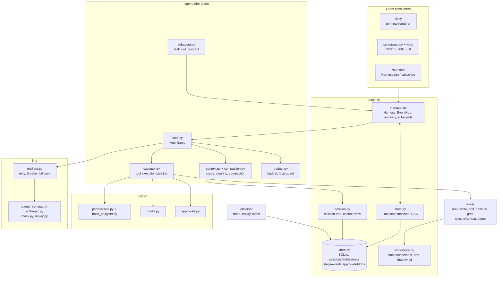
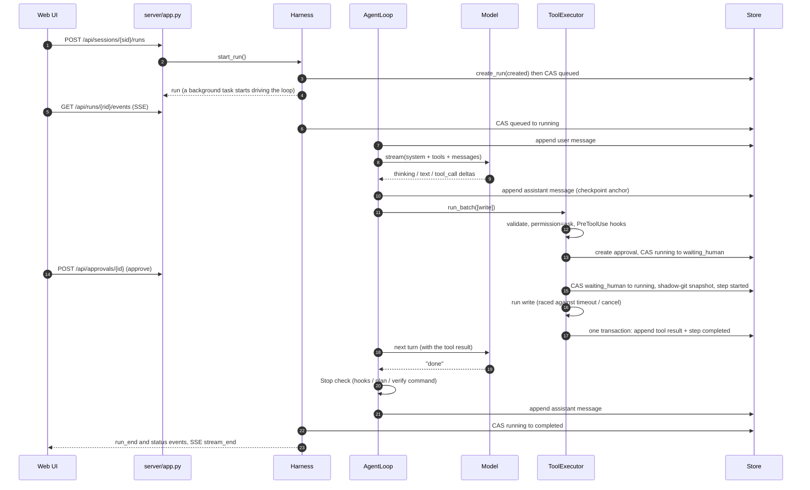
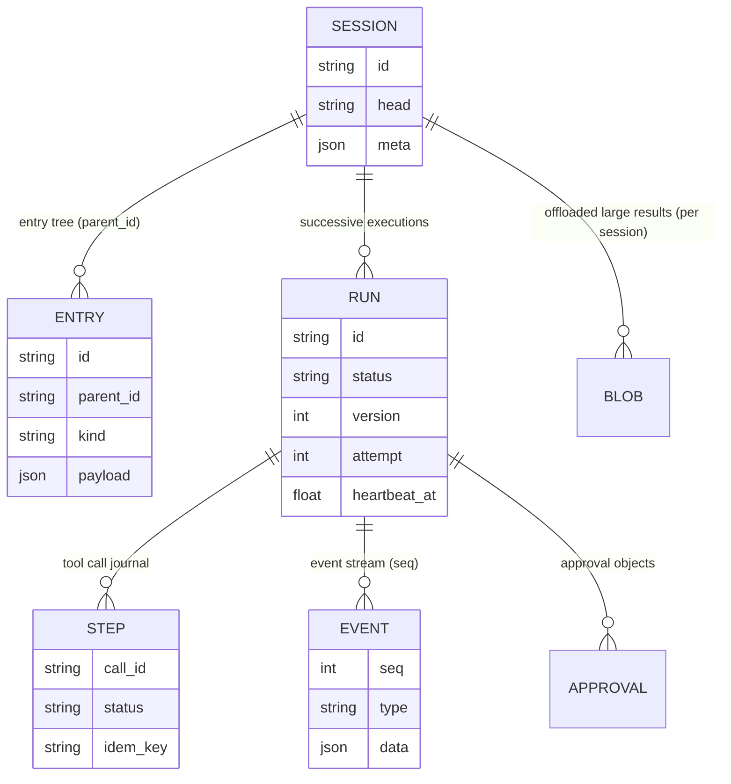

# 03 Architecture overview

This page does not go deep on any one mechanism. It walks one run from input to end and names the file and function where each step happens. Later chapters zoom into one block of this map.

## Module map



Dependencies point one way. Consumers know only `Harness` and events. `Harness` assembles a `RunContext` and hands it to `AgentLoop`, and the loop reaches storage, the model, tools and policy through that context. There are no globals. In a test, replacing any part (a scripted model, in-memory storage, a custom permission policy) means changing a constructor argument.

## The timeline of one run

The example is typing `创建 hello.py` ("create hello.py") in the Web UI, in default permission mode:



Each step maps to code:

| Step | Where | Point to notice |
|---|---|---|
| Create the run | `Harness.start_run()` | One active run per session; input during a run goes through steer or follow-up |
| Drive in the background | `Harness._launch()` then `_drive()` | The run lives in an `asyncio.Task`, independent of the HTTP connection; a heartbeat task starts with it |
| Event dispatch | `EventHub.publish()` | Assigns a monotonic `seq`, writes to the database in batches, then fans out to subscribers |
| Main loop | `AgentLoop.run()` / `_body()` | An async generator that always ends in an explicit state |
| Context | `_maybe_compact()`, `_call_model()` | Estimate usage, compact if needed, clear old results, build the `ModelRequest` |
| Model call | `ResilientProvider.stream()` | Retry, circuit breaker and fallback happen only in this layer |
| Tool execution | `ToolExecutor.run_batch()` / `_run_one()` | Batching and concurrency, permissions, hooks, approval, intent, execution, blob offload, persistence in original order |
| Completion check | `AgentLoop._stop_gaps()` | Unfinished plan, failing verify command or a Stop hook blocks the end and injects the gap |
| End | `Harness._finish()` | Maps the loop's `Outcome` to a state machine transition; if cancel and completion race, the first one wins |

## Four design principles

### 1. Everything is an event

`AgentLoop.run()` is an async generator that yields `Event(type, data, seq)`. The CLI's `TerminalRenderer`, the Web UI's `app.js`, test assertions and a subagent's pass-through to its parent are all consumers of events. The types are defined in `events.py`:

| Category | Events |
|---|---|
| Run | `run_start`, `run_end`, `status` (a state machine transition; offline transitions with no active EventHub, such as create, recover, offline cancel and crash takeover, also write one) |
| Turn | `turn_start`, `turn_end` |
| Message | `message_start`, `message_update` (text / thinking / toolcall deltas), `message_end` |
| Tool | `tool_start`, `tool_update` (progress, partial output, subagent events), `tool_end` |
| Policy | `approval_request`, `approval_resolved` |
| Context | `compaction_start`, `compaction_end` |
| Other | `model_retry`, `notice`, `usage`, `error` |

The naming follows pi's ten AgentEvents (start/update/end for agent, turn, message and tool execution), plus events specific to this runtime: status, approval, compaction and retry.

### 2. Events never get ahead of persisted state

```python
def _append(self, msg: Message) -> Event:
    """消息落盘（检查点）后再发 message_end：事件永远不会领先于持久化状态。"""
    self.rc.log.append_message(msg, self.rc.run_id)
    return self._ev(E.MESSAGE_END, message=msg.to_dict())
```

(The docstring says: emit `message_end` only after the message is persisted as a checkpoint.)

When the UI sees `message_end`, the message is already in the database. If the process crashes now, the history after recovery matches what the UI showed. Tool results follow the same rule: `run_batch` first writes the tool message and the step completion mark in one transaction, and only after the commit emits `tool_end`. `EventHub` obeys it too: it writes a batch of events to the database, then fans out. A client that reconnects reads the gap from the database and never sees an event that existed only in memory.

### 3. History is append-only

Session entries are never modified. Branching only moves the `head` pointer. Compaction appends a compaction entry. Even the system-reminder the harness injects is persisted as a user message, not assembled fresh on each request. This has three payoffs:

- Prefix caching: each request's message list starts with the previous one (`tests/test_loop.py::test_prefix_stability_append_only`).
- Valid thinking signatures: in newer Claude models a thinking block is bound to the full prefix it was generated under, so rewriting history invalidates every later thinking block.
- Faithful replay: the trace records what the model actually saw.

### 4. Every failure becomes an explicit result

| Failure | What it becomes |
|---|---|
| Unknown tool, invalid arguments, permission denied, approval rejected, tool exception, local operation timeout | A tool result with `is_error=True`, which the model reads and corrects |
| An external side effect whose outcome is unknown (cancel grace period expired, non-idempotent external call timed out, process crashed mid-call) | A tool result with `status=unknown` plus a journal record, telling the model to verify before retrying; on recovery it is reconciled through the idempotency key |
| Cancel, pause | `RunCancelled` / `RunPaused`, then `Outcome("cancelled" / "paused")` |
| Budget exhausted, loop detected, repeated failed completion checks | `budget_exhausted` / `loop_detected` / `incomplete`, never disguised as `completed` |
| An unrecoverable model call failure | `failed`; the error goes into the run record and into a message with `stop_reason=error`; `retry()` can continue from history |

The outer `try/except` in `AgentLoop.run()` guarantees that an unexpected exception inside the loop still ends the run as `failed` and keeps the evidence, instead of leaving it in `running` forever.

## Data model



- **Session.meta** freezes the system prompt, the tool set and the model (version pinned), plus session-level grants and the clearing watermark.
- **Entry** is the source of truth for context: a `message` or a `compaction`.
- **Run** carries `version` (incremented on every transition, for optimistic locking), `attempt`, `heartbeat_at` (the lease) and `checkpoint` (the workspace manifest).
- **Step** is a write-ahead log for a tool call: `started` is written before the side effect and the result after, so recovery can tell whether it happened.
- **Event** has a unique `(run_id, seq)` key, used for streaming, resumption after a dropped connection, and audit.

More in [09 State and persistence](/en/reliability/state-persistence).

## Directory layout

```
src/flywhl_harness/
+-- __init__.py          public API
+-- types.py             unified message model: Message / TextBlock / ThinkingBlock / ToolCall / Usage
+-- events.py            event types
+-- cancel.py            CancelToken: cooperative cancellation
+-- config.py            config dataclass tree (flywhl.toml + environment variables)
+-- prompts.py           system prompt, AGENTS.md, skill list, compaction template
+-- agent/               loop, executor, context, compaction, budget, inbox, subagent, run_context
+-- llm/                 base, models, openai_compat, anthropic, mock, replay, resilient
+-- tools/               base, schema, registry, fs, shell, extra, demo, mcp
+-- policy/              permissions, bash_analyzer, hooks, approvals
+-- runtime/             manager, store, session, state, workspace, retry, scheduler, dispatch
+-- observe/             trace, replay, evals
+-- server/app.py        FastAPI: REST + SSE
+-- web/                 index.html, app.js, md.js, style.css (no build step)
+-- cli.py               the flywhl command
```

The directory listing is abridged: `tools/` also holds `confine.py`, `egress.py`, `sandbox.py` and `regex_search.py`, `policy/` holds `fatigue.py`, `sensitive.py` and `supply_chain.py`, `llm/` holds `profiles.py` and `doctor.py`, `observe/` holds `export.py`, and `web/` has `boot.js`, `lib/` and `views/`.

For a suggested reading order of the source, see the [source map](/reference/source-map) (Chinese). Next: [04 The agent loop](/en/core/agent-loop). [Read the full chapter in Chinese](/guide/architecture).
