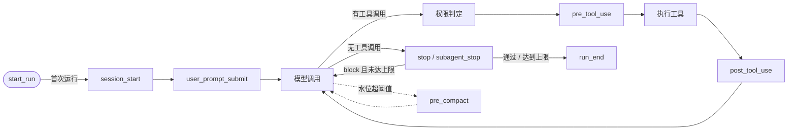
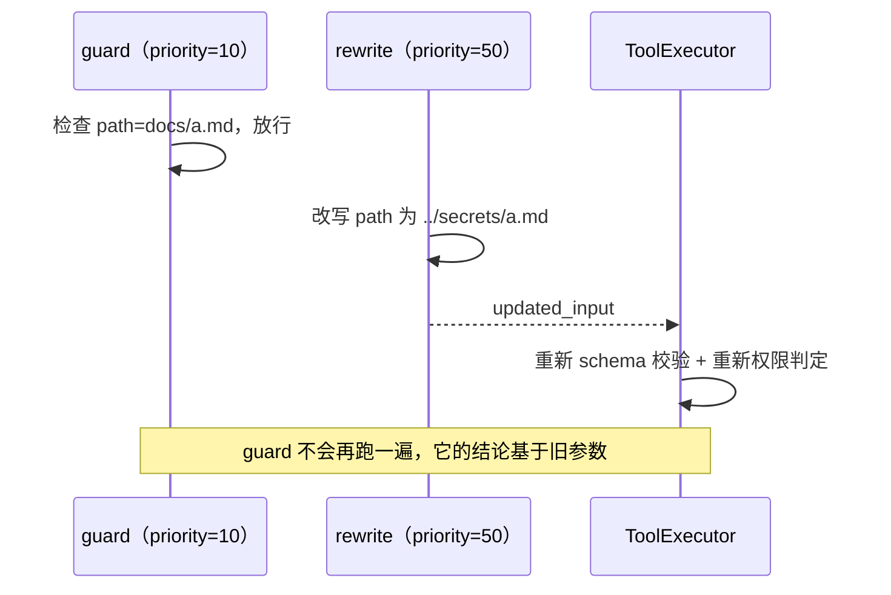
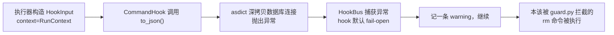
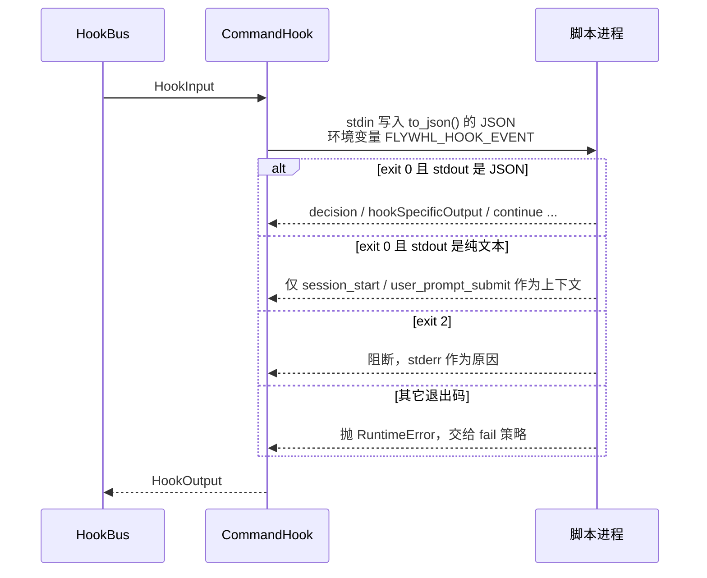

# 16 Hooks：把规则变成代码

提示词里写“修改后请运行测试”，模型可能照做，也可能忘；把测试放进 Stop hook，它就 **一定** 会跑。
这一章讲清楚 hooks 在 harness 里挂在哪里、多个 hook 如何组合、hook 自己出错时怎么办，以及为什么 hook 本身也是一个需要治理的攻击面。

## 为什么需要 hooks

Agent 的行为由两类东西共同决定：概率性的模型输出，和确定性的 harness 代码。很多团队规范一开始都写在系统提示词或 `AGENTS.md` 里，
跑久了会发现它们的约束力不同：

| 维度 | 写在提示词里 | 写成 hook |
|---|---|---|
| 是否一定执行 | 取决于模型是否注意到、是否被长上下文稀释 | 每次到达挂载点都执行 |
| 能否被注入绕过 | 网页里一句“忽略之前的规则”就可能生效 | 模型看不到也改不了 hook 代码 |
| 可测试性 | 只能靠评测集统计 | 普通单元测试，输入输出确定 |
| 失败时的表现 | 静默不遵守 | 明确的 deny / block，带原因回给模型 |
| 成本 | 每次请求占用上下文 token | 不占上下文（除非主动注入 `additional_context`） |

判断一条规则该放哪里，可以用一个简单的问题：**违反它时，你能接受“模型这次忘了”吗？**
“代码风格尽量简洁”可以留在提示词里；“不许删除迁移文件”“结束前测试必须通过”“日志里不能出现手机号”必须写成代码。

hooks 能做的事归纳为四类：**拦截**（deny / block）、**修改**（改写参数、改写结果）、**补充**（注入上下文）、**观测**（审计、指标）。

## 挂载点全表

flywhl-harness 在 `src/flywhl_harness/policy/hooks.py` 的 `HookEvent` 中定义了 8 个事件。
每个事件在哪里触发、能返回什么、返回值被如何使用，都由调用方决定——同一个 `HookOutput` 字段在不同事件里含义不同：

| 事件 | 触发位置 | 生效的输出 | 典型用途 | Claude Code 对应 |
|---|---|---|---|---|
| `session_start` | `Harness.start_run`，仅会话首次运行 | `additional_context` 以 `<system-reminder>` 拼到首条 prompt 后 | 注入目录结构、可用命令、开场流程 | SessionStart |
| `user_prompt_submit` | `AgentLoop._accept_prompt` | `block`/`deny` → Run 以 `failed` 结束；`additional_context` → reminder | 敏感词拦截、补充工单背景 | UserPromptSubmit |
| `pre_tool_use` | `ToolExecutor._run_one`，权限判定之后；审批人改参后再跑一遍 | `allow`/`ask`/`deny`（只能收紧，`block` 视同 `deny`）、`updated_input`、`additional_context`、`stop_run` | 拦截危险命令、改写路径、注入租户 ID | PreToolUse（另有独立的 PermissionRequest） |
| `post_tool_use` | `ToolExecutor._run_one`，执行之后、外置大结果之前 | `updated_result`、`block`（原因附加到结果并标记 `is_error`）、`additional_context` | 审计、脱敏、编辑后格式化或跑测试 | PostToolUse / PostToolUseFailure |
| `stop` | `AgentLoop._stop_gaps`（主代理） | `block` → 作为验收缺口注入；`additional_context`（block 时并入缺口，否则 Run 完成时落盘为 reminder）；`stop_run` | 跑验收：测试、产物、清单 | Stop |
| `subagent_stop` | 同上（`rc.role != "main"`） | 同上 | 校验子代理回传契约 | SubagentStop |
| `pre_compact` | `AgentLoop._maybe_compact` | `additional_context` → 作为压缩器的 `extra_instructions` | 声明“压缩时必须保留”的信息 | PreCompact |
| `run_end` | `Harness._drive` 的 `finally` | 无（异常被吞掉） | 通知、指标上报 | SessionEnd（粒度不同：会话 vs Run） |



与 Claude Code 相比，本项目少了 PermissionRequest、PostToolUseFailure、SubagentStart、PostCompact、Notification 等事件
（Claude Code 文档列出的事件有 30 余个，以官方为准）。缺失的大多可以用现有事件模拟：工具失败可以在 `post_tool_use` 里看
`tool_result["is_error"]`；审批通知可以订阅 `approval_request` 事件流而不是用 hook。
**事件少不是缺陷，每多一个挂载点就多一份需要长期兼容的契约。**

## 数据契约：HookInput 与 HookOutput

```python
@dataclass
class HookInput:
    event: str
    run_id: str
    session_id: str
    cwd: str = ""
    tool_name: str | None = None
    tool_input: dict[str, Any] | None = None
    tool_result: dict[str, Any] | None = None   # {"content", "is_error", "details"}
    prompt: str | None = None
    stop_blocks: int = 0                         # Stop 已被阻止的次数：hook 自己也应防止无限续跑
    last_message: str | None = None
    data: dict[str, Any] = field(default_factory=dict)
    # 进程内 hook 可以直接访问运行时对象（如消息历史、工作区）；进程外 hook 只拿到 JSON
    context: Any = None

    def to_json(self) -> dict[str, Any]:
        # 注意不能用 dataclasses.asdict：它会深拷贝 context（运行时对象，含数据库连接）而失败
        d = {f.name: getattr(self, f.name) for f in fields(self) if f.name != "context"}
        # 去掉空字段，但工具类事件的 tool_input 必须保留（无参工具的 {} 也是合法输入，hook 脚本常直接取它）
        d = {k: v for k, v in d.items() if v is not None and (v not in ({}, "") or k == "tool_input")}
        d["hook_event_name"] = d.pop("event")
        if "tool_result" in d:
            d["tool_response"] = d.pop("tool_result")
        return d
```

几个设计点：

- **两种 hook 共用一份输入。** 进程内 hook（Python 函数）通过 `context` 拿到 `RunContext`，可以读消息历史、工作区、预算；
  进程外 hook（`CommandHook`）只拿到 `to_json()` 的结果。`to_json` 把字段名改成 Claude Code 的叫法
  （`hook_event_name`、`tool_response`），让现成的脚本少改几行。
- **`tool_input` 是副本。** `ToolExecutor._hook_input` 传入的是 `dict(args)`，hook 原地修改它不会影响执行；想改参数必须显式返回 `updated_input`，
  这样每一次改写都有迹可循。
- **空值会被过滤，`tool_input` 例外。** 空字典、空串、`None` 不进 JSON，但工具类事件的 `tool_input: {}` 保留：
  无参工具（如 `todo_read`）的空参数也是合法输入。早期版本连它一起过滤，脚本里的 `d["tool_input"]` 会 `KeyError`；
  如果 hook 被配成 fail-closed，这会把所有无参工具调用都变成拒绝。非工具事件（`stop`、`session_start`）本来就没有 `tool_input`，
  通用脚本仍应写 `d.get("tool_input", {})`。回归测试：`tests/test_security.py::test_hook_input_keeps_empty_tool_input`。

`HookOutput` 的字段：

| 字段 | 含义 | 生效事件 |
|---|---|---|
| `decision` | `allow` / `ask` / `deny`，或 `block`；由 `normalize_decision` 统一取值（见下文） | 前三者用于 `pre_tool_use`；`block` 用于 `stop`、`subagent_stop`、`post_tool_use`、`user_prompt_submit` |
| `reason` | 原因，会带上 `[hook 名]` 前缀回给模型或写入审计 | 全部 |
| `updated_input` | 替换工具参数 | `pre_tool_use` |
| `updated_result` | 替换模型看到的工具结果 | `post_tool_use` |
| `additional_context` | 以 system-reminder 注入下一轮上下文（`pre_compact` 中作为压缩指令） | `session_start`、`user_prompt_submit`、`pre_tool_use`、`post_tool_use`、`pre_compact`；`stop` 中 block 时并入验收缺口，不 block 时在 Run 完成时落盘为 reminder |
| `stop_run` | 立即终止整个 Run（对应 Claude Code 的 `continue: false`） | `pre_tool_use`、`stop` |
| `warnings` | 由 HookBus 填充：fail-open 时被忽略的错误、无法识别的决策取值 | — |

## HookBus 精读

```python
async def run(self, event: str, inp: HookInput) -> HookOutput:
    """按优先级串行执行匹配的 hook，并聚合结果。"""
    agg = HookOutput()
    reasons: list[str] = []
    contexts: list[str] = []
    for h in sorted((h for h in self._hooks if h.event == event and h.applies(inp)), key=lambda h: h.priority):
        try:
            out = await asyncio.wait_for(h.fn(inp), h.timeout)
        except Exception as e:  # 含超时
            msg = f"hook {h.name} 失败：{type(e).__name__}: {e}"
            if h.fail_closed:
                block = "deny" if event == HookEvent.PRE_TOOL_USE else "block"
                return HookOutput(decision=block, reason=msg + "（fail-closed，按阻断处理）")
            agg.warnings.append(msg + "（fail-open，忽略）")
            continue
        if out is None:
            continue
        if out.updated_input is not None:
            inp.tool_input = out.updated_input   # 链式传递给下一个 hook
            agg.updated_input = out.updated_input
        # ... updated_result 同理链式传递
        if out.additional_context:
            contexts.append(out.additional_context)
        decision, warn = normalize_decision(event, out.decision)
        if warn:
            agg.warnings.append(f"[{h.name}] {warn}")
        if decision:
            agg.decision = strictest(agg.decision, decision) if decision != "block" else "block"
            if out.reason:
                reasons.append(f"[{h.name}] {out.reason}")
        # ... stop_run
        if agg.decision in ("deny", "block") and event == HookEvent.PRE_TOOL_USE:
            break  # deny 短路
    agg.reason = "\n".join(reasons)
    agg.additional_context = "\n".join(contexts) or None
    return agg
```

### 匹配与排序

`Hook.applies()` 只对带 `tool_name` 的事件做匹配：`matcher` 按 `|` 拆开，每段用 `fnmatchcase` 做 glob 匹配，
所以 `"read|grep"`、`"mcp__*"`、`"write|edit"` 都能用；非工具事件（`stop`、`pre_compact` 等）忽略 matcher。
排序键只有 `priority`（升序，默认 100），Python 的 `sorted` 是稳定排序，同优先级按注册顺序执行。

### 串行还是并行

Claude Code 让匹配到的 hook 并行执行；本项目选择串行。两者各有代价：

| | 串行（本项目） | 并行（Claude Code） |
|---|---|---|
| 参数改写 | 可以链式传递：A 规范化路径，B 在规范化后的路径上检查 | 多个 hook 同时改写时需要额外的合并规则 |
| 延迟 | 各 hook 耗时相加 | 取最慢的一个 |
| 短路 | deny 之后的 hook 不再执行，省时 | 都会执行完 |
| 确定性 | 顺序由 priority 决定，结果可复现 | 结果聚合与完成顺序无关时才确定 |
| 审计 | 被短路的审计 hook 看不到这次调用 | 审计 hook 总能执行 |

串行的最后一行代价值得单独说：如果你把审计 hook 也挂在 `pre_tool_use` 上，排在拦截 hook 之后，被拒绝的调用就不会被记录——
而“被拒绝的尝试”恰恰是安全审计最想要的数据。两种解法：审计 hook 用更小的 priority 排到最前面；或者干脆不用 hook 做审计，
直接消费 `tool_end` 事件（`status="denied"` 的调用也会产生 `tool_end`）。

### 改写的链式传递与“检查在前、改写在后”陷阱

`inp.tool_input = out.updated_input` 让后面的 hook 看到改写后的参数。这带来一个顺序依赖：
**检查类 hook 必须排在所有改写类 hook 之后**，否则它检查的是旧参数。



执行器会对改写后的参数重新做 schema 校验和 **权限规则** 判定（见下一节），所以托管基线的 deny 仍然兜得住；
但其它 hook 的自定义检查不会重跑。经验规则：**改写用小 priority，检查用大 priority，安全检查放在最后一个。**

### 决策聚合

`strictest()` 定义在 `src/flywhl_harness/policy/permissions.py`，按 `allow < ask < deny` 取最严。所以多个 hook 的结论只会越来越严：
任何一个 hook 说 deny，整体就是 deny；一个 ask 加一个 allow 是 ask。`block` 单独处理：一旦出现就覆盖为 `block`。

### 决策归一化：写错一个词不能等于放行

hook 的作者来自不同生态：有人照 Claude Code 旧文档在 PreToolUse 里写 `decision: "block"`，有人写 `approve`，也有人拼错。
`HookBus.run` 在聚合之前先调用 `normalize_decision(event, decision)`：

```python
_PRE_TOOL_DECISIONS = {"allow": "allow", "approve": "allow", "ask": "ask", "deny": "deny", "block": "deny"}


def normalize_decision(event: str, decision: str | None) -> tuple[str | None, str | None]:
    # ...
    if not decision:
        return None, None
    d = str(decision).strip().lower()
    if event == HookEvent.PRE_TOOL_USE:
        if d in _PRE_TOOL_DECISIONS:
            return _PRE_TOOL_DECISIONS[d], None
    elif d in ("block", "deny"):
        return "block", None
    elif d in ("allow", "approve", "continue"):
        return None, None
    return None, f"无法识别的 hook 决策 {decision!r}（{event}），已忽略"
```

| hook 返回 | `pre_tool_use` | 其它事件（`stop`、`post_tool_use`、`user_prompt_submit` ……） |
|---|---|---|
| `allow` / `approve` | `allow` | 不干预 |
| `ask` | `ask` | 告警，忽略 |
| `deny` / `block` | `deny` | `block` |
| `continue` | 告警，忽略 | 不干预 |
| 拼错的值（如 `denyy`） | 告警，忽略 | 告警，忽略 |

大小写与首尾空白不敏感。这个函数修掉的是一个真实缺陷：以前执行器只认 `allow`/`ask`/`deny`，进程内 hook 在 `pre_tool_use`
返回 `block` 会被静默忽略，**工具照常执行**；而未知取值会让 `strictest()` 里的 `Decision(...)` 抛 `ValueError`——它发生在 `try` 之外，fail 策略管不到，直接打断调用方。
现在未知取值既不放过也不崩溃：它不改变决策，但进入 `agg.warnings`，由调用方发布为 `hook_warning` 通知（见下文 fail-open 一节），应当接入告警——
安全类 hook 写错一个单词就失效，是最需要被看见的错误。回归测试：`tests/test_security.py` 的
`test_pre_tool_block_is_deny`（block 拦下 write）、`test_unknown_hook_decision_warns_instead_of_crashing`，
以及 `test_stop_hook_warnings_are_visible`（Stop hook 把 block 拼成 `blcok`，Run 的事件流里必须出现对应的 `hook_warning`）。

## 组合规则：hook 只能收紧，不能放宽

hook 和权限策略谁先谁后、谁说了算，是 hooks 设计里最容易出安全问题的地方。`ToolExecutor._run_one` 的写法：

```python
# ---- 权限 + PreToolUse hooks ----
perm = rc.permissions.evaluate(tool, args, tainted=rc.tainted, grants=rc.grants)
decision, reason = perm.decision, perm.reason
if rc.hooks.has(HookEvent.PRE_TOOL_USE):
    out = await rc.hooks.run(HookEvent.PRE_TOOL_USE, self._hook_input(HookEvent.PRE_TOOL_USE, call.name, args))
    # ... 发布 hook_warning 通知
    if out.updated_input is not None:
        new_args, errs = validate(tool.parameters, out.updated_input)
        if errs:
            return done(ToolResult.error("PreToolUse hook 改写后的参数未通过校验：\n" + "\n".join(errs)), "invalid")
        args = new_args
        perm = rc.permissions.evaluate(tool, args, tainted=rc.tainted, grants=rc.grants)  # 改写后必须重新判定
        decision, reason = perm.decision, perm.reason
    if out.decision in ("allow", "ask", "deny"):
        # hook 只能收紧、不能放宽：hook 说 allow 也绕不过规则的 ask/deny
        stricter = strictest(decision, out.decision)
        if stricter != decision:
            decision, reason = stricter, out.reason or f"PreToolUse hook 要求 {out.decision}"
    if out.additional_context:
        rc.remind(out.additional_context)
    if out.stop_run:
        rc.stop_requested = out.reason or "hook 要求终止运行"
```

三条规则各自防的是什么：

1. **改写后重新 schema 校验。** hook 是人写的代码，可能产出缺字段、类型错误的参数。校验失败直接以 `invalid` 结束这次调用，
   而不是把脏参数交给工具。
2. **改写后重新权限判定。** hook 可能把 `path` 改到 `.ssh/` 下，或把一条只读命令改成写命令。权限判定必须基于 **最终要执行的参数**，
   否则就是“检查 A、执行 B”。
3. **决策取最严。** 结果矩阵：

| 规则判定 ＼ hook 决定 | allow | ask | deny |
|---|---|---|---|
| allow | allow | ask | deny |
| ask | **ask** | ask | deny |
| deny | **deny** | **deny** | deny |

加粗的格子就是“hook 想放宽但被拒绝”的情况。为什么不允许 hook 放宽？因为 hook 的来源比托管规则更多样（项目仓库、用户目录、第三方插件），
如果任何一个 hook 返回 allow 就能跳过 `deny:read(*/.ssh/*)`，托管基线就形同虚设。
按调研资料，Claude Code 的 PreToolUse hook 返回 allow 同样绕不过 deny/ask 规则（以官方文档为准）。

### 审批人改参后：hooks 再跑一遍

审批卡片允许人修改参数后再批准（见 [17 权限与人审](/governance/permissions-hitl)）。人改过的参数同样要经过 hook：

```python
if dec.edited_args:
    new_args, errs = validate(tool.parameters, dec.edited_args)
    if errs:
        return done(ToolResult.error("审批人修改后的参数未通过校验：\n" + "\n".join(errs)), "invalid")
    args = new_args
    recheck = rc.permissions.evaluate(tool, args, tainted=rc.tainted, grants=rc.grants)  # 防 TOCTOU
    if recheck.decision == Decision.DENY:
        return done(ToolResult.error(f"修改后的参数被权限策略拒绝：{recheck.reason}"), "denied")
    if rc.hooks.has(HookEvent.PRE_TOOL_USE):
        # 审批人改过的参数同样要过 PreToolUse 守卫：hook 表达的是“不变量”，人工批准不能绕过它
        again = await rc.hooks.run(HookEvent.PRE_TOOL_USE, self._hook_input(HookEvent.PRE_TOOL_USE, call.name, args))
        if again.decision == "deny":
            return done(ToolResult.error(f"修改后的参数被 PreToolUse hook 拒绝：{again.reason}"), "denied")
        if again.updated_input is not None:
            args, errs = validate(tool.parameters, again.updated_input)
            # ... 校验失败同样以 invalid 结束
```

理由是：人批准的是 **审批卡片上那一次调用**，不是“这次可以不守规矩”。审批人把路径从 `out/a.md` 改成 `feature_list.json`，
清单守卫照样要检查；hook 的 `updated_input`（例如强制输出目录）也照样生效。第二轮只认 `deny`——`ask` 已经被人回答过了，
不会再弹一次审批。回归测试：`tests/test_security.py::test_edited_args_rerun_pre_tool_hooks`。

`stop_run` 不会打断当前这次调用——它只设置 `rc.stop_requested`，`AgentLoop` 在下一回合开始时检查并以
`Outcome("cancelled", ..., by="hook")` 结束。想同时阻止当前调用，需要再返回 `decision="deny"`。

`post_tool_use` 的处理更简单：`updated_result` 替换内容但保留 `tainted` 标记（脱敏不等于变可信）；
`block` 把原因以 `[PostToolUse 反馈]` 附加到结果末尾并置 `is_error=True`，模型会把它当作一次需要修正的失败。
注意 PostToolUse 运行在 `shape_tool_result`（大结果外置）之前，所以脱敏发生在结果落库之前。

## fail-open 还是 fail-closed

hook 自己会出错：脚本有 bug、依赖的服务超时、JSON 解析失败。`HookBus.run` 对异常的处理由 `Hook.fail_closed` 决定：

| 类别 | 例子 | 建议 | 理由 |
|---|---|---|---|
| 安全拦截 | 危险命令拦截、密钥访问拦截、出口白名单 | **fail-closed** | hook 失败时放行，等于攻击者只要让 hook 崩溃就能绕过 |
| 合规改写 | 注入租户 ID、强制输出目录 | **fail-closed** | 改写失败就执行原参数，可能写到别的租户 |
| 验收 | Stop 时跑测试 | 视情况 | fail-closed 会把不稳定的测试变成 `incomplete`；fail-open 会让崩溃的验收被当作通过 |
| 观测 | 审计落库、指标上报、通知 | **fail-open** | 监控挂了不应该让业务停摆，但要告警 |

fail-closed 的实现是 **立即返回** 阻断结果，前面 hook 积累的改写和上下文都被丢弃——阻断时这些已经没有意义。
fail-open 不是“静默忽略”：错误进入 `warnings`，调用方把它们发布成 `code="hook_warning"` 的 notice 事件，应当接入告警。
`HookBus.run` 只负责收集，发不发布由各挂载点决定，这一点曾经出过问题：早期只有 `pre_tool_use` 会发布，Stop 等事件里 fail-open 的异常、
写错的决策取值都被悄悄吞掉。现在每个挂载点都会发布：

| 挂载点 | 发布方式 |
|---|---|
| `pre_tool_use`（含审批人改参后重跑的那一轮）、`post_tool_use` | `ToolExecutor._run_one` 遍历 `out.warnings` 逐条发布 |
| `user_prompt_submit`、`pre_compact`、`stop` / `subagent_stop` | `AgentLoop._hook()` 运行 hook 时收集警告，`_hook_notices()` 转成 notice 事件 |
| `session_start`、`run_end` | `Harness._hook_warnings()`：这两个时刻没有活动的事件枢纽（Run 还没开始 / 事件流已关闭），用 `append_event_next()` 直接追加到该 Run 的事件表 |

### 案例：一次真实的 fail-open 事故

早期版本里 `HookInput.to_json()` 用的是 `dataclasses.asdict(self)`。问题在于 `asdict` 会递归深拷贝所有字段，
而 `context` 字段放的是 `RunContext`——里面有 SQLite 连接，无法拷贝。事故链条是这样的：



单元测试没有发现它，因为 `test_command_hook_protocol` 直接调用 `CommandHook`，构造的 `HookInput` 不带 `context`；
只有经过执行器、带上真实运行时对象时才会触发。这个事故有三条教训：

1. **fail-open 会把 hook 路径上的任何 bug 变成静默绕过。** 拦截逻辑写得再对，序列化崩了一样放行。
2. **测试必须走真实调用路径。** 修复后加了回归测试 `test_command_hook_with_runtime_context_blocks`：用 bypass 模式跑一个完整 Run，
   断言 `rm -f x` 被命令 hook 拦下、`status == "denied"`。
3. **默认值很重要。** `config.py` 里 `HookConfig.fail_closed` 的默认值是 `False`，从 `flywhl.toml` 的 `[[hooks]]` 注册的拦截脚本
   如果忘了写 `fail_closed = true`，就会重演这个事故。

## 超时

每个 hook 都被 `asyncio.wait_for(h.fn(inp), h.timeout)` 包住：进程内 hook 默认 10 秒，配置文件里的命令 hook 默认 30 秒。
超时抛出 `TimeoutError`，与其它异常一起交给 fail 策略处理（`tests/test_policy.py::test_hook_fail_closed_on_timeout` 覆盖了两种策略）。

设置超时时要算清楚：`pre_tool_use` 的耗时直接加在每次工具调用上，串行执行时多个 hook 的超时会累加；
`stop` 里跑测试可能需要几分钟，应该单独调大，而不是全局调大。

### 超时要杀掉整个进程组

`wait_for` 取消的只是 `CommandHook.__call__` 协程，`asyncio.create_subprocess_shell` 启动的进程不会随之终止。
早期版本里一个超时的 `sleep` hook 会继续在后台运行，卡住的 hook 每次工具调用都泄漏一个进程。现在的写法：

```python
proc = await asyncio.create_subprocess_shell(
    self.command, stdin=asyncio.subprocess.PIPE, stdout=asyncio.subprocess.PIPE,
    stderr=asyncio.subprocess.PIPE, cwd=self.cwd or inp.cwd or None,
    env={**os.environ, "FLYWHL_HOOK_EVENT": inp.event}, start_new_session=True,
)
try:
    out, err = await proc.communicate(json.dumps(inp.to_json(), ensure_ascii=False).encode("utf-8"))
except BaseException:
    # HookBus 的超时会取消这里：必须杀掉整个进程组，否则超时的 hook 脚本（及其子进程）会在后台继续运行
    with contextlib.suppress(ProcessLookupError, PermissionError):
        os.killpg(proc.pid, signal.SIGKILL)
    with contextlib.suppress(Exception):
        await asyncio.wait_for(proc.wait(), 2)
    raise
```

三个细节缺一不可：`start_new_session=True` 让 shell 成为新进程组的组长，`killpg` 才能连同它派生的子进程（`sleep 30 &`、
脚本里起的 `pytest`）一起杀掉——只 `proc.kill()` 杀的是 shell，孙进程会被过继给 init 继续跑；捕获 `BaseException`
而不是 `Exception`，因为取消抛的是 `CancelledError`；杀完再 `wait` 回收，避免僵尸进程。最后 `raise` 把超时交还 HookBus，
照常走 fail 策略。回归测试 `tests/test_security.py::test_command_hook_is_killed_on_timeout` 让 hook 在后台起一个
`sleep 30` 并记下 PID，断言超时后该 PID 已不存在。

## CommandHook：进程外协议

进程内 hook 适合 harness 开发者；团队规范更适合写成独立脚本，用任何语言实现、单独版本化。`CommandHook` 的协议与 Claude Code 兼容：



JSON 输出到 `HookOutput` 的映射：

```python
data = json.loads(stdout)
spec = data.get("hookSpecificOutput") or {}
res = HookOutput(
    decision=spec.get("permissionDecision") or data.get("decision"),
    reason=spec.get("permissionDecisionReason") or data.get("reason") or data.get("stopReason") or "",
    updated_input=spec.get("updatedInput"),
    updated_result=spec.get("updatedToolOutput"),
    additional_context=spec.get("additionalContext") or data.get("additionalContext"),
    stop_run=data.get("continue") is False,
)
return res  # 决策取值由 HookBus 统一归一化（approve → allow、block → deny ……）
```

`CommandHook` 只搬运字段，不翻译取值：`approve`、`block` 这类别名交给 `normalize_decision` 统一处理，
进程内 hook 和命令 hook 因此遵循同一张决策表，不会出现“脚本里写 block 有效、Python 里写 block 无效”的分裂。

与 Claude Code 的兼容点和差异：

| 方面 | 兼容 | 差异 |
|---|---|---|
| 输入 | stdin JSON；`tool_name`、`tool_input`、`cwd`、`session_id`、`tool_response` 同名 | `hook_event_name` 的值是 `pre_tool_use` 这样的小写下划线，而非 `PreToolUse`；没有 `transcript_path`、`permission_mode`、`tool_use_id`；多了 `run_id`、`stop_blocks` |
| 退出码 | 0 成功、2 阻断（stderr 为原因）、其它为非阻断错误 | “非阻断错误”在这里是抛异常，`fail_closed=True` 时会变成阻断 |
| JSON 字段 | `continue`、`stopReason`、`decision`+`reason`（含 PreToolUse 里的旧写法 `approve`/`block`）、`permissionDecision`、`updatedInput`、`updatedToolOutput`、`additionalContext` | 不识别 `systemMessage`、`suppressOutput`；`permissionDecision: "defer"` 等未知值被忽略并产生 `hook_warning` |
| hook 类型 | command | 不支持 http / mcp_tool / prompt / agent 类型 |
| 执行方式 | — | 串行而非并行 |
| 环境变量 | — | 子进程继承完整的 `os.environ`（包括 bash 工具会剥离的密钥变量） |

在 `flywhl.toml` 里注册：

```toml
[[hooks]]
event = "pre_tool_use"
matcher = "bash"
command = "python scripts/guard.py"
timeout = 5
fail_closed = true      # 拦截类 hook 一定要显式打开
```

`Harness.__init__` 把每条配置包装成 `Hook(..., source="project")` 加入 HookBus，工作目录是工作区根。

## Stop hook：验收与“阻止次数上限”

Stop hook 是 hooks 里收益最高的一类：它把“完成”的定义从模型的自我感觉变成外部可验证的条件。
`AgentLoop._stop_gaps` 收集三类缺口——计划中未完成的 todo、验收命令失败、Stop hook 返回 `block`——任何一个非空都会阻止结束：

```python
gaps = await self._stop_gaps(msg)
if gaps:
    if rc.stop_blocks < rc.config.max_stop_blocks:
        rc.stop_blocks += 1
        # ... 发布 stop_blocked 通知
        yield self._append(user_message(reminder(
            "你准备结束，但验收尚未通过：\n" + "\n".join(f"- {g}" for g in gaps)
            + "\n请继续完成；如果确实无法完成，请如实说明原因。"), kind=MsgKind.STOP_FEEDBACK))
        continue
    self.outcome = Outcome("incomplete", "多次验收未通过：" + "；".join(gaps))
    return
```

为什么必须有上限：验收条件可能根本不可达（依赖的服务挂了、需求本身矛盾），没有上限的 Stop hook 会让 Agent 无限续跑、烧光预算。
`max_stop_blocks`（默认 3）用完后，Run 以 `incomplete` 结束——**如实承认没完成，而不是伪装成 completed**。
`tests/test_loop.py::test_stop_hook_blocks_then_gives_up_honestly` 验证了这一点：模型反复说“完成了！”，
hook 两次阻止后 Run 以 `incomplete` 结束，会话里恰好有 2 条 `stop_feedback` 消息。

Stop hook 的 `additional_context` 按是否阻止分两种去向：

| Stop hook 返回 | `additional_context` 的去向 | 适合放什么 |
|---|---|---|
| `block` | 与 `reason` 一起并入验收缺口，随 `stop_feedback` 交给模型立即处理 | 失败测试的输出、缺失产物的清单 |
| 不 block | Run 以 `completed` 结束时，作为一条 `reminder` 消息追加到会话，本会话下一次 Run 的模型会看到 | “下次记得更新 CHANGELOG”这类不阻塞本次交付的提示 |

以前不 block 时这段上下文被直接丢弃，hook 作者以为“提醒过了”，其实谁也没看到。
`tests/test_security.py::test_stop_additional_context_is_kept_as_reminder` 断言 Run 仍是 `completed`，且会话里多了一条带该文本的 reminder。

`HookInput.stop_blocks` 把已阻止次数告诉 hook，hook 可以据此自己降级（例如第二次之后只检查核心测试）。
Claude Code 的 Stop hook 输入中有类似作用的 `stop_hook_active` 字段（以官方文档为准），但上限需要 hook 自己实现；
本项目把上限放在 Loop 里，单个写错的 hook 也无法造成死循环。

## 企业策略分层

一个组织里同时存在三层策略：平台/安全团队的托管策略（managed）、仓库自带的项目策略（project）、开发者个人策略（user）。
分层的核心要求是 **下层不能削弱上层**。本项目的实现方式值得看清楚：

- `Hook.source` 字段（managed / project / user）只是标签，`HookBus.run` 并不读它；
- 真正保证“企业层不可覆盖”的是组合语义：决策取最严 + deny 短路 + hook 只能收紧权限规则。
  用户 hook 返回 allow 推翻不了托管 hook 的 deny，也推翻不了托管基线规则；
- 托管规则（`MANAGED_BASELINE`）在权限层而非 hook 层，hook 改写参数后会被重新判定，见 [17 权限与人审](/governance/permissions-hitl)。

组合语义能保证“deny 不被推翻”，但保证不了下面两件事，生产实现需要补上：

| 风险 | 说明 | 补救 |
|---|---|---|
| 托管 hook 被卸载 | hook 由代码或项目配置注册，用户可以不注册它 | 托管 hook 从用户不可写的系统路径加载；Claude Code 提供只允许托管 hook 的设置项（以官方文档为准） |
| 改写逃过检查 | 托管检查 hook 排在用户改写 hook 之前时，检查的是旧参数 | 托管检查 hook 使用最大的 priority，保证最后执行 |
| 被短路后看不到 | 用户 hook 先 deny，托管审计 hook 不执行 | 审计走事件流，不依赖 hook 顺序 |

## hook 本身是供应链风险点

hook 是 harness 里权限最高的扩展：它在模型之外运行、不经过权限策略，`CommandHook` 还继承了完整的环境变量。
这意味着：

- **克隆一个仓库就可能执行它的代码。** `flywhl.toml` 里的 `[[hooks]]` 会在第一次匹配的工具调用时执行。
  恶意仓库可以在 `session_start` hook 里读取 `~/.aws/credentials` 并外发——托管基线拦截的是 **模型** 读密钥，拦不住 hook。
- **hook 脚本被篡改等于策略被篡改。** 模型在 bypass 模式下改写了 `scripts/guard.py`，下一次调用时拦截逻辑就变了。

对应的治理措施：项目级 hook 首次加载或内容变化时要求人工确认（Claude Code 在启动时快照 hook 配置、变更需在 `/hooks` 中审阅，以官方文档为准）；
用哈希锁定 hook 脚本内容；把 hook 脚本所在目录加入 `deny:write(...)` 规则，防止 Agent 改写自己的护栏；
给命令 hook 一个最小化的环境，而不是 `os.environ`。更完整的供应链讨论见 [19 安全](/governance/security)。

## 典型配方

| 需求 | 事件 / matcher | 输出 | fail 策略 |
|---|---|---|---|
| 审计落库 | `post_tool_use` / `*` | 无（只写日志） | open |
| 输出脱敏 | `post_tool_use` / `bash\|read` | `updated_result` | closed |
| 编辑后格式化、跑测试 | `post_tool_use` / `write\|edit` | `additional_context` 或 `block` | open |
| 拦截危险命令 | `pre_tool_use` / `bash`，命令 hook | exit 2 | closed |
| 注入租户 ID | `pre_tool_use` / 业务工具 | `updated_input` | closed |
| 清单只能改 passes 字段 | `pre_tool_use` / `write\|edit\|bash` + `stop` | `deny` / `block` | closed |

输出脱敏：

```python
import re
PHONE = re.compile(r"(?<!\d)1[3-9]\d{9}(?!\d)")

@h.hooks.on(HookEvent.POST_TOOL_USE, matcher="bash|read", priority=10, fail_closed=True)
async def redact(inp):
    text = inp.tool_result["content"]
    masked = PHONE.sub(lambda m: m.group()[:3] + "****" + m.group()[-4:], text)
    if masked != text:
        return HookOutput(updated_result=masked)
```

::: warning 脱敏的覆盖范围
bash 工具边执行边通过 `ctx.emit` 推送 `tool_update` 事件，这些部分输出在 PostToolUse 之前就已发布并批量落库（`EventHub.publish`）。
PostToolUse 只能保证 **模型看到的结果** 和 `tool_end` 里的内容被脱敏，保护不了流式输出通道。需要严格脱敏时，要在 `emit` 路径上也做过滤。
:::

编辑后跑测试，失败时把输出反馈给模型：

```python
@h.hooks.on(HookEvent.POST_TOOL_USE, matcher="write|edit", timeout=120)
async def run_tests(inp):
    proc = await asyncio.create_subprocess_shell(
        "pytest -q -x", cwd=inp.cwd, stdout=asyncio.subprocess.PIPE, stderr=asyncio.subprocess.STDOUT)
    out, _ = await proc.communicate()
    if proc.returncode != 0:
        return HookOutput(decision="block", reason="测试未通过：\n" + out.decode()[-2000:])
```

功能清单保护（摘自 `examples/10_long_running.py::install_hooks`）：

```python
target = (WS / "feature_list.json").resolve()
# ...

# fail_closed：守卫自己出错（例如清单文件损坏）时按拒绝处理——守卫失效不能等于放行
@h.hooks.on(HookEvent.PRE_TOOL_USE, matcher="write|edit|bash", fail_closed=True)
async def guard_feature_list(inp):
    if inp.tool_name == "bash":
        # 用 sed -i / perl -pi / 重定向改清单绕过 write 检查：只读命令（cat、jq）放行，其余一律拒绝
        cmd = str(inp.tool_input.get("command", ""))
        if target.name in cmd and analyze(cmd).level != "read":
            return HookOutput(decision="deny", reason="feature_list.json 只能用 write / edit 修改（以便逐项检查）")
        return None
    # 按解析后的真实路径比较：./feature_list.json、子目录/../feature_list.json 都指向同一个文件
    if (WS / str(inp.tool_input.get("path", ""))).resolve() != target:
        return None
    current = target.read_text()
    if inp.tool_name == "edit":  # 先算出“改完之后”的内容，再和 write 走同一套检查
        old_s = inp.tool_input.get("old_string", "")
        if not old_s or old_s not in current:
            return None  # 交给 edit 工具自己报“找不到 old_string”
        new_s = inp.tool_input.get("new_string", "")
        after = current.replace(old_s, new_s) if inp.tool_input.get("replace_all") else current.replace(old_s, new_s, 1)
    else:
        after = inp.tool_input.get("content", "")
    try:
        new = json.loads(after)
    except json.JSONDecodeError:
        return HookOutput(decision="deny", reason="修改后的 feature_list.json 不是合法 JSON")
    strip = lambda items: [{k: v for k, v in f.items() if k != "passes"} for f in items]  # noqa: E731
    if strip(json.loads(current)) != strip(new):
        return HookOutput(decision="deny", reason="只允许修改 passes 字段，不得增删或改写功能描述")
```

这个守卫的每一行都对应一种绕过手法，早期版本逐个踩过：

| 绕过尝试 | 早期写法的问题 | 现在的处理 |
|---|---|---|
| `write(path="./feature_list.json")` | 按字符串比较 `path != "feature_list.json"`，换个写法就放行 | `resolve()` 后与目标真实路径比较 |
| `edit(old_string="…描述…", new_string="…")` | `edit` 没有 `content`，`json.loads("")` 失败，所有 edit 都以误导性的理由被拒 | 先在当前内容上模拟替换（含 `replace_all`），得到“改完之后”的全文，再与 write 走同一套检查 |
| `bash("sed -i.bak 's/F2/F9/' feature_list.json")` | matcher 只有 `write\|edit`，bash 通道完全不设防 | matcher 加上 `bash`：命令里出现清单文件名且命令分析不是 read，一律拒绝 |
| 让守卫自己崩溃（清单被写坏、读文件出错） | 默认 fail-open，守卫异常等于放行 | `fail_closed=True` |

例子的演示环节用 bypass 模式依次尝试前三种篡改，三次都是 `denied`，清单逐字未变——hook 不受权限模式影响。

bash 分支是按 **命令文本** 判断的，文件名不以字面出现就识别不到：`python3 fix.py`、`f=feature_list; sed -i … $f.json`、
`sed -i … feature_*.json` 都能绕过。所以别只依赖调用前的拦截——例子里的 Stop hook `one_unit_done`
（只装在编码会话上）检查的是 **结果**：本会话 `passes` 数比会话开始时多、`progress.md` 的日志有新增记录，否则 block。
“结果必须满足某性质”的约束，最终都应落到这种对产物状态的检查上。

## 动手验证

```bash
# hooks 相关的单元测试：改写与拒绝、超时 fail-closed、命令 hook 协议、带运行时 context 的回归
uv run pytest tests/test_policy.py -k hook -q
uv run pytest tests/test_loop.py::test_stop_hook_blocks_then_gives_up_honestly -q

# 决策归一化、警告可见、空 tool_input、命令 hook 超时被杀、改参重跑 PreToolUse、Stop 的 additional_context 落盘
uv run pytest tests/test_security.py -q -k "block_is_deny or unknown_hook or warnings_are_visible or empty_tool_input or killed_on_timeout or rerun_pre_tool or stop_additional"

# 演示：PreToolUse 改写到 out/、拒绝读系统文件、Stop 阻止虚报完成、命令 hook 拦截 rm
uv run python examples/05_hooks_permissions.py

# 长时任务：hook 保证功能清单只能改 passes 字段
uv run python examples/10_long_running.py
```

一个可以自己做的实验——体会 fail-open 的代价：

```python
import asyncio
from flywhl_harness.policy.hooks import Hook, HookBus, HookEvent, HookInput

async def broken_guard(inp):
    raise KeyError("tool_input")          # 模拟脚本 bug

async def main():
    for closed in (False, True):
        bus = HookBus()
        bus.add(Hook(HookEvent.PRE_TOOL_USE, broken_guard, "guard", fail_closed=closed))
        out = await bus.run(HookEvent.PRE_TOOL_USE,
                            HookInput(HookEvent.PRE_TOOL_USE, "r", "s", tool_name="bash", tool_input={"command": "rm -rf build"}))
        print(f"fail_closed={closed}: decision={out.decision} warnings={out.warnings}")

asyncio.run(main())
```

`fail_closed=False` 时 `decision=None`——执行器会按权限规则的结论继续，如果是 bypass 模式就直接执行了 `rm`。

## 小结

- hooks 把“必须发生”和“绝不能发生”的规则从提示词移到确定性代码；判断标准是能否接受“模型这次忘了”。
- 本项目 8 个挂载点覆盖会话、输入、工具前后、结束验收、压缩和收尾；同一输出字段在不同事件里语义不同。
- `HookBus` 串行执行：改写可链式传递、deny 短路，代价是顺序敏感——改写在前，检查在后，审计不要依赖 hook 顺序。
- hook 只能收紧权限：改写后重新校验、重新判定，决策取最严；审批人改参后 PreToolUse 再跑一遍，人工批准绕不过 hook。
- 决策先经 `normalize_decision` 归一化：`block` 在 PreToolUse 里就是 deny，写错的取值产生告警而不是静默放行。
- 拦截类 hook 必须 fail-closed；`to_json` 的事故说明 fail-open 会把任何 bug 变成绕过。命令 hook 超时会杀掉整个进程组。
- Stop hook 定义“完成”，`max_stop_blocks` 保证它不会无限续跑，并以 `incomplete` 如实收尾。
- hook 的权限比模型高，本身就是供应链风险，需要审阅、锁定和最小化环境。

延伸思考：如果要支持 Claude Code 的并行执行，`updated_input` 冲突应当怎么合并？
一种做法是规定只有一个 hook 能改写某个字段，冲突即 deny——这比“后写覆盖”安全，也更容易审计。
权限判定本身的细节见下一章 [17 权限与人审](/governance/permissions-hitl)。
