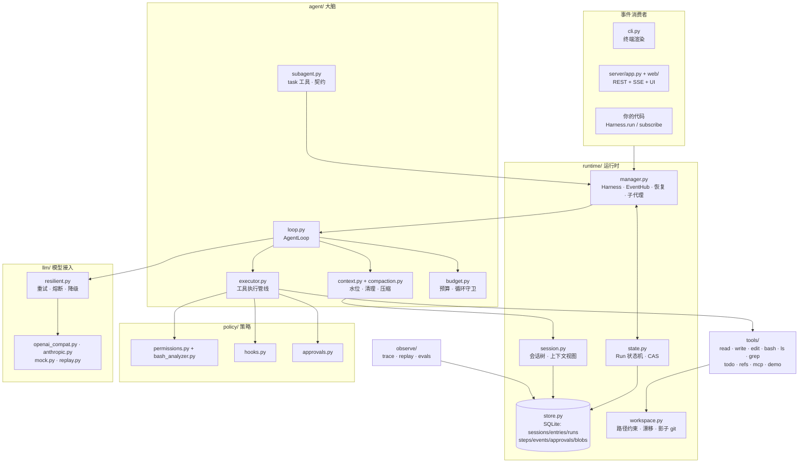
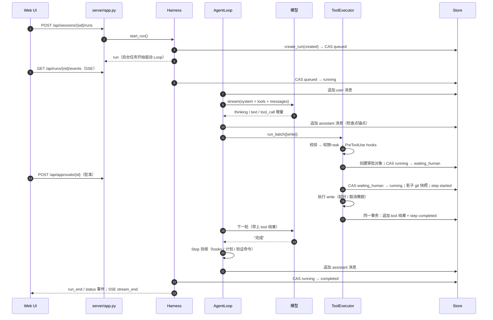
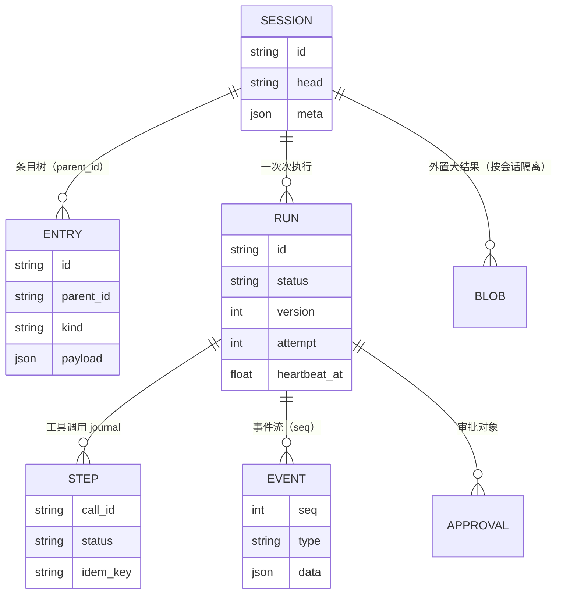

# 03 架构总览：一次请求的旅程

这一章不深入任何一个机制，而是把 **一次 Run 从输入到结束** 完整走一遍，让你知道每件事发生在哪个文件、哪个函数里。
后面的章节都是在这张地图上放大某一块。

## 模块地图



依赖方向是单向的：消费者只认识 `Harness` 与事件；`Harness` 组装 `RunContext` 交给 `AgentLoop`；
Loop 通过 `RunContext` 使用存储、模型、工具与策略。没有全局变量——测试里替换任何一个零件（脚本化模型、内存存储、
自定义权限策略）都只需要换掉构造参数。

## 一次 Run 的完整时间线

以 Web UI 里输入“创建 hello.py”（default 权限模式）为例：



每一步都对应一处具体代码：

| 步骤 | 代码位置 | 关键点 |
|---|---|---|
| 创建 Run | `Harness.start_run()` | 同一会话同时只允许一个活动 Run；运行中的输入走 steer / follow_up |
| 后台驱动 | `Harness._launch()` → `_drive()` | Run 在 `asyncio.Task` 中执行，与 HTTP 连接无关；心跳任务同时启动 |
| 事件分发 | `EventHub.publish()` | 分配单调递增的 `seq` → 批量落库 → 扇出给订阅者 |
| 主循环 | `AgentLoop.run()` / `_body()` | async generator；保证无论如何都以明确状态结束 |
| 上下文 | `_maybe_compact()`、`_call_model()` | 先估算水位，必要时压缩；清理旧结果；构造 `ModelRequest` |
| 模型调用 | `ResilientProvider.stream()` | 重试 / 熔断 / 降级只在这一层发生 |
| 工具执行 | `ToolExecutor.run_batch()` / `_run_one()` | 分批并发、权限、hooks、审批、intent、执行、外置、按原序落盘 |
| 验收 | `AgentLoop._stop_gaps()` | 计划未完成 / 验证命令失败 / Stop hook 阻止 → 注入缺口继续 |
| 结束 | `Harness._finish()` | 把 Loop 的 `Outcome` 映射为状态机迁移；取消与完成竞争时先到者胜 |

## 四条贯穿全局的设计原则

### 1. 一切都是事件，消费者只认事件

`AgentLoop.run()` 是一个 async generator，产出 `Event(type, data, seq)`。CLI 的 `TerminalRenderer`、
Web UI 的 `app.js`、测试断言、子代理向父代理的透传，全都只是“事件的消费者”。事件类型定义在 `events.py`：

| 类别 | 事件 |
|---|---|
| Run | `run_start` · `run_end` · `status`（状态机迁移；没有活动 EventHub 的离线迁移——创建、恢复、离线取消、崩溃接管——也会写一条） |
| 回合 | `turn_start` · `turn_end` |
| 消息 | `message_start` · `message_update`（text / thinking / toolcall 增量）· `message_end` |
| 工具 | `tool_start` · `tool_update`（进度 / 部分输出 / 子代理事件）· `tool_end` |
| 策略 | `approval_request` · `approval_resolved` |
| 上下文 | `compaction_start` · `compaction_end` |
| 其它 | `model_retry` · `notice` · `usage` · `error` |

命名借鉴了 pi 的 10 种 AgentEvent（agent / turn / message / tool_execution 的 start/update/end），
再补充了运行时特有的状态、审批、压缩与重试事件。

### 2. 事件永远不领先于持久化状态

```python
def _append(self, msg: Message) -> Event:
    """消息落盘（检查点）后再发 message_end：事件永远不会领先于持久化状态。"""
    self.rc.log.append_message(msg, self.rc.run_id)
    return self._ev(E.MESSAGE_END, message=msg.to_dict())
```

UI 看到 `message_end` 时，这条消息一定已经在数据库里；进程此刻崩溃，恢复后看到的历史与 UI 一致。
工具结果同理：`run_batch` 里 **先** 在一个事务中写入 tool 消息与 step 完成标记，事务提交 **之后** 才发 `tool_end`。
`EventHub` 自己也遵守这条规则：先把事件批量落库，再扇出给订阅者——断线重连的客户端从数据库补读，不会看到“只在内存里出现过”的事件。

### 3. 历史只追加

会话条目从不修改；分支只是移动 `head` 指针；压缩是追加一个 compaction 条目；
就连 harness 注入的 system-reminder 也作为一条用户消息 **落盘**，而不是每次请求临时拼接。好处有三个：

- **前缀缓存**：相邻两次请求的消息列表，后者以前者为前缀（`tests/test_loop.py::test_prefix_stability_append_only`）；
- **thinking 签名有效**：新一代 Claude 模型的 thinking 块绑定了“生成它时的完整前缀”，改写历史会让之后所有 thinking 失效；
- **回放忠实**：轨迹里记录的就是模型当时真正看到的东西。

### 4. 所有失败都变成明确的结果

| 失败 | 变成什么 |
|---|---|
| 未知工具、参数非法、权限拒绝、审批拒绝、工具异常、本地操作超时 | `is_error=True` 的 **工具结果**，模型读到后自己修正 |
| 外部副作用“不知道成没成功”（取消宽限期到期、非幂等外部调用超时、进程在执行中崩溃） | `status=unknown` 的工具结果 + journal 记录，提示先核实再重试；恢复时凭幂等键对账 |
| 取消、暂停 | `RunCancelled` / `RunPaused` → `Outcome("cancelled" / "paused")` |
| 预算耗尽、死循环、验收多次不过 | `budget_exhausted` / `loop_detected` / `incomplete`，绝不伪装成 `completed` |
| 模型调用不可恢复的失败 | `failed`，错误信息写进 Run 记录与一条 `stop_reason=error` 的消息；之后可以 `retry()` 从历史继续 |

`AgentLoop.run()` 外层的 `try/except` 保证：哪怕 Loop 内部出现未预料的异常，也会以 `failed` 结束并保留现场，
而不是让 Run 永远停在 `running`。

## 数据模型一览



- **Session.meta** 冻结了系统提示词、工具集与模型（版本钉住），以及会话级授权、清理水位线；
- **Entry** 是上下文的事实源：`message` 或 `compaction`；
- **Run** 带 `version`（每次迁移 +1，用于乐观锁）、`attempt`、`heartbeat_at`（租约）、`checkpoint`（工作区清单）；
- **Step** 是工具调用的预写日志：执行副作用 **之前** 写 `started`，完成后写结果——恢复时据此判断“做没做过”；
- **Event** 带 `(run_id, seq)` 唯一键，用于流式展示、断线续传与审计。

详见 [09 状态与持久化](/reliability/state-persistence)。

## 目录结构

```
src/flywhl_harness/
├── __init__.py          公开 API
├── types.py             统一消息模型：Message / TextBlock / ThinkingBlock / ToolCall / Usage
├── events.py            事件类型
├── cancel.py            CancelToken：协作式取消
├── config.py            配置 dataclass 树（flywhl.toml + 环境变量）
├── prompts.py           系统提示、AGENTS.md、技能清单、压缩模板
├── agent/               loop · executor · context · compaction · budget · inbox · subagent · run_context
├── llm/                 base · models · openai_compat · anthropic · mock · replay · resilient
├── tools/               base · schema · registry · fs · shell · extra · demo · mcp
├── policy/              permissions · bash_analyzer · hooks · approvals
├── runtime/             manager · store · session · state · workspace · retry · scheduler · dispatch
├── observe/             trace · replay · evals
├── server/app.py        FastAPI：REST + SSE
├── web/                 index.html · app.js · md.js · style.css（无构建步骤）
└── cli.py               flywhl 命令
```

推荐的源码阅读顺序见 [源码地图](/reference/source-map)。下一章从心脏开始：[04 Agent Loop](/core/agent-loop)。
