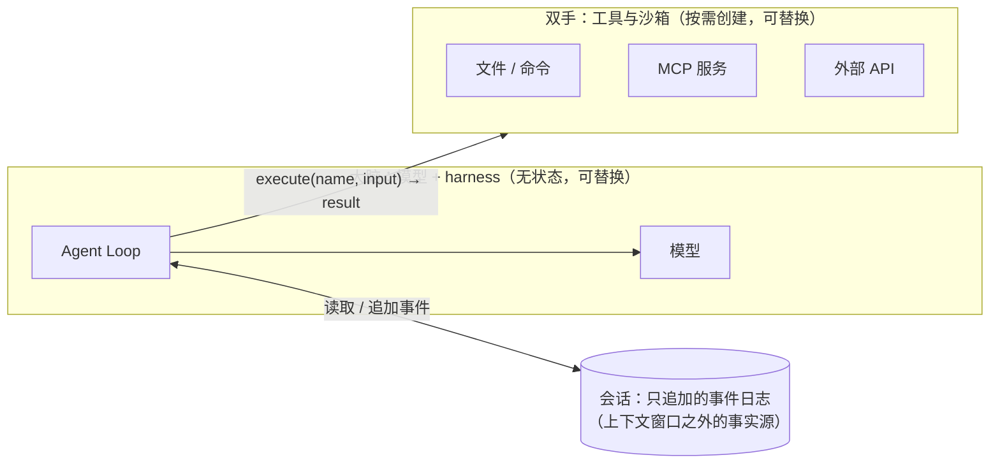

# 01 什么是 Harness

> 模型只做一件事：**看着上下文，决定下一步说什么、调用什么**。除此之外的一切——把上下文拼出来、把工具真正执行掉、
> 把结果塞回去、决定要不要继续、出错了怎么办、进程崩了怎么接着干——都是 harness 的工作。

## 从 15 行代码说起

几乎所有 Agent 教程都从这样一个循环开始：

```python
messages = [{"role": "user", "content": task}]
while True:
    reply = llm(messages, tools=TOOLS)             # 1. 调用模型
    messages.append(reply)
    if not reply.tool_calls:                        # 2. 没有工具调用 → 结束
        return reply.text
    for call in reply.tool_calls:                   # 3. 执行工具，把结果塞回去
        result = TOOLS[call.name](**call.arguments)
        messages.append({"role": "tool", "tool_call_id": call.id, "content": result})
```

它能跑，但离“能放心交给它一个两小时的任务”还差得很远。逐行追问下去：

| 追问 | 这 15 行代码的表现 | 需要的 harness 能力 |
|---|---|---|
| 模型返回了不存在的工具名、参数不合 schema？ | `KeyError` / `TypeError`，循环崩溃 | 工具层：校验 + **可操作的错误信息**回给模型 |
| 一个工具返回了 10 万行日志？ | 上下文直接撑爆 | 上下文层：截断、外置句柄、压缩 |
| 模型反复调用同一个工具？ | 死循环，烧光预算 | 终止条件：轮次/token/费用预算、循环检测 |
| 用户点了“停止”，此时正在发一个外部通知？ | 不知道发没发出去 | 生命周期：协作式取消、“结果未知”的对账 |
| 进程在工具执行一半时被 kill？ | 所有进度丢失；重跑会重复发通知 | 状态与恢复：检查点、journal、幂等键 |
| 模型想执行 `rm -rf ~`？ | 照做 | 策略：权限、审批、hooks、沙箱 |
| 模型说“完成了”，但测试其实没跑？ | 直接相信 | 验收：Stop hook、产物检查 |
| 上线后成功率掉了，是模型变了还是提示词变了？ | 无从得知 | 度量：轨迹、回放、评测 |

这些能力的总和就是 **harness**（“马具”：让一匹力气很大但不受控的马，能稳定地拉车）。业界越来越多的共识是：

```
Agent = Model + Harness
```

同一个模型，放在不同的 harness 里，表现可以差出一大截。LangChain 在 2026 年初公开过一组数据：模型固定不变，
只改 harness（系统提示、工具、中间件），在 Terminal Bench 2.0 上的成绩从 52.8 提升到 66.5。

## Harness 的八个维度

本教程把 harness 拆成八个相互配合的维度，每个维度对应 flywhl-harness 里的一组模块：

| 维度 | 它回答的问题 | 关键手段 | 代码 | 章节 |
|---|---|---|---|---|
| **Loop** | 一轮里发生什么？何时继续？ | 阶段化主循环、async generator、插话/排队 | `agent/loop.py` | [04](/core/agent-loop) |
| **工具** | 模型如何安全地作用于世界？ | schema、可操作错误、副作用分级、并发策略、外置句柄 | `tools/`、`agent/executor.py` | [06](/core/tools) |
| **上下文** | 有限的窗口里放什么？ | 水位估算、清理、压缩、复述、子代理隔离 | `agent/context.py`、`agent/compaction.py` | [07](/core/context-engineering) |
| **状态** | 什么是事实源？ | Session / Run / Step / Event、只追加、CAS | `runtime/store.py`、`runtime/session.py` | [09](/reliability/state-persistence) |
| **生命周期** | 暂停、恢复、取消、重试、崩溃怎么办？ | 状态机、协作式取消、journal、心跳租约 | `runtime/state.py`、`cancel.py`、`runtime/manager.py` | [10](/reliability/run-lifecycle)–[12](/reliability/cancellation) |
| **策略** | 什么能做、什么要问人、什么不能做？ | hooks、权限模式与规则、人审、预算 | `policy/`、`agent/budget.py` | [16](/governance/hooks)–[17](/governance/permissions-hitl) |
| **执行环境** | 工具在哪里跑？ | Workspace、快照、沙箱、端云 | `runtime/workspace.py`、`runtime/dispatch.py` | [18](/governance/workspace-sandbox)、[26](/advanced/edge-cloud) |
| **度量** | 做得好不好？为什么？ | 轨迹、回放、评测、成本 | `observe/` | [22](/multi-agent/trajectory-eval)–[23](/multi-agent/observability-cost) |

一个有用的视角是把它们分成两层：

- **能力补偿层**：弥补“当前模型还做不好的事”——强制规划、格式修复重试、激进摘要……这一层会随着模型变强而 **被删减**；
- **治理基础设施层**：权限、审计、幂等、持久化、配额——与模型多聪明无关，**永远需要**。

[28 可删减的 Harness](/advanced/evolving-harness) 专门讨论如何让第一层可开关、可消融、可删除。

## Harness、框架、工作流：别混为一谈

| 名词 | 是什么 | 例子 |
|---|---|---|
| **Harness** | 驱动模型完成任务的 *运行时*：循环 + 工具执行 + 上下文 + 状态 + 策略 | Claude Code、Codex CLI、pi、本项目 |
| **框架** | 搭建 Agent 的 *编程抽象*（图、节点、链、记忆接口），需要你在其上组装出 harness | LangGraph、AgentScope、Spring AI |
| **Harness SDK** | 把现成的 harness 打包成库 | Claude Agent SDK（Claude Code 的 harness）、pi 的 SDK 模式 |
| **托管 Agent** | harness + 部署 + 沙箱全托管 | Anthropic Managed Agents |
| **工作流** | 路径预先写死的编排，LLM 只是其中的节点 | 提示词链、路由、并行投票 |

“要不要用 Agent”本身就是一个工程判断。当 **步骤可以事先写清楚**、错误代价高且难以纠正、或者延迟/成本预算很紧时，
确定性的工作流往往更好——LLM 作为其中的一个节点（抽取、分类、生成）即可。Agent 适合的是：

1. 任务多步、路径难以预先穷举（“把这份设计文档变成一个 PR”）；
2. 结果的价值足以覆盖更高的成本与延迟；
3. 模型确实有能力完成这类任务；
4. 错误可以被发现并纠正（有测试、可回滚、可审查）。

四条里只要有一条不满足，就应该退回到更简单的形态。

## 三种循环范式，都能装进同一个 harness

| 范式 | 核心思想 | 在 harness 里的落点 |
|---|---|---|
| **ReAct** | 想一步、做一步、看结果，再想下一步 | 默认的主循环本身：模型 → 工具 → 结果回填 → 下一轮 |
| **Plan-and-Execute** | 先产出计划，再逐项执行 | `todo_write` 外置计划 + 计划复述；或把计划交给 [DAG 调度器](/multi-agent/swarm-dag) 并行执行 |
| **Reflexion** | 执行后自我评估，失败了带着反思重试 | Stop 验收（hooks / 验证命令）阻止“虚报完成”，把缺口作为反馈注入下一轮 |

生产中常见的组合是：ReAct 打底，长任务用外置计划约束方向，关键节点用 **确定性验证器**（测试、schema、引用可解析）
代替“让模型自评”——模型自评普遍偏宽松。

## 大脑、双手与会话

Anthropic 在介绍其托管 Agent 架构时，用了一个很好的拆分：



- **会话** 是唯一的事实源，存在于上下文窗口之外；上下文只是会话的一个“投影”，投影策略（清理、压缩）可以替换；
- **大脑** 本身不持有关键状态——进程崩了，新进程从会话里“唤醒”即可继续；
- **双手** 通过统一接口调用，可以是本地子进程，也可以是远程沙箱，甚至是用户的笔记本电脑。

flywhl-harness 的结构与此对应：`runtime/store.py` + `runtime/session.py` 是会话，`agent/loop.py` 是大脑，
`tools/` 是双手；`Harness.recover()` 就是“唤醒”。[03 架构总览](/guide/architecture) 会把一次请求完整走一遍。

## 为什么要自己写一个

现成的 harness 已经很好用了，但“会用”和“理解”是两回事。当你需要回答下面这些问题时，只有亲手实现过才说得清：

- 取消请求到达时，一个已经发出、还没回包的外部写操作该怎么处理？
- 压缩时为什么绝不能把一个 `tool_call` 和它的结果切到两边？
- 为什么同一轮的工具结果必须按调用的原始顺序回填？
- 进程崩溃后，凭什么断定某个副作用“已经发生过”？
- 为什么注入的 system-reminder 也要落盘，而不是每次请求临时拼上？

flywhl-harness 的定位是 **“最小，但不玩具”**：

- 核心只依赖标准库 + httpx，没有任何 Agent 框架；
- 每个机制都有测试守护（包括一个真实 `kill -9` 的崩溃恢复测试）；
- 每个设计点都标注了它对应的业界做法（Claude Code、Codex、pi、Manus、Temporal……）以及简化了什么。

它有意没有做的事也写在明处：没有 microVM 沙箱、存储是单机 SQLite、多 Worker 只演示了租约与接管——这些在对应章节里
都给出了生产化的路线。

## 小结

- harness 是“模型之外的一切”；同一个模型在不同 harness 里的表现可以差很多；
- 八个维度：Loop、工具、上下文、状态、生命周期、策略、执行环境、度量；
- 能力补偿层会被模型进步“吃掉”，治理基础设施层不会；
- 会话（事实源）、大脑（无状态）、双手（可替换）三者解耦，是长任务可恢复、可迁移的基础。

下一章先把项目跑起来：[02 快速上手](/guide/quickstart)。
