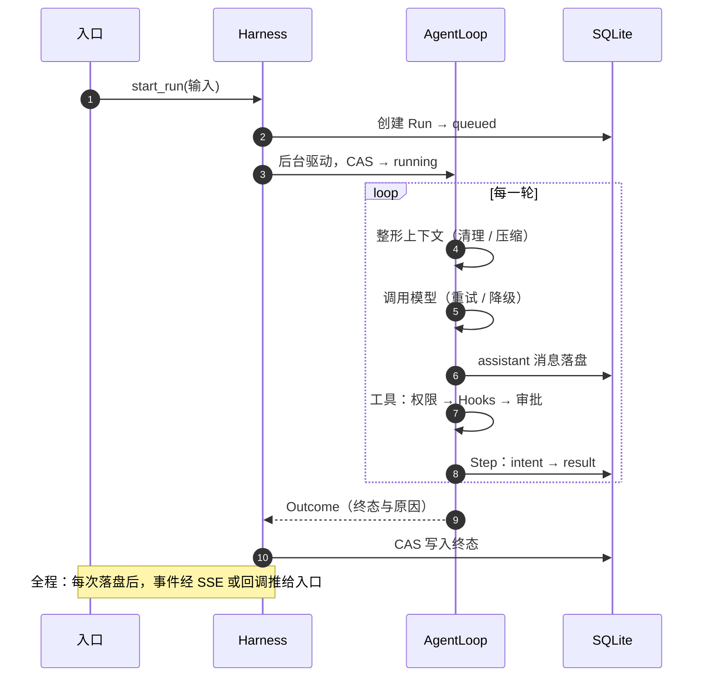

# 架构与组件

## 分层与模块

| 层 | 主要模块（`src/flywhl_harness/`） | 职责 |
|---|---|---|
| 入口 | `cli.py`、`server/app.py`、`web/` | 解析参数与配置，订阅事件并渲染；Web 经 REST 下指令、经 SSE 收事件 |
| 运行时 | `runtime/manager.py`、`state.py`、`store.py`、`session.py`、`workspace.py` | `Harness` 创建并驱动 Run；状态机迁移；SQLite 持久化；会话分支；工作区与快照 |
| Agent | `agent/loop.py`、`context.py`、`compaction.py`、`executor.py`、`budget.py`、`inbox.py`、`subagent.py` | 回合循环、上下文整形与压缩、工具执行、预算与循环守卫、插话收件箱、子代理 |
| 模型接入 | `llm/resilient.py`、`openai_compat.py`、`anthropic.py`、`profiles.py`、`mock.py` | 统一消息模型与各家协议适配；重试、熔断、降级；演示模型 |
| 工具 | `tools/fs.py`、`shell.py`、`extra.py`、`mcp.py`、`sandbox.py`、`confine.py`、`egress.py` | 内置工具、MCP 客户端、系统沙箱与出站代理 |
| 策略 | `policy/permissions.py`、`bash_analyzer.py`、`hooks.py`、`approvals.py`、`sensitive.py` | 权限判定、命令风险分析、Hooks、审批、凭证位置识别 |
| 观测 | `observe/trace.py`、`replay.py`、`evals.py` | 轨迹与 OTel span、确定性回放、评测统计 |

依赖只能自上而下：Agent 层不认识 CLI 与 Web，策略层不认识具体模型，因此每一层都能单独测试、单独替换。

## 一次请求的旅程

三个容易误解的点：

- `start_run` 返回时 Run 已在库里，处于 `queued`；客户端靠事件流跟进，不靠等待返回值。
- 模型回复先落盘，工具才开始执行；并发执行的工具结果仍按调用的原始顺序写回。
- 结束原因由 Loop 产出的 `Outcome` 决定，`Harness` 只负责用 CAS 把它写成终态。

## 数据模型

| 实体 | 含义 | 关键字段 |
|---|---|---|
| Session | 一段对话 | `head` 指向当前分支末端 |
| Entry | 会话树上的节点：消息、压缩摘要、系统注入 | 父节点；只追加 |
| Run | 对一次输入的执行 | `status`、`version`、`attempt`、`worker_id`、`heartbeat_at`、`checkpoint` |
| Step | 一次工具调用的日志 | intent → result、幂等键、写前快照 |
| Event | 推给客户端的变化 | Run 内单调递增的 `seq` |
| Approval | 待审批的调用及最终决定 | 风险、修改后的参数、决定人、是否记住授权 |
| Blob | 外置的超长工具结果 | 供 `read_ref` / `search_ref` 读取 |

## 内置工具

| 工具 | 副作用 | 说明 |
|---|---|---|
| `read`、`ls`、`grep` | READ | 带行号读取、列目录、正则搜索；可以并发 |
| `write`、`edit` | WRITE | 执行前打影子 git 快照 |
| `bash` | 按命令分析 | 只读命令按 READ 处理，其余进入权限判定；可中断 |
| `todo_write` | READ | 外置计划，只改 harness 内部状态 |
| `read_ref`、`search_ref` | READ | 分页读取或检索外置结果 |
| `task` | 由子代理自身把关 | 派生隔离上下文的子代理，只回传结构化结论 |
| MCP 工具 | EXTERNAL；配置点名的为 READ | 命名为 `mcp__<服务器>__<工具>`；服务器自报的注解默认不采信 |

## 扩展点

- **工具**：用 `@tool(effect=Effect.READ)` 装饰异步函数，参数类型与 `Annotated` 说明自动生成 schema。
- **Hooks**：Python 回调或外部命令，挂在 8 个生命周期事件上，协议与 Claude Code 兼容。
- **MCP**：在配置里声明 `mcp_servers`，即可接入任意 stdio 服务器。
- **模型**：OpenAI 兼容服务只需配置 `base_url` 与密钥；新协议在 `llm/` 下实现 `Provider`。
- **事件**：库里传 `on_event` 回调，或订阅 Web 的 SSE。

深入阅读：[03 架构总览](/guide/architecture)、[09 状态与持久化](/reliability/state-persistence)、[源码地图](/reference/source-map)。
