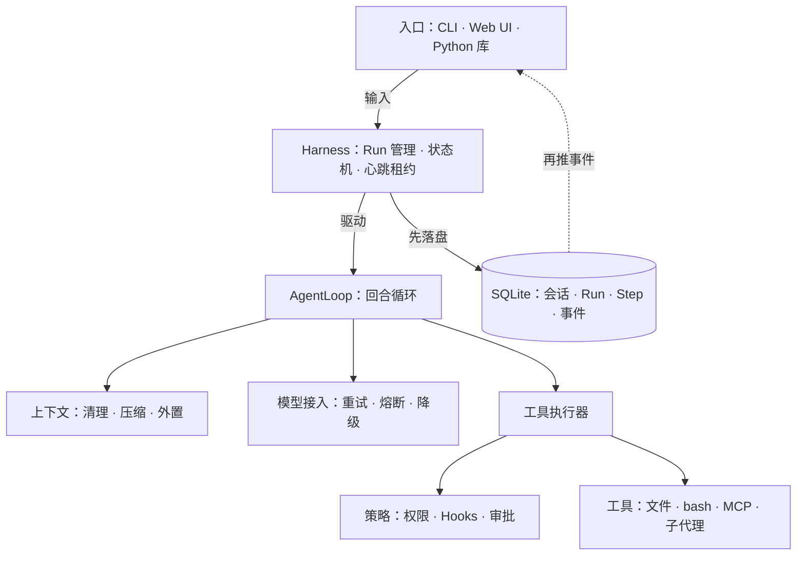

# 精简手册

**Agent = Model + Harness。** 模型只决定“下一句说什么、调哪个工具”；让它连续工作几小时、崩溃能续上、越权会被拦下，靠的是模型之外的一切——循环、工具、上下文、状态、生命周期、策略、执行环境与度量，统称 Harness。

本手册把 [30 章教程](/guide/what-is-harness) 压缩成 7 页，只保留结论、机制与用法；每页末尾列出可以深入的章节。

## 全景

入口把输入交给 `Harness`，它创建 Run 并在后台驱动 `AgentLoop`。Loop 每一轮先整形上下文、再调用模型，把模型要求的工具调用交给执行器；执行器让每次调用逐道通过策略关卡后才真正执行。所有变化先写进 SQLite，再作为事件推给三种入口。

## 阅读路径

| 目标 | 顺序 |
|---|---|
| 十分钟跑起来 | [实战手册](./practice) → [速查表](./cheatsheet) |
| 理解为什么这样设计 | [理论精要](./theory) → [架构与组件](./architecture) → [关键机制](./mechanisms) |
| 上线前评估风险 | [安全与治理](./security) |

## 项目速览

- Python 3.11+，核心只依赖 `httpx`；Web 层是 FastAPI + SSE；状态存 SQLite（WAL 模式）。
- 三种入口：终端 `flywhl chat` / `flywhl run`、Web UI `flywhl serve`、Python 库 `Harness`。
- 模型写成 `<供应商>:<模型>`，接入 DeepSeek、Anthropic、OpenAI 兼容服务、百炼、Kimi、智谱、MiniMax、OpenRouter 与本地 Ollama；一个密钥都没有时，内置演示模型 `flywhl-demo` 按剧本演示全部机制。
