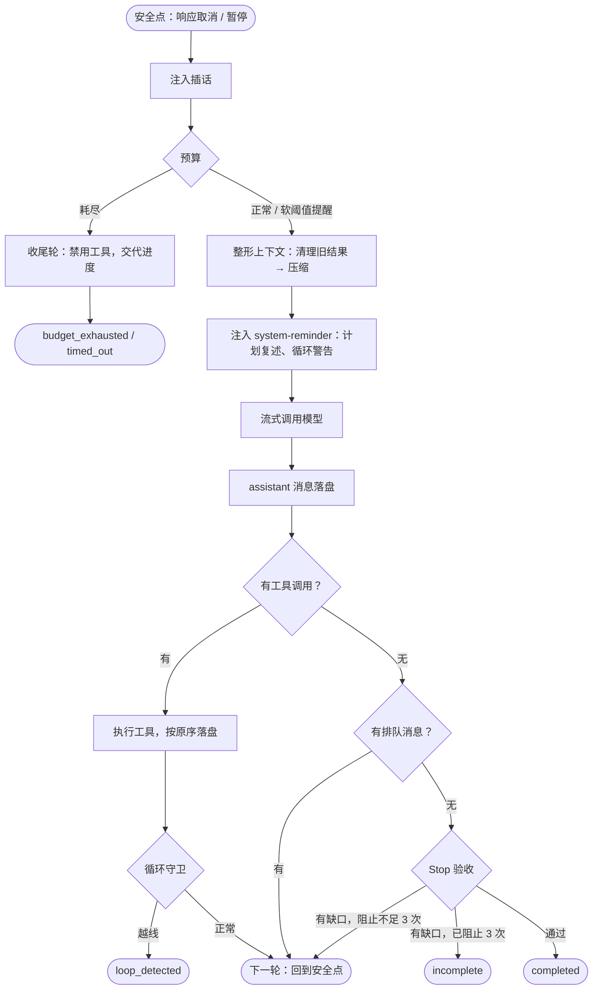
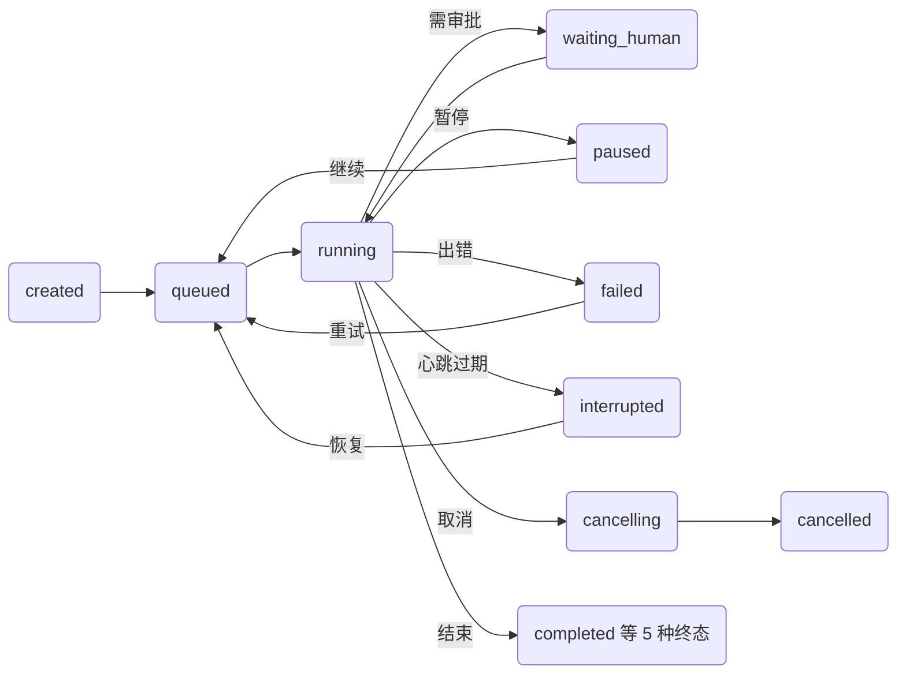

# 关键机制

## 回合循环

`AgentLoop` 是一个异步生成器：每一轮按固定阶段推进，每个阶段的边界都落盘，崩溃后从最近的边界继续。

Stop 验收汇总三类缺口：`stop` Hook 的拒绝、未完成的待办（`verify_todos`）、`verify_command` 的失败输出。缺口作为反馈注入后继续干活，最多阻止 `max_stop_blocks` 次。

## 工具执行管线

| 阶段 | 做什么 | 不通过时 |
|---|---|---|
| 预处理 | 工具是否存在，参数是否符合 JSON Schema | 错误作为结果回给模型，由它自行修正 |
| 权限判定 | 见[安全与治理](./security#权限判定) | deny 直接回结果；ask 进入审批 |
| PreToolUse Hooks | 可拒绝，也可改写参数；改写后重新校验、重新判定 | 拒绝原因回给模型 |
| 审批 | Run 进入 `waiting_human`；人可批准、改参后批准或拒绝 | 改过的参数重新校验、判定并再过 Hooks；Hooks 若再次改参就再判定一次，结果为 deny 则不执行 |
| 预写 intent | Step 先记下意图与幂等键；写操作前打影子 git 快照 | — |
| 执行 | 与超时、取消赛跑；只读或幂等工具遇瞬时错误自动重试 | 超时、取消都成为显式结果 |
| PostToolUse Hooks | 审计、脱敏 | — |
| 结果处理 | 超过 6000 token 的结果外置为句柄；来自外部世界的内容打污点 | — |

同一轮的调用被切成连续批次：只读且并发安全的组成并行批（上限 `parallel_tool_limit` = 8），其余严格串行；结果一律按模型给出的原始顺序写回，保证调用与结果配对、回放确定。

## 上下文工程

水位 = 上一次模型返回的真实用量 + 之后新增内容的估算。

| 触发 | 动作 |
|---|---|
| 单个结果超过 `tool_result_max_tokens`（6000） | 外置为 blob 句柄，模型用 `read_ref` 分页读、`search_ref` 检索 |
| 水位超过 `clear_threshold`（55%） | 清掉较早的工具结果正文，保留最近 3 轮 |
| 水位超过 min(窗口 × 80%，窗口 − 8192) | 摘要压缩 |

压缩是最后一道、也是唯一有损的手段，规则是“保留恢复工作所需的最小集”：

- 只在回合边界、所有工具调用都已配对时触发；从最新消息往回保留约 12000 token，切点优先落在用户消息上，绝不切在工具结果处。
- 已有摘要时做增量更新，避免“摘要的摘要”层层失真。
- 原始任务原文、读过和改过的文件清单由代码直接提取，不依赖模型记忆。
- 摘要作为新条目追加，原始历史仍可回查；模型调用失败时退化为确定性摘要，压缩失败不会拖垮 Run。

## 模型接入：重试、熔断与降级

`ResilientProvider` 包住一条模型链：先在主模型上按指数退避加全抖动重试（延迟取 0 到 min(上限, 基数 × 2^n) 间的随机值，避免一齐重试），连续失败 5 次熔断 30 秒，再沿 `fallback_models` 逐个切换，可以跨供应商。

| 错误类别 | 处理 |
|---|---|
| 限流、过载、服务端错误、超时、网络 | 原地退避重试，仍失败再降级 |
| 余额不足、模型不存在 | 不原地重试，直接降级 |
| 鉴权失败 | 只降级到另一家供应商 |
| 上下文超长、参数非法 | 不降级；超长交给 Loop 压缩 |

流式重试时半截输出已经推给了界面，所以整体重发请求，并先发 `retry` 事件让客户端丢弃半截消息，已消耗的 token 照实记账。每条 assistant 消息都记下实际服务的 `provider/model`，评测时可以归因。

## 预算与循环守卫

| 限额 | 默认 | 到达后 |
|---|---|---|
| 轮次 / 工具调用 | 40 / 200 | 达到 80% 时提醒收敛；耗尽时再给一轮禁用工具的收尾调用，以 `budget_exhausted` 结束 |
| token / 费用 / 墙钟 | 不限，可配置 | 同上；墙钟超限以 `timed_out` 结束 |
| 同一调用重复（最近 12 次内） | 3 次 / 5 次 | 警告 / 以 `loop_detected` 结束 |
| 工具连续报错 | 6 次 | 以 `loop_detected` 结束 |
| 同一文件反复编辑 | 6 次 | 警告 |

## Run 状态机

图中省略了次要迁移：`created`、`queued`、`paused`、`waiting_human`、`interrupted` 都能直接取消；`waiting_human`、`cancelling` 遇心跳过期也进入 `interrupted`；`waiting_human`、`interrupted` 可能直接 `failed`。

- 终态 6 个：`completed`、`incomplete`、`budget_exhausted`、`loop_detected`、`timed_out`、`cancelled`。`failed` 可重试（attempt + 1，从历史继续），`interrupted` 可恢复。
- 每次迁移都是一条 `UPDATE … WHERE status=? AND version=?`，成功则 version 加一；并发的两次迁移只有一次生效，非法迁移直接报错。

## 取消、崩溃与恢复

- **取消是协作式的。** Run 先进入 `cancelling`，Loop 只在安全点响应。可中断工具（`bash`、`sleep`）连同整个进程组先 SIGTERM、后 SIGKILL；不可中断的（已发出的外部请求、子代理）有 `cancel_grace_seconds`（5 秒）宽限，仍未结束就记为“结果未知”。
- **心跳租约。** Worker 每 2 秒更新 `heartbeat_at`，超过 10 秒没更新即视为崩溃。`flywhl recover` 或服务内的恢复循环固定 `expect_version` 做 CAS 接管，两个 Worker 不会同时接手；恢复后从检查点继续，并告诉模型暂停期间工作区哪些文件变了。
- **有 intent 无 result 的调用先对账。** 工具能凭幂等键查到结果就直接采用；查不到时，只读或幂等工具用同一幂等键重跑，其余返回“结果未知，先核实外部状态”，绝不盲目重试。`examples/11_kill9_cli_recover.py` 用 `kill -9` 验证恰好一次的 7 条不变量。

## 插话与断线续传

运行中用户的新输入有两种去向：**插话**在下一个安全点注入当前运行，**排队**等模型想结束时接着处理。事件带 Run 内单调递增的 `seq`，SSE 断线后浏览器带 `Last-Event-ID` 续传，不丢不重。

## 子代理、调度与评测

- **子代理**：`task` 工具派生全新会话，看不到父上下文；工具集更窄，预算从父预算切出，取消令牌由父令牌派生（父取消，子立即取消）。回传必须符合结构化契约（`status`、`summary`、带证据与置信度的 `findings` 等），经 schema 与产物存在性校验，违约修正一次，仍违约按失败处理。默认最多嵌套 2 层。
- **DAG 调度**：拆解交给模型，调度交给确定性代码。Kahn 算法拓扑排序并检测环；先拿租户名额、再拿全局名额，避免队头阻塞；失败策略可选 `fail_fast`、`skip_downstream`、`continue`。
- **回放与评测**：确定性回放从轨迹读取模型输出与工具结果，不调模型、不产生副作用；改了提示词或截断规则后，第一个上下文指纹不一致的位置就是分叉点。反事实回放前 N 次调用用录制结果，之后换新模型，工作区复制到临时目录。评测报告成功率的 Wilson 95% 置信区间、配对对比的 McNemar 精确检验与过早结束率。

深入阅读：[07 上下文工程](/core/context-engineering)、[10 Run 生命周期](/reliability/run-lifecycle)、[11 检查点与崩溃恢复](/reliability/checkpoint-recovery)、[13 重试、熔断与降级](/reliability/retry-fallback)、[14 幂等与副作用](/reliability/idempotency)、[20 子代理](/multi-agent/subagents)、[22 轨迹、回放与评测](/multi-agent/trajectory-eval)。
