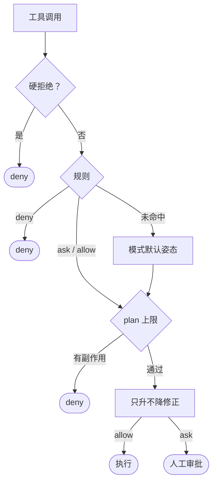

# 安全与治理

## 威胁模型

| 来源 | 典型攻击 | 主要防线 |
|---|---|---|
| 模型读到的内容 | 网页、文件、MCP 结果里的提示注入，诱导外传凭证或搞破坏 | 污点升级、凭证位置硬拒绝、人工审批 |
| 不可信仓库 | `flywhl.toml` 或 `.env` 改写 `base_url` 引走密钥、挂恶意 Hook、放宽权限 | 项目配置信任、`.env` 白名单 |
| 本机端口 | 恶意网页借 DNS 重绑定或跨站请求驱动 Agent | 访问令牌、Host 白名单、Origin 校验 |
| 命令本身 | 看似只读的命令暗藏执行或写入 | bash 风险分析、运行环境加固、沙箱、快照 |

## 权限判定

- **硬拒绝**：灾难性命令、涉及凭证位置的操作，任何模式都拒绝。bash 先经命令分析定级，只读命令按只读处理。
- **规则**：托管基线、项目与用户规则、本会话授权放在一起，按 deny → ask → allow 取第一个命中。复合命令（`&&`、`;`、管道）要求每一段都被 allow 覆盖，`git status && rm -rf x` 搭不了便车；deny 与 ask 匹配时不区分大小写，`.SSH/config` 绕不过 `*/.ssh/*`。
- **plan 上限**：plan 模式下，任何规则与授权都放行不了副作用。
- **只升不降**：高危命令、含命令替换的命令、污点会话里的副作用，即使命中 allow 也改为审批（bypass 除外）。
- **人工审批**：批准、改参后批准或拒绝；无人值守时按 `on_ask` 处理，`auto_approve`（`--approve`）列出的规则命中才自动批准。卡片上写明“本会话始终允许”会添加哪条规则；接连秒批、同类操作反复批准时，时间线里会提示改成规则。

| 模式 | 只读 | 写文件 | 命令与外部操作 |
|---|---|---|---|
| `default` | 放行；工作区外需审批 | 审批 | 审批 |
| `accept_edits` | 同 default | 工作区内 `write` / `edit` 放行 | 审批 |
| `plan` | 仅工作区内放行 | 拒绝 | 拒绝 |
| `bypass` | 放行 | 放行 | 放行 |

`bypass` 只是不再询问：规则（含托管基线）照常生效，也只应在隔离沙箱里使用。

## 托管基线

排在所有规则之前，任何配置和模式都去不掉：

| 对象 | 决策 |
|---|---|
| 凭证位置：`.ssh`、`.aws`、`.kube`、`.gnupg`、`.docker/config.json`、`.netrc`、`.git-credentials`、gh / gcloud / azure 配置、`.pgpass`、`.vault-token`、`/etc/shadow`、`/proc/*/environ`、`~/.flywhl/server_token` 等 | 读、搜、写、改一律拒绝 |
| `.env`、`.env.*`、`.npmrc`、shell 历史 | 需审批 |
| `.flywhl/` 数据目录 | 写入拒绝 |
| `flywhl.toml`、任意 `.git/` 下的文件 | 写入需审批，`accept_edits` 也一样 |
| `rm -rf /`、`mkfs`、fork 炸弹等 | 拒绝 |

## bash 风险分析与运行环境

以下写法会从“只读”升级为写入或外部操作，进入审批：

- 读命令的执行或写入选项：`rg --pre`、`awk -f`、`sed -f`、`sort --compress-program`、`uniq IN OUT`、`tree -o`、`less -o`；
- 环境变量前缀或单独赋值：`PATH=`、`HOME=`、`LD_PRELOAD=`、`DYLD_*`、`GIT_*`、`LESSOPEN`；
- git 的 `-c`（只放行少数安全键）、`--config-env`、`--exec-path`、`--git-dir`；`remote show` / `remote update` 算联网，`branch -D`、`tag -d` 算写入；
- `&>>`、`>&` 重定向算写入；`trap`、`watch` 的参数递归分析；
- 路径先解析符号链接：指向凭证位置直接拒绝，指向工作区外需审批。

变量与当前目录同样参与判断：命令里赋过值的变量按每种取值各分析一遍（`C=rm; $C -rf ~` 照样拒绝），`cd` 之后的相对路径按切换后的目录拼起来（`cd ~ && rm -rf *` 拒绝）。变量可能为空时，`rm -rf`、`find -delete`、`chmod -R` 的目标按“为空”再判一次：`rm -rf $DIR/*` 就是 `rm -rf /*`，任何模式都拒绝，并提示改写成 `${DIR:?}`。

bash 子进程的环境同步加固：剥离密钥类环境变量（`strip_secret_env`）；经 `GIT_CONFIG_COUNT` 强制 `core.fsmonitor=false` 与 `safe.bareRepository=explicit`，并设 `GIT_OPTIONAL_LOCKS=0`，仓库里的 git 配置无法借机执行代码。`grep` 与 `search_ref` 的正则在可强杀的子进程里限时运行，灾难性回溯拖不垮服务。

## 污点与 Hooks

- 会话读入外部世界的内容后（`curl`、`git pull` 等联网命令，以及默认视为开放世界的 MCP 工具）被标记污点，此后所有副作用至少需要审批。污点记在会话上，暂停恢复、崩溃接管后依然有效。
- Hooks 只能收紧：按优先级串行执行，任一拒绝立即短路。`pre_tool_use` 的命令 Hook 未写 `fail_closed` 时默认失败即拒绝，脚本崩溃或超时都按拒绝处理；其余事件默认失败放行。
- MCP 服务器启动时同样剥离密钥环境变量。

## 配置信任

启动目录的 `flywhl.toml` 或 `.flywhl/config.toml` 可能来自陌生仓库，其中的高危设置要先信任才生效：`hooks`、`mcp_servers`、`verify_command`、`base_url`、`api_key` / `api_key_env`、`extra_body`、`workspace`、`data_dir`、`durability`、allow 规则，以及 `bypass` / `accept_edits`、`on_ask = "allow"`、`strip_secret_env = false`、出站白名单条目与沙箱里放行的 Unix 套接字等放宽项。关闭沙箱不在其中：项目配置里的 `sandbox = "off"` 信任了也不算。信任绑定“路径 + SHA-256”，记录在 `~/.flywhl/trusted.json`，文件内容一变就要重新确认（终端逐项确认或 `--trust`）。`-c` 指定的文件与 `~/.flywhl/config.toml` 视为可信。

hook 与 MCP 服务器默认跑在系统沙箱里，读不到凭证、写不了工作区之外，但工作区它们能写，仍按供应链对待：命令里写出的脚本（`python3 scripts/guard.py`）一并算进信任哈希，命令 hook 每次执行前再核对，Agent 改过脚本就拒绝执行；`npx`、`uvx`、`docker run` 临时拉取又没锁到确切版本的包会在确认提示和设置页里标出（认不出的选项、本地目录这类拿不准的情况一律算没锁），`permissions.require_pinned = true` 时直接拒绝启动。包管理器还会读运行目录里的 `uv.toml`、`.npmrc` 来换包源，hook 与 MCP 服务器最好在工作区外的目录运行。

`.env` 同理：默认只读取各家密钥与模型选择，地址、代理、权限模式等变量被忽略；确实需要时写进环境变量，或用 `--env-file` 显式加载。

## Web 访问控制

- **令牌默认开启。** 首次启动生成令牌并保存到 `~/.flywhl/server_token`（权限 0600），终端打印带 `?token=` 的链接；在 `/` 上兑换成 30 天的 HttpOnly Cookie 后 303 跳转，地址栏不留令牌。API 也接受 `Authorization: Bearer`。`--token` 指定令牌。`--no-token` 只允许监听回环地址，Agent 运行的命令连得到控制台端口时也拒绝启动：没有令牌时，这些命令能调用审批接口，批准自己的人工门。“连得到”指沙箱档位是 off、网络策略是 `allow`，或者白名单放行了回环地址上的这个端口，hook 和 MCP 服务器自己的沙箱设置同样算；沙箱用不了时命令不会执行，不算。
- **监听非回环地址要显式声明。** 没加 `--expose` 时拒绝启动，退出码 2。这类地址必须带令牌，`--token` 手动指定时至少 16 个字符。
- **请求体上限** 8 MB，超出返回 413；不接受分块上传，缺少 `Content-Length` 返回 411。
- **Host 白名单** 抵御 DNS 重绑定，不能关闭：只接受回环地址和 `--allow-host` 写的主机名或 IP，不接受 `*`。监听具体的 IP 时这个 IP 自动加入，监听 `0.0.0.0`、`::` 时不加。所有写请求要求 Origin 与服务同主机同端口。
- **安全响应头**：CSP 禁止内联脚本并设 `frame-ancestors 'none'`，另有 `X-Frame-Options: DENY`、`X-Content-Type-Options: nosniff`、`Referrer-Policy: no-referrer`。

## 执行环境

- 文件工具经 `Workspace.resolve()` 解析路径并跟随符号链接，越出工作区即拒绝。
- 写操作前打影子 git 快照（`.flywhl/shadow.git`，不碰你自己的 `.git`），可在 Web 的“历史”页回滚。
- 系统沙箱默认开启（macOS 用 sandbox-exec，Linux 用 bubblewrap），bash、命令 hook、MCP 服务器和 `verify_command` 都在里面：凭证位置由内核拒绝，写入限于工作区与临时目录，docker.sock、ssh-agent、钥匙串、`open` 这类能让沙箱外的进程代劳的通道也被拒绝（本机数据库的套接字可以在 `unix_sockets` 里放行）。
- 网络默认只放行 `network_allow` 里的主机，默认一个都没有，被拦时结果里写明主机和放行办法。`sandbox_network = "deny"` 整体断网。
- 用不了沙箱时命令拒绝执行，不退回沙箱外。Linux 上 `apt install bubblewrap`；确实要在没有沙箱的环境里运行，在用户配置里写 `sandbox = "off"` 或加 `--sandbox off`，项目配置写的不算。
- 要在沙箱外跑一条命令（`git push`、`gh`），模型要带 `outside_sandbox`，任何模式都要人确认，`auto_approve` 和规则放行不了，无人值守时拒绝。
- 工作区里之后会在沙箱外起作用的位置只读：`.flywhl/`、`flywhl.toml`、数据目录、`.git/hooks`、`.git/config`。所以 `git config`、`git remote add` 在沙箱里会失败，`git add`、`git commit` 不受影响。
- 系统沙箱挡的是误操作和注入驱动的越界，和宿主共用内核。跑不可信代码、多租户时请用容器或 microVM。
- CLI 显示工具输出前过滤终端控制字符，防止输出篡改终端。

深入阅读：[16 Hooks](/governance/hooks)、[17 权限与人审](/governance/permissions-hitl)、[18 Workspace 与沙箱](/governance/workspace-sandbox)、[19 安全](/governance/security)。
