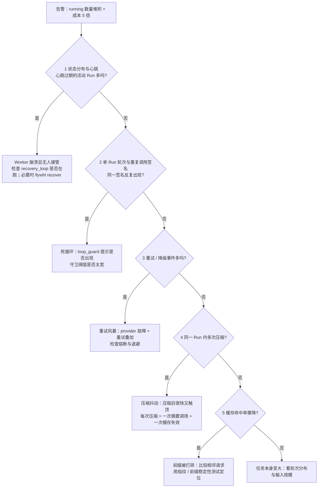

# 23 可观测性与成本

Agent 上线之后，最常被问的两个问题是“它现在在干什么”和“这个月为什么花了这么多钱”。
本章讲三件事：怎么把 harness 的事件映射成业界通用的 trace（OTel GenAI 语义约定）；看板上应该有哪些指标、从哪些事件算出来；以及成本怎么计量、怎么优化、出了“成本暴涨”事故怎么排查。

## OTel GenAI 语义约定

OpenTelemetry 为生成式 AI 定义了一组语义约定（GenAI semantic conventions），其中与 Agent 相关的部分规定了 span 的类型与属性命名：

| span 类型（`gen_ai.operation.name`） | 表示什么 |
|---|---|
| `create_agent` | 创建一个 Agent（定义、注册） |
| `invoke_agent` | 一次 Agent 调用 |
| `chat` 等模型操作 | 一次模型调用 |
| `execute_tool` | 一次工具执行 |

常用属性包括 `gen_ai.provider.name`、`gen_ai.agent.id` / `gen_ai.agent.name`、`gen_ai.conversation.id`、`gen_ai.request.model` / `gen_ai.response.model`、`gen_ai.usage.input_tokens` / `gen_ai.usage.output_tokens`、`gen_ai.tool.name` / `gen_ai.tool.call.id` 等。约定把消息内容（提示词、回复、工具参数与结果）视为敏感数据，**默认不采集，需要显式开启**。

::: warning 规范仍在演进
GenAI 语义约定目前处于 Development 状态，属性名在不同版本之间有过调整（例如 provider 属性曾经叫 `gen_ai.system`）。接入时以你所用版本的官方文档为准。
:::

## to_otel_spans：事件流到 span 的映射

`src/flywhl_harness/observe/trace.py` 的 `to_otel_spans()` 不依赖 OTel SDK，直接从一次 Run 的事件流生成 span 字典：

```python
def to_otel_spans(run: dict[str, Any], events: list[Event], session_meta: dict[str, Any]) -> list[dict[str, Any]]:
    trace_id = hashlib.sha1(run["id"].encode()).hexdigest()[:32]
    root_id = _sid(run["id"], "root")
    # ...
    spans.append({
        "trace_id": trace_id, "span_id": root_id, "parent_span_id": None, "name": "invoke_agent flywhl",
        "start_ns": int(start * 1e9), "end_ns": int(end * 1e9),
        "attributes": {
            "gen_ai.operation.name": "invoke_agent", "gen_ai.agent.name": "flywhl", "gen_ai.agent.id": run["id"],
            "gen_ai.conversation.id": run["session_id"], "gen_ai.provider.name": provider, "gen_ai.request.model": model,
            "gen_ai.usage.input_tokens": usage.get("input_tokens", 0), "gen_ai.usage.output_tokens": usage.get("output_tokens", 0),
            "flywhl.run.status": end_ev.data.get("status") if end_ev else run.get("status"),
        },
    })
    for ev in events:
        if ev.type == E.MESSAGE_START:
            open_chat[ev.data["message_id"]] = ev
        elif ev.type == E.MESSAGE_END and ev.data.get("message", {}).get("role") == "assistant":
            # ... 以 message_start 为起点、message_end 为终点生成 chat span
        elif ev.type == E.TOOL_START:
            open_tool[ev.data["call_id"]] = ev
        elif ev.type == E.TOOL_END:
            # ... 以 tool_start 为起点、tool_end 为终点生成 execute_tool span，出错时加 error.type
    return spans
```

映射关系：

| span | 起止事件 | 属性 | 取值来源 |
|---|---|---|---|
| `invoke_agent flywhl`（根） | 第一个事件 → 最后一个事件 | `gen_ai.agent.id` | Run ID |
| | | `gen_ai.conversation.id` | 会话 ID |
| | | `gen_ai.provider.name` / `gen_ai.request.model` | 会话 `meta` 中记录的 provider 与模型 |
| | | `gen_ai.usage.input_tokens` / `output_tokens` | `runs.usage`（含子代理，见下文） |
| | | `flywhl.run.status` | `run_end` 事件的状态 |
| `chat {model}` | `message_start` → assistant 的 `message_end` | `gen_ai.response.model` | 消息上记录的实际模型（降级后与请求模型不同） |
| | | `gen_ai.response.finish_reasons` | `stop_reason` |
| | | `gen_ai.usage.*`，含 `gen_ai.usage.cache_read.input_tokens` | 该次调用的真实 usage |
| `execute_tool {name}` | `tool_start` → `tool_end` | `gen_ai.tool.name` / `gen_ai.tool.call.id` / `gen_ai.tool.type=function` | 工具调用 |
| | | `error.type` | 仅在 `is_error` 时设置，取工具结果的状态（如 `denied`、`timeout`） |

几个实现上的选择：

- **ID 是确定性的**：`trace_id` 取 Run ID 的 SHA-1，span ID 取 `(run_id, message_id / call_id)` 的哈希。同一个 Run 重复导出得到完全相同的 ID，后端可以据此去重；
- **chat 与 execute_tool 是兄弟**：两者的 `parent_span_id` 都是根 span。工具执行发生在两次模型调用之间，时间线上自然交错；
- **默认不带内容**：span 里没有提示词、回复和工具参数。需要内容时去轨迹的 `messages` 里取，访问控制可以和 trace 后端分开做。

`examples/08_replay_eval.py` 导出的 6 个 span 正好是：1 个 `invoke_agent`、3 个 `chat`（3 次模型调用）、2 个 `execute_tool`（`read` 与 `send_notification`）。

### 与语义约定之间的差距

| 差距 | 现状 | 改进方向 |
|---|---|---|
| 子代理不在同一条 trace 里 | 子 Run 的轨迹在 `children` 中递归导出，但 `trace_id` 由子 Run ID 自己算出，根 span 的 `parent_span_id` 为空 | 子 Run 沿用父 Run 的 `trace_id`，`parent_span_id` 指向父 Run 中那次 `task` 调用的 `execute_tool` span。这需要在创建子 Run 时记下父工具调用的 `call_id` |
| 不能接入上游 trace | `trace_id` 由 Run ID 派生，与发起请求的 HTTP 调用、队列消息无关 | 创建 Run 时接受 W3C `traceparent`，存进 Run 的 `config`，导出时作为根 span 的父 |
| 缓存写入 token 未导出 | `chat` span 只有 `cache_read` | 补上缓存写入的属性（属性名以语义约定当前版本为准） |
| token 口径 | 本项目的 `input_tokens` 是**未命中缓存**的输入（见下文“成本计量”） | 导出前确认后端与语义约定对 `input_tokens` 是否包含缓存部分的口径，必要时换算 |
| 根 span 的用量含子代理 | `runs.usage` 包含子代理消耗 | 汇总时只算根 Run 的根 span，或只汇总 `chat` span |
| 失败没有 `error.type` | 根 span 只有 `flywhl.run.status` | Run 以非 `completed` 状态结束时，给根 span 设置 `error.type` |

## trace 上下文的传播

单进程内，事件天然按 `run_id` 串在一起；一旦跨进程，就要显式传播 trace 上下文：

| 边界 | 传播方式 |
|---|---|
| HTTP（客户端 → `server/app.py`） | 标准 `traceparent` / `tracestate` 请求头 |
| 消息队列（入口 → Worker） | 把 `traceparent` 写进消息头或消息体；Worker 取出后作为 Run 根 span 的父 |
| 工作流引擎 | 写进工作流的 memo / header，活动执行时恢复上下文（见 [25 持久执行引擎映射](/advanced/durable-execution)） |
| 进程内子代理 | 通过 `RunContext` 传递父 span 信息（目前未实现，见上表） |
| 外部子进程（如用 bash 启动另一个 Agent） | 环境变量传入 `TRACEPARENT`，子进程自行读取 |

传播的价值在于“一次用户请求的全部开销”能在一条 trace 里看完：入口排队了多久、模型调用了几次、哪个子代理最慢、哪次工具调用失败了。

## 指标与看板

下表的指标都能从现有的表与事件算出来，不需要额外埋点：

| 指标 | 定义 | 数据来源 | 告警思路 |
|---|---|---|---|
| 活动 Run 数与状态分布 | 各状态的 Run 数量 | `runs.status`（只看 `parent_run_id IS NULL`） | `running` 持续上升而 `completed` 速率下降 |
| 心跳过期的活动 Run | 状态为活动但 `heartbeat_at` 超过 `stale_after_seconds` | `runs.heartbeat_at`、`runs.worker_id` | 出现即告警：Worker 崩溃且无人接管 |
| TTFT | 一次模型调用从请求到第一个增量的时间 | `message_start.ts` → 同 `message_id` 的第一个 `message_update.ts` | P95 相对基线显著上升 |
| 输出速度 | 输出 token / 生成时长 | `message_end` 的 usage 与时间戳 | 持续下降常意味着 provider 拥塞 |
| 每 Run 成本 | 根 Run 的 `usage.cost_usd` | `runs.usage` 或 `run_end.usage` | P95 超过近 7 天基线的若干倍 |
| 每 Run 轮次 | 回合数 | `run_end.turns`、`turn_start` 计数 | 分布右移意味着任务变难或 Agent 原地打转 |
| 缓存命中率 | `cache_read / (input + cache_read + cache_write)` | assistant `message_end` 的 `usage` | 发布后骤降：前缀被打碎 |
| 工具错误率 | `is_error` 的 `tool_end` 占比，按工具名分组 | `tool_end` 事件 | 某个工具突然升高：环境变化或工具回归 |
| 重试率 / 降级率 | 每次模型调用的重试次数；降级发生次数 | `model_retry` 事件；`notice` 中 `code=fallback` | 升高时先看 provider 状态，警惕重试风暴 |
| 循环守卫触发率 | 每 Run 的守卫提示次数；`loop_detected` 结束占比 | `notice` 中 `code=loop_guard`；`runs.status` | 新版本上线后上升：提示词或工具改坏了 |
| 压缩频率 | 每 Run 的压缩次数，及 `skipped=true` 的次数 | `compaction_start` / `compaction_end` | 同一 Run 内多次压缩：压缩抖动 |
| 审批等待时长 | 审批创建到决定的时间 | `approval_request` → `approval_resolved`；`approvals` 表 | 等待过长影响吞吐，考虑放宽规则或加值班 |
| 预算耗尽率 | 以 `budget_exhausted` 结束的占比 | `runs.status` | 上升说明限额与任务规模不匹配，或成本异常 |
| 过早停止率 | `completed` 但产物检查失败的占比 | 离线评测 `EvalReport.summary()`；线上需要产物侧的反馈信号 | 评测门禁的核心指标，见 [22](/multi-agent/trajectory-eval) |
| 污点会话占比 | 读过不可信内容的 Run 比例 | `notice` 中 `code=tainted`；会话 `meta.tainted` | 升高意味着更多副作用要走人工确认，审批等待时长会随之上升 |
| 模型切换 | 老会话在新模型下继续运行的次数 | `notice` 中 `code=model_switched` | 切换后的 Run 不能直接与切换前比较成本、轮次与缓存命中率 |
| 排队消息丢弃 | Run 结束时仍有未处理的 steer / follow_up | `notice` 中 `code=inbox_dropped` | 出现即说明用户的输入没有被处理，需要排查 |

状态分布与状态迁移都可以直接从 `events` 表读：每一次迁移都有一条 `status` 事件（`from`、`to`、`reason`、`version`）。不只是运行中由 `EventHub` 发布的迁移，**离线迁移**——创建后进入 `queued`、`resume` 重新排队、`recover` 接管、对不在内存中的 Run 做离线取消、子 Run 的创建与收尾——也经 `_offline_transition()` 写入，序号由 `Store.append_event_next()` 在同一事务里按 `max(seq) + 1` 分配，不会与并发写入撞号。所以按 `seq` 排序的 `status` 事件就是一个 Run 完整的状态史，可以用来算排队时长（`queued` → `running`）、恢复次数、取消耗时，而不必依赖 `runs` 表里只保存当前值的字段。

阈值建议用**相对基线**而不是绝对值：不同任务类型的轮次、成本差异很大，“比上周同期高 3 倍”比“超过 1 美元”更能区分异常与正常的大任务。

## 成本计量

### 真实 usage 与价格表

`src/flywhl_harness/types.py` 的 `Usage` 记录四类 token 与成本，以 provider 返回值为准：

```python
@dataclass
class Usage:
    """一次模型调用的用量。以 provider 返回值为准，本地 tokenizer 只做预估。"""

    input_tokens: int = 0
    output_tokens: int = 0
    cache_read_tokens: int = 0
    cache_write_tokens: int = 0
    cost_usd: float = 0.0
```

成本由 `src/flywhl_harness/llm/models.py` 的 `compute_cost()` 按百万 token 单价计算，四类 token 各有单价：

```python
def compute_cost(info: ModelInfo, usage: Usage) -> float:
    """按百万 token 单价计算一次调用的成本（美元）。"""
    m = 1_000_000
    return round(
        usage.input_tokens * info.input_price / m
        + usage.output_tokens * info.output_price / m
        + usage.cache_read_tokens * info.cache_read_price / m
        + usage.cache_write_tokens * info.cache_write_price / m,
        8,
    )
```

这个公式成立的前提是：**四类 token 互不重叠**，`input_tokens` 只包含未命中缓存、也未写入缓存的部分。两个 provider 适配层都保证了这一点：

| provider | 原始字段 | 换算 |
|---|---|---|
| Anthropic（`llm/anthropic.py`） | `input_tokens`、`cache_read_input_tokens`、`cache_creation_input_tokens` 本就分开计数 | 直接映射 |
| OpenAI 兼容（`llm/openai_compat.py`） | `prompt_tokens` **包含**缓存命中部分；命中数在 `prompt_tokens_details.cached_tokens`（OpenAI、百炼）、`prompt_cache_hit_tokens`（DeepSeek）或顶层 `cached_tokens`（Kimi） | `input_tokens = prompt_tokens - cached`，`cache_read_tokens = cached` |

如果漏掉这个减法，缓存命中的 token 会被按输入价和缓存读价各算一次，缓存越有效，账算得越离谱。

价格来自 `MODELS` 表中每个 `ModelInfo` 的四个单价字段。这是本地维护的价格表，价格调整、新增计费维度时会与账单产生偏差，所以需要**定期与 provider 的账单对账**；具体单价以各家官方价格页为准。
两种情况不依赖这张表：

- **服务直接返回费用。** OpenRouter 在 usage 里带 `cost`（实际扣费），`reports_cost=True` 的供应商以它为准；
- **分时段计价。** DeepSeek 非高峰时段是高峰价的一半，表里取高峰价，所以算出来的是 **上限**——用来卡预算是安全的，对账时会偏高。
- **币种折算。** 百炼、Kimi、MiniMax 以人民币计价，`compute_cost()` 按 `CNY_PER_USD` 折算成美元；按人民币对账时用同一个汇率反算，
  汇率变化时设置 `FLYWHL_CNY_PER_USD`。

表里没有的模型成本记为 0，这会让 `max_cost_usd` 悄悄失效。配置了费用预算而模型没有价格时，Run 开始就发出 `notice`（`code=unpriced_model`），
提示改用 `max_total_tokens` 限额。

用 deepseek-flash 跑完 `tests/live` 的 33 个真实场景（2026-10-14，含百炼、Kimi、MiniMax、OpenRouter 与 Claude 的场景），
计入台账的 33 次 Run 合计约 30 万 token、0.047 美元，其中输入侧 64% 命中了前缀缓存——多步 Agent 任务每一轮都带着完整历史，
缓存命中率几乎决定了成本。

Web UI 与 CLI 用同一个口径显示 token：`↑` 是输入侧的全部 token（未命中 + 缓存命中 + 缓存写入，与 `Usage.context_tokens` 一致），
缓存命中单独列出；Run 级的合计、运行记录列表、检查器里的预算条也都用这个口径，与预算 `max_total_tokens` 的计数方式相同。

### 按 Run、Step、租户归因

| 粒度 | 数据来源 | 注意 |
|---|---|---|
| 每次模型调用 | assistant `message_end` 事件中的 `message.usage` | 最细、也最可靠的口径 |
| 每 Run | `runs.usage` / `run_end.usage` | 包含子代理与压缩调用的消耗；两者口径相同（都来自 `RunContext.run_usage`）。子 Run 的修正尝试与首次尝试共用一份子预算，但各自只记本次尝试的用量 |
| 每 Step（工具调用） | 工具本身不花 token；它的结果会进入之后每一次请求的输入 | 归因到 Step 时，看的是“这个结果在之后的请求里被带了几次、是否被缓存” |
| 每租户 | 本项目的 Run 没有租户字段 | 在 Run 的 `config` 或会话 `meta` 中写入租户标识，汇总时按它分组；`DagScheduler` 的 `TaskSpec.tenant` 只用于并发配额 |

`runs.usage` 的累计关系需要特别小心。子代理的预算是父预算的子预算，用量会向上累计（见 [20 子代理与回传契约](/multi-agent/subagents)）；同一次 `task` 调用的首次尝试与修正尝试共用一份子预算，但每个子 Run 只记录自己那次尝试的增量。用 `examples/06` 的流程跑一次、把结果写进文件型数据库后查询，可以看到：

```text
Run                      是否子 Run   runs.usage.input_tokens   本 Run 自己的 message_end 输入合计
r_…bfd（父）              否            13787                     4778
r_…f9d（子，首次尝试）     是             6686                     6686
r_…55d（子，修正尝试）     是             2323                     2323
```

子 Run 的 `usage` 与它自己的模型调用一一对应；父 Run 的 13787 = 自己的 4778 + 两次子尝试的 6686 + 2323。也就是说，父 Run 的 `usage` 已经包含了子代理，对 `runs` 表的 `usage` 直接求和得到 22796，仍然把子代理的消耗算了两遍。两条正确的汇总口径：

- 只汇总根 Run：`WHERE parent_run_id IS NULL`；
- 或者汇总所有 assistant `message_end` 的 `usage`，再加上压缩调用的消耗（压缩调用通过 `AgentLoop._maybe_compact()` 中的 `charge_model(res.usage)` 计入预算，但不产生 assistant 消息）。

## 成本优化组合拳

| 手段 | 原理 | 代价 / 前提 |
|---|---|---|
| **前缀缓存**（首选） | 缓存命中的输入按低得多的单价计费，延迟也更低 | 要求前缀逐字节稳定；缓存有过期时间 |
| 上下文清理与压缩 | 减少每轮的输入量 | 清理与压缩都会改变前缀，各造成一次缓存失效；压缩本身要付一次摘要调用 |
| 子代理隔离 | 高噪声探索不进父上下文，父代理之后每轮少带很多 token | 子代理自己的冷启动成本，见 [20](/multi-agent/subagents) |
| 模型路由 / 级联 | 简单任务用便宜模型 | 换模型等于换缓存命名空间，级联中途切换会丢掉已有缓存；先试同一个模型的低 effort 档位往往更划算 |
| 批处理 | 不需要实时结果的任务走批处理接口，通常有折扣 | 延迟以小时计；折扣与限制以各家官方说明为准 |
| 结果缓存 | 相同输入的只读工具结果或子任务结论直接复用 | 要判断输入真的没变（文件内容、外部状态） |
| 限额与熔断 | 每 Run 的 token / 费用上限，模型调用失败率高时熔断 | 只能止损，不能省钱；限额设得太紧会提高预算耗尽率 |

Manus 团队在分享上下文工程经验时把 KV-cache 命中率称为生产环境 Agent 最重要的单一指标，并举例说缓存命中与未命中的输入单价相差约 10 倍。Agent 的输入/输出 token 比远高于聊天场景——每一轮都要带上全部历史，只输出一小段——所以输入侧的单价几乎决定了总成本。

### 本项目如何保持前缀稳定

| 措施 | 代码位置 | 防止的破坏 |
|---|---|---|
| 系统提示在会话创建时冻结 | `Harness.create_session()` 写入 `meta["system_prompt"]`，`_build_rc()` 从 `meta` 读回 | 配置文件、AGENTS.md、技能清单在会话中途变化导致系统提示变化 |
| 工具集与顺序稳定 | `ToolRegistry` 按注册顺序保存，`specs()` 每次输出相同顺序；`register(replace=True)` 替换同名工具时不改变位置 | 工具列表顺序抖动 |
| reminder 落盘、只追加 | `AgentLoop._inject_reminders()` 把提醒作为一条用户消息追加并持久化 | 每次请求临时拼接的提醒插在不同位置，打碎后续前缀 |
| 清理水位线只前进 | `ContextManager.apply_clearing()`：水位线只在水位超过清理阈值时前移，`max(watermark, …)` 保证不后退 | 每轮重新决定“清理哪些结果”导致前缀每轮都变 |
| `append_only` 模型关闭清理 | `apply_clearing()` 开头：`if not self.cfg.clear_old_tool_results or self.model.append_only: return` | 改写历史会让新一代 Claude 模型的 thinking 签名失效、打碎缓存；交给压缩处理 |
| 压缩后水位线归零 | `_maybe_compact()` 中 `rc.clear_watermark = 0` | 压缩后消息下标整体变化，旧水位线已无意义 |
| 请求级自动缓存 | `llm/anthropic.py` 请求体顶层 `"cache_control": {"type": "ephemeral"}` | 不用手工在消息上打缓存断点（该参数的具体行为以 Anthropic 官方文档为准） |

这一切由 `tests/test_loop.py::test_prefix_stability_append_only` 守护：

```python
async def test_prefix_stability_append_only(ws):
    """相邻两次请求：后一次的消息列表必须以前一次为前缀（只追加）——前缀缓存与 thinking 签名都依赖它。"""
    # ... 脚本化模型：ls → grep → 完成
    await h.run("看看")
    reqs = h.provider.requests
    for a, b in zip(reqs, reqs[1:]):
        assert a.system == b.system and a.tools == b.tools
        assert [m.to_dict() for m in b.messages[: len(a.messages)]] == [m.to_dict() for m in a.messages]
```

它断言的是一个不变量，而不是某个具体输出：相邻两次请求的系统提示、工具列表完全相同，后一次的消息列表以前一次为前缀。任何“顺手改一下历史”的优化都会让这个测试失败。

::: warning “冻结”的边界
系统提示与工具集都从会话 `meta` 读回：`_build_rc()` 用 `self.tools.subset(meta["tools"])` 构造工具集，进程以不同配置重启后新增的工具（例如新接入的 MCP 服务器）不会出现在老会话里，已不存在的工具被跳过。**模型不钉**：老会话可以在新模型下继续（例如升级），`_note_model_switch()` 会在 Run 创建或恢复时写一条 `code=model_switched` 的 notice 并更新 `meta["model"]`。换模型等于换缓存命名空间，切换后的第一次调用必然不命中缓存，成本曲线上会出现一个可以用这条 notice 解释的台阶。
:::

## 事故推演：大批 Run 卡在 running，token 成本暴涨 5 倍

两个症状可能是同一个原因，也可能是两个原因：**心跳新鲜**的 running 是在真实消耗 token 的（可能在原地打转）；**心跳过期**的 running 不消耗 token，但占着会话、阻塞后续输入。排查时先把它们分开。



每一步对应的数据（SQLite 数据库默认位于工作区下的 `.flywhl/harness.db`，`usage`、`data` 字段是 JSON，用 `json_extract` 读取）：

::: code-group

```sql [1 状态与心跳]
-- 根 Run 的状态分布（子 Run 单独看，见下方提示）
SELECT status, count(*) FROM runs WHERE parent_run_id IS NULL GROUP BY status;

-- 活动 Run 的心跳年龄（秒）；超过 stale_after_seconds（默认 10）即视为 Worker 已崩溃
SELECT id, worker_id,
       round((julianday('now') - 2440587.5) * 86400.0 - heartbeat_at, 1) AS hb_age
FROM runs
WHERE status IN ('running', 'waiting_human', 'cancelling') AND parent_run_id IS NULL
ORDER BY hb_age DESC LIMIT 20;
```

```sql [2 重复调用]
-- 每个 Run 中出现次数最多的工具调用签名（工具名 + 参数）
SELECT run_id, json_extract(data, '$.name') || ' ' || json(json_extract(data, '$.args')) AS sig, count(*) AS n
FROM events WHERE type = 'tool_start'
GROUP BY run_id, sig HAVING n >= 3 ORDER BY n DESC LIMIT 20;

-- 循环守卫提示次数
SELECT run_id, count(*) FROM events
WHERE type = 'notice' AND json_extract(data, '$.code') = 'loop_guard'
GROUP BY run_id ORDER BY 2 DESC;
```

```sql [3 重试与降级]
SELECT run_id,
       sum(type = 'model_retry') AS retries,
       sum(type = 'model_retry' AND json_extract(data, '$.discard_partial')) AS discarded,
       sum(type = 'notice' AND json_extract(data, '$.code') = 'fallback') AS fallbacks
FROM events GROUP BY run_id HAVING retries > 0 ORDER BY retries DESC LIMIT 20;
```

```sql [4 压缩]
SELECT run_id,
       sum(type = 'compaction_end') AS compactions,
       sum(type = 'compaction_end' AND json_extract(data, '$.skipped')) AS skipped
FROM events GROUP BY run_id HAVING compactions > 1 ORDER BY compactions DESC;
```

```sql [5 缓存命中率]
SELECT run_id,
       sum(json_extract(data, '$.message.usage.cache_read_tokens')) * 1.0 /
       nullif(sum(json_extract(data, '$.message.usage.input_tokens')
                + json_extract(data, '$.message.usage.cache_read_tokens')
                + json_extract(data, '$.message.usage.cache_write_tokens')), 0) AS hit_rate
FROM events
WHERE type = 'message_end' AND json_extract(data, '$.message.role') = 'assistant'
GROUP BY run_id ORDER BY hit_rate ASC LIMIT 20;
```

:::

各步骤的判读要点：

| 步骤 | 关键信号 | 本项目中的含义 |
|---|---|---|
| 1 状态与心跳 | 大量 `hb_age` 远超 10 秒 | 心跳任务随 Worker 一起死了；`Harness.recover()` 通过 CAS 把它们迁移到 `interrupted` 并自动恢复。服务端（`auto_recover` 开启时）启动后会运行 `recovery_loop()` 周期性接管；如果数量一直不降，说明没有进程在执行恢复（或恢复进程本身也挂了） |
| 2 重复调用 | 同一签名出现 ≥ `warn_repeats`（默认 3）次 | `LoopGuard` 在最近 `window`（默认 12）次调用里，只把“同签名且同结果”算作原地打转，结果在变化的轮询不会被拦；重复达到 `stop_repeats`（默认 5）次才以 `loop_detected` 结束。签名重复很多、守卫却没触发，说明每次结果都略有不同（例如输出里带时间戳） |
| 3 重试与降级 | `discard_partial` 为真的重试 | 流式输出到一半失败、已生成的部分被丢弃重来，输出 token 白付；降级到另一个模型意味着该次调用不命中原模型的缓存 |
| 4 压缩 | 同一 Run 多次 `compaction_end`，或 `skipped` 为真 | 压缩后很快再次触顶，说明最近的消息本身就很大（例如每轮都读入大文件）；`skipped` 表示已经没有可压缩的历史 |
| 5 缓存命中率 | 从高位骤降到接近 0 | 前缀在每轮都变：检查系统提示是否带了时间戳、工具列表顺序是否稳定、是否有改写历史的逻辑 |

::: tip 子 Run 的状态统计
子 Run 不单独恢复：`recover()` 遇到心跳过期的子 Run，只把它迁移到 `interrupted` 再到 `cancelled`（原因“子代理由父 Run 重新派生”），父 Run 恢复后会重新派生新的子代理。所以崩溃之后，同一个 `task` 调用下会出现一个 `cancelled` 的旧子 Run 和一个新的子 Run。看板统计活动 Run 与成功率时只看根 Run；子 Run 的 `cancelled` 数量单独看，它反映的是父 Run 被中断或取消的频率，而不是子代理本身的质量。
:::

止血与根治：

| 阶段 | 手段 | 本项目中的落点 |
|---|---|---|
| 止血 | 暂停入口：停止接受新的 Run | 在服务入口（`POST /api/sessions/{sid}/runs`）前加开关 |
| 止血 | 处理在途 Run | `POST /api/runs/{rid}/pause`（下一个安全点生效）或 `/cancel` |
| 止血 | 限额 | `BudgetConfig.max_cost_usd` / `max_total_tokens`。注意它们**默认不设上限**（`None`），生产环境应按任务类型显式配置 |
| 止血 | 熔断 | `ResilientProvider` 为降级链上的每个 provider 各配一个熔断器，连续的可重试错误达到阈值（默认 5，成功一次即清零）后暂停调用它，阻止重试风暴继续烧钱；半开状态只放一个探测请求，探测被取消或以鉴权失败这类不计入熔断的错误结束时会 `release()` 归还名额，名额也会在 `reset_timeout` 后过期，熔断器不会卡在“正在探测”而永远不放行，见 [13](/reliability/retry-fallback) |
| 根治 | 加守卫 | 收紧 `LoopGuardConfig`；为新发现的打转模式补充检测 |
| 根治 | 修前缀稳定性 | 找到改变前缀的代码，补一条类似 `test_prefix_stability_append_only` 的回归测试 |
| 根治 | 加告警 | 缓存命中率、每 Run 成本、心跳过期数量三条告警，相对基线触发 |

预算检查发生在每个回合开始前（`Budget.check()`），单次调用的开销可以越过上限；并行的子代理各自在回合开始时检查父预算，也可能合计越线。所以限额是“大致不超过”，而不是精确的硬上限，要给它留出余量。

## 本项目未实现的部分与接入思路

### OTLP 导出

`to_otel_spans()` 产出的已经是带 `trace_id`、`span_id`、纳秒时间戳与属性的 span，接入 OTel Collector 只差一层格式转换。下面是一个**示意**：在 Run 结束的 hook 里导出轨迹中的 span，按 OTLP/HTTP 的 JSON 编码发送到 Collector（字段结构以 OTLP 规范为准）。

```python
# 示意：RUN_END hook 中导出 span 到 OTel Collector（OTLP/HTTP JSON）
import httpx
from flywhl_harness.observe.trace import export_trajectory


def _attr(k, v):
    if isinstance(v, bool):
        val = {"boolValue": v}
    elif isinstance(v, int):
        val = {"intValue": str(v)}
    elif isinstance(v, float):
        val = {"doubleValue": v}
    elif isinstance(v, list):
        val = {"arrayValue": {"values": [{"stringValue": str(x)} for x in v]}}
    else:
        val = {"stringValue": str(v)}
    return {"key": k, "value": val}


async def export_otlp(store, run_id: str, endpoint="http://localhost:4318/v1/traces"):
    traj = export_trajectory(store, run_id)
    spans = traj["spans"] + [s for c in traj["children"] for s in c["spans"]]   # 子 Run 目前在独立的 trace 中
    body = {"resourceSpans": [{
        "resource": {"attributes": [_attr("service.name", "flywhl-harness")]},
        "scopeSpans": [{"scope": {"name": "flywhl.observe.trace"}, "spans": [{
            "traceId": s["trace_id"], "spanId": s["span_id"], "parentSpanId": s["parent_span_id"] or "",
            "name": s["name"], "kind": 1,
            "startTimeUnixNano": str(s["start_ns"]), "endTimeUnixNano": str(s["end_ns"]),
            "attributes": [_attr(k, v) for k, v in s["attributes"].items() if v is not None],
        } for s in spans]}],
    }]}
    async with httpx.AsyncClient() as c:
        await c.post(endpoint, json=body)


# 注册为进程内 hook（示意）：h 是已创建的 Harness
from flywhl_harness.policy.hooks import HookEvent

@h.hooks.on(HookEvent.RUN_END, timeout=10.0)
async def otlp_on_run_end(inp):
    await export_otlp(h.store, inp.run_id)
```

接入时的几个决定：

- **在哪里触发**：`Harness._drive()` 结束时会运行 `HookEvent.RUN_END` hook，适合做“Run 结束后整体导出”。子 Run 不经过 `_drive()`，不会单独触发这个 hook，所以从父 Run 的 `children` 中一并导出；
- **事后导出还是实时导出**：事后导出实现简单、ID 确定、可重放；代价是长任务在结束前看不到 trace。需要实时可见时，订阅 `Harness.subscribe()` 的事件流，在 `message_end` / `tool_end` 到达时逐个发送已闭合的 span；
- **内容是否随 span 上报**：默认不上报。确有需要时只对特定租户、特定环境开启，并在 Collector 侧做脱敏。

### 看板

本项目没有内置指标接口。两种接入路径：

| 路径 | 做法 | 适合 |
|---|---|---|
| 直接查库 | 用上面的 SQL 定时计算指标，写入时序库或直接作为看板数据源 | 单机、低频查看 |
| 事件流转指标 | 订阅事件流，在 `message_end`、`tool_end`、`status` 等事件上更新计数器与直方图，按 Prometheus 或 OTel Metrics 暴露 | 多 Worker、需要实时告警 |
| LLM 可观测平台 | 把导出的 span 送进 Langfuse 这类平台，复用其 trace 浏览、成本统计与评测功能 | 团队已有平台，或需要按 trace 做标注与评测 |

无论哪条路径，看板的第一屏建议放四个数：活动 Run 数（含心跳过期数）、每 Run 成本 P95、缓存命中率、过早停止率。前两个回答“它现在怎么样”，后两个回答“它值不值这个钱”。

## 动手验证

```bash
.venv/bin/python examples/08_replay_eval.py                          # 观察导出的 6 个 span
.venv/bin/python -m pytest tests/test_loop.py::test_prefix_stability_append_only -q
flywhl trace <run_id> -o traj.json                                   # 导出任意一次 Run 的轨迹与 span
flywhl runs                                                          # 列出最近的 Run：状态、尝试次数、token
```

可以继续做的实验：

1. 在自己的工作区里跑一个会派发子代理的任务，然后用上面“按 Run 归因”的方法分别计算 `runs.usage` 之和与 assistant `message_end` 之和，确认两种口径的差异；
2. 临时把系统提示改成每次请求都带当前时间（例如在 `_call_model()` 里拼接时间戳），运行 `test_prefix_stability_append_only`，观察它如何失败——再想想如果没有这个测试，线上会在哪个指标上先看到问题。

## 小结

- `to_otel_spans()` 把 Run / 模型调用 / 工具调用映射为 `invoke_agent` / `chat` / `execute_tool` 三类 span，ID 确定、默认不带内容；子代理与上游 trace 的串联还需要补上；
- 指标都能从 `runs`、`events` 两张表算出来，阈值用相对基线；
- 成本以 provider 返回的四类 token 为准，`input_tokens` 不含缓存部分；`runs.usage` 包含子代理消耗，汇总时只看根 Run 或只看模型调用；
- 前缀缓存是成本优化的第一手段，本项目用冻结系统提示、只追加的 reminder、只前进的水位线、对 `append_only` 模型关闭清理来保持前缀稳定，并用不变量测试守护；
- “卡在 running + 成本暴涨”按心跳 → 重复调用 → 重试 → 压缩 → 缓存命中率的顺序排查，先止血再根治。

延伸思考：当一个 Run 要跑几个小时甚至几天，心跳、恢复、成本控制会遇到哪些新问题？见 [24 长时任务 Harness](/advanced/long-running)。
