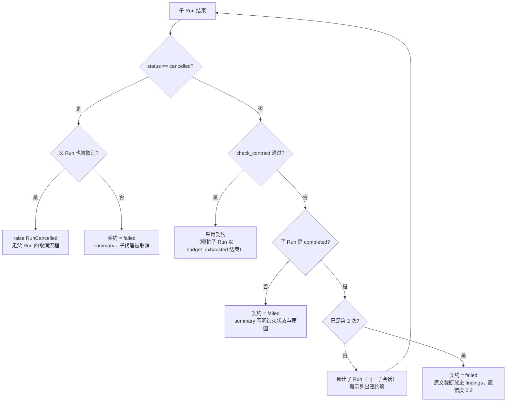
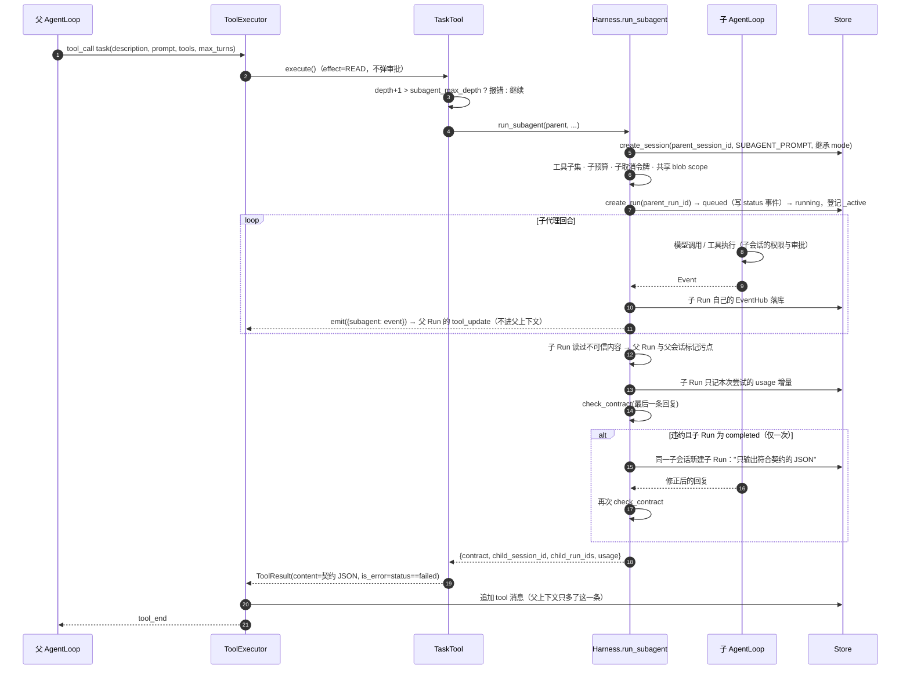

# 20 子代理与回传契约

把一段工作交给“另一个 Agent”时，要回答四个问题：值不值得拆、交接时给它什么、收回来什么、怎么保证它不会拖垮父代理（上下文、预算、权限、取消）。
本章先讲判断标准与业界模式，再精读 flywhl-harness 的 `task` 工具、`Harness.run_subagent()` 与回传契约校验 `check_contract()`。

## 先问：真的需要子代理吗

多 Agent 的正当理由只有三个，其余大多是“看起来更像团队协作”的审美冲动：

| 理由 | 换来什么 | 典型场景 |
|---|---|---|
| **上下文隔离** | 高噪声的探索（几十次 grep、读十几个文件）留在子上下文里，父上下文只收到结论 | 定位入口、梳理调用链、读一份长文档后给出要点 |
| **并行** | 互不依赖的子任务同时推进，墙钟时间缩短 | 同时调研 3 个候选库、对多个模块分别做静态检查 |
| **专业化 / 更窄权限** | 子代理有专门的系统提示与更小的工具集，爆炸半径更小 | 只读的代码审查员、只能跑测试的验证员 |

代价同样明确：

- **信息损失**：子代理看过的数万 token 被压成一两千 token 的摘要，父代理只能相信摘要；
- **token 成本**：每个子代理都要重新付系统提示、工具定义、重新读文件的钱，多 Agent 的总消耗通常是单 Agent 的数倍；
- **协调开销**：简报写不清、子代理之间改同一处、结果互相矛盾，都要父代理来收拾。

所以子代理不是默认选项。下面几类任务**不宜拆**：

| 不宜拆的情形 | 原因 |
|---|---|
| 强耦合的连续推理（定位 bug → 理解根因 → 修复 → 验证） | 每一步都依赖上一步的细节，摘要会丢掉恰好需要的那条线索 |
| 依赖大量父上下文中的隐性约定（用户前面说过的偏好、已否决的方案） | 子代理看不到父历史，简报很难把这些都写全 |
| 任务本身很小 | 写简报 + 子代理冷启动的成本超过直接做 |
| 多个子任务要改同一个文件 | 并发写冲突，合并比串行做还贵 |

Anthropic 介绍其多 Agent 研究系统时给出的经验是：子代理可以在干净的上下文里消化数万 token，只回传约 1,000–2,000 token 的浓缩结果。
这句话同时说明了收益（父上下文干净）和前提（回传必须足够浓缩且可信）。拆完是否真的更好，要靠评测证明，方法见 [22 轨迹、回放与评测](/multi-agent/trajectory-eval)。

## 四种多 Agent 模式

| 模式 | 控制流 | 上下文流 | 适合 | 主要风险 | flywhl-harness 对应 |
|---|---|---|---|---|---|
| **编排者-执行者** | 父代理派发、等待、汇总 | 简报下行、结论上行 | 可拆成独立子问题的探索与调研 | 父代理成为瓶颈；简报质量决定一切 | `task` 工具（本章） |
| **层级式** | 多层编排，执行者也可再派发 | 每层再做一次摘要 | 规模很大、天然分层的任务 | 多层转述像传话游戏一样失真；成本按层放大 | `subagent_max_depth` 限制层数（默认 2：子代理还能再委托一层） |
| **Swarm / handoff** | 控制权在 Agent 之间移交，或由调度器按依赖派发 | 依赖结果沿边传递 | 有明确依赖关系的一批子任务 | 失败传播、调度公平、结果合并 | `DagScheduler` + 子代理，见 [21 DAG 调度与 Swarm](/multi-agent/swarm-dag) |
| **黑板** | 各 Agent 读写共享存储，按需取用 | 共享的是存储，不是对话 | 多个 Agent 需要看到彼此的中间产物 | 写冲突、陈旧数据、上下文污染 | 工作区文件 + 外置句柄（`artifacts` 只传路径/句柄） |

本项目只内置了第一种，并用深度上限把第二种限制在主代理之下两层（子代理、孙代理，孙代理拿不到 `task` 工具）；第三种由确定性调度器承担，LLM 不参与调度；第四种用“产物写文件、契约里只放引用”的方式实现，避免把大段内容在 Agent 之间搬来搬去。

## 任务简报：子代理唯一的世界

子代理看不到父会话历史，**简报就是它掌握的全部信息**。一份能用的简报至少包含：

| 要素 | 写什么 | 在 flywhl-harness 中由谁承载 |
|---|---|---|
| 目标 | 要回答的问题或要产出的东西 | `task` 的 `prompt` |
| 范围与边界 | 看哪些目录、不碰哪些文件、做到哪一步为止 | `prompt`；硬边界靠 `tools` 白名单 |
| 输入 | 文件路径、外置结果的句柄——**传引用不传内容** | `prompt`；句柄能用是因为父子共享 blob scope（见下文） |
| 约束 | 只读 / 不得联网 / 不得修改测试 | `prompt` + 子会话继承的权限模式 |
| 输出 schema | 回传什么字段、什么格式 | `SUBAGENT_PROMPT` 里固定的回传契约 |
| 预算 | 最多多少轮 | `max_turns`（工具调用上限自动取 4 倍） |
| 停止条件 | 什么时候算“做完了”，什么时候该放弃并报 `needs_input` | `prompt`；契约的 `status` 枚举 |

一个反例与改写：

::: code-group

```text [反例]
看看这个项目的配置是怎么回事。
```

```text [改写]
目标：找出程序入口文件，以及配置是从哪里、用什么函数加载的。
范围：只看 app/ 与 config/ 目录；不要修改任何文件。
输入：入口候选见 pyproject.toml 的 [project.scripts]。
停止条件：找到加载函数及其调用点即可；若存在多个配置源且无法判断优先级，status 填 needs_input 并在 open_questions 中说明。
输出：按回传契约给出 findings，每条 evidence 写成“文件路径:行号”。
```

:::

反例的问题不是“太短”，而是子代理无法判断做到哪里算完，最后要么浅尝辄止，要么把整个仓库读一遍。

## 回传契约：为什么不让子代理返回自然语言

`src/flywhl_harness/agent/subagent.py` 中的 `CONTRACT_SCHEMA`：

```python
CONTRACT_SCHEMA: dict[str, Any] = {
    "type": "object",
    "properties": {
        "status": {"type": "string", "enum": ["ok", "partial", "failed", "needs_input"]},
        "summary": {"type": "string", "maxLength": 2000},
        "findings": {
            "type": "array",
            "items": {
                "type": "object",
                "properties": {
                    "claim": {"type": "string"},
                    "evidence": {"type": "array", "items": {"type": "string"}},
                    "confidence": {"type": "number", "minimum": 0, "maximum": 1},
                },
                "required": ["claim"],
            },
        },
        "artifacts": {"type": "array", "items": {"type": "string"}},
        "open_questions": {"type": "array", "items": {"type": "string"}},
    },
    "required": ["status", "summary"],
}
```

逐字段看它们分别给父代理提供了什么决策依据：

| 字段 | 含义 | 父代理据此做什么 |
|---|---|---|
| `status` | `ok` 完成 / `partial` 部分完成 / `failed` 失败 / `needs_input` 缺信息 | 分支：`ok` 直接用；`partial` 决定补派还是自己补；`needs_input` 去问用户；`failed` 换思路。`failed` 还会让 task 结果带上 `is_error=True` |
| `summary` | 结论摘要（schema 上限 2000 字符） | 进入父上下文的主体内容 |
| `findings[].claim` | 一条可独立判断的结论 | 逐条采纳或质疑，而不是整段相信 |
| `findings[].evidence` | 证据：`文件路径:行号` 或句柄 | 父代理可以按图索骥复核，而不必重做整个探索 |
| `findings[].confidence` | 0..1 的自评置信度 | 低置信度的结论先复核再用 |
| `artifacts` | 产出文件的路径 | 大段内容不进上下文，只传位置；harness 会校验它们是否存在 |
| `open_questions` | 未解决的问题 | 父代理决定是否追问；harness 也把自动检测到的问题写在这里 |

为什么不接受自然语言回传：

1. **父代理要的是“结论 + 证据 + 产物位置”**，不是子代理的心路历程。自由文本里这三样混在一起，父代理只能靠“猜”去拆分；
2. **多层转述会失真**。层级越深，每一层的“我理解你的意思是……”叠加起来，最终结论可能与第一手证据相去甚远。强制 `evidence` 字段至少让每条结论能回溯到源头；
3. **可以机器校验**。schema 校验、产物存在性校验都是确定性的，不需要再调一次模型来判断“子代理到底说没说清楚”；
4. **长度可控**。schema 限制了 `summary` 长度，`SUBAGENT_PROMPT` 要求大段内容写文件，父上下文的增长是可预期的。

对应的系统提示在 `src/flywhl_harness/prompts.py` 的 `SUBAGENT_PROMPT`，要点有三：明确告诉子代理“看不到父代理的对话历史”；“只做简报范围内的事，不要宣布整体任务完成”；最后一条回复只包含一个符合契约的 JSON 代码块。

::: warning 一处不一致
`SUBAGENT_PROMPT` 里写的是“不超过 200 字的结论”，而 `CONTRACT_SCHEMA` 允许 `summary` 最长 2000 字符。提示词用更严的数字引导模型精简，schema 用宽松的上限避免轻微超长就判违约——这可以是有意的“软目标 + 硬上限”，但读代码时要知道两处数字不同。
:::

## check_contract：校验形式，不校验真伪

```python
def check_contract(text: str, workspace: Any) -> tuple[dict[str, Any] | None, list[str]]:
    """解析并校验回传契约。返回 (契约, 违约项)。"""
    data = extract_json_block(text)
    if data is None:
        return None, ["最后一条回复中没有找到 JSON 对象"]
    data, errors = validate(CONTRACT_SCHEMA, data)
    if errors:
        return data, errors
    missing = [a for a in data.get("artifacts", []) if not workspace.resolve(a, allow_outside=True).exists()]
    if missing:
        data.setdefault("open_questions", []).append(f"声明的产物不存在：{missing}")
        if data["status"] == "ok":
            data["status"] = "partial"
    return data, []
```

三层检查，结果分两类——**违约**（返回非空错误列表，触发修正）与**降级**（契约有效但被改写）：

| 情形 | 结果 | 设计理由 |
|---|---|---|
| 回复里找不到 JSON | 违约 | 格式问题，让子代理重来一次成本最低 |
| JSON 不符合 schema（缺 `status`、枚举值不对、`confidence` 越界） | 违约 | 同上；`validate()` 默认 `coerce=True`，像 `"0.9"` 这类可转换的类型会先尝试转换，不算违约 |
| `artifacts` 中声明的文件不存在 | **不违约**，`ok` 降为 `partial`，并在 `open_questions` 里写明 | 结论本身可能仍有价值，只是“证据链断了一环”；降级比拒收保留了更多信息，同时阻止父代理把它当作完全可信 |
| `artifacts` 指向工作区外 | 只检查存在性（`allow_outside=True`） | 契约校验不承担越界拦截，写文件的越界由工具层的路径约束负责 |
| `evidence` 里的“路径:行号”无法解析 | **不检查** | 见下文“扩展点” |

`extract_json_block()`（`src/flywhl_harness/_utils.py`）的提取顺序是：优先第一个 ```` ```json ```` 代码块，其次文本中第一个括号配平的 `{...}`。两个边界条件值得记住：

- 如果子代理在最终契约之前先输出了一个“示例 JSON”代码块，被取走的是前面那个；
- 括号配平的兜底扫描不识别字符串内的花括号，`"summary": "使用 {name} 占位"` 这类内容可能让兜底提取失败——这也是提示词要求“用代码块”的原因。

**它只校验形式，不校验真伪。** 跑一下 `examples/06_subagent.py` 就能看到：示例中子代理回传的 `summary` 写着“配置从 config.toml 读取”，而工作区里根本没有任何文件提到 config.toml——这份契约照样通过了 schema 与产物检查。要往“真伪”方向再走一步，可以在子代理结束时做更强的校验：

::: details 扩展点：用 subagent_stop hook 校验证据可解析
子代理的 Loop 在结束前会运行 Stop 验收；对子代理来说触发的是 `HookEvent.SUBAGENT_STOP` 而不是 `STOP`（见 `AgentLoop._stop_gaps()`）。Hook 拿得到 `last_message`，可以解析其中的契约，逐条检查 `evidence` 里的 `路径:行号` 是否存在、该行是否包含 `claim` 里的关键标识符；不满足时返回 `decision="block"`，缺口会作为提示注入，子代理在同一个 Run 里继续补证据。
这样做的边界是：它只能证明“引用的位置存在”，不能证明“结论正确”。Hook 的写法见 [16 Hooks](/governance/hooks)。
:::

## run_subagent 精读：六个隔离维度

`TaskTool.execute()` 只做两件事：检查嵌套深度，然后把活交给 `Harness.run_subagent()`。

```python
async def execute(self, args: dict[str, Any], ctx: ToolContext) -> ToolResult:
    if ctx.harness is None or ctx.run is None:
        return ToolResult.error("当前运行环境不支持子代理")
    parent = ctx.run
    if parent.depth + 1 > parent.config.subagent_max_depth:
        return ToolResult.error(f"子代理嵌套深度已达上限 {parent.config.subagent_max_depth}，请直接完成该任务。")
    result = await ctx.harness.run_subagent(
        parent, description=args["description"], prompt=args["prompt"], tools=args.get("tools"),
        max_turns=args.get("max_turns", 15), emit=ctx.emit,
    )
    contract, text = result["contract"], json.dumps(result["contract"], ensure_ascii=False, indent=1)
    return ToolResult(
        content=f"子代理「{args['description']}」回传（status={contract.get('status')}）：\n{text}",
        is_error=contract.get("status") == "failed",
        details={k: v for k, v in result.items() if k != "contract"} | {"contract": contract},
    )
```

注意 `content` 与 `details` 的分工：`content` 进入父模型的上下文，只有契约 JSON；`details` 只给 UI 与程序消费（子会话 ID、子 Run 列表、用量），不进上下文。

`TaskTool.effect = Effect.READ`，注释写明“子代理内部的副作用由其自身的权限与审批把关”。也就是说，派发子代理这个动作本身不弹审批；子代理要写文件、跑命令，会在它自己的会话里按同样的权限模式走审批。

`effect=READ` 还有一个连带效果：`Tool.concurrency_safe` 默认等于“effect 是否为 READ”，而 `ToolExecutor.run_batch()` 会把相邻的可并发调用放进同一批、用 `parallel_tool_limit` 信号量并发执行。所以**父代理在同一轮里发出的多个 `task` 调用会并行运行**——这就是“并行”这条理由在本项目里的落地方式，不需要额外的编排代码。反过来，执行管线是按“派发动作只读”来判断能否并发的，它并不知道子代理内部会不会写文件；让两个会写同一处的子任务同一轮发出，管线不会替你串行化。

下面是 `src/flywhl_harness/runtime/manager.py` 中 `Harness.run_subagent()` 的主体：

```python
async def run_subagent(self, parent: RunContext, *, description: str, prompt: str, tools: list[str] | None,
                       max_turns: int, emit: Callable[[dict[str, Any]], None]) -> dict[str, Any]:
    ps = self._session(parent.session_id)
    sp = SUBAGENT_PROMPT.replace("{workspace}", str(parent.workspace.root))
    child_s = self.create_session(f"子代理：{description}", workspace=str(parent.workspace.root),
                                  mode=ps.meta.get("mode"), parent_session_id=parent.session_id, system_prompt=sp)
    child_tools = parent.tools.subset(tools, exclude=["task"] if parent.depth + 1 >= self.config.subagent_max_depth else [])
    budget = parent.budget.child(BudgetConfig(max_turns=max_turns, max_tool_calls=max_turns * 4))
    cancel = parent.cancel.child()  # 父取消 → 子取消
    contract, child_runs, attempt_prompt = None, [], prompt
    for attempt in range(2):  # 违约时给一次修正机会
        run = self.store.create_run(child_s.id, attempt_prompt, parent_run_id=parent.run_id,
                                    config={"role": "subagent", "description": description})
        self._offline_transition(run.id, RunStatus.QUEUED, "子代理已创建")
        rc = self._build_rc(run, child_s, cancel=cancel, inbox=Inbox(), role="subagent", depth=parent.depth + 1,
                            tools=child_tools, budget=budget, blob_scope=parent.scope)
        rc.usage_base = budget.usage  # 多次尝试共用一份子预算：每个子 Run 只记自己这次尝试的用量
        rc.config = _no_verify(self.config)
        # 事件序号接在离线写入的 status 事件之后，否则第一批事件会和它撞号
        a = ActiveRun(run.id, child_s.id, rc, AgentLoop(rc), EventHub(self.store, run.id, self.store.max_event_seq(run.id)))
        rc.set_status = lambda to, reason, a=a: self._set_status(a, to, reason)
        self._active[run.id] = a
        self._transition(a, RunStatus.RUNNING, "子代理开始", expect={RunStatus.QUEUED},
                         worker_id=self.worker_id, heartbeat_at=now())
        hb = asyncio.create_task(self._heartbeat(a))
        try:
            async for ev in a.loop.run(attempt_prompt):
                a.hub.publish(ev)
                if ev.type not in EPHEMERAL_EVENTS:
                    emit({"subagent": {"run_id": run.id, "session_id": child_s.id, "description": description,
                                       "event": ev.to_dict()}})
            await self._finish(a)
        except asyncio.CancelledError:
            # 父 Run 被抢占式终止：子 Run 也必须落到明确的终态，不能永远停在 running
            with contextlib.suppress(Exception):
                self._pair_dangling_offline(self.store.get_run(run.id), "已取消：父 Run 被终止")  # type: ignore[arg-type]
                if self.store.get_run(run.id).status in (RunStatus.RUNNING, RunStatus.WAITING_HUMAN):  # type: ignore[union-attr]
                    self._transition(a, RunStatus.CANCELLING, "父 Run 被终止")
                self._transition(a, RunStatus.CANCELLED, "父 Run 被终止")
            raise
        finally:
            hb.cancel()
            a.hub.close()
            self._active.pop(run.id, None)
        child_runs.append(run.id)
        # ... 见下文：污点上传、契约校验与修正
```

逐个维度拆开：

| 维度 | 代码 | 效果与理由 |
|---|---|---|
| **会话 / 上下文** | `create_session(..., parent_session_id=..., system_prompt=SUBAGENT_PROMPT)` | 全新会话，历史为空，子代理物理上看不到父对话；`parent_session_id` 只用于关联与展示。系统提示在会话创建时冻结进 `meta`，子会话内的前缀同样稳定 |
| **权限** | `mode=ps.meta.get("mode")` | 继承父会话的权限模式，子代理不会比父代理更宽松。但新会话的 `grants` 为空——父会话里“本会话始终允许”的授权**不会继承**，子代理遇到同类操作会再次请求审批 |
| **工具集** | `parent.tools.subset(tools, exclude=[...])` | 白名单只能从父工具集中挑（`subset` 会静默丢弃父代理没有的名字），权限只收不放；到达深度上限的那一层连 `task` 工具都看不到 |
| **预算** | `parent.budget.child(BudgetConfig(max_turns, max_tool_calls=max_turns*4))` | 子预算的 token / 费用上限被裁剪到父预算的剩余额度；子代理的模型用量与工具调用通过 `charge_model` / `charge_tool` 向上累计；`Budget.check()` 还会检查父预算是否已硬耗尽 |
| **取消** | `parent.cancel.child()` | 子令牌挂在父令牌上：父 Run 被取消，子 Run 在下一个安全点停下。`TaskTool` 声明 `interruptible = False`、`cancel_grace = 30`：父 Run 取消时执行器不抢占 task 调用，而是最多等 30 秒让子 Run 协作式停下、写入终态；宽限期过了才抢占，此时走上面的 `CancelledError` 分支，子 Run 被直接迁移到 `cancelled` |
| **外置句柄** | `blob_scope=parent.scope` | `RunContext.scope` 返回 `blob_scope or session_id`，子代理沿用父的范围，所以父代理传给子代理的句柄能直接读取，子代理产出的句柄也能回传给父代理——传引用不搬运内容 |

子 Run 与主 Run 的生命周期管理有几处异同：

- **不跑验收命令**：`_no_verify()` 把 `verify_command` 置空。验收命令针对的是整体任务，让一个只负责“找入口”的子代理去跑全量测试既浪费又会误判；
- **同样登记到 `_active`、同样写状态事件**：子 Run 在运行期间登记到 `Harness._active`，结束后在 `finally` 中移除。登记的意义有两个：一是可以用 `Harness.cancel(child_run_id)` 单独取消某个子代理（取消的是子令牌，不影响父令牌；父代理收到一份 `status=failed`、summary 为“子代理被取消：…”的回传，由它决定改做什么——见下文“违约修正”中的判定顺序，`tests/test_runtime.py::test_cancelling_only_the_child_returns_failed_contract`）；二是 `recover()` 会跳过 `_active` 里的 Run，正在运行的子 Run 不会被当成崩溃残留。创建时的 `queued` 迁移经 `_offline_transition()` 写入一条 status 事件，子 Run 的事件流里状态序列从“已创建”开始就是完整的；
- **崩溃后不单独恢复**：`recover()` 遇到心跳过期且 `parent_run_id` 非空的 Run，只做收尾——迁移到 `interrupted`、再到 `cancelled`（原因“子代理由父 Run 重新派生”），并为悬空的工具调用补上结果。父 Run 恢复后，未完成的 `task` 调用会重新派生一个**新的**子代理。子代理的中间过程没有续跑价值：它的产出只有最后那份契约，重做一遍比把半截子会话接上更简单可靠。

### 预算的两个容易忽略的后果

`Budget.charge_tool()` 会把子代理的工具调用计入父预算，而 `Budget.next_turn()` 不向上传播。于是：

- 一个子代理用了 40 次工具调用，父 Run 的 `tool_calls` 也随之 +40。父代理连续派发几个“重”子代理后，可能因为 `max_tool_calls` 而以 `budget_exhausted` 结束，尽管它自己只调用了几次 `task`；
- 子代理的轮次不占父代理的 `max_turns`，父代理的轮次预算只衡量“父代理自己思考了几轮”。

另外，同一次 `task` 调用里的两次尝试（首次 + 修正）**共用同一份子预算**：首次尝试如果把轮次用光，修正轮一开始就会因预算耗尽结束。

共享预算带来一个记账问题：`budget.usage` 是两次尝试的累计值，如果每个子 Run 结束时都把它写进自己的 `usage`，修正 Run 就会把首次尝试的用量再记一遍。
所以每次尝试开始前把当前用量记为这个子 Run 的起点 `rc.usage_base`，`RunContext.run_usage` 返回“当前用量 − 起点”：

```python
# src/flywhl_harness/agent/run_context.py
@property
def run_usage(self) -> Usage:
    """本 Run 的用量。主 Run 恢复时预算从检查点还原，起点为空：用量跨暂停 / 崩溃累计。"""
    return self.budget.usage - self.usage_base if self.usage_base is not None else self.budget.usage
```

`_finish()` 写进 `runs.usage` 的、`run_end` 事件携带的都是 `run_usage`，两处口径一致：每个子 Run 只记自己那次尝试。

### 污点上传：不可信内容会借契约进入父上下文

子代理的上下文是隔离的，但它的结论不是——契约会作为 tool 结果进入父上下文。如果子代理读过网页、外部文档这类不可信内容（子 Run 的 `rc.tainted` 被置位），它写出的 `summary` 与 `findings` 就可能夹带注入指令。因此每次尝试结束后：

```python
        if a.rc.tainted and not parent.tainted:
            # 子代理读过不可信内容：它的结论同样不可信（注入可以“借”回传契约进入父上下文）
            parent.tainted = True
            ps = self.store.get_session(parent.session_id)
            if ps is not None:
                self.store.update_session(ps.id, meta={**ps.meta, "tainted": True})
```

父 Run 被标记污点，并写进父会话的元数据（之后在这个会话里新建的 Run 也会继承 `tainted`），后续的副作用操作按污点规则升级审批。只把子 Run 标成污点是不够的：隔离挡住了原文，挡不住经过转述的指令。

### 事件透传：UI 看得见，父模型看不见

子 Loop 的每个事件先发布到子 Run 自己的 `EventHub`（按子 `run_id` 落库，可以单独订阅），非增量事件再经 `emit()` 包装成父 Run 的 `tool_update`：

```text
父 Run 事件流： tool_start(task) → tool_update{subagent: {run_id, event: tool_start(ls)}} → ... → tool_end(task)
父模型上下文： [assistant: 调用 task] → [tool: 子代理「…」回传（status=ok）：{契约 JSON}]
```

`EPHEMERAL_EVENTS` 是 `message_update` 与 `tool_update`，所以子代理的文本增量不会被透传，避免父事件流被刷屏。Web UI 收到 `update.subagent` 时把它们嵌套在 task 卡片下展示（`web/app.js` 的 `subagentLine()`：工具调用、工具结果、审批请求、子代理结束）；CLI 只渲染其中的 `tool_start`，在 task 那一行下面打印 `↳ [描述] 子代理调用的工具`。子代理进度只走这一条通道，没有单独的“子代理事件”类型。关键在于这些事件**只是事件**——事件不是上下文，父模型永远只读到 `ToolResult.content`。

### 违约修正：同一个子会话里再来一次

```python
        out = a.loop.outcome
        assert out is not None
        if out.status == "cancelled":
            # 父 Run 被取消：向上传播。只有这个子 Run 被单独取消：作为失败的回传交给父代理，由它决定下一步
            parent.cancel.raise_if_cancelled()
            contract = {"status": "failed", "summary": f"子代理被取消：{out.reason}", "findings": [],
                        "artifacts": [], "open_questions": []}
            break
        text = out.final_text or (a.loop._last.text if a.loop._last else "")
        contract, errors = check_contract(text, parent.workspace)
        if not errors and contract is not None:
            break
        if out.status not in ("completed",):
            contract = {"status": "failed", "summary": f"子代理以 {out.status} 结束：{out.reason}", "findings": [],
                        "artifacts": [], "open_questions": []}
            break
        attempt_prompt = ("你的回传不符合契约：\n" + "\n".join(f"- {e}" for e in errors)
                          + "\n请只输出一个符合契约的 JSON 代码块，不要附加其它文字。")
        contract = {"status": "failed", "summary": "子代理回传两次均不符合契约",
                    "findings": [{"claim": clip(text, 500), "evidence": [], "confidence": 0.2}],
                    "artifacts": [], "open_questions": errors}
    return {"contract": contract, "child_session_id": child_s.id, "child_run_ids": child_runs,
            "usage": budget.usage.to_dict()}
```

判定顺序决定了几个边界行为：



- **先校验契约，再看结束状态**：子 Run 因预算耗尽结束，但最后一条消息恰好是合格的契约，照样采用。反过来，子 Run 非正常结束且没有合格契约，不再给修正机会——此时再要求“只输出 JSON”大概率还是失败；
- **修正轮在同一个子会话里**：第二个子 Run 的 `session_id` 仍是 `child_s`，子代理能看到自己第一次的全部工作，只需要把结论重新组织成 JSON，不必重做探索。代价是修正轮要重发整段子会话历史（好在子会话前缀稳定，能命中前缀缓存）；
- **两次都违约时不丢信息**：原文被截断到 500 字放进 `findings`，置信度标为 0.2，违约项写进 `open_questions`——父代理拿到的是“失败但附带线索”，而不是一句“出错了”。

## 父子交互全景



## 成本：钱花在哪里

一次 `task` 调用的 token 构成：

| 部分 | 说明 | 能否被缓存 |
|---|---|---|
| 子代理系统提示 + 工具定义 | 每个子会话都付一次 | 子会话内的多轮之间可命中前缀缓存；与父会话的前缀不同，无法共享父的缓存 |
| 子代理的探索过程 | 读文件、搜索结果——这正是“隔离”想挡在父上下文之外的部分 | 子会话内只追加，后续轮次可命中 |
| 修正轮 | 重发整段子会话历史 + 一条修正提示 | 前缀与首轮一致，通常命中 |
| 回传到父上下文的契约 | 一条 tool 消息 | 之后父代理的每一轮都要带上它，这是“父上下文成本”的唯一增量 |

`details["usage"]` 是这次子代理调用（含修正轮）的用量合计，而每个子 Run 记录的只是自己那次尝试的增量；同时，这部分用量已经通过子预算向上累计进了父 Run 的 `usage`。这意味着**对 `runs` 表所有记录的 `usage` 直接求和会重复计算**子代理的消耗——按 Run 统计成本时只汇总根 Run（`parent_run_id` 为空），详见 [23 可观测性与成本](/multi-agent/observability-cost)。

## 常见坑

| 坑 | 表现 | 对策 |
|---|---|---|
| 回传完整对话记录 | 父上下文暴涨，隔离形同虚设 | 契约 + `summary` 长度上限；大段内容写文件、只传路径 |
| 多层转述失真 | 第三层子代理的结论到父代理时已面目全非 | 限制深度（默认 2）；`evidence` 必须指向第一手位置 |
| 子代理宣布“任务全部完成” | 父代理被误导提前结束 | `SUBAGENT_PROMPT` 明确“不要宣布整体任务完成”；`status` 只描述子任务；父 Run 的验收命令不交给子代理 |
| 简报依赖父上下文 | 子代理反复问“哪个文件”或自作主张 | 按简报要素写；无法确定时让它报 `needs_input` 而不是猜 |
| 白名单写了父代理没有的工具 | `subset` 静默丢弃，子代理缺工具后绕路或失败 | 派发前确认工具名；必要时在简报里写明可用工具 |
| 子代理读了不可信内容 | 注入指令经由 `summary` / `findings` 进入父上下文 | 污点自动上传到父 Run 与父会话，后续副作用升级审批；简报里尽量把联网读取与写操作拆给不同的子任务 |
| 父会话的授权不继承 | 子代理在 default 模式下对已授权过的操作再次请求审批 | 子代理以只读探索为主；需要写操作时预期会有审批，或在配置规则层面放行 |
| 修正轮预算不足 | 首轮用光轮次，修正轮立即 `budget_exhausted` | `max_turns` 留余量；简报里写清停止条件，避免首轮无止境探索 |
| 契约“合格”但内容没有依据 | schema 通过、结论却无证据 | 父代理对低 `confidence` 或空 `evidence` 的结论先复核；用 subagent_stop hook 做证据校验 |
| 并行子代理改同一文件 | 同一轮的多个 `task` 被当作只读调用并发执行，后写覆盖先写 | 子任务按文件边界切分；会写的子任务分多轮发出，或交给 [21](/multi-agent/swarm-dag) 的调度器按依赖排序 |

## 与 Claude Code、pi 的取舍对比

| | flywhl-harness | Claude Code 子代理 | pi |
|---|---|---|---|
| 形态 | 内置 `task` 工具，子代理是同进程里的另一个 Run | `Agent` 工具（旧称 Task），可在 `.claude/agents/` 用 Markdown + frontmatter 定义专用子代理 | 核心不内置；作者主张需要时用 bash 再起一个 pi 进程，subagent 只作为示例扩展提供 |
| 上下文 | 全新会话 | 独立上下文窗口 | 新进程，天然隔离 |
| 工具与权限 | 父工具集的子集，继承权限模式 | 可为每个子代理配置工具集与模型 | 由启动参数决定 |
| 回传 | **结构化契约**，机器校验，违约修正一次 | 子代理的最终结果返回给主代理，以自由文本为主 | 进程输出，由调用方自行解析 |
| 过程可见性 | 事件透传到父 Run，UI 嵌套展示 | 界面中可以看到子代理的进展 | 黑盒——这正是 pi 作者对子代理的主要批评 |
| 嵌套与并发 | 深度上限可配置（默认 2）；同一轮的多个 task 调用会并发执行（见上文“并行”） | 有嵌套与并发上限，具体以官方文档为准 | 由调用方控制 |

三者的分歧集中在两点：**回传要不要结构化**，以及**过程要不要可见**。flywhl-harness 选择“结构化 + 可见但不进上下文”，代价是子代理必须遵守一个它可能违反的格式，于是需要修正机制；pi 的选择更朴素，把子代理当成一个普通的外部命令，可组合性最好，但父代理对子代理的过程一无所知。

## 动手验证

```bash
.venv/bin/python examples/06_subagent.py
.venv/bin/python -m pytest tests/test_runtime.py::test_subagent_contract -q
```

`examples/06_subagent.py` 用一个按 `req.metadata["role"]` 分流的脚本化模型，让父代理派发一个子任务；子代理先 `ls`、再 `grep`，第一次用自然语言回答（违约），第二次输出契约 JSON。输出的关键几行：

```text
    [子代理] tool_start: ls
    [子代理] tool_start: grep
    [子代理] run_end: completed
    [子代理] run_end: completed
» 子代理是否看到了父会话历史：False（应为 False）
» 子 Run 次数：2（第一次违约，修正一次）
» 父上下文中的工具结果：['task']（只有 task，没有子代理的 ls/grep）
```

逐行对应本章的机制：

- 两次 `run_end`：首次 Run 正常完成但契约违约，于是同一子会话里新建了修正 Run；
- “看到父会话历史：False”：脚本化模型检查了子代理收到的消息里有没有父代理说过的“这需要大量搜索”，结果没有——隔离是物理的，不靠提示词自觉；
- 父上下文只有 `task`：`ls` / `grep` 只出现在子会话与透传事件里。

`test_subagent_contract` 断言的是同一组性质：最终契约 `status == "ok"`、`child_run_ids` 长度为 2、父会话消息里没有 `ls`、父事件流里存在带 `subagent` 的 `tool_update`。

可以继续做的实验：

1. 把示例里子代理的第二条回复也改成自然语言：`tool_end` 的 `is_error` 变为 `True`，契约 `status=failed`，原文出现在 `findings[0].claim`；
2. 把 `CONTRACT["artifacts"]` 改成一个不存在的路径：契约仍被接受，但 `status` 变为 `partial`，`open_questions` 多出“声明的产物不存在”；
3. 把示例里的 `harness(ws, prov)` 改成 `harness(ws, prov, subagent_max_depth=1)`，并让子代理的脚本再调用一次 `task`：子代理的工具列表里已经没有 `task`（`subset` 排除了它），即便模型硬调用，也会得到未知工具的错误结果。

## 小结

- 子代理只有三个正当理由：上下文隔离、并行、专业化/更窄权限；收益要用评测证明；
- 简报是子代理唯一的世界，回传契约是父代理唯一的输入——两头都要结构化；
- `run_subagent()` 在会话、权限、工具、预算、取消、句柄六个维度上做了隔离，事件透传给 UI 但不进父上下文；
- `check_contract()` 只校验形式：找不到 JSON 或 schema 不符是违约，产物缺失是降级；真伪需要另外的校验；
- 子 Run 登记在 `_active`，可单独取消；崩溃后不单独恢复，由父 Run 重新派生；子代理读过不可信内容时污点会上传到父 Run；
- 子代理用量会累计进父 Run（子 Run 自身只记增量），做成本统计时注意不要重复计算。

延伸思考：如果要让多个子代理并行探索、再由父代理合并结论，结论冲突怎么裁决？依赖关系怎么表达？这是 [21 DAG 调度与 Swarm](/multi-agent/swarm-dag) 的内容。
