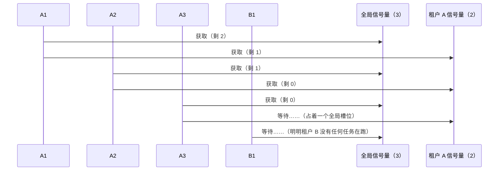

# 21 DAG 调度与 Swarm

当一个大任务能拆成一批带依赖关系的子任务时，“下一步跑哪个、同时跑几个、某个失败了怎么办”这些问题，应该交给确定性代码而不是 LLM。
本章精读 `src/flywhl_harness/runtime/scheduler.py`，再把它和 [20 子代理与回传契约](/multi-agent/subagents) 组合成一个最小 Swarm。

## 拆解与调度要分开

Plan-and-Execute 的常见做法是：规划器（LLM）把任务拆成一张 DAG，执行器按拓扑顺序把节点派发给执行者（通常是子代理）。关键的分工是：

| 角色 | 负责 | 不负责 |
|---|---|---|
| LLM（规划器） | 把目标拆成子任务、写出每个子任务的简报、声明依赖 | 决定“现在该跑哪个节点” |
| 确定性调度器 | 依赖校验、环检测、就绪判断、并发配额、重试、失败传播 | 理解任务内容 |
| LLM（执行者） | 在子任务边界内完成工作，按契约回传 | 调度其它子任务 |

为什么调度决策不交给 LLM：

- **可回放**：同样的 DAG 与同样的任务结果，调度轨迹完全相同；调度如果由模型做，每次决策都是一个非确定性来源；
- **便宜**：入度表维护的成本是 O(1)，而“问模型下一步跑什么”每次都要付一整段上下文的 token；
- **可执行策略**：租户配额、并发上限、失败策略这些是平台规则，必须保证执行，不能指望模型“记得”；
- **可审计**：出了问题，查的是调度器的事件，而不是去猜模型当时为什么那样选。

LLM 什么时候再介入？在**边界**上重新规划：一批任务跑完，调度器把结果（含失败原因）交回规划器，规划器为剩余工作产出新的 DAG。调度过程中不做中途改图。

## TaskSpec 与 TaskResult

```python
@dataclass
class TaskSpec:
    id: str
    fn: Callable[[dict[str, Any]], Awaitable[Any]]   # 参数：上游任务的结果 {dep_id: value}
    deps: list[str] = field(default_factory=list)
    tenant: str = "default"
    retries: int = 0
    timeout: float | None = None
    priority: int = 0                                 # 越小越先调度


@dataclass(frozen=True)
class UpstreamFailed:
    """continue 策略下传给下游的“上游失败”信息：下游自己决定降级处理还是放弃。"""
    id: str
    status: str
    error: str | None


@dataclass
class TaskResult:
    id: str
    status: str = "pending"    # ok | failed | skipped | cancelled
    value: Any = None
    error: str | None = None
    attempts: int = 0
    started_at: float | None = None
    ended_at: float | None = None
    deps: list[str] = field(default_factory=list)
```

`fn` 的签名把“依赖”变成了数据流：任务拿到的是上游结果的字典，不是全局状态；上游失败时（只在 `continue` 策略下会发生），对应的值是一个 `UpstreamFailed`，而不是 `None`。这让每个任务都可以单独测试，也让“上游传什么给下游”成为显式的设计点——在 Swarm 里，传的应该是契约里的结论与产物路径，而不是上游子代理的对话。

`TaskResult` 保留了来源（`deps`）、尝试次数、起止时间，合并结果时每一条都能追溯“谁、基于哪些上游、试了几次、花了多久”。

## topo_order：Kahn 算法顺带做校验

```python
def topo_order(tasks: list[TaskSpec]) -> list[str]:
    """Kahn 拓扑排序；存在环时抛出 CycleError 并指出涉及的任务。"""
    ids = {t.id for t in tasks}
    for t in tasks:
        missing = [d for d in t.deps if d not in ids]
        if missing:
            raise ValueError(f"任务 {t.id} 依赖不存在的任务 {missing}")
    indeg = {t.id: len(t.deps) for t in tasks}
    # ... 构建 children 邻接表
    q = deque(sorted(i for i, n in indeg.items() if n == 0))
    order = []
    while q:
        cur = q.popleft()
        order.append(cur)
        for c in children[cur]:
            indeg[c] -= 1
            if indeg[c] == 0:
                q.append(c)
    if len(order) != len(tasks):
        raise CycleError(f"依赖存在环，涉及任务：{sorted(i for i, n in indeg.items() if n > 0)}")
    return order
```

两道校验在派发任何任务之前完成：

1. **未知依赖**：规划器（LLM）拼错一个任务 ID 是常见错误，提前报错比跑到一半卡住好；
2. **环**：Kahn 算法每次取出入度为 0 的节点，若最终取出的数量少于任务总数，剩下的节点一定在环上或依赖环。

注意报错信息里“涉及任务”列的是所有入度未归零的节点，**既包括环上的节点，也包括环的下游**：`a ⇄ b`、`c → a` 时，报告的是 `[a, b, c]`。把这个列表回传给规划器让它修图时，要知道它比真正的环更大。

`DagScheduler.run()` 开头调用 `topo_order(tasks)` 只是为了校验，并不按这个静态顺序执行。真正的派发是事件驱动的：一个节点在**它的依赖全部完成的那一刻**就绪，而不是等静态序列轮到它——这样并行度最大。

## DagScheduler.run：就绪队列 + 两级信号量

```python
async def run(self, tasks: list[TaskSpec]) -> dict[str, TaskResult]:
    topo_order(tasks)  # 校验依赖与环
    # ... 构建 spec / results / children / indeg
    ready = sorted((i for i, n in indeg.items() if n == 0), key=lambda i: (spec[i].priority, i))
    global_sem = asyncio.Semaphore(self.max_concurrency)
    tenant_sems: dict[str, asyncio.Semaphore] = {}
    running: dict[asyncio.Task, str] = {}
    aborted = False

    async def execute(tid: str) -> None:
        t = spec[tid]
        r = results[tid]
        sem_t = tenant_sems.setdefault(t.tenant, asyncio.Semaphore(self.per_tenant))
        async with sem_t, global_sem:  # 先租户、后全局：等租户名额时不占用全局名额
            r.started_at = time.monotonic()
            self.on_event("start", r)
            upstream = {d: results[d].value if results[d].status == "ok"
                        else UpstreamFailed(d, results[d].status, results[d].error) for d in t.deps}
            try:
                for attempt in range(t.retries + 1):
                    r.attempts = attempt + 1
                    try:
                        coro = t.fn(upstream)
                        r.value = await (asyncio.wait_for(coro, t.timeout) if t.timeout else coro)
                        r.status, r.error = "ok", None
                        break
                    except asyncio.CancelledError:
                        r.status, r.error = "cancelled", "已取消"
                        raise
                    except Exception as e:  # noqa: BLE001
                        r.status, r.error = "failed", f"{type(e).__name__}: {e}"
                        if attempt < t.retries:
                            await asyncio.sleep(min(2.0, 0.1 * 2 ** attempt))
            finally:  # 被取消的任务也要记下结束时间：关键路径与耗时归因依赖它
                r.ended_at = time.monotonic()
                self.on_event("end", r)
```

主循环：

```python
    def abort() -> None:
        nonlocal aborted
        aborted = True
        for task in running:
            task.cancel()

    # 取消令牌与任务一起等待：取消请求立即生效，而不是等到下一个任务结束
    cancel_waiter = asyncio.ensure_future(self.cancel.wait())
    try:
        while ready or running:
            if self.cancel.cancelled and not aborted:
                abort()
            while ready and not aborted:
                tid = ready.pop(0)
                if results[tid].status == "pending":
                    running[asyncio.create_task(execute(tid))] = tid
            if not running:
                break
            waits = set(running) if aborted else {*running, cancel_waiter}  # 已中止就不再等取消信号，避免空转
            done, _ = await asyncio.wait(waits, return_when=asyncio.FIRST_COMPLETED)
            for task in done - {cancel_waiter}:
                tid = running.pop(task)
                if results[tid].status == "failed":
                    if self.failure_policy == "fail_fast" and not aborted:
                        abort()
                    elif self.failure_policy == "skip_downstream":
                        skip_descendants(tid, f"上游任务 {tid} 失败")
                        continue
                if aborted:
                    continue
                for c in children[tid]:  # continue 策略下，失败任务的下游照常放行
                    indeg[c] -= 1
                    if indeg[c] == 0 and results[c].status == "pending":
                        ready.append(c)
                ready.sort(key=lambda i: (spec[i].priority, i))
    finally:
        cancel_waiter.cancel()
    # ... 收尾：仍为 pending 的任务标为 cancelled（中止）或 skipped
```

几个实现细节决定了调度器的真实行为：

| 细节 | 行为 | 含义 |
|---|---|---|
| 就绪即建 Task | 依赖满足的节点立刻 `create_task`，并发上限由 Task 内部的信号量执行 | `running` 里既有在跑的，也有在排队等信号量的 |
| `started_at` 在拿到两级信号量之后才记录，`ended_at` 在 `finally` 里记录 | `duration` 只计执行时间（含重试与退避），不含排队等待；被取消的任务也有 `ended_at`，`duration` 是它被取消前跑了多久 | 关键路径按“干活时间”算，排队时间要另看总墙钟 |
| `asyncio.wait(FIRST_COMPLETED)`，等待集合里还有 `cancel_waiter` | 每完成一个任务就推进一次入度表；取消令牌一触发也会醒来 | 下游的就绪延迟只有一次事件循环调度；取消不必等某个在途任务先结束 |
| 重试在 Task 内部、持有信号量 | 退避 `min(2.0, 0.1 * 2**attempt)` 秒期间，并发槽位不释放 | 重试中的任务会占着名额；退避没有抖动 |
| `timeout` 作用于单次尝试 | `asyncio.wait_for` 超时抛出的异常被当作普通失败，会进入重试 | 最坏耗时约为 `(retries+1) × timeout + 退避` |
| `priority` | 只在就绪队列排序时生效 | 只决定“同时就绪的节点谁先建 Task”，对已经在等信号量的 Task 没有插队能力 |

### 两级信号量与获取顺序

全局信号量限制整个调度的并发，租户信号量防止一个租户占满所有槽位。两把锁的获取顺序不是随便写的：`async with sem_t, global_sem` **先拿租户、再拿全局**。反过来写会出现队头阻塞。设想全局并发 3、每租户 2，租户 A 有 3 个就绪任务、租户 B 有 1 个，如果先拿全局：



A3 拿着全局槽位却在等租户 A 的名额，B1 因为拿不到全局槽位而排队——实际并发只有 2，租户 B 被一个“不在干活”的任务挡住。先拿租户名额时，A3 卡在租户闸门外，不占全局容量，B1 直接拿到第 3 个全局槽位。用下面的脚本可以观察到（当前实现的输出）：

```python
import asyncio, time
from flywhl_harness.runtime.scheduler import DagScheduler, TaskSpec

async def main():
    t0, log = time.monotonic(), []
    def job(name):
        async def fn(up):
            log.append((name, round(time.monotonic() - t0, 2)))
            await asyncio.sleep(0.2)
        return fn
    await DagScheduler(max_concurrency=3, per_tenant=2).run(
        [TaskSpec(n, job(n), tenant=n[0]) for n in ("A1", "A2", "A3", "B1")])
    print(log)   # [('A1', 0.0), ('A2', 0.0), ('B1', 0.0), ('A3', 0.2)]

asyncio.run(main())
```

把 `async with` 的两项对调，B1 的开始时间就会变成 0.2s。这是多级配额的通用原则——先过最窄的闸门，再占共享资源。回归测试 `test_dag_tenant_limit_does_not_block_other_tenants` 固定了这一点：全局 2、每租户 1，租户 A 的两个长任务不能让租户 B 的任务排在它们后面。

## 三种失败策略

| 策略 | 失败任务的后代 | 正在运行的其它任务 | 与失败无关的任务 | 未运行任务的最终状态 | 适合 |
|---|---|---|---|---|---|
| `fail_fast` | 不再派发 | **立即取消**（状态 `cancelled`） | 不再派发 | `cancelled`（“调度被中止”） | 任何一个失败都意味着整体无意义，越早停越省钱（如发布流水线） |
| `skip_downstream`（默认） | 传递性地标为 `skipped` | 继续运行 | 继续派发 | 后代 `skipped` | 子任务相对独立，部分成果仍有价值（如多模块迁移） |
| `continue` | 照常派发，失败的上游以 `UpstreamFailed` 传入 | 继续运行 | 继续派发 | 全部会运行 | 下游有能力处理缺失的上游（如汇总报告注明“某模块失败”） |

`skip_descendants()` 用一个栈做深度优先遍历，只把仍为 `pending` 的节点改为 `skipped`，所以菱形依赖里的公共下游只会被标记一次。

### `continue` 策略下游拿到的是什么

`execute()` 构造 `upstream` 时，成功的上游给 `value`，其余给 `UpstreamFailed(id, status, error)`。下游用 `isinstance` 判断即可拿到失败状态与原因（`error`），自己决定是降级（汇总报告里写明“某模块失败：原因”）还是放弃（抛异常，让自己也记为失败）。`tests/test_runtime.py` 里的用法：

```python
async def boom(up):
    raise RuntimeError("坏了")

async def downstream(up):
    return f"上游状态：{up['bad'].status}" if isinstance(up["bad"], UpstreamFailed) else "?"

res = await DagScheduler(failure_policy="continue").run([TaskSpec("bad", boom), TaskSpec("next", downstream, deps=["bad"])])
assert res["next"].value == "上游状态：failed"
```

如果传的是 `None`，下游只能看出“这个上游没有产出”，分不清是失败还是上游本来就返回空值，更拿不到失败原因。

### 取消：与任务完成一起等待

外部取消通过构造参数 `cancel: CancelToken` 传入。主循环把 `cancel_waiter = ensure_future(self.cancel.wait())` 和在途任务放进同一个 `asyncio.wait` 等待集合，令牌一触发循环就醒来，调用 `abort()` 取消所有在途任务；仍为 `pending` 的任务在收尾时标为 `cancelled`（“调度被中止”）。如果只在每轮开头检查 `self.cancel.cancelled`，就要等某个在途任务自己结束才会注意到取消——在途任务恰好是最后一批时，它们会正常跑完，状态是 `ok` 而不是 `cancelled`。

两个配套细节：

- **中止后不再等取消信号**：`aborted` 之后等待集合只剩 `running`。`cancel_waiter` 已经完成，再把它放进 `asyncio.wait` 会让每次等待立即返回，主循环原地空转；
- **被取消的任务也写 `ended_at`**：`execute()` 的记录放在 `finally` 里，`CancelledError` 分支 `raise` 之前同样会写结束时间并发出 `end` 事件。否则被取消任务的 `duration` 会算成负数，关键路径与耗时归因都会失真。

`test_dag_continue_policy_passes_failure_and_cancel_is_immediate` 同时覆盖这两点：`continue` 策略下下游拿到 `status == "failed"` 的 `UpstreamFailed`；令牌在 0.05s 后触发时，一个要睡 5 秒的任务在 1 秒内被取消，且 `ended_at` 非空，其下游为 `cancelled`。

在 Swarm 里，每个任务内部是一个子代理：`abort()` 抢占式取消任务时，`run_subagent()` 的 `CancelledError` 分支会把子 Run 迁移到 `cancelled`（见 [20](/multi-agent/subagents)）。取消语义的一般讨论见 [12 取消语义](/reliability/cancellation)。

## critical_path：按实际耗时找瓶颈

```python
def critical_path(tasks: list[TaskSpec], results: dict[str, TaskResult]) -> tuple[list[str], float]:
    """按实际耗时计算关键路径（最长路径）：优化长任务总耗时时，应该先优化这条路径上的任务。"""
    order = topo_order(tasks)
    spec = {t.id: t for t in tasks}
    best: dict[str, tuple[float, list[str]]] = {}
    for tid in order:
        d = results[tid].duration if tid in results else 0.0
        prev = max((best[p] for p in spec[tid].deps), key=lambda x: x[0], default=(0.0, []))
        best[tid] = (prev[0] + d, prev[1] + [tid])
    total, path = max(best.values(), key=lambda x: x[0], default=(0.0, []))
    return path, total
```

DAG 上的最长路径可以在拓扑序上一次动态规划求出：每个节点的最长到达时间 = 其依赖中最长的那条 + 自身耗时。

用关键路径做性能分析时，要把它和总墙钟时间对比：

| 对比结果 | 说明 | 该做什么 |
|---|---|---|
| 总墙钟 ≈ 关键路径长度 | 瓶颈在任务本身 | 优化关键路径上的任务（换更快的模型、缩小子任务、减少轮次） |
| 总墙钟明显大于关键路径 | 时间花在排队上（`duration` 不含等待） | 提高并发上限或租户配额，检查是否有上面那种信号量阻塞 |

还有一个边界：`TaskResult.duration` 依赖 `ended_at`。`execute()` 在 `finally` 里记录结束时间，被 `fail_fast` 或外部取消打断的任务也有 `ended_at`，它的 `duration` 是被取消前实际跑了多久；从未开始的任务 `duration` 为 0。所以把失败、取消的任务也传进 `critical_path()`，得到的是“包含失败路径”的真实关键路径；`examples/07_swarm_dag.py` 只传了 `ok` 的结果，算出的是“已完成部分”的关键路径（见文末的解读）。

## 组合成 Swarm：调度器 + 子代理

`DagScheduler` 只认识“返回 awaitable 的函数”，所以任何能 `await` 的执行者都能接上。下面给出两种组合方式，**均为示意代码**（项目中没有内置这两个封装），用到的 `run_subagent()`、`Harness.run()`、`check_contract()`、`DagScheduler` 都是真实接口。

::: code-group

```python [示意：工具内组合（共享父预算与取消）]
# 示意：一个让父代理一次性提交整张 DAG 的工具。
# 规划由父模型完成（参数里的 tasks），调度由 DagScheduler 完成。
import json
from flywhl_harness.runtime.scheduler import DagScheduler, TaskSpec
from flywhl_harness.tools.base import Effect, Tool, ToolContext, ToolResult


class SwarmTool(Tool):
    name = "swarm"
    description = "提交一组带依赖的子任务，由调度器并发派发给子代理，返回每个子任务的契约。"
    parameters = {
        "type": "object",
        "properties": {"tasks": {"type": "array", "items": {"type": "object", "properties": {
            "id": {"type": "string"}, "prompt": {"type": "string"},
            "deps": {"type": "array", "items": {"type": "string"}},
            "tools": {"type": "array", "items": {"type": "string"}}},
            "required": ["id", "prompt"]}}},
        "required": ["tasks"],
    }
    effect = Effect.READ   # 与 task 相同：副作用由子代理自己的权限与审批把关
    interruptible = False  # 与 task 相同：父 Run 取消时由调度器中止、子 Run 写入终态，而不是被执行器直接打断

    async def execute(self, args, ctx: ToolContext) -> ToolResult:
        def make_fn(spec):
            async def fn(upstream: dict) -> dict:
                # 只把上游契约的结论与产物路径拼进简报：传引用，不传对话
                brief = spec["prompt"] + "".join(
                    f"\n上游「{k}」：{(v or {}).get('summary', '（无产出）')}；产物：{(v or {}).get('artifacts', [])}"
                    for k, v in upstream.items())
                res = await ctx.harness.run_subagent(
                    ctx.run, description=spec["id"], prompt=brief, tools=spec.get("tools"),
                    max_turns=15, emit=ctx.emit)
                if res["contract"]["status"] == "failed":
                    raise RuntimeError(res["contract"]["summary"])   # 交给失败策略处理
                return res["contract"]
            return fn

        tasks = [TaskSpec(t["id"], make_fn(t), deps=t.get("deps", [])) for t in args["tasks"]]
        results = await DagScheduler(max_concurrency=3, failure_policy="skip_downstream",
                                     cancel=ctx.run.cancel).run(tasks)
        merged = {tid: {"status": r.status, "attempts": r.attempts, "duration": round(r.duration, 2),
                        "contract": r.value, "error": r.error} for tid, r in results.items()}
        return ToolResult(content=json.dumps(merged, ensure_ascii=False, indent=1))
```

```python [示意：外部编排（每个子任务一个独立会话）]
# 示意：在 harness 之外用调度器驱动多个顶层 Run。
from flywhl_harness.agent.subagent import check_contract
from flywhl_harness.runtime.scheduler import DagScheduler, TaskSpec


def agent_task(h, prompt: str):
    async def fn(upstream: dict) -> dict:
        brief = prompt + "".join(f"\n上游「{k}」结论：{v['summary']}" for k, v in upstream.items() if v)
        res = await h.run(brief + "\n最后只输出回传契约 JSON。")        # 每次调用新建一个会话
        ws = h.workspace(h.store.get_session(res.session_id))
        contract, errors = check_contract(res.text, ws)
        if res.status != "completed" or errors or contract["status"] == "failed":
            raise RuntimeError(errors or res.reason)
        return contract
    return fn

# results = await DagScheduler(max_concurrency=3, per_tenant=2).run([
#     TaskSpec("scan", agent_task(h, "扫描依赖……")),
#     TaskSpec("core", agent_task(h, "升级 core……"), deps=["scan"], tenant="team-a", retries=1),
# ])
```

:::

两种方式的差别：

| | 工具内组合 | 外部编排 |
|---|---|---|
| 子任务的会话 | `run_subagent` 创建的子会话，带 `parent_session_id` | 各自独立的顶层会话 |
| 预算 | 子预算从父预算切出并向上累计，父预算能约束整个 Swarm | 每个 Run 使用默认预算，总量要由编排代码自己统计 `res.usage` 并决定何时停止 |
| 取消 | 父 Run 取消 → 子令牌取消 → 子代理在安全点停下 | 需要编排代码自己对每个 Run 调用 `Harness.cancel()` |
| 契约 | 系统提示与违约修正由 `run_subagent` 负责 | 要自己在提示里要求契约、自己调用 `check_contract`，没有修正轮 |
| 崩溃恢复 | 父 Run 恢复时整体重来 | 每个顶层 Run 可以被 `recover()` 单独接管，但调度器自己的进度（哪些节点已完成）不在库里，需要另外持久化 |
| 适合 | 一次对话中的中等规模并行探索 | 平台级批处理，需要跨进程、跨 Worker 时再换成持久化的队列与工作流引擎（见 [25 持久执行引擎映射](/advanced/durable-execution)） |

工具内组合还有一个要点：`retries` 对子代理任务要慎用。子代理重试意味着重新跑一个带副作用的 Agent，除非子任务是只读的或写操作是幂等的（见 [14 幂等](/reliability/idempotency)），否则重试可能重复修改文件。

## 结果合并与冲突裁决

多个子代理的结论放在一起时，难免冲突：两个子代理对“配置从哪里加载”给出不同答案，或者两个修复方案改了同一个函数。裁决手段按可靠性排序：

| 裁决方式 | 做法 | 适用 | 局限 |
|---|---|---|---|
| **确定性校验器**（优先） | 跑测试、编译、类型检查、schema 校验、检查 `evidence` 中的 `路径:行号` 是否存在 | 结论可以被程序验证 | 只能验证可被形式化的部分 |
| **投票** | 同一问题派多个独立子代理，取多数 | 答案是离散的（选项、是/否、某个文件名） | 子代理用同一模型、同一提示时错误高度相关，多数票未必更对；成本按票数倍增 |
| **LLM Judge** | 另起一个评审模型，对比候选结论与证据 | 开放式结论、方案优劣 | 有位置偏差、冗长偏差、自我偏好，需要用人工标注校准，并交换候选顺序做一致性检查（见 [22](/multi-agent/trajectory-eval)） |
| **升级给人** | 契约 `status=needs_input`，或把冲突列进 `open_questions` | 涉及业务取舍 | 打断自动化 |

合并时把来源一起保留：哪一条结论来自哪个子任务、基于哪些上游、尝试了几次。`TaskResult` 已经提供了 `deps`、`attempts`、`duration`，加上契约里的 `evidence`，冲突发生时可以回溯到第一手证据，而不是在两段摘要之间二选一。

## 调度公平、防饥饿与弹性伸缩

`DagScheduler` 是进程内的最小模型，平台化时需要补上以下能力：

| 问题 | 本项目现状 | 平台化做法 |
|---|---|---|
| 大租户挤占资源 | 每租户固定上限 `per_tenant`，所有租户相同 | 按租户权重分配配额；**加权公平队列**按“已用量/权重”决定下一个出队的租户 |
| 低优先级任务饥饿 | `priority` 只影响同时就绪节点的建 Task 顺序 | 真正的优先级队列 + **老化**（等待越久优先级越高），保证低优先级任务最终能执行 |
| 队头阻塞 | 先租户、后全局，等租户名额的任务不占全局槽位 | 跨进程时信号量变成分布式配额，同样先过租户闸门再占共享资源；或由一个中心分派器只在两级都有空位时才出队 |
| 伸缩 | 单进程单事件循环，并发上限是常量 | 任务入持久化队列，Worker 按**队列深度**与**最长等待时长**扩缩容；Worker 租约 + 心跳防止任务丢失（见 [24 长时任务 Harness](/advanced/long-running)） |
| 成本失控 | 依赖调用方控制；工具内组合时受父预算约束 | 每个任务有独立预算（`max_turns`、费用上限），整张 DAG 有总预算；超支时按 `fail_fast` 语义中止 |

失败策略本身也是成本控制手段：`fail_fast` 最省（失败即停），`skip_downstream` 只为注定无意义的下游省钱，`continue` 花得最多。对“一个失败就全盘无意义”的任务用 `continue`，等于花钱跑完一批注定被丢弃的结果。

## examples/07 时间线解读

`examples/07_swarm_dag.py` 把“迁移一个仓库”拆成 8 个子任务，用 `asyncio.sleep` 模拟子代理耗时；调度参数为全局并发 3、每租户 2、`skip_downstream`，“修复 core 测试”设置 `retries=1` 且必然失败。

```bash
.venv/bin/python examples/07_swarm_dag.py
.venv/bin/python -m pytest tests/test_runtime.py -q -k "dag"
```

一次实际运行的事件（毫秒精度可能有几毫秒浮动）画成甘特图：

```mermaid
gantt
    title examples/07 实际时间线（单位：毫秒）
    dateFormat x
    axisFormat %S.%L
    section default 租户
    扫描依赖                 :done, s0, 0, 400
    集成测试（被跳过）       :milestone, m1, 2310, 2310
    section team-a
    升级 api                 :done, a1, 400, 1000
    升级 core                :done, c1, 400, 1200
    修复 api 测试            :done, a2, 1000, 1410
    修复 core 测试 第 1 次   :crit, c2, 1200, 1700
    退避 0.1s                :c3, 1700, 1800
    修复 core 测试 第 2 次   :crit, c4, 1800, 2310
    section team-b
    升级 web                 :done, w1, 400, 1100
    更新文档                 :done, w2, 1100, 1410
```



逐段看调度器的决策：

1. **0–0.4s**：只有“扫描依赖”入度为 0；
2. **0.4s**：三个“升级”同时就绪。team-a 的两个占满本租户的 2 个名额，team-b 的“升级 web”用掉第 3 个全局名额——全局与租户上限同时生效；
3. **1.0s / 1.1s**：“升级 api”完成后“修复 api 测试”立即就绪；“升级 web”完成后“更新文档”就绪。下游的启动不等同层其它任务，这就是事件驱动派发的好处；
4. **1.2s**：“升级 core”完成，“修复 core 测试”开始。此时在跑的是 team-a 两个、team-b 一个，正好 3 个全局名额；
5. **1.20–2.31s**：“修复 core 测试”第一次失败，退避 0.1s，第二次仍失败，总耗时约 1.11s（两次尝试 + 退避，退避期间一直占着名额）；
6. **2.31s**：按 `skip_downstream`，只有它的后代“集成测试”被跳过；“更新文档”等无关任务早已正常完成。

示例最后打印的关键路径是“扫描依赖 → 升级 api → 修复 api 测试，约 1.41s”，与“扫描依赖 → 升级 web → 更新文档”几乎等长。但总墙钟是 2.31s——差距来自于示例只把 `ok` 的结果传给了 `critical_path()`，失败任务的耗时被当作 0。如果把失败任务也算进去，真正决定总耗时的是“扫描依赖 → 升级 core → 修复 core 测试”（0.4 + 0.8 + 1.11 ≈ 2.31s）。**优化总耗时时，失败路径往往才是瓶颈**：一次注定失败的重试，花掉的时间与成本和成功任务一样多。

## 小结

- LLM 负责拆解与执行，确定性调度器负责依赖、并发、重试与失败传播；需要改图时在批次边界重新规划；
- `topo_order()` 在派发前校验未知依赖与环；`DagScheduler.run()` 用入度表事件驱动派发，用两级信号量限流；
- 三种失败策略的差别在于“失败的影响面”：全停、只停后代、全部继续；
- 几处容易写错的边界：信号量要先租户、后全局，否则会队头阻塞；`continue` 策略下失败的上游以 `UpstreamFailed` 传给下游；取消令牌与在途任务一起等待，取消立即生效；被取消的任务同样记录 `ended_at`；
- 关键路径要与总墙钟对比着看，并把失败路径计算在内。

延伸思考：Swarm 跑完了，怎么知道它比单个 Agent 更好？需要把每次执行完整记录下来并做统计意义上的比较——这是 [22 轨迹、回放与评测](/multi-agent/trajectory-eval) 的内容。
