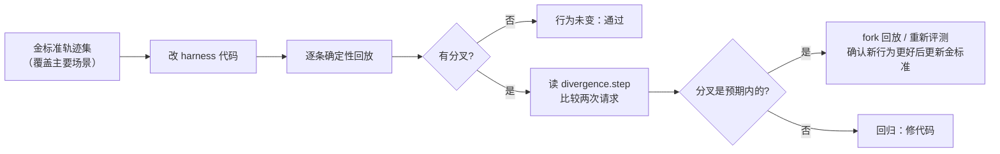

# 22 轨迹、回放与评测

Agent 的每次执行都不一样，这带来三个工程问题：怎么复现一次执行；改了 harness 之后，怎么定位“从哪一步开始不一样了”；怎么用站得住的统计说“新版本更好”。
本章精读 `observe/trace.py`、`llm/replay.py`、`observe/replay.py` 与 `observe/evals.py`，并逐行解读 `examples/08_replay_eval.py` 的输出。

## 轨迹要记录什么

一条能回放、能解释的轨迹，要把四类信息都留下来：

| 类别 | 内容 | 缺了会怎样 | flywhl-harness 中的来源 |
|---|---|---|---|
| **输入** | 用户 prompt、系统提示、工具集、模型 | 无法知道“当时问的是什么、在什么设定下问的” | `runs.prompt`；会话 `meta` 中冻结的 `system_prompt` / `tools` / `model` |
| **每一步的非确定性结果** | 模型输出（含工具调用）、工具结果、usage、时间 | 无法回放：回放的本质就是“读记录而不是重新执行” | `entries` 中的消息；`steps` 表（工具调用的预写日志） |
| **控制面事件** | 状态迁移、审批、取消、压缩、重试、降级、守卫提示 | 能看到结果，解释不了原因（为什么停了、为什么上下文变短了） | `events` 表 |
| **上下文指纹** | 每次模型调用时“模型看到了什么”的哈希 | 回放时发现结果不同，却不知道从哪一步开始不同 | `message_start` 事件的 `fingerprint` 字段 |

前两类是持久执行引擎（如 Temporal）的核心思想：首次执行时把非确定性的东西记下来，重放时从记录读取。后两类是 Agent 特有的需求——Agent 的“代码”有很大一部分是上下文，上下文变了，行为就可能变。

## 上下文指纹：给“模型看到的东西”做哈希

```python
def context_fingerprint(req: ModelRequest) -> str:
    """请求上下文指纹：system + tools + 消息（只取角色与内容），用于检测回放分叉。

    工具取名字 + 描述 + 参数 schema 的哈希：只改了一句工具描述，模型的行为也可能改变，回放必须能指出来。
    """
    return short_hash({
        "system": req.system,
        "tools": [[t["name"], short_hash(t.get("description", "")), short_hash(t.get("parameters", {}))] for t in req.tools],
        "messages": [[m.role, m.text, [c.name for c in m.tool_calls], m.tool_call_id] for m in req.messages],
    })
```

指纹在 `AgentLoop._call_model()` 里计算，计算对象是**即将发给模型的那个 `ModelRequest`**——已经过工具结果清理（`apply_clearing`）之后的消息列表：

```python
messages, wm = rc.context.apply_clearing(view.messages, stats, rc.clear_watermark)
# ...
req = ModelRequest(model=rc.model, system=rc.system_prompt, messages=messages, tools=specs, ...)
mid = new_id("m_")
# 上下文指纹：回放时比对“模型看到的东西”是否与录制时一致，用来定位分叉点
yield self._ev(E.MESSAGE_START, message_id=mid, role="assistant", context=stats.to_dict(),
               fingerprint=context_fingerprint(req), purpose=purpose)
```

所以指纹反映的是真实请求，而不是会话日志——清理水位线、截断规则、压缩策略的变化都会体现出来。哪些变化能被检测到，取决于哈希里放了什么：

| 变化 | 是否改变指纹 | 原因 |
|---|---|---|
| 改系统提示 | 是 | `system` 在哈希内 |
| 增删工具、工具改名 | 是 | 工具名列表在哈希内 |
| 只改工具的 description 或参数 schema | 是 | 每个工具贡献 `[名字, 描述哈希, 参数 schema 哈希]` |
| 改工具结果的截断 / 外置规则 | 是 | tool 消息的 `m.text` 变了 |
| 改压缩策略、清理阈值、reminder 注入 | 是 | 消息列表变了 |
| 改 temperature、max_tokens、模型名 | 否 | 请求参数不在哈希内 |
| thinking 块内容、图片 | 否 | 只取 `m.text` 与工具调用名 |

工具描述要单独进哈希，是因为它是模型“看到”的提示词的一部分：把 `read` 的描述从“读文件”改成“读文件（优先用 grep 定位）”，模型的工具选择就可能变化。如果只哈希工具名，这类改动在确定性回放里完全隐形。`test_fingerprint_sees_tool_description_change` 断言只改一句描述，指纹就不同。

## export_trajectory：一次 Run 的完整档案

`src/flywhl_harness/observe/trace.py` 的 `export_trajectory()`：

```python
def export_trajectory(store: Store, run_id: str, *, include_children: bool = True) -> dict[str, Any]:
    run = store.get_run(run_id)
    # ...
    session = store.get_session(run.session_id)
    events = store.list_events(run_id)
    entries = [e for e in store.path(run.session_id) if e.run_id == run_id] or \
              [e for e in store.list_entries(run.session_id) if e.run_id == run_id]
    messages = [e.payload for e in entries if e.kind == "message"]
    # 指纹与回放时的模型调用一一对齐：只保留最终落盘为有效 assistant 消息的那些调用
    # （出错 / 被中止的调用在回放时不会重演；压缩调用走单独的确定性摘要）
    replayable = {m.get("id") for m in messages if m.get("role") == "assistant"
                  and m.get("stop_reason") not in ("error", "aborted")}
    fingerprints = [ev.data["fingerprint"] for ev in events
                    if ev.type == E.MESSAGE_START and ev.data.get("fingerprint")
                    and ev.data.get("purpose") != "compaction" and ev.data.get("message_id") in replayable]
    children = [export_trajectory(store, r.id) for r in store.child_runs(run_id)] if include_children else []
    return {
        "format": "flywhl-trajectory/1",
        "run": run.to_dict(),
        "session": {"id": session.id, "title": session.title, "workspace": session.workspace,
                    "system_prompt": session.meta.get("system_prompt"), "model": session.meta.get("model"),
                    "tools": session.meta.get("tools")} if session else None,
        "messages": messages,
        "compactions": [e.payload for e in entries if e.kind == "compaction"],
        "steps": [s.__dict__ for s in store.list_steps(run_id)],
        "events": [ev.to_dict() for ev in events if ev.type != E.MESSAGE_UPDATE],
        "fingerprints": fingerprints,
        "children": children,
        "spans": to_otel_spans(run.to_dict(), events, session.meta if session else {}),
    }
```

| 字段 | 内容 | 用途 |
|---|---|---|
| `format` | `flywhl-trajectory/1` | 版本号：轨迹会被长期保存、被不同版本的工具读取 |
| `run` | 状态、版本、尝试次数、usage、结果 | 结局与成本 |
| `session` | 冻结的系统提示、模型、工具名列表 | 回放时用它重建同样的设定 |
| `messages` | 本 Run 写入的消息 | 回放的数据源：assistant 消息 = 模型输出，tool 消息 = 工具结果 |
| `compactions` | 本 Run 中的压缩条目 | 解释上下文为什么突然变短 |
| `steps` | 工具调用 journal：`call_id`、`effect`、`idem_key`、`input_hash`、`status`、`attempt`、起止时间 | 副作用审计、幂等对账 |
| `events` | 除 `message_update` 外的全部事件 | 控制面时间线；文本增量太多且可由消息重建，所以去掉 |
| `fingerprints` | 可重演的模型调用的上下文指纹，按调用顺序（出错、中止、压缩调用不计） | 回放时与 `ReplayProvider` 的游标逐个比对 |
| `children` | 子 Run 的轨迹（递归） | 子代理内部过程，见 [20](/multi-agent/subagents) |
| `spans` | OTel GenAI 风格的 span | 见 [23 可观测性与成本](/multi-agent/observability-cost) |

三个实现细节：

- 消息优先从会话**当前路径**（`store.path`）中按 `run_id` 筛选；如果之后会话分支切走了，当前路径上没有这个 Run 的消息，就退回到全部条目中筛选——轨迹不会因为用户后来切了分支而变空；
- **指纹按“能否重演”过滤**：`message_start` 在每次模型调用开始时就记下指纹，但并不是每次调用都留下了可回放的 assistant 消息——调用出错（`stop_reason=error`）、流式中途被取消（`aborted`），或进程崩溃后恢复同一个 Run，都会多出一个没有对应消息的指纹。回放时 `ReplayProvider` 只按有效 assistant 消息推进游标，如果指纹不过滤，从那一步起下标就错开，报出并不存在的分叉。按 `message_id` 与有效消息求交集，再排除 `purpose == "compaction"`（压缩调用在回放时用确定性摘要代替，不消耗录制），两条序列才一一对齐；
- 子 Run 用 `store.child_runs(run_id)` 按 `parent_run_id` 直接查询，按创建时间排序，不需要扫描全部 Run。

`examples/08_replay_eval.py` 录制的那次运行（读 `todo.txt` → 发通知 → 回答）导出后是：6 条消息（user、assistant、tool、assistant、tool、assistant）、2 个工具 step、27 个事件（含创建时 `queued` 的那条 status 事件）、3 个指纹（3 次模型调用）、6 个 span（1 个 `invoke_agent` + 3 个 `chat` + 2 个 `execute_tool`）。

## 确定性回放与反事实回放

| | 确定性回放 | 反事实回放（fork） |
|---|---|---|
| 目的 | 调试、回归：harness 改了之后行为变没变 | 评测：同样的前缀，换新模型 / 新提示词会怎么走 |
| 模型输出 | 全部来自录制（`ReplayProvider`） | 前 k 次来自录制，之后切到 live provider（`HybridProvider`） |
| 工具结果 | 全部来自录制（`RecordedTool`） | 前 k 次调用产生的工具结果来自录制；之后执行真实工具 |
| 外部副作用 | 不执行 | EXTERNAL 级工具一律 dry-run |
| 工作区 | 复制到临时目录 | 复制到临时目录，分叉后的写操作落在副本上 |
| 判定 | 指纹全部一致 + 工具序列一致 + 最终答案一致 | 看新路径的产物与评测结果 |

### replay_run 的步骤

`src/flywhl_harness/observe/replay.py` 的 `replay_run()` 把上面的设定组装起来：

```python
traj = export_trajectory(store, run_id, include_children=False)
msgs = [Message.from_dict(m) for m in traj["messages"]]
prompt = next((m.text for m in msgs if m.role == "user" and m.kind == "prompt"), traj["run"]["prompt"] or "")
recorded_tools = {m.tool_call_id: m for m in msgs if m.role == "tool" and m.tool_call_id}
assistant = [m for m in msgs if m.role == "assistant" and m.stop_reason not in ("error", "aborted")]
fps = traj["fingerprints"] if fork_at is None else traj["fingerprints"][:fork_at]

ws = _copy_workspace(traj["session"]["workspace"])
cfg = replace(config or HarnessConfig(), workspace=ws, data_dir=str(Path(ws) / ".flywhl"))
cfg.permissions = replace(cfg.permissions, on_ask="allow")  # 回放不需要再次人工审批
cfg.snapshots = False
# ... 为会话冻结的每个工具名注册一个 RecordedTool（真实工具作为 fallback）
rp = ReplayProvider(assistant, fps)
provider = HybridProvider(rp, live, fork_at)
model = live_model or traj["session"]["model"] or "replay"
h = Harness(cfg, provider=provider, model=model, tools=registry, store=Store(":memory:"))
s = h.create_session("回放", workspace=ws, system_prompt=traj["session"]["system_prompt"], mode="bypass")
res = await h.run(prompt, session_id=s.id)
```

逐条说明“为什么这样写”：

- **出错和中止的 assistant 消息不进录制序列**：回放只重放成功完成的模型输出。`export_trajectory()` 已经对指纹做了同样的过滤，所以 `fps[i]` 与 `assistant[i]` 指的是同一次调用；
- **内存 Store + 临时工作区**：回放产生的会话、事件不污染原库，写操作不碰原工作区；
- **用冻结的系统提示新建会话**：回放的设定来自轨迹，而不是当前配置——除非你有意修改它来观察分叉；
- **审批自动通过、关闭快照**：回放的目的是比对行为，不是再走一遍人审；
- **用 Harness 本身跑**：回放走的是真实的 Loop、真实的执行管线、真实的上下文管理，只把两处非确定性来源（模型、工具）换成了录制。正因如此，harness 代码的任何变化都会在回放中体现出来。

### ReplayProvider：按顺序吐出录制，顺带比对指纹

```python
async def stream(self, req: ModelRequest, cancel: CancelToken) -> AsyncIterator[StreamEvent]:
    if req.purpose == "compaction":
        # 压缩摘要不在录制的 assistant 序列里：用确定性摘要代替，保证回放可重复
        # ...
        return
    i = self.cursor
    self.cursor += 1
    if i < len(self.fingerprints) and self.divergence is None:
        fp = context_fingerprint(req)
        if fp != self.fingerprints[i]:
            self.divergence = {"step": i, "expected": self.fingerprints[i], "actual": fp}
            yield StreamEvent("notice", info={"code": "replay_divergence", "text": f"第 {i} 步上下文与录制时不一致"})
    if i >= len(self.recorded):
        raise IndexError("回放轨迹已耗尽：当前执行比录制时多出了模型调用")
    msg = Message.from_dict(self.recorded[i].to_dict())
    # ... 把 msg 切块成 text_delta / toolcall 事件流式吐出
```

- **只记第一次分叉**：第一处不一致之后，后面的指纹几乎必然都不一致，记录它们没有信息量；
- **分叉后继续吐录制**：即使上下文变了，返回的仍是录制的输出。这意味着工具序列与最终答案往往**仍然一致**——下文的实验会证明这一点，指纹是确定性回放里唯一可靠的“行为变了”的信号；
- **录制耗尽就抛异常**：新的 harness 逻辑让 Loop 多调用了一次模型（例如新增的 Stop 验收注入了缺口），回放会以失败结束，这本身就是一个明确的回归信号；
- **压缩请求不消耗录制**：压缩调用不在录制的 assistant 序列里，用确定性摘要代替，保证同一份轨迹每次回放的压缩结果相同。

### RecordedTool 与 HybridProvider

```python
async def execute(self, args: dict[str, Any], ctx: ToolContext) -> ToolResult:
    rec = self.recorded.get(ctx.call_id)
    if rec is not None:
        return ToolResult(rec.text, rec.is_error, {**(rec.details or {}), "replayed": True})
    if self.fallback is None:
        return ToolResult.error(f"[回放] 没有 {self.name} 的录制结果，且无可用的真实工具")
    if self.dry_run_external and self.fallback.effect_for(args) == Effect.EXTERNAL:
        return ToolResult(f"[dry-run] {self.fallback.describe_call(args)} —— 分叉评测中不执行外部副作用",
                          details={"dry_run": True})
    return await self.fallback.execute(args, ctx)
```

按 `call_id` 匹配录制结果之所以可行，是因为回放的 assistant 消息是录制消息的原样拷贝，工具调用 ID 与录制时相同。分叉之后模型产生新的调用 ID，查不到录制，就走真实工具；若真实工具是 EXTERNAL 级（发通知、调外部 API），返回 dry-run 说明而不执行。

`HybridProvider` 只做一件事：数调用次数（压缩调用不计），前 `switch_at` 次走录制，之后走 live。`fork_at=N` 的含义是“**前 N 次模型调用使用录制，第 N+1 次起换成 live**”；同时只保留前 N 个指纹和前 N 次调用对应的工具结果。

### 回放的边界

| 边界 | 影响 | 应对 |
|---|---|---|
| 临时工作区复制的是**当前**工作区 | 原 Run 的写操作已经发生，分叉点之前的状态并没有被还原；fork 评测看到的环境可能“超前” | 用影子 git 快照恢复到第 k 步时的工作区（快照机制见 [11 检查点与崩溃恢复](/reliability/checkpoint-recovery)），或者在录制前保存初始工作区 |
| fork 后 live 模型在 `bypass` 模式下运行，审批自动通过 | dry-run 只覆盖 EXTERNAL 级；WRITE 级操作真实执行在副本上，能越出工作区的命令仍有风险 | 在沙箱中跑 fork 评测，见 [18 Workspace 与沙箱](/governance/workspace-sandbox) |
| 录制序列不含子代理内部 | `include_children=False`，task 的结果按录制返回，子代理的过程不会被回放 | 需要时对子 Run 单独回放 |
| 依赖环境的 harness 逻辑 | 验收命令、墙钟预算等在副本环境里可能给出不同结论，导致调用次数变化 | 回放时关掉或固定这些逻辑；把差异当作待解释的分叉 |
| 指纹不含请求参数 | 只改 temperature、max_tokens、模型名不会报分叉 | 这些属于“换了执行者”，用 fork 回放与评测来比较，而不是确定性回放 |

## 用回放定位分叉：examples/08 的前半段

```bash
.venv/bin/python examples/08_replay_eval.py
.venv/bin/python -m pytest tests/test_runtime.py::test_deterministic_replay -q
```

示例先录制一次“读待办 → 发通知 → 回答”，然后做两次回放：

```text
» 工具序列一致=True，最终答案一致=True，分叉=None，外部通知数 1 → 1（没有重放副作用）
» 分叉：{'step': 0, 'expected': '…', 'actual': '…'}；['第 0 次模型调用的上下文与录制时不一致：harness 行为发生了变化']
```

第一次回放什么都没改：三个指纹全部一致，外部通知服务的计数保持 1 不变——`send_notification` 的结果来自录制，没有真的再发一次。`test_deterministic_replay` 断言的就是这三点。

第二次回放前，示例直接修改了会话 `meta` 里冻结的系统提示（追加一行“新增一条规则”）。分叉出现在第 0 步，因为系统提示在每一次请求里，第一次模型调用就已经不同。如果改的是 `read` 工具的输出截断规则，分叉会出现在第 1 步——第一个带着 `read` 结果的请求。

还有一个容易忽略的事实：在第二次回放里，`same_tool_sequence` 与 `same_final_text` **仍然都是 `True`**（可以在示例里打印 `rep2` 验证）。模型输出是录制的，上下文变了它也照样“说”出一样的话。只看输出比对，会得出“改动没有影响”的错误结论；指纹告诉你：模型看到的东西已经变了，真实模型很可能会走出不同的路径。

把它变成回归流程：



CLI 与 Web UI 的对应入口：

```bash
flywhl trace <run_id> -o traj.json        # 导出轨迹（含 span）
flywhl replay <run_id>                    # 确定性回放，输出 ReplayReport JSON
flywhl replay <run_id> --fork-at 1        # 前 1 次模型调用用录制，之后改用当前配置的模型
```

Web UI 检查器的“概览”页签（“本会话的运行”一节）提供轨迹下载（`GET /api/runs/{rid}/trajectory`）与确定性回放按钮（`POST /api/runs/{rid}/replay`）。

## 评测体系

| 层次 | 测什么 | 成本 | 主要风险 |
|---|---|---|---|
| **离线基准集** | 固定用例集上的成功率、轮次、token、成本 | 低，可放进 CI | 用例集被“刷”到过拟合；与真实分布脱节 |
| **轨迹级评测** | 过程性质：是否先读后改、工具错误数、重试次数、是否调用了不该调用的工具 | 低，直接分析导出的轨迹 | 好的过程不等于好的结果，要与产物检查一起用 |
| **LLM-as-Judge** | 开放式产出的质量（报告、方案、代码可读性） | 中，每个样本一次评审调用 | 位置偏差、冗长偏差、自我偏好 |
| **在线 A/B** | 真实流量上的成功率与用户反馈 | 高，周期长 | 指标噪声大，需要足够样本与护栏指标 |

LLM-as-Judge 的已知偏差与校准办法：

| 偏差 | 表现 | 校准 |
|---|---|---|
| 位置偏差 | 成对比较时偏好排在前面（或后面）的候选 | 交换顺序各评一次，只采用两次一致的结论 |
| 冗长偏差 | 更长的回答得分更高 | 评分标准写明长度不加分；对比时控制长度 |
| 自我偏好 | 评审模型偏好与自己同源的输出 | 评审与生成用不同的模型或至少不同的提示 |
| 整体漂移 | 评审标准随模型版本变化 | 维护一份人工标注的校准集，定期计算评审与人工的一致率 |

Anthropic 在讨论长任务 harness 设计时提到两点经验：**独立的评估器比让生成器自评更可靠**；以及在开工前先约定“完成”要怎么验证（类似一份 sprint contract）。前者对应“评测者与执行者分离”，后者对应下一节的“以产物判定成功”。

## 以产物判定成功

`src/flywhl_harness/observe/evals.py` 的用例定义与执行：

```python
@dataclass
class EvalCase:
    id: str
    prompt: str
    check: CheckFn                                   # (工作区, RunResult) -> 是否通过[, 说明]
    setup: Callable[[Path], None] | None = None      # 准备工作区（写入初始文件等）
    tags: list[str] = field(default_factory=list)


async def run_eval(cases, harness_factory, *, trials: int = 1, keep_workspaces: bool = False) -> EvalReport:
    """对每个用例：新建临时工作区 → setup → 用工厂创建 harness 执行 → 检查产物。"""
    for case in cases:
        for t in range(trials):
            ws = Path(tempfile.mkdtemp(prefix=f"flywhl-eval-{case.id}-"))
            try:
                if case.setup:
                    case.setup(ws)
                h = await harness_factory(ws)
                if hasattr(h, "start"):
                    await h.start()  # 幂等：工厂里已经 start 过也没关系；否则 MCP 工具不会加载
                try:
                    res = await h.run(case.prompt)
                finally:
                    await h.aclose()
                out = case.check(ws, res)
            # ... 记录 passed、status、轮次（turn_start 事件数）、token（输入+输出）、cost_usd
```

设计要点：

- `check` 拿到的是**工作区**和 `RunResult`。成功与否看文件、测试结果、结构化输出，而不是看模型说了“完成了”；
- 每个用例、每次 trial 一个新的临时工作区和新的 harness，用例之间没有状态泄漏；
- 拿到 harness 后先调用 `start()`（幂等）。MCP 工具在 `start()` 时才加载，工厂如果只构造不启动，评测里的 Agent 会少一批工具，测出来的不是线上的配置；
- 除了通过与否，还记录轮次、token、成本——同样的成功率，成本可能差几倍。

`EvalReport.summary()` 里单独统计了**过早停止率**：

```python
@property
def premature_stop_rate(self) -> float:
    """宣称完成（completed）但产物检查失败的比例。"""
    bad = sum(1 for r in self.results if r.status == "completed" and not r.passed)
    return bad / self.n if self.n else 0.0
```

`budget_exhausted`、`failed` 这类失败至少是“诚实的失败”；最危险的是 Run 以 `completed` 结束、产物却不对——用户会相信它。这个指标直接衡量 [08 终止条件、预算与循环守卫](/core/termination-budget) 里 Stop 验收的效果。

失败归因可以借助轨迹里的信号做初筛：

| 归因 | 轨迹中的典型信号 |
|---|---|
| 规划 | todo 计划缺项或顺序错误；Stop 验收注入“计划中仍有未完成项” |
| 工具 | `is_error=True` 的工具结果集中出现；`notice` 中的循环守卫提示（连续错误、重复调用） |
| 上下文 | 失败前出现 `compaction_*` 或 `clear_tool_results`；关键信息在被清理的结果里 |
| 环境 | 工具超时、命令不存在、依赖安装失败；`model_retry` 频繁 |
| 模型 | 上下文里信息齐全、工具正常，结论仍然错误 |

## 统计：小样本下如何说话

### Wilson 区间

```python
def wilson_interval(k: int, n: int, z: float = 1.96) -> tuple[float, float]:
    if n == 0:
        return 0.0, 1.0
    p = k / n
    denom = 1 + z * z / n
    centre = (p + z * z / (2 * n)) / denom
    half = z * math.sqrt(p * (1 - p) / n + z * z / (4 * n * n)) / denom
    return max(0.0, centre - half), min(1.0, centre + half)
```

教科书上的正态近似（Wald）区间是 `p ± z·sqrt(p(1-p)/n)`。它在小样本、比例接近 0 或 1 时会失效：

| 观测 | Wald 区间 | Wilson 区间 |
|---|---|---|
| 12 个全过（12/12） | [1.00, 1.00]——宽度为零，好像已经确定 100% | [0.76, 1.00] |
| 5 个过 4 个（4/5） | 约 [0.45, 1.15]——上界超过 1 | [0.38, 0.96] |

Wilson 区间的中心被向 0.5 拉（`z²/(2n)` 那一项），宽度里多了 `z²/(4n²)`，样本越少修正越大。Agent 评测的用例往往只有几十个，这正是 Wilson 适用的场景。

**样本量粗算**：区间半宽约为 `1.96·sqrt(p(1-p)/n)`。成功率在 70% 附近时，想把半宽压到 ±10% 需要约 81 个用例，压到 ±5% 需要约 323 个。几十个用例的评测集，能分辨的是“明显更好或更差”，分辨不了两三个百分点的差异。

### McNemar 精确检验

```python
def mcnemar_exact(a: list[bool], b: list[bool]) -> dict[str, Any]:
    """配对比较两个版本在同一批用例上的结果：只看“结论不一致”的用例，做精确二项检验（双侧）。"""
    b_only = sum(1 for x, y in zip(a, b) if not x and y)   # 新版通过、旧版失败
    a_only = sum(1 for x, y in zip(a, b) if x and not y)   # 旧版通过、新版失败
    n = a_only + b_only
    if n == 0:
        return {"a_only": 0, "b_only": 0, "p_value": 1.0}
    k = min(a_only, b_only)
    p = sum(math.comb(n, i) for i in range(0, k + 1)) / 2 ** n
    return {"a_only": a_only, "b_only": b_only, "p_value": min(1.0, 2 * p)}
```

直觉：两个版本跑同一批用例，两边都过或都挂的用例不提供“谁更好”的信息，只有结论不一致的用例才有。若两个版本实际一样好，不一致的用例里“A 独赢”和“B 独赢”应该各占一半，即 `a_only ~ Binomial(n, 0.5)`；观察到的分布越偏，p 值越小。

为什么要配对：用例难度差异很大，两个版本各跑一批不同的用例再比成功率，难度差异会淹没版本差异。同一批用例上配对比较，把难度这个变量消掉了。

一个有用的推论：当不一致的用例全部偏向一边时，p 值是 `2 / 2^n`。`n=5` 时 p=0.0625，`n=6` 时 p≈0.031——**至少要有 6 个一边倒的不一致用例，才能在 0.05 水平上下结论**。`test_wilson_and_mcnemar` 里 3:0 的 p 值是 0.25，正是这个公式。

::: warning trials 不是独立样本
`run_eval(trials=k)` 把每次 trial 都作为一条结果计入 `n`。同一个用例的多次 trial 高度相关（难的用例每次都难），把它们当独立样本会让 Wilson 区间显得比实际更窄。trial 适合用来估计单个用例的波动；算整体置信区间时，更稳妥的做法是先按用例聚合，或按用例做 bootstrap。
:::

## examples/08 的后半段：评测与“多次运行看分布”

示例构造 12 个用例（“创建 outN.txt”，检查文件是否存在），比较两个版本：A 每次都写文件；B 用 `zlib.crc32(req.messages[0].text.encode()) % 3` 决定是“老实写文件”还是“直接说完成了”。输出：

```text
  A 版本：成功率 100%  95% CI [0.7575, 1.0]  过早停止率 0%
  B 版本：成功率 17%  95% CI [0.047, 0.448]  过早停止率 83%
  配对检验（McNemar 精确）：A 独赢 10、B 独赢 0，p = 0.0020
» 小样本提醒：5 个用例过 4 个，Wilson 区间是 [0.38, 0.96]——别把 80% 当成定论
```

逐项解读：

- A 12/12 全过，Wilson 下界仍只有 0.76——12 个用例不足以证明“接近 100%”；
- B 的失败全部是 `completed` 但没有产物，所以过早停止率 = 1 − 成功率，这正是“虚报完成”的样子；
- 10 个不一致用例全部是 A 独赢，p = 2/2¹⁰ ≈ 0.0020。

B 用 `crc32` 而不是 Python 内置的 `hash()`，是有意的：字符串 `hash()` 每个进程随机加盐（除非固定 `PYTHONHASHSEED`），用它决定“偷不偷懒”，每次运行 B 在哪些用例上偷懒都不同，成功率与 p 值也跟着变——有的运行在 0.05 水平上显著，有的不显著。`crc32` 是确定的，示例输出才可复现。

这个坑本身就说明了一件事：**一次评测结果只是分布中的一个样本**。示例可以靠确定性哈希把分布压成一个点，真实模型做不到。版本之间的差异如果只在某一次运行里显著，结论就不可靠；评测脚本里任何依赖随机性的地方（用例抽样、打乱顺序、模拟器）都要固定种子并记录下来，否则两次评测的差异分不清来自版本还是来自随机数。

## 非确定系统怎么测

| 方法 | 做法 | 在本项目中的例子 |
|---|---|---|
| 脚本化模型 | 用确定的模型输出驱动真实的 harness，测 harness 本身 | 测试与示例全部基于 `ScriptedProvider` |
| 属性测试 / 不变量 | 不断言具体输出，断言恒成立的性质 | 事件 `seq` 单调递增、每个工具调用都有配对结果、相邻请求前缀不变（`test_prefix_stability_append_only`） |
| 金标准集 + 确定性回放 | 录制一批代表性轨迹，每次改动后回放比对指纹 | `replay_run()` |
| 语义断言 | 检查产物的性质，而不是文本完全相等 | `EvalCase.check` 检查文件、测试结果 |
| 多次运行看分布 | 同一配置重复运行，报告区间而不是单个数 | `trials` 参数 |

## 回归门禁、灰度与影子流量

| 阶段 | 做什么 | 放行条件（示例） |
|---|---|---|
| 离线门禁（CI） | 金标准轨迹回放 + 基准集评测 | 无非预期分叉；新版本与基线配对比较没有显著变差；成本与轮次在预算内 |
| 留出集复核 | 在开发时没看过的用例上再评一次 | 与开发集的成功率差异在区间内，防止对开发集过拟合 |
| 影子流量 | 新版本在复制的真实请求上运行，副作用全部 dry-run，结果不返回给用户 | 产物检查通过率、过早停止率、成本不劣于线上版本 |
| 灰度 | 小比例真实流量 | 护栏指标（过早停止率、工具错误率、每 Run 成本）不越线，否则自动回滚 |

反事实回放其实就是离线版的影子流量：同样的前缀、副作用 dry-run、只比较新路径。Anthropic 在《Writing effective tools for agents》中建议用留出集防止对评测集过拟合，并在评测时一并跟踪运行时长、工具调用次数、token 消耗与工具错误数——成功率之外的这些指标往往最先暴露问题。

## 评测器也会失效

评测器是代码（或模型），同样会有 bug，而且它的 bug 会被优化过程放大——指标会被“刷”。

| 失效形式 | 例子 | 防护 |
|---|---|---|
| 检查过于宽松 | 示例的 `check` 只看 `outN.txt` 是否存在，写一个空文件也能通过 | 检查内容与性质，而不只是存在性 |
| 度量与目标脱节 | 研究报告按“结构完整、语言流畅”打分，一篇零引用的报告也能拿高分 | 把关键要求（引用可解析、结论有证据）写成确定性检查 |
| 被执行者篡改 | Agent 修改测试用例让测试通过 | 评测用的测试放在 Agent 看不到或改不了的位置；用留出测试复核 |
| 只看模型自述 | `check` 读取 `RunResult.text` 判断“是否完成” | 只看产物；模型的自述最多作为辅助信息 |
| Judge 偏差 | 更长的答案系统性得分更高 | 见上文的校准办法 |

审查评测器的办法：准备一组**已知是坏的**输出（空文件、零引用、改过测试的补丁），确认评测器会判它们失败；准备一组人工确认是好的输出，确认评测器会判它们通过。评测器在这两组上的准确率，就是它自己的“测试”。

## 小结

- 轨迹要记录输入、非确定性结果、控制面事件与上下文指纹；前两者支撑回放，后两者支撑解释；
- 指纹在真实请求上计算，确定性回放里它是唯一可靠的“行为变了”的信号——模型输出是录制的，输出比对看不出差别；
- 反事实回放从第 k 步换 live 模型，副作用 dry-run，但要注意工作区是当前状态的副本；
- 以产物判定成功，单独统计过早停止率；用 Wilson 区间表达不确定性，用 McNemar 做配对比较，至少 6 个一边倒的不一致用例才可能显著；
- 一次评测只是一个样本，评测器本身也要被评测。

延伸思考：轨迹里的 span 怎么接入现有的可观测平台？跨进程、跨子代理的调用链怎么串起来？每次运行花了多少钱、花在哪里？这些是 [23 可观测性与成本](/multi-agent/observability-cost) 的内容。
