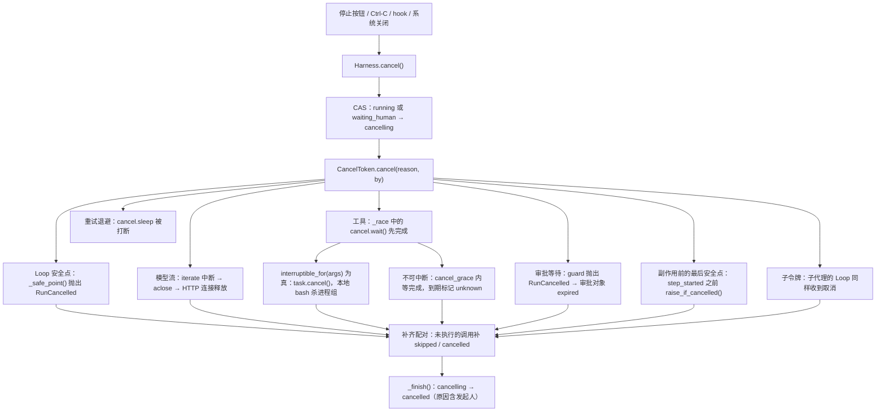
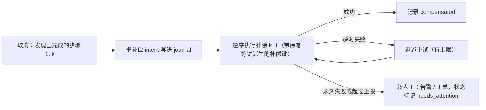

# 12 取消语义

“停止”按钮看起来只是一个布尔开关，背后却有一串问题要回答：模型正在输出一半的话怎么办？正在跑的 `npm test` 怎么办？
已经发出去、还没收到回包的通知怎么办？子代理怎么办？取消和完成同时发生时听谁的？
本章从 `CancelToken` 的源码开始，沿着取消信号的传播路径走一遍，最后讨论补偿和几个常见的坑。

## 协作式与抢占式

| | 抢占式（preemptive） | 协作式（cooperative） |
|---|---|---|
| 代表 | asyncio 的 `task.cancel()`、杀线程、`SIGKILL` | Go 的 `context.Context`、JS 的 `AbortSignal`、本项目的 `CancelToken` |
| 在哪里停 | 被取消方的任意一个 `await` 处（或任意一条指令） | 被取消方自己选择的 **安全点** |
| 响应速度 | 快 | 取决于安全点的密度 |
| 对已发出的外部写 | 可能在“请求已发出、回包未到”时被打断，结果未知 | 被取消方可以决定等它完成，或者如实标记未知 |
| 资源清理 | 依赖 `finally` 写得是否正确 | 由被取消方按自己的语义清理 |

`src/flywhl_harness/cancel.py` 的模块 docstring 说得很直接：asyncio 的取消是抢占式的，它会在任意 `await` 处抛出 `CancelledError`，
可能正好打断一个已经发出去的下发指令、发通知或扣款。harness 需要的是 **取消请求**，而不是 **取消命令**：
令牌沿着“主循环 → 模型流 → 工具 → 子 Agent”逐层传播，每一层在自己的安全点决定怎么停。

pi 的做法与此同构：一个 `AbortSignal` 贯穿 `streamFn`、`transformContext` 和每个 `tool.execute`；bash 工具收到 abort 后杀掉整棵进程树；
provider 把这次回复的 `stopReason` 标成 `aborted`。

取消有两种粒度，需要分清：

| 粒度 | 含义 | flywhl-harness 中的对应 |
|---|---|---|
| 中断 | 停掉当前这次执行，会话保留，用户可以接着说话 | `Harness.cancel()`：Run 进入 `cancelled`，会话的历史完整、配对完好，下一条输入开启新的 Run |
| 终止 | 整个进程或 Worker 退出，或本 Worker 失去了某个 Run 的租约 | 第二次 Ctrl-C、进程被杀、关闭服务时宽限期内没停下的 Run、租约丢失后的自我 fencing：等同于崩溃，交给 [11 检查点与崩溃恢复](/reliability/checkpoint-recovery) |

正常关闭服务（`Harness.aclose()`）两种都不是：它让 Run 在安全点暂停，重启后接着做，见下文“关闭服务不是取消”。本章讨论的是第一种。它的目标不仅是“停下来”，还要“停得干净”，让会话能够继续。

## CancelToken 源码精读

```python
# src/flywhl_harness/cancel.py · CancelToken（节选）
class CancelToken:
    def __init__(self, parent: "CancelToken | None" = None):
        self._event = asyncio.Event()
        self.reason: str | None = None
        self.by: str | None = None
        self._children: list[CancelToken] = []
        if parent is not None:
            parent._children.append(self)
            if parent.cancelled:
                self.cancel(parent.reason or "parent_cancelled", parent.by or "system")

    def cancel(self, reason: str = "cancelled", by: str = "user") -> bool:
        """发出取消请求。返回 True 表示这是首次取消。"""
        if self._event.is_set():
            return False
        self.reason, self.by = reason, by
        self._event.set()
        for c in self._children:
            c.cancel(reason, by)
        return True

    def child(self) -> "CancelToken":
        return CancelToken(parent=self)
```

- **幂等，只记录第一次**：用户连点三次停止，或者 hook 和用户同时要求终止，审计里只留第一个原因和发起人。
  后面的调用返回 False，调用方据此知道“已经有人取消过了”；
- **级联只向下**：父取消会递归地取消所有子令牌，子取消不影响父。子代理自己出错停下，不会把父任务一起带走；
- **出生即取消**：从一个已取消的父令牌派生子令牌，子令牌立刻就是取消状态。这防住了一个竞态：父任务刚被取消，还没来得及停下，又派生了一个子代理；
- `_children` 只增不减。一个父令牌派生的子令牌越多，这个列表越长，不过它的寿命与一次 Run 相同，问题不大。

### guard：让任意等待可被打断

```python
# src/flywhl_harness/cancel.py · CancelToken.guard
async def guard(self, aw: Awaitable[T]) -> T:
    self.raise_if_cancelled()
    task = asyncio.ensure_future(aw)
    waiter = asyncio.ensure_future(self._event.wait())
    try:
        done, _ = await asyncio.wait({task, waiter}, return_when=asyncio.FIRST_COMPLETED)
    except asyncio.CancelledError:  # 外层任务被抢占式取消：两边都收拾干净
        task.cancel()
        waiter.cancel()
        raise
    finally:
        waiter.cancel()
    if task in done:
        return task.result()
    task.cancel()
    with contextlib.suppress(asyncio.CancelledError, Exception):
        await task
    raise self.error()
```

这就是协作式取消在 asyncio 里的基本构件：让真正的工作与“取消信号”赛跑。有三种结局：

| 结局 | 行为 |
|---|---|
| 工作先完成 | 返回结果（两者 **同时** 就绪时也返回结果） |
| 取消信号先到 | 取消被等待的任务，**等它收尾完**，再抛出 `RunCancelled(reason, by)` |
| 外层被抢占式取消 | 两边都取消，然后把 `CancelledError` 原样抛出，不吞掉 |

第二种结局里的 `await task` 很关键：被放弃的任务收到 asyncio 取消之后，可能还要在 `finally` 里关连接、删临时文件。
`guard` 等它收拾完再返回，调用方拿到 `RunCancelled` 时，资源已经释放了。

“同时就绪时返回结果”是一个有意识的选择：结果已经拿到了，丢掉它反而会造成不一致。但这也意味着，`guard` 返回之后，
调用方 **不能假设取消没有发生**。[10 Run 生命周期状态机](/reliability/run-lifecycle) 的场景二就是这个细节引出的问题：
审批 `guard` 返回了“批准”，执行器随后没有再检查取消，于是发起了一个新的副作用。

### iterate：让流可被打断，并保证关闭底层流

```python
# src/flywhl_harness/cancel.py · CancelToken.iterate
async def iterate(self, source: AsyncIterator[T]) -> AsyncIterator[T]:
    it = source.__aiter__()
    try:
        while True:
            try:
                item = await self.guard(it.__anext__())
            except StopAsyncIteration:
                return
            yield item
    finally:
        aclose: Any = getattr(it, "aclose", None)
        if aclose is not None:
            with contextlib.suppress(Exception):
                await aclose()
```

每取一个元素都经过 `guard`，所以取消在“等下一个 token”时也能立即生效。`finally` 里的 `aclose()` 保证无论正常结束、出错还是被取消，
底层的异步生成器都会被关闭。对 HTTP 流来说，这意味着连接被释放：`OpenAICompatProvider.stream()` 里的 `async with self.client.stream(...)` 会退出，
服务端看到连接断开，就会停止生成。取消之后流还开着，模型就还在生成，token 就还在计费，连接池里的连接也被占着。

`AgentLoop._call_model()` 在外层用 `rc.cancel.iterate(rc.provider.stream(req, rc.cancel))` 包了一次；provider 内部读 SSE 行时又包了一次
（`cancel.iterate(resp.aiter_lines())`）。两层都能独立响应取消，provider 的实现即使写得不严谨，外层也能兜住。

### sleep 与 raise_if_cancelled

```python
async def sleep(self, seconds: float) -> None:
    """可被取消打断的 sleep（重试退避、轮询等待都应该用它）。"""
    await self.guard(asyncio.sleep(seconds))

def raise_if_cancelled(self) -> None:
    """安全点检查：主循环在每个阶段边界调用它。"""
    if self.cancelled:
        raise self.error()
```

`ResilientProvider.stream()` 在两次重试之间用的是 `await cancel.sleep(delay)`。如果这里用普通的 `asyncio.sleep`，
用户在“模型限流、退避 30 秒”时点停止，就得干等 30 秒。`ToolExecutor._invoke()` 对瞬时错误的重试退避也是这样处理的。

## 取消的传播路径



各层的检查方式和最大延迟：

| 层 | 怎样感知取消 | 最大延迟 |
|---|---|---|
| 主循环 | 每轮开头 `_safe_point()` | 取决于当前在做什么（下面几层） |
| 模型流 | `iterate` 中的 `guard` | 立即（下一次事件循环调度） |
| 可中断工具 | `_race` 中的 `cancel.wait()` | 立即；bash 还要加上 SIGTERM 的宽限期（2 秒） |
| 不可中断工具 | 同上 | 工具声明的 `cancel_grace`，未声明时用 `cancel_grace_seconds`（默认 5 秒）；`task` 为 30 秒 |
| 审批等待 | `guard` | 立即 |
| 同步阻塞的代码 | 感知不到 | 直到这段代码执行完 |

最后一行是协作式取消的固有局限：没有 `await` 的代码不会让出控制权，令牌再怎么喊它也听不见。下文“常见坑”还会回到这一点。

## 流式中途取消：保留文本，丢弃半截工具调用

```python
# src/flywhl_harness/agent/loop.py · AgentLoop._call_model（节选）
try:
    async for sev in rc.cancel.iterate(rc.provider.stream(req, rc.cancel)):
        t = sev.type
        if t == "text_delta":
            text_acc.append(sev.delta)
            # ... 产出 message_update 事件
except RunCancelled:
    # 流式中途被取消：保留已生成的文本（标记 aborted），丢弃半截工具调用
    if text_acc:
        partial = Message(role="assistant", content=[TextBlock("".join(text_acc))], id=mid,
                          stop_reason=StopReason.ABORTED, model=rc.model, provider=rc.provider.name)
        yield self._append(partial)
    raise
```

为什么这样分开处理？

| 已生成的内容 | 处理 | 理由 |
|---|---|---|
| 文本 | 保留，存成 `stop_reason=aborted` 的 assistant 消息 | 用户已经在屏幕上看到了；下一轮的上下文要和 UI 一致，否则用户问“你刚才说的第二点”时模型不知道在说什么 |
| 半截工具调用 | 丢弃 | JSON 参数不完整，无法执行；保留下来还得给它补一个结果才能配对 |
| thinking | 不保存 | 只累加了文本增量；半截 thinking 的签名也不完整 |

发送下一次请求时，`prepare_history()` 对 aborted 消息只保留文本（见 `src/flywhl_harness/llm/base.py` 的 docstring）。
`tests/test_cancel.py::test_cancel_mid_stream_keeps_partial_text` 断言最后一条消息是 aborted，而且文本长度介于 0 和完整长度之间。

## 在途工具：按副作用分级

工具是取消语义里最难处理的部分，因为它可能已经对外部世界做了点什么。处理方式按副作用分级：

| 副作用等级 | 例子 | 取消时的处理 | 结果状态 |
|---|---|---|---|
| 只读 | `read`、`grep`、`sleep`、只读 bash 命令 | 立即中止 | `cancelled` |
| 本地写 | `write`、`edit`（原子写 + 影子 git 快照） | 一旦开始就在同一次调度里写完；需要时用快照回滚 | `ok` |
| 本地子进程 | 分析结果为 read / write 的 `bash` 命令 | SIGTERM 整个进程组 → 2 秒宽限 → SIGKILL | `cancelled` |
| 不可逆外部写 | `send_notification`、`git push`、`curl -X POST`、非只读 MCP 工具 | **不半途打断**：宽限期内等它完成，到期则标记结果未知并附幂等键 | `ok`（`completed_after_cancel`）或 `unknown` |
| 子代理 | `task` | 不可中断，宽限 30 秒；子令牌级联，子 Run 协作式收尾并写入终态 | 见下文 |

“能不能直接中止”由 `Tool.interruptible_for(args)` 按 **这一次调用的参数** 判定，默认返回静态的 `interruptible`；
宽限期取工具自己的 `cancel_grace`，没有声明时用全局的 `cancel_grace_seconds`。实现在 `ToolExecutor._race()`：

```python
# src/flywhl_harness/agent/executor.py · ToolExecutor._race（节选）
task = asyncio.ensure_future(tool.execute(args, ctx))
waiter = asyncio.ensure_future(rc.cancel.wait())
try:
    done, _ = await asyncio.wait({task, waiter}, timeout=timeout, return_when=asyncio.FIRST_COMPLETED)
except asyncio.CancelledError:
    task.cancel()
    raise
finally:
    waiter.cancel()
if task in done:
    r = task.result()
    return r, ("error" if r.is_error else "ok")
if rc.cancel.cancelled:
    if tool.interruptible_for(args):
        task.cancel()
        with contextlib.suppress(asyncio.CancelledError, Exception):
            await task
        return ToolResult.error(f"已取消：{rc.cancel.reason}（工具执行被中断）"), "cancelled"
    # 不可中断（已发出的外部请求）：给一个宽限期等它完成，而不是半途打断
    try:
        r = await asyncio.wait_for(asyncio.shield(task), tool.cancel_grace or rc.config.cancel_grace_seconds)
        r.details = {**(r.details or {}), "completed_after_cancel": True}
        return r, ("error" if r.is_error else "ok")
    except asyncio.TimeoutError:
        task.cancel()
        return ToolResult.error(
            f"结果未知：取消时该操作仍在进行（幂等键 {ctx.idempotency_key}）。它可能已经生效，需要对账确认。"), "unknown"
# ... 超时分支：外部且非幂等的工具同样记为 unknown，见 14 章
```

`asyncio.shield(task)` 的作用是：`wait_for` 超时时只取消外面的 shield 包装，不会直接取消工具任务本身。
宽限期过后，代码再显式地 `task.cancel()` 放弃它。这时外部请求可能已经生效，所以结果写成 `unknown`，并带上幂等键，
供人或模型去外部系统核实。这比写一个“已取消”诚实，因为“已取消”会让模型以为什么都没发生过。

开头的 `except asyncio.CancelledError` 处理的是另一种情况：驱动这批工具的任务本身被 **抢占式** 取消（进程关闭、宽限期内没停下）。
这时只把工具任务一并取消、把 `CancelledError` 原样抛出，不写任何结果，见下文“配对修补”。

两个测试分别覆盖宽限期内的两种结局：

- `test_non_interruptible_tool_completes_within_grace`：宽限 5 秒，工具 0.5 秒完成，结果是 `ok` 且带 `completed_after_cancel`，Run 仍然是 `cancelled`；
- `test_non_interruptible_tool_marked_unknown_after_grace`：宽限 0.1 秒，工具要 3 秒，结果是 `unknown`，内容里带幂等键。

### bash：杀整棵进程树

```python
# src/flywhl_harness/tools/shell.py · _terminate 与 BashTool.execute（节选）
async def _terminate(proc: asyncio.subprocess.Process, grace: float = 2.0) -> None:
    """先 SIGTERM，宽限期后 SIGKILL；作用于整个进程组。"""
    if proc.returncode is not None:
        return
    try:
        pgid = os.getpgid(proc.pid)
        os.killpg(pgid, signal.SIGTERM)
    except (ProcessLookupError, PermissionError):
        return
    try:
        await asyncio.wait_for(proc.wait(), grace)
    except asyncio.TimeoutError:
        try:
            os.killpg(pgid, signal.SIGKILL)
        except ProcessLookupError:
            pass
        await proc.wait()

# ...（BashTool.execute 中）
try:
    await asyncio.wait_for(asyncio.gather(pump(), proc.wait()), timeout)
except asyncio.CancelledError:
    await _terminate(proc)  # 被取消：杀掉整棵进程树后再把取消向上传播
    raise
```

子进程用 `start_new_session=True` 启动，自成一个进程组。`npm run dev` 这类命令会派生多个子进程，只杀 shell 自己会留下孤儿进程继续占着端口。
`killpg` 一次处理整个组。先发 SIGTERM，是给测试框架、构建工具留出写完报告、清理临时文件的机会。

### 可中断性随参数变化

bash 的副作用等级是动态的：`ls` 是只读，`git push` 是外部写（由命令分析器给出，`effect_for(args)`）。
如果可中断性只是一个类属性，取消正在执行的 `git push` 就会直接 `killpg`、记成 `cancelled`，而远端可能已经收到了推送。
所以 bash 覆盖了 `interruptible_for`：

```python
# src/flywhl_harness/tools/shell.py · BashTool.interruptible_for
def interruptible_for(self, args: dict[str, Any]) -> bool:
    # 已经发出的外部操作（git push、curl POST、部署……）半途打断会留下“不知道成没成功”的状态：
    # 给它宽限期跑完，超时才标记为结果未知；本地命令可以直接杀进程组
    return self.effect_for(args) != Effect.EXTERNAL
```

MCP 工具的 `interruptible` 取自注解 `readOnlyHint`：只读工具直接中止，写工具走宽限期。
MCP 调用被放弃时（取消、超时），客户端会向服务器发一条 `notifications/cancelled`，告诉它“不用做了”。
这只是尽力而为的提示，已经发生的副作用不会因此撤销，结果仍按上表记录。

**`write` / `edit` 在 asyncio 层面不可打断**。它们的 `execute` 里没有任何 `await`，一旦开始执行就会在同一次调度里跑完，
取消要么发生在它开始之前，要么在它结束之后。进程崩溃则由原子写兜住：`_atomic_write` 先写临时文件、`fsync`，再 `os.replace`，
文件要么是旧内容，要么是新内容，不会留下写了一半的残缺文件。

## 配对修补：每个 tool_use 都必须有结果

模型 API 要求 assistant 消息里的每个 tool_use 后面都有对应的 tool_result，缺了就会直接返回 400。
取消打断执行之后，flywhl-harness 在三个地方补合成结果：

| 位置 | 时机 | 合成结果 | step 状态 |
|---|---|---|---|
| `ToolExecutor.run_batch` 的 `driver` 的 `finally` | 协作式取消或异常时，同一批里还没执行的调用 | `未执行：<原因>` | `skipped` |
| `AgentLoop._pair_dangling()` | Loop 捕获 `RunCancelled` 之后，兜底检查 | `已取消：<原因>` | `cancelled` |
| `Harness._pair_dangling_offline()` | 离线取消（paused / interrupted 等），或恢复时遇到 `cancelling` | journal 停在 `started` 的：`结果未知……需要对账确认`；其余：`已取消：<原因>` | `unknown` 或 `cancelled` |

`driver` 的 `finally` 在 **抢占式** 终止时不补结果，原因见第 11 章的 bug 案例：抢占式终止下，在途调用的结果是未知的，不能写“未执行”。
这些调用的 journal 停在 `started`，留给离线收尾或恢复流程：`_pair_dangling_offline()` 看到 `started` 就写 `unknown` 并附幂等键，
恢复执行时则先调用工具的 `reconcile()` 对账。

`tests/test_cancel.py::test_cancel_interrupts_interruptible_tool_within_one_step` 构造了一批两个调用（`sleep 30` 和 `ls`），
取消后断言 `unpaired_tool_calls()` 为空，这就是“配对不变量”。第二个调用是否已经执行，取决于两个调用是否同属一个并行批：两者都是只读的，
会被放进同一个并行批，所以 `ls` 很可能已经完成了，测试也因此只按名字断言 `sleep` 的状态。

`prepare_history()` 是最后一道安全网：发送前如果发现不在末尾、又缺结果的调用，它会补一条 `[没有返回结果：该调用被中断或丢失]`。
但它只是防止 400 的兜底，这些合成结果不落盘。正确的做法是在取消路径上把结果 **写进历史**，让下一轮的模型和审计看到同样的东西。

## 状态与审计：running → cancelling → cancelled

```python
# src/flywhl_harness/runtime/manager.py · Harness.cancel（活动 Run 分支）
if cur is not None and cur.status in (RunStatus.RUNNING, RunStatus.WAITING_HUMAN):
    try:
        self._transition(a, RunStatus.CANCELLING, f"{reason}（发起人：{by}）")
    except Exception:
        return False  # 刚好完成了：完成者胜出
a.rc.cancel.cancel(reason, by)
return True
```

为什么要有 `cancelling` 这个中间状态，而不是直接迁移到 `cancelled`？

1. **取消需要时间**：不可中断工具有宽限期（默认 5 秒，`task` 30 秒），bash 的 SIGTERM 宽限 2 秒，补配对结果也要写库。这段时间里 UI 必须能显示“正在停止”，
   而且不能再接受新的输入；
2. **唯一赢家**：先 CAS 占位，取消与完成的竞争就在数据库里分出了胜负（推演见第 10 章场景一）；
3. **崩溃可识别**：如果进程死在取消途中，恢复流程看到 `cancelling` 就知道用户的意图是取消，直接收尾，不会把它恢复过来接着跑。

发起人 `by` 一路传到最终的 `status_reason`。不同的入口会填上不同的发起人：

| 入口 | `by` |
|---|---|
| Web UI 停止按钮（`POST /api/runs/{rid}/cancel`） | `web-user`，原因“用户在 Web UI 点击停止” |
| SDK 直接调用 `Harness.cancel()` | 默认 `user`，调用方可以传入 |
| 终端 Ctrl-C | `terminal-user`，原因“用户按下 Ctrl-C” |
| Stop hook 要求终止（`stop_run`） | `hook` |
| 心跳发现子 Run 的租约丢失 | `system:fencing`（主 Run 的租约丢失不走取消，见下文“自我 fencing”） |
| 父令牌级联 | 继承父令牌的发起人 |

`03_cancel_semantics.py` 的输出可以直接看到这一点：`原因：用户点击停止（发起人：demo-user）`，
迁移轨迹为 `[('queued', 'running'), ('running', 'cancelling'), ('cancelling', 'cancelled')]`。

### 关闭服务不是取消

用户点停止，意图是“这件事不做了”；运维重启服务，意图是“待会儿接着做”。`Harness.aclose(grace=10.0)` 因此不发取消令牌，而是请求 **暂停**：

```python
# src/flywhl_harness/runtime/manager.py · Harness.aclose（节选）
for a in list(self._active.values()):
    if a.rc.role == "main":
        a.rc.state["paused_by"] = "shutdown"
        a.rc.pause_requested = True
tasks = [a.task for a in self._active.values() if a.task is not None]
if tasks:
    done, pending = await asyncio.wait(tasks, timeout=grace)
    for t in pending:
        t.cancel()
```

| 情况 | 结果 | 重启后 |
|---|---|---|
| 主 Run 在宽限期内走到下一个安全点 | `paused`，检查点记 `paused_by=shutdown`，未注入的排队输入一起写进检查点 | `recover()` 自动 `resume`；用户主动暂停的 Run（`paused_by=user`）不会被自动恢复 |
| 宽限期内停不下来（例如正在跑很长的工具） | 驱动任务被 `task.cancel()`，即抢占式终止，Run 停在 `running`，在途 step 停在 `started` | 心跳过期后按崩溃接管，在途调用按“结果未知”对账 |

在途工具在暂停前会先执行完，所以 `tests/test_lifecycle.py::test_shutdown_pauses_then_restart_resumes` 能断言：关闭时 Run 是 `paused`，
换一个 Harness 实例 `recover()` 之后 Run 走到 `completed`，外部通知只发了一次。

### 自我 fencing：抢占式取消的正当用途

协作式取消的价值在于“停得干净”：迁移到 `cancelled`、写 usage 与检查点、给未执行的调用补结果。但有一种情况恰恰不能这样收尾。
Worker 假死（GC 停顿、机器休眠）期间心跳过期，Run 被另一个 Worker 接管；旧 Worker 醒来时，这个 Run 已经属于新主人，
它的任何“收尾写入”都是在改别人的 Run。所以心跳发现租约易主或条件续租失败时，走的是 `Harness._fence()`：

```python
# src/flywhl_harness/runtime/manager.py · Harness._fence
def _fence(self, a: ActiveRun, why: str) -> None:
    """失去租约 = 对这个 Run 而言本进程已经“崩溃”：立即中止驱动任务、丢弃之后的一切写入。

    不能走协作式取消——那条路会照常收尾（迁移到 cancelled、写 usage 与检查点、补“已取消”的工具结果），
    而这个 Run 此刻已经属于新主人，旧 Worker 的收尾会把它改坏。新主人会按“结果未知”对账在途的调用。
    """
    if a.finishing:
        return
    a.fenced = True
    a.hub.fence()
    if a.task is not None and not a.task.done():
        a.task.cancel()
    else:  # 子 Run 在父 Run 的任务里执行：只能协作式地停下（子 Run 由本 Worker 独占，收尾不会碰到别人）
        a.rc.cancel.cancel(why, by="system:fencing")
```

| 动作 | 作用 |
|---|---|
| `a.hub.fence()` | 清空缓冲区，之后的事件一律丢弃：这个 Run 的序号空间已经归新主人 |
| `a.task.cancel()` | 抢占式终止驱动任务，等同崩溃：`run_batch` 不补“未执行”，在途调用的 journal 停在 `started`，由新主人对账 |
| `a.finishing` 检查 | Run 自己进入 `_finish()` 后状态离开活动集合是正常现象，不能误判为租约丢失 |
| 子 Run 例外 | 子 Run 没有独立的驱动任务，只能协作式取消；它由本 Worker 独占，收尾不会碰到别人的数据 |

`Harness.wait()` 用 `asyncio.wait({a.task})` 等待，被 fencing 取消的任务不会让等待方抛出 `CancelledError`。
`tests/test_lifecycle.py::test_fenced_worker_does_not_touch_the_new_owners_run` 模拟了这个场景：通知请求在途时 Run 被另一个 Worker 接管，
旧 Worker 停下之后，Run 仍是 `running` 且属于新 Worker，在途 step 仍是 `started`，库里的事件序号没有再增加。

这说明“协作式优先”不是教条：要停的是 **自己的** 工作时，协作式让它停得干净；工作已经不属于自己时，任何收尾都是越权，抢占式加上“当作崩溃”才是对的。

## 取消时正在等审批

```python
# src/flywhl_harness/policy/approvals.py · ApprovalBroker.request（节选）
except RunCancelled:
    self.store.resolve_approval(rec.id, "expired", decided_by="system:cancel", reason="运行已取消")
    raise
```

审批等待外面包着 `cancel.guard`，取消一到就抛出 `RunCancelled`。审批对象被 CAS 成 `expired`，这样 UI 上那张审批卡片就失效了，
用户之后再点批准，`resolve_approval` 返回 False。这个工具调用最终在 `driver` 的 `finally` 里得到 `未执行` 的合成结果。

`test_cancel_during_approval_wait` 验证了三件事：Run 是 `cancelled`；没有 pending 的审批；要写的 `x.txt` 不存在。

还有一种更隐蔽的时序（第 10 章场景二）：取消和批准在执行器被唤醒之前 **都** 已到达，`guard` 会优先返回批准。
PreToolUse hook 运行期间到达的取消也一样，hook 本身不看令牌。所以执行器在发出副作用之前、写 intent 之前，再设一个安全点：

```python
# src/flywhl_harness/agent/executor.py · ToolExecutor._run_one（节选）
# ---- 最后一个安全点：审批/hooks 期间可能已经收到取消；副作用发出之前必须再检查一次 ----
rc.cancel.raise_if_cancelled()

# ---- 预写 intent（+ 写操作前快照）----
effect = tool.effect_for(args)
# ...
rc.store.step_started(rc.run_id, call.id, tool=tool.name, effect=str(effect),
                      idem_key=ctx.idempotency_key, input_hash=short_hash(args), snapshot=snapshot)
```

这里抛出的 `RunCancelled` 与审批等待中被打断走的是同一条路：调用没有 intent 记录，`driver` 的 `finally` 补一条 `未执行`，状态 `skipped`。

## 子代理：级联取消

```python
# src/flywhl_harness/runtime/manager.py · Harness.run_subagent（节选）
cancel = parent.cancel.child()  # 父取消 → 子取消
# ... 构造子 Run，驱动子 Loop；子 Loop 以 cancelled 结束时的处理见下文
```

父 Run 被取消时，子令牌同步收到取消，子 Loop 会在自己的安全点停下、补齐配对、通过 `_finish()` 迁移到 `cancelled`。
然后 `run_subagent` 把 `RunCancelled` 重新抛给父 Run 的 `task` 工具调用。父子各自协作式收尾，靠的是 `task` 工具 **不可中断**：

```python
# src/flywhl_harness/agent/subagent.py · TaskTool（节选）
# 不可中断：父 Run 取消时，子 Run 通过子取消令牌协作式地停下并写入终态；
# 若直接抢占，子 Run 会永远停在 running（它的收尾代码来不及执行）
interruptible = False
cancel_grace = 30.0
```

如果 `task` 可中断，父 Run 的 `_race` 一看到取消就会对 `task` 协程 `task.cancel()`，子 Loop 在某个 `await` 处收到 `CancelledError`，
`_finish()` 来不及执行，子 Run 就停在 `running`。现在父 Run 的 `_race` 最多等 30 秒，子 Run 在这段时间里自己走完收尾。

协作式收尾也有走不通的时候：父 Run 本身被抢占式终止（关闭服务时宽限期到期、租约丢失后的自我 fencing），或子 Run 在 30 秒内停不下来。
`run_subagent` 为此兜了一层：

```python
# src/flywhl_harness/runtime/manager.py · Harness.run_subagent（节选）
except asyncio.CancelledError:
    # 父 Run 被抢占式终止：子 Run 也必须落到明确的终态，不能永远停在 running
    with contextlib.suppress(Exception):
        self._pair_dangling_offline(self.store.get_run(run.id), "已取消：父 Run 被终止")  # type: ignore[arg-type]
        if self.store.get_run(run.id).status in (RunStatus.RUNNING, RunStatus.WAITING_HUMAN):  # type: ignore[union-attr]
            self._transition(a, RunStatus.CANCELLING, "父 Run 被终止")
        self._transition(a, RunStatus.CANCELLED, "父 Run 被终止")
    raise
```

子 Run 在执行期间登记在 `Harness._active` 里，所以也可以用子 Run 的 id 单独调用 `Harness.cancel()`。子取消不影响父，
`run_subagent` 据此区分两种 `cancelled`：

```python
# src/flywhl_harness/runtime/manager.py · Harness.run_subagent（节选）
if out.status == "cancelled":
    # 父 Run 被取消：向上传播。只有这个子 Run 被单独取消：作为失败的回传交给父代理，由它决定下一步
    parent.cancel.raise_if_cancelled()
    contract = {"status": "failed", "summary": f"子代理被取消：{out.reason}", "findings": [],
                "artifacts": [], "open_questions": []}
    break
```

单独取消时，父代理收到一份 `status=failed` 的回传，`summary` 是“子代理被取消：<原因>”，可以换个办法继续；只有父 Run 自己也被取消时，才抛出 `RunCancelled` 向上传播。

下面是“动手验证”里那个脚本的输出：父取消之后，两层子 Run（`ScriptedProvider` 对每个新会话都从第一条剧本开始回放，所以子代理又派生了一层孙代理）都落到了 `cancelled`：

```text
子 cancelled [('sleep', 'cancelled')]
子 cancelled [('task', 'cancelled')]
父 cancelled [('task', 'cancelled')]
```

父 Run 被取消、子 Run 协作式收尾之后，`run_subagent` 向上抛出 `RunCancelled`；`_invoke()` 在通用的 `except Exception` 之前单独接住它，
把 `task` 调用记为 `cancelled`（内容“已取消：<原因>”），审计里按 step 状态统计取消时口径一致
（`tests/test_cancel.py::test_cancelling_parent_marks_task_call_cancelled`）。子 Run 被单独取消时则不同：父 Run 没有被取消，
`task` 调用收到的是一份 `status=failed` 的回传，状态是 `error`——这是预期的，父代理要据此决定下一步。

## 补偿（Saga）：取消之后的“撤销”

协作式取消只能保证“停在一个说得清的状态”，不能让已经发生的副作用消失。什么时候需要补偿？

| 场景 | 是否需要补偿 | 原因 |
|---|---|---|
| 只读操作 | 不需要 | 没有副作用 |
| 单步、幂等的外部写 | 通常不需要 | 要么做了要么没做，结果如实记录即可；用户要撤销就发起一个新的反向操作 |
| 工作区文件写入 | 按需 | 影子 git 快照可以回滚，由用户决定（`POST /api/sessions/{sid}/rollback`，会话运行中时拒绝） |
| 多步、跨系统的写入 | **需要** | 创建了云主机却没配 DNS，扣了款却没下单：中途取消会留下不一致的状态 |

一个补偿流程应该满足下面几条：



- **补偿本身必须幂等**：补偿也可能在执行中崩溃、被重试。用原操作的幂等键派生补偿键，例如 `<idem_key>:compensate`；
- **补偿 intent 要先落盘**：和正向操作一样先写 journal，否则补偿做到一半崩溃后，没人知道还欠着哪些步骤；
- **逆序执行**：后做的先撤，依赖关系才不会乱；
- **失败要有人兜底**：退款接口挂了、资源被别人锁了，重试到上限后必须转给人，而不是悄悄放弃；
- **不让模型临场发挥**：补偿动作应该是工具作者预先定义的，模型可以提议，但执行前要走审批。

flywhl-harness 目前 **没有** 实现自动补偿。它做到的是补偿的前提：每个副作用都有 intent 记录、确定性的幂等键、如实的结果状态（包括 `unknown`），
工作区写入有快照可以回滚。幂等与副作用的更多讨论见 [14 幂等与副作用](/reliability/idempotency)。

## CLI：Ctrl-C 两次

```python
# src/flywhl_harness/cli.py · _stream_run（节选）
def on_sigint() -> None:
    presses.append(time.time())
    if len(presses) >= 2 and presses[-1] - presses[-2] < 1.5:
        raise SystemExit(130)
    print(_c("yellow", "\n⏹ 正在取消（协作式：在途的不可中断操作会先完成）…再按一次 Ctrl-C 强制退出"))
    asyncio.ensure_future(h.cancel(run.id, reason="用户按下 Ctrl-C", by="terminal-user"))
```

SIGINT 处理器通过 `loop.add_signal_handler` 注册，所以 Ctrl-C 不会在任意位置抛出 `KeyboardInterrupt`，而是在事件循环里调用这个回调：

| 操作 | 效果 | journal 上的痕迹 |
|---|---|---|
| 第一次 Ctrl-C | 协作式取消：CAS 到 `cancelling`，发令牌，在途的不可中断操作先完成 | 正常的取消路径，结果如实记录 |
| 1.5 秒内第二次 Ctrl-C | `SystemExit(130)` 冒出事件循环，`asyncio.run` 退出前取消所有任务，即 **抢占式** 终止 | Run 停在 `cancelling`，在途 step 停在 `started` |
| 下一次 `flywhl recover` | 心跳过期的 `cancelling` Run 迁移到 `cancelled`，并离线补配对 | 停在 `started` 的调用记为 `unknown`（附幂等键），其余记为 `cancelled` |

“按一次温和、按两次强硬”是终端程序的惯例，用户在“想停”和“必须马上退出”之间有一个明确的选择。
第一次按下时打印的提示把协作式的含义告诉了用户：为什么没有立刻停下，以及怎样强制退出。

## 常见坑

**1. 取消后迟到的工具结果写回历史**。工具在后台继续运行，完成后通过回调把结果写进历史，这时 Run 早已是 `cancelled`，
甚至已经开始了下一个 Run。历史里突然多出一条结果，配对被打乱。flywhl-harness 的防法是：工具结果只由 `run_batch` 的 `driver` 统一落盘，
宽限期过后，被放弃的任务会被 `task.cancel()`，不会再有写入路径。如果你写的工具在内部启动了后台任务，务必让它们响应 `ctx.cancel`。

**2. 永远不检查取消的工作**。Temporal 的 Activity 只有在发送心跳时才能收到取消通知，一个不发心跳的长 Activity 根本不知道自己被取消了
（具体行为以 Temporal 官方文档为准）。asyncio 里有几个同类问题：

- 同步阻塞的循环（CPU 密集计算、同步 HTTP 客户端）不会让出控制权，`task.cancel()` 也要等它自己执行到下一个 `await`；
- `asyncio.to_thread()` 里的线程 **无法被取消**：取消只作用在外面的 future 上，线程会继续跑完（影子 git 的 `snapshot` 和 `restore` 就是这样运行的）；
- 长循环要在每次迭代时检查 `ctx.cancel.cancelled`，或者用 `ctx.cancel.sleep()` 代替 `asyncio.sleep()`。

**3. 只杀父进程**。前面讲过，`killpg` 加 `start_new_session=True` 才能清理整棵进程树。

**4. 吞掉 `CancelledError`**。`except Exception` 捕获不到 `CancelledError`（3.8 起它继承自 `BaseException`），但 `except BaseException` 或裸 `except:` 可以。
吞掉之后任务永远停不下来，`asyncio.run` 退出时会一直挂着。本项目所有捕获 `CancelledError` 的地方（`guard`、`_race`、`driver`、bash）都在清理后重新抛出。

**5. 取消后没有关闭流**。不关闭流，模型就继续生成，token 继续计费，连接也一直占着。`iterate` 的 `finally` 负责关闭它。

**6. 新副作用前不检查取消**。审批、hook 这类等待之后，到写 intent、发起外部写之前，必须再检查一次取消（本项目放在 `step_started` 之前）。

**7. 用静态属性描述动态副作用**。工具的可中断性应该和它这一次调用的副作用等级挂钩，而不是写死在类上（见上文 `interruptible_for`）。

**8. 把关闭服务当成取消**。重启时取消所有 Run，用户第二天回来看到的是一排 `cancelled`。关闭应当暂停，并且能在重启后自动接着做。

## 动手验证

```bash
# 三个取消场景：流式中途、可中断工具、不可中断工具（宽限期内完成）
.venv/bin/python examples/03_cancel_semantics.py

# 取消语义的全部测试
.venv/bin/python -m pytest tests/test_cancel.py -q
```

**终端里体验 Ctrl-C**（无需 API Key，内置演示模型会按剧本调用 `sleep`）：

```bash
.venv/bin/flywhl chat -w playground
# 输入：等待 20 秒
# 按一次 Ctrl-C：看到“正在取消”提示，Run 在一个安全点内结束
# 再试一次，这次连按两次：进程立即退出；随后执行 .venv/bin/flywhl recover -w playground，看 cancelling 的 Run 如何被收尾
```

**验证子代理级联取消**。把下面的脚本保存为 `sub_cancel.py`，放在仓库根目录运行：

```python
import asyncio, tempfile
from pathlib import Path
from tests.conftest import make_harness

async def main():
    h = make_harness(Path(tempfile.mkdtemp()), [
        {"tool_calls": [{"name": "task", "args": {"description": "等待", "prompt": "等 30 秒"}}]},
        {"tool_calls": [{"name": "sleep", "args": {"seconds": 30}}]},
    ])
    s = h.create_session("t")
    run = await h.start_run(s.id, "委托")
    while not any(st.tool == "sleep" for r in h.store.list_runs(limit=10) if r.parent_run_id
                  for st in h.store.list_steps(r.id)):
        await asyncio.sleep(0.02)
    await h.cancel(run.id, reason="停", by="tester")
    await h.wait(run.id)
    await asyncio.sleep(0.5)
    for r in h.store.list_runs(limit=10):
        print("子" if r.parent_run_id else "父", r.status, [(x.tool, x.status) for x in h.store.list_steps(r.id)])

asyncio.run(main())
```

```bash
.venv/bin/python sub_cancel.py
```

所有子 Run 都应该显示 `cancelled`（输出见上文“子代理：级联取消”）。在 `print` 里加上 `r.status_reason`，可以看到子 Run 的原因是 `停（发起人：tester）`，即令牌级联带下来的原因。
在脚本开头加一行 `TaskTool.interruptible = True`（从 `flywhl_harness.agent.subagent` 导入）再跑一次：子 Run 仍然落到 `cancelled`，
但原因变成“父 Run 被终止”，说明它们是被抢占的，靠 `run_subagent` 的 `CancelledError` 兜底收尾，而不是子 Loop 自己停下。

## 小结

- 协作式取消是一个请求：令牌沿 Loop → 模型流 → 工具 → 审批 → 子代理逐层传播，每层在自己的安全点停下；
- `CancelToken` 的四个构件：幂等的 `cancel`、向下级联的 `child`、让等待可被打断的 `guard`、保证关闭底层流的 `iterate`；
- 流式中途取消：保留文本（aborted），丢弃半截工具调用；在途工具按副作用分级处理，不可逆的写宁可标 `unknown` 也不撒谎；
- 每个 tool_use 都要有落盘的结果；状态 `running → cancelling → cancelled`，原因带发起人；
- 取消不等于撤销：多步跨系统写入需要补偿，补偿要幂等、先落盘、可重试、有人兜底；
- 可中断性按参数判定（`interruptible_for`），宽限期按工具声明（`cancel_grace`）；副作用发出前还有最后一个安全点；
- 子代理靠不可中断的 `task` 协作式收尾，父 Run 被抢占时由 `run_subagent` 兜底落到 `cancelled`；单独取消子 Run 时父代理收到 failed 回传；
- 关闭服务是暂停，不是取消；租约丢失时的自我 fencing 则必须是抢占式的，当作崩溃处理，不碰已经属于新主人的 Run。

**延伸思考**

1. 如果要支持“只取消当前这个工具调用，让模型换个办法继续”（而不是取消整个 Run），令牌应该怎样分层？取消结果怎样写给模型看？
2. `task` 的宽限期是 30 秒，其它不可中断工具默认 5 秒。UI 的“正在停止”提示应该怎样反映这个差异，用户等不及时又该给什么出口？
3. 子代理的取消如果改成“先请求子代理在 10 秒内交回部分成果，再取消”，`task` 工具的契约需要增加什么字段？

下一章讨论另一类“失败之后怎么办”：[13 重试、熔断与降级](/reliability/retry-fallback)。
