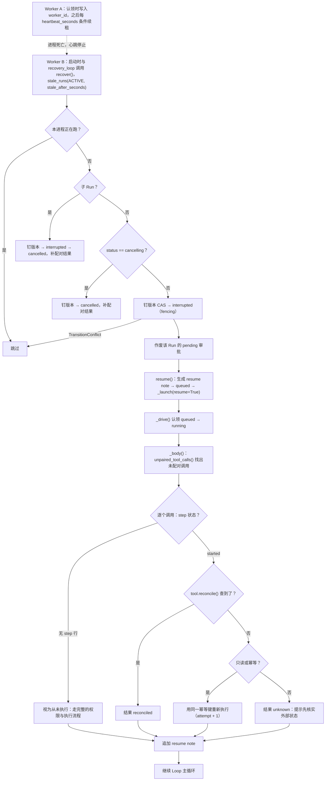
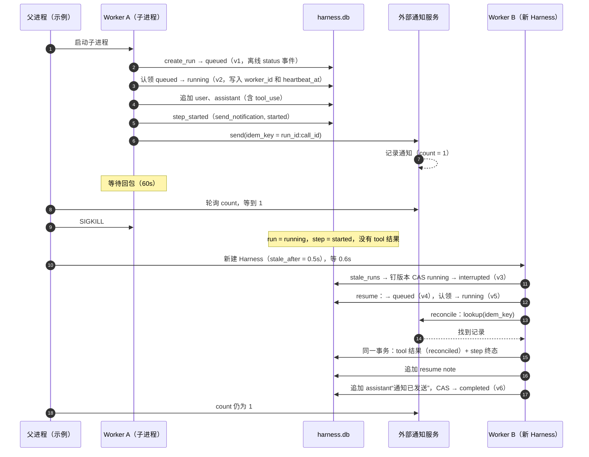

# 11 检查点与崩溃恢复

进程总会死：OOM、部署重启、`kill -9`、宿主机宕机。本章把 flywhl-harness 的恢复路径从头走一遍，
从“怎样知道一个 Worker 死了”一直到“那个 Run 怎样继续跑完、而且外部副作用只发生一次”。
贯穿全章的是一个观点：**Agent 的恢复靠重建，不靠重跑**。

## 暂停与崩溃：两种不同的“中断”

先把两种情况分开，它们对持久化的要求完全不同：

| | 暂停（`pause()` / 关闭服务） | 崩溃 / 被强杀 |
|---|---|---|
| 发生在哪里 | 只在 **安全点**：`AgentLoop._safe_point()` | 任意一条指令 |
| 在途工具 | 先执行完，结果落盘 | 可能执行到一半，结果未知 |
| 未配对的 tool_use | 没有 | 可能有 |
| 状态 | `paused`（由 Loop 自己迁移） | 停在 `running` / `waiting_human`，等别人发现 |
| 检查点 | `_finish()` 里必定记录预算、工作区清单、`paused_at` / `paused_by`，还没注入的排队输入也带进 `inbox` | 最近一个 `turn_end` 记录的预算和清单 |

```python
# src/flywhl_harness/agent/loop.py · AgentLoop._safe_point
def _safe_point(self) -> None:
    self.rc.cancel.raise_if_cancelled()
    if self.rc.pause_requested:
        raise RunPaused()
```

`Harness.pause()` 只是把 `rc.pause_requested` 置为 True，然后发一条 notice：“已请求暂停，将在下一个安全点生效”。
安全点位于 `_body()` 每一轮的开头，这时上一轮的工具结果已经全部落盘、配对完整。
**暂停不制造“结果未知”**，这是把它限定在安全点的全部理由。如果允许在工具执行中途暂停，暂停就和崩溃没有区别了。

### 优雅关闭：暂停而不是取消

服务关闭（`create_app` 的 lifespan 退出、`async with Harness(...)` 结束）走的也是这条路：

```python
# src/flywhl_harness/runtime/manager.py · Harness.aclose
async def aclose(self, grace: float = 10.0) -> None:
    """优雅关闭：活动 Run 在下一个安全点 **暂停**（而不是取消），重启后由 recover() 自动继续；
    宽限期内停不下来的（例如正在跑一个很长的工具）直接放弃——它们会在下次启动时被当作崩溃接管。"""
    for a in list(self._active.values()):
        if a.rc.role == "main":
            a.rc.state["paused_by"] = "shutdown"
            a.rc.pause_requested = True
    tasks = [a.task for a in self._active.values() if a.task is not None]
    if tasks:
        done, pending = await asyncio.wait(tasks, timeout=grace)
        for t in pending:
            t.cancel()
    # ...
```

- 只给主 Run 置暂停标志：子 Run 跑在父 Run 的 `task` 调用里，父 Run 到达安全点之前子 Run 会先跑完；
- `paused_by="shutdown"` 由 `_checkpoint(paused=True)` 写进检查点，下次启动的 `recover()` 据此自动 resume；用户主动暂停的记为 `user`，不会被自动恢复；
- 宽限期到了还没停下的任务被 `task.cancel()` 抢占。这是一次“事故”而不是请求：journal 停在 `started`，状态停在 `running`，
  下次启动等心跳过期后按崩溃接管（见下文“抢占式终止与协作式取消”）。

关闭服务如果直接取消，Run 会落进 `cancelled` 这个终态，重启后再也无法继续；用暂停，部署重启对用户来说只是一次停顿。

崩溃没法选择发生的时机，所以需要另一套机制：每个阶段边界都落盘（见 [09 状态与持久化](/reliability/state-persistence) 的崩溃推演表），
再加上 step 预写日志，用来回答“副作用做没做过”。

## 快照还是事件溯源：本项目的混合方案

第 09 章介绍过两条路线：LangGraph 式的按步快照，和 Temporal 式的事件历史加确定性重放。flywhl-harness 的四类持久数据在恢复时各有分工：

| 数据 | 类型 | 恢复时怎么用 |
|---|---|---|
| `entries`（从根到 head 的路径） | 快照式事实源：路径本身就是“当前状态” | 直接重建上下文，Loop 从下一轮继续 |
| `steps` | 预写日志 | 找出“有 intent 无 result”的调用，逐个决定对账、重执行还是上报 |
| `events` | 审计流 | **不参与恢复**，只让 UI 接着播 |
| `runs.checkpoint` | 预算状态、工作区清单、暂停信息、排队输入 | 还原预算计数和 inbox；清单与当前工作区对比，生成漂移说明 |

为什么不学 Temporal 做确定性重放？因为 Agent Loop 里没有需要重放的业务代码。Temporal 要重放，是因为工作流代码在两次 Activity 之间做了计算，
这些计算的中间状态没有存下来。Agent 的“计算”主要就是 LLM 调用和工具调用，它们的结果已经作为消息写进了 entries。
恢复时把 entries 拼回上下文，就等于拿到了全部的中间状态。

这也带来一个好处：**恢复不要求 Loop 代码是确定性的，也不怕升级**。新版本的 harness 可以接手旧版本留下的会话，
只要消息格式兼容。Temporal 工作流的代码一旦有改动，就得用版本标记（patching）保证旧历史还能重放，这里没有这个负担。

## 恢复算法完整走读



心跳过期的扫描之外，`recover()` 还有第二轮，处理没有心跳可看的 `queued` 和 `paused`，见第二步末尾。

### 第一步：认领与心跳租约

租约在 `_drive()` 认领时建立：`queued → running` 的那一次 CAS 同时写入 `worker_id` 和 `heartbeat_at`（代码见第 10 章场景四）。
之后由心跳任务续租：

```python
# src/flywhl_harness/runtime/manager.py · Harness._heartbeat / Harness._fence
async def _heartbeat(self, a: ActiveRun) -> None:
    while True:
        if a.finishing:
            return
        cur = self.store.get_run(a.run_id)
        if cur is not None and (cur.status not in ACTIVE and cur.status != RunStatus.QUEUED
                                or (cur.worker_id and cur.worker_id != self.worker_id)):
            # 租约已丢失（例如本进程假死期间被别的 Worker 接管）：自我 fencing
            return self._fence(a, "租约丢失：Run 已被其它 Worker 接管")
        if not self.store.heartbeat(a.run_id, self.worker_id):
            return self._fence(a, "租约丢失：续租失败")
        await asyncio.sleep(self.config.heartbeat_seconds)

def _fence(self, a: ActiveRun, why: str) -> None:
    """失去租约 = 对这个 Run 而言本进程已经“崩溃”：立即中止驱动任务、丢弃之后的一切写入。

    不能走协作式取消——那条路会照常收尾（迁移到 cancelled、写 usage 与检查点、补“已取消”的工具结果），
    而这个 Run 此刻已经属于新主人，旧 Worker 的收尾会把它改坏。新主人会按“结果未知”对账在途的调用。
    """
    if a.finishing:
        return
    a.fenced = True
    a.hub.fence()
    if a.task is not None and not a.task.done():
        a.task.cancel()
    else:  # 子 Run 在父 Run 的任务里执行：只能协作式地停下（子 Run 由本 Worker 独占，收尾不会碰到别人）
        a.rc.cancel.cancel(why, by="system:fencing")
```

```python
# src/flywhl_harness/runtime/store.py · Store.heartbeat
def heartbeat(self, rid: str, worker_id: str) -> bool:
    """续租：只有租约仍属于自己时才成功（条件更新，避免“先检查再写入”的竞态把新主人的租约覆盖掉）。"""
    return self._x("UPDATE runs SET heartbeat_at=? WHERE id=? AND (worker_id IS NULL OR worker_id=?)",
                   (now(), rid, worker_id)) == 1
```

- 续租只写 `heartbeat_at`，并且带 `worker_id` 条件。上面的 `get_run` 检查和这条 `UPDATE` 之间有窗口，
  如果续租写成无条件的“刷新心跳 + 写 worker_id”，一个刚醒来的旧 Worker 就会把新主人的租约抢回去；
- 发现租约不属于自己（状态已不在活动态，或者 `worker_id` 换了人），或者条件续租影响 0 行，就执行 **自我 fencing**：
  把这个 Run 当作“本进程已经崩溃”处理——事件枢纽进入 fenced 状态（之后的事件一律丢弃，序号空间已归新主人），
  再 **抢占式** 地取消驱动任务。不能用协作式取消：那条路会照常收尾（迁移到 `cancelled`、写 usage 与检查点、给在途调用补结果），
  而 Run 此刻已经属于新主人；
- `finishing` 标记排除一种误判：Run 自己收尾、状态离开活动集合时，心跳看到的“不在活动态”是自己造成的，不是租约丢失；
- `worker_id` 形如 `w<pid>-<随机串>`，接管时写进迁移原因，审计时能知道“谁死了”。

心跳过期的阈值 `stale_after_seconds` 默认是 10 秒，是心跳间隔（默认 2 秒）的 5 倍。这个倍数不能太小：心跳任务和工具运行在 **同一个事件循环** 里，
一段同步阻塞的代码（大仓库上的 `os.walk`、同步的 SQLite 调用、写得不好的工具）会让心跳晚到。阈值太紧，
活着的 Worker 就会被误判为崩溃。误判了也不至于出大乱子，后面的 fencing 会兜住状态迁移，但会产生一次无谓的接管。

### 第二步：`recover()` 接管

```python
# src/flywhl_harness/runtime/manager.py · Harness.recover
async def recover(self, auto_resume: bool = True) -> list[str]:
    """接管心跳过期的 Run（其 Worker 已崩溃）。CAS 迁移本身就是 fencing：两个 Worker 同时接管只有一个成功。"""
    stale = self.store.stale_runs(tuple(ACTIVE), self.config.stale_after_seconds)
    recovered = []
    for run in stale:
        if run.id in self._active:
            continue
        try:
            if run.parent_run_id:
                # 子 Run 不单独恢复：父 Run 恢复时 task 调用会重新派生新的子代理。这里只把残留的子 Run 收尾
                if run.status != RunStatus.CANCELLING:
                    self._offline_transition(run.id, RunStatus.INTERRUPTED, "父 Run 所在进程中断",
                                             expect_version=run.version)
                self._offline_transition(run.id, RunStatus.CANCELLED, "子代理由父 Run 重新派生")
                self._pair_dangling_offline(run, "已取消：父 Run 中断，子代理将重新派生")
                continue
            if run.status == RunStatus.CANCELLING:
                self._offline_transition(run.id, RunStatus.CANCELLED, "恢复时完成取消", expect_version=run.version)
                self._pair_dangling_offline(run, "已取消（进程在取消过程中中断）")
                continue
            # 钉住扫描时看到的版本：扫描之后若已被别的 Worker 接管（版本变了），这里的 CAS 必然失败
            self._offline_transition(run.id, RunStatus.INTERRUPTED, f"Worker {run.worker_id} 心跳超时",
                                     expect_version=run.version)
            for ap in self.store.list_approvals("pending", run.id):
                self.store.resolve_approval(ap.id, "expired", decided_by="system:recover", reason="进程中断")
        except Exception:
            continue  # 被别的 Worker 抢先接管（CAS 失败）
        recovered.append(run.id)
        if auto_resume:
            await self.resume(run.id)
    # queued 孤儿：创建后、开始执行前进程就退出了；关闭服务时被暂停的 Run：重启后自动继续
    for run in self.store.runs_with_status(RunStatus.QUEUED, RunStatus.PAUSED):
        if run.id in self._active or run.parent_run_id or run.id in recovered:
            continue
        idle = now() - (run.updated_at or 0)
        try:
            if run.status == RunStatus.QUEUED and idle > self.config.stale_after_seconds:
                s = self._session(run.session_id)
                started = any(e.run_id == run.id for e in self.store.path(s.id))
                recovered.append(run.id)
                if auto_resume:
                    self._launch(run, s, prompt=None if started else run.prompt, resume=started,
                                 resume_note=self._resume_note(run, s) if started else None)
            elif run.status == RunStatus.PAUSED and (run.checkpoint or {}).get("paused_by") == "shutdown":
                recovered.append(run.id)
                if auto_resume:
                    await self.resume(run.id)
        except Exception:
            continue
    return recovered
```

第一轮逐段说明：

- **先 CAS、后写入**：每个分支的第一步都是带 `expect_version=run.version` 的迁移，赢下 CAS 的那个 Worker 才去补配对结果、作废审批。
  扫描之后 Run 若已被别人接管，版本变了，迁移以 `TransitionConflict` 失败，整个分支跳过；
- **子 Run 只收尾、不恢复**：子代理由父 Run 里的 `task` 调用派生。父 Run 恢复时这个 `task` 调用是未配对的，
  `task` 工具的 `effect` 是 `read`，恢复时会用同一幂等键重新执行，派生出新的子 Run。残留的旧子 Run 走 `interrupted → cancelled`
  落到明确的终态，不再停在 `running`；
- **`cancelling` 直接收尾**：用户已经明确要求取消，恢复它没有意义；
- **其余迁移到 `interrupted`**，然后作废 pending 审批：原来等审批的那个协程已经不在了，审批对象必须失效，否则 UI 上会留着一个点了也没用的按钮；
- **`auto_resume`**：Web 服务启动（`create_app` 的 lifespan）、`recovery_loop()` 和 `flywhl recover` 都传 True。
  所有迁移都经 `_offline_transition()`，接管过程在事件流里有完整记录。

第二轮用 `runs_with_status(QUEUED, PAUSED)` 查出没有心跳可看的 Run：

| 情形 | 判定 | 动作 |
|---|---|---|
| `queued` 孤儿 | 非子 Run，`updated_at` 空闲超过 `stale_after_seconds` | 会话路径上已有这个 Run 写的条目：走恢复路径（`resume=True` + resume note）；没有：用原始 prompt 从头启动 |
| 关闭服务时暂停 | `paused` 且 `checkpoint.paused_by == "shutdown"` | `resume()` |
| 用户主动暂停 | `paused` 且 `paused_by == "user"` | 不动，只能由用户恢复 |

`queued` 孤儿直接 `_launch()`，不需要新的迁移；如果两个 Worker 同时启动了同一个孤儿，`_drive()` 的认领 CAS 只放行一个，另一个安静退出。

### 周期性接管：`recovery_loop()`

只在启动时扫描一次是不够的：服务在崩溃后几秒内就重启时，那些 Run 的心跳还没过期，启动时扫不到。
另一台 Worker 崩溃时，本进程也需要有人去发现。所以服务端在启动扫描之后还会常驻一个周期任务：

```python
# src/flywhl_harness/runtime/manager.py · Harness.recovery_loop
async def recovery_loop(self, interval: float | None = None) -> None:
    """周期性接管：不只在启动时恢复一次——崩溃的 Worker 心跳要等一会儿才会过期。"""
    while True:
        await asyncio.sleep(interval or max(5.0, self.config.stale_after_seconds))
        with contextlib.suppress(Exception):
            await self.recover(auto_resume=True)
```

```python
# src/flywhl_harness/server/app.py · create_app 的 lifespan
if auto_recover:
    recovered = await harness.recover(auto_resume=True)
    # ...
    loop_task = asyncio.create_task(harness.recovery_loop())  # 之后周期性接管心跳过期的 Run
yield
if loop_task:
    loop_task.cancel()
await harness.aclose()  # 活动 Run 在安全点暂停，重启后自动继续
```

以库的方式使用 `Harness` 或只跑 `flywhl recover` 时，扫描只发生在调用的那一刻；需要持续接管就自己启动 `recovery_loop()`。
多个 Worker 同时跑 `recovery_loop()` 是安全的，竞争由钉版本的 CAS 和认领 CAS 裁决。

### 第三步：`resume()` 与 resume note

```python
# src/flywhl_harness/runtime/manager.py · Harness._resume_note
def _resume_note(self, run: RunRecord, s: SessionRecord) -> str:
    cp = run.checkpoint or {}
    lines = []
    if run.status == RunStatus.FAILED:
        lines.append(f"上一次尝试以失败结束（{run.error or run.status_reason or '原因未知'}）。现在重试：先检查失败原因，"
                     "不要重复已经成功的步骤。")
    elif run.status == RunStatus.PAUSED and cp.get("paused_at"):
        lines.append(f"本次运行曾暂停 {now() - cp['paused_at']:.0f} 秒，现已恢复。")
    else:
        lines.append("运行进程曾意外中断（崩溃或重启），现已从最近的检查点恢复。未完成的工具调用会先按幂等键对账，"
                     "已生效的副作用不会重复执行。")
    if cp.get("manifest") is not None:
        diff = Workspace.diff_manifest(cp["manifest"], self.workspace(s).manifest())
        if not diff.empty:
            lines.append("在此期间工作区发生了变化（" + diff.describe() + "）。继续之前，请重新读取与任务相关的文件。")
    return "\n".join(lines)
```

说明按迁移前的状态分三种：`failed`（经 `retry()` 而来）写明上次失败的原因，提醒不要重复已经成功的步骤；
`paused` 写暂停了多久；其余（`interrupted`、`queued` 孤儿）都按“进程意外中断”说明。

`resume()` 先算好说明，调用 `_note_model_switch()` 记录模型是否换过，再把状态迁移到 `queued`（`expect={PAUSED, INTERRUPTED, FAILED}`，
走 `_offline_transition()`），最后 `_launch(run, s, prompt=None, resume=True, resume_note=note)`。`prompt=None` 意味着不追加新的用户输入。
`_launch()` 在 `resume=True` 时还会从检查点取回暂停前排队、尚未注入的插话和追加输入，重新放进 inbox；
`_build_rc()` 用 `budget.restore()` 让预算接着之前的计数走。

Loop 在 `_body()` 里先补齐未配对的调用，再把说明包装成 `<system-reminder>`，作为一条 `kind=resume_note` 的用户消息落盘：

```python
# src/flywhl_harness/agent/loop.py · AgentLoop._body（开头）
# 修复/恢复：上一次中断遗留的、尚未得到结果的工具调用（崩溃恢复的关键一步）。
# 必须先于恢复说明处理：tool 结果要紧跟在它的 assistant 调用之后，中间插入任何 user 消息
# 都会让 OpenAI 兼容协议拒绝请求，也会让 prepare_history 把真实结果当作孤立结果丢弃。
pending = unpaired_tool_calls(rc.log.context().messages)
if pending:
    yield self._ev(E.NOTICE, level="info", code="recover",
                   text=f"发现 {len(pending)} 个未完成的工具调用，开始对账/补执行")
    async for ev in self.executor.run_batch(pending, recovering=True):
        yield ev
if rc.resume and rc.resume_note:
    yield self._append(user_message(reminder(rc.resume_note), kind=MsgKind.RESUME_NOTE))
```

说明是落盘的，没有在每次请求时临时拼接。这样历史保持只追加，回放时模型看到的内容和当时完全一致。
为什么顺序必须是“先结果、后说明”，见下文“恢复说明的插入位置”。

### 第四步：逐个处理未配对的调用

`unpaired_tool_calls()` 找出最后一条 assistant 消息里还没有 tool 结果的调用，交给 `run_batch(recovering=True)`。关键逻辑在 `_run_one()` 的开头：

```python
# src/flywhl_harness/agent/executor.py · ToolExecutor._run_one（恢复分支）
if recovering:
    step = rc.store.get_step(rc.run_id, call.id)
    if step is not None and step.status == "started":
        rec = await tool.reconcile(args, ctx)
        if rec is not None:
            return done(rec, "reconciled")
        if not (effect == Effect.READ or tool.idempotent):
            return done(ToolResult.error(
                "上次执行在进程中断时结果未知，且该工具不支持对账。请先核实外部状态（例如查询目标系统），"
                f"不要盲目重试。幂等键：{ctx.idempotency_key}"), "unknown")
        publish(E.NOTICE, {"level": "info", "code": "recover_reexecute",
                           "text": f"{call.name} 结果未知，但它是只读/幂等操作，将用同一幂等键重新执行"})
# ... 之后走正常的权限 → hooks → 审批 → intent → 执行流程
```

把所有情况整理成决策表：

| step 状态 | 工具能力 | 动作 | 结果状态 | 外部副作用 |
|---|---|---|---|---|
| 无 step 行 | 任意 | 正常执行（包括重新审批） | 按执行结果 | 第一次发生 |
| `started` | `reconcile()` 查到了记录 | 用对账结果作为工具结果 | `reconciled` | 不重复 |
| `started` | 查不到，但只读或 `idempotent=True` | 用 **同一幂等键** 重新执行 | 按执行结果 | 外部系统按键去重 |
| `started` | 查不到，且非只读、非幂等 | 不执行，返回错误结果 | `unknown` | 交给模型或人去核实 |

最后一行的提示文字是写给模型看的：“不要盲目重试”。harness 能做的到此为止，它不知道外部系统的真实状态，
只能把“不知道”如实说出来。`unknown` 永远比猜一个“成功”或“失败”要好。

对账为什么有效，取决于幂等键是否稳定：`ToolExecutor._ctx()` 里 `idempotency_key=f"{rc.run_id}:{call.id}"`。
恢复后 `run_id` 和 `call_id` 都没变，键也就没变，`FakeNotifyService.lookup()` 用它能找到崩溃前写入的那条记录。
幂等键的设计细节见 [14 幂等与副作用](/reliability/idempotency)。

## 为什么恢复靠重建而不是重跑

“重跑”指的是从原始 prompt 重新执行整个 Run。对 Agent 来说，这条路基本走不通：

| | 重跑 | 重建（本项目） |
|---|---|---|
| 已完成的副作用 | 全部再做一遍 | 不碰：结果已经在 entries 里 |
| LLM 输出 | 不同：第二次的规划可能完全不一样 | 相同：历史就是第一次的输出 |
| 成本 | 前面所有 token 再花一遍 | 只多一次带前缀缓存的请求 |
| 用户感知 | 前面看到的过程被推翻 | 接着刚才的地方继续 |
| 需要特殊处理的部分 | 全部 | 只有“结果未知”的那几个调用 |

重建的前提是 **所有需要的状态都在存储里**。恢复时新建的 `RunContext` 里，派生状态分成两类：

| 状态 | 存在哪 | 恢复后 | 不持久化会怎样 |
|---|---|---|---|
| `Budget`（轮次、工具调用数、用量、已用墙钟） | `runs.checkpoint.budget`，每个 `turn_end` 写一次 | `budget.restore()` 接着计数；暂停期间不计入墙钟 | 反复暂停或崩溃就能绕过限额，`_finish()` 还会用新计数覆盖 `runs.usage` |
| 排队未注入的插话 / 追加输入 | `runs.checkpoint.inbox`，暂停时写入 | `_launch()` 放回 inbox | 用户暂停前发的消息被静默丢弃 |
| `rc.tainted`（读过不可信内容） | `sessions.meta.tainted` | `_build_rc()` 还原 | 污点感知失效，之后的副作用操作审批等级降低（见 [19](/governance/security)） |
| `LoopGuard` 的观察窗口 | 只在内存 | 清空 | 跨越恢复点的重复调用检测失效 |
| `rc.state["file_mtimes"]` | 只在内存 | 清空 | `write` / `edit` 的“读取后被外部修改”检查对恢复前读过的文件不生效 |
| `stop_blocks` | 只在内存 | 0 | Stop 验收的阻止次数重新计数 |

预算只在 `turn_end` 落盘，所以崩溃发生在某一回合中间时，这一回合已花掉的用量不在检查点里，恢复后会少算一点。

`file_mtimes` 这一项值得多说两句：工作区最可能被人改动的时间恰恰是暂停期间，而恢复之后这道检查正好失效了。
这时唯一的防线是 resume note 里那句“请重新读取与任务相关的文件”，外加 `edit` 工具自带的 `old_string` 必须匹配这一约束。

## Fencing：CAS 就是 fencing token

分布式锁有一个经典问题：Worker A 拿到锁之后经历了一次长 GC 停顿（或者网络分区），锁过期了，Worker B 拿到锁开始干活，
然后 A 醒过来，以为自己还持有锁，继续往存储里写。光靠锁防不住这种情况，需要 **fencing token**：
锁每次发放时附带一个单调递增的号码，存储端拒绝号码更小的写入。Martin Kleppmann 对 Redlock 的著名批评讲的就是这件事。

flywhl-harness 里，`runs.version` 起的就是 fencing token 的作用：

```python
# tests/test_recovery.py · test_recover_is_fenced
async def test_recover_is_fenced(ws, tmp_path):
    """两个 Worker 同时接管同一个崩溃的 Run：CAS 保证只有一个成功。"""
    # ... 构造一个停在 running、没有心跳的 Run
    a = make_harness(ws, ["x"], store=Store(db), stale_after_seconds=0)
    b = make_harness(ws, ["x"], store=Store(db), stale_after_seconds=0)
    ra = await a.recover(auto_resume=False)
    rb = await b.recover(auto_resume=False)
    assert sorted(ra + rb) == [run.id]
```

这个测试里 B 在 A 完成迁移之后才扫描，看到的已经是 `interrupted`，根本不在 `stale_runs(ACTIVE)` 的结果里。
真正并发时，A 和 B 都扫到 `running@v2`，都带着 `expect_version=2` 迁移：A 把它 CAS 成 `interrupted@v3`，
B 的 CAS 影响 0 行，或者重读发现版本已是 3，都以 `TransitionConflict` 结束，跳过。
`tests/test_lifecycle.py::test_takeover_based_on_stale_observation_is_fenced` 覆盖的是更隐蔽的一种：
B 扫描后、迁移前，A 已经完成了一整轮接管，Run 又回到 `running`。B 不钉版本的话，`running → interrupted` 依然合法，会把 A 刚接手的 Run 再抢一次。

如果原来的 Worker 其实没死，只是卡住了，它醒来后的第一道关是心跳：发现 `worker_id` 换了人，或者条件续租失败，就按崩溃处理自己——
中止驱动任务、丢弃之后的事件。`tests/test_lifecycle.py::test_fenced_worker_does_not_touch_the_new_owners_run` 模拟了这个过程：
旧 Worker 正在等一个外部调用的回包，Run 被接管；旧 Worker 醒来后 Run 仍是新主人的 `running`，在途调用的 step 停在 `started`
留给新主人对账，事件表里没有旧 Worker 的新写入。早先的版本在这里用协作式取消，结果旧 Worker 照常收尾，把新主人的 Run 改成了 `cancelled`。

::: warning fencing 的覆盖范围
现在有三层：存储端的 CAS 守住 `runs.status` 的迁移（接管时钉住观察到的版本）；条件续租守住租约本身；
Worker 的自我 fencing 在心跳发现租约丢失时按崩溃中止自己。但 `append_entry`、`step_started`、`step_finished` 仍然不检查租约，
而心跳是周期性的：从旧 Worker 醒来到下一次心跳检查之间（最多一个心跳间隔），它仍可能往会话里追加一条消息，或者让一个不可中断工具执行完。

彻底的做法是 **存储端校验**：每次写入都带上租约，如 `INSERT ... SELECT ... WHERE EXISTS (SELECT 1 FROM runs WHERE id=? AND worker_id=? AND version=?)`。
:::

## 版本钉住

会话创建时，`Harness.create_session()` 把系统提示、模型、provider、工具名单写进 `sessions.meta`（见第 09 章）。为什么要钉住：

| 被钉住的东西 | 中途改变会怎样 |
|---|---|
| 系统提示 | 前缀缓存全部失效；模型在同一个任务里收到两套不同的指令 |
| 模型 | thinking 块带签名，换模型后历史 thinking 还能不能原样回传，以各家官方文档为准；不同模型的工具调用习惯和上下文窗口也不同 |
| 工具集 | 历史里出现了一个已经不存在的工具的调用；工具 schema 变了，历史参数可能不再合法；工具定义是请求前缀的一部分，改动会让缓存失效 |

三者在 `Harness._build_rc()` 里的待遇不同：

```python
# src/flywhl_harness/runtime/manager.py · Harness._build_rc（节选）
if tools is None:
    # 工具集在会话创建时钉住：之后 Harness 新增的工具不会出现在老会话里（前缀稳定），
    # 已不存在的工具自然被跳过
    pinned = s.meta.get("tools")
    tools = self.tools.subset(pinned) if pinned else self.tools
# ...
rc = RunContext(
    run_id=run.id, session_id=s.id, log=SessionLog(self.store, s.id), store=self.store, workspace=ws,
    provider=self.provider, model=self.model, model_info=self.model_info, tools=tools, config=cfg,
    # ...
    system_prompt=s.meta.get("system_prompt") or build_system_prompt(ws.root), grants=grants,
    # ...
)
```

- **系统提示**：按 meta 生效；
- **工具集**：按 meta 里的名单取当前注册表的子集。新进程多注册的工具不会出现在老会话里，已经下线的工具被跳过；
  但同名工具的 schema 如果变了，用的仍是新 schema；
- **模型**：不钉。`model=self.model`、`provider=self.provider` 用的是当前进程的配置，换模型继续老会话是允许的（例如升级）。
  `start_run()` 和 `resume()` 都会调用 `_note_model_switch()`：发现 meta 里的模型和当前不同，就发一条 `model_switched` 通知并改写 meta，
  回放和评测时能看出“这里换过模型”。这条通知只进事件流，不进上下文，模型本身并不知道自己是“接班”的。

## 环境漂移与凭据过期

Run 停下来的这段时间里，外部世界照样在变。工作区漂移由检查点清单检测：

```python
# src/flywhl_harness/runtime/manager.py · Harness._drive（节选）与 _checkpoint
wrote = False
async for ev in a.loop.run(prompt):
    a.hub.publish(ev)
    if ev.type == E.TOOL_START and ev.data.get("effect") != "read":
        wrote = True
    elif ev.type == E.TURN_END:
        # 每轮记录预算状态；有写操作的回合再记录工作区清单（恢复时据此检测“暂停期间的漂移”）
        self._checkpoint(a, manifest=wrote)
        wrote = False

def _checkpoint(self, a: ActiveRun, *, manifest: bool = False, paused: bool = False) -> None:
    cp = a.cp
    cp["at"] = now()
    cp["budget"] = a.rc.budget.state()
    if manifest or paused or "manifest" not in cp:
        cp["manifest"] = a.rc.workspace.manifest()
    if paused:
        cp["paused_at"] = now()
        cp["paused_by"] = a.rc.state.get("paused_by", "user")
    self.store.update_run(a.run_id, checkpoint=cp)
```

检查点是一个在内存里累积、每次整体覆盖写回 `runs.checkpoint` 的字典 `a.cp`。`_launch()` 用库里的检查点初始化它（去掉已经取回的 `inbox`），
所以接管后的 Run 会沿用崩溃前记录的清单和预算。暂停时 `_finish()` 再把未处理的排队输入放进 `a.cp["inbox"]`，然后调用 `_checkpoint(paused=True)`。

`Workspace.manifest()` 记录的是“相对路径 → [大小, mtime_ns]”，最多 5000 个文件。预算每个 `turn_end` 都写，清单则只在
有写操作的回合、暂停时和第一次检查点时重新计算，因为只读回合不改变工作区，没必要每轮都遍历一遍目录。这个清单有几处边界：

- **基于 mtime 而不是内容哈希**：便宜，但 `touch` 一下也算修改，内容相同的覆盖写入也算修改；
- **5000 个文件的上限**：超过上限的仓库只对比前 5000 个（`os.walk` 排序后的顺序），新增的文件可能把末尾的文件“挤出”清单，被误报为删除；
- **崩溃时清单可能落后**：清单只在写操作回合 **结束** 时记录。如果进程死在一个写操作回合的中间，这一回合里 Agent 自己写的文件
  也会出现在漂移说明里。这类误报无害，只是让模型多读一次；
- **第一个回合结束之前崩溃就没有清单**：检查点里还没有 `manifest` 时，第一次 `turn_end` 一定会记一份，所以只读的 Run 也有基线；
  但进程死在第一回合中间时，`checkpoint` 还是空的，恢复时不做漂移检测。暂停则不同，`_finish()` 暂停时一定会记录清单。

漂移以外，长时间停顿还会带来几类问题，本项目目前 **没有专门处理**：

| 问题 | 表现 | 常见处理 |
|---|---|---|
| 凭据过期 | OAuth token、云厂商临时凭证在暂停期间过期，恢复后第一次调用返回 401 | 恢复时主动刷新；鉴权错误归类为“不可重试、需要人介入” |
| 长连接断开 | MCP 服务器进程、数据库连接在新进程里需要重新建立 | 恢复时重新握手；把连接状态视为不可持久化 |
| 外部状态变化 | 暂停时 CI 还在跑，恢复时已经结束；PR 被别人合并了 | 在 resume note 里提示“外部状态可能已变”，让模型重新查询 |
| 进程环境变化 | 新 Worker 的环境变量、工具版本与原来不同 | 结合版本钉住，至少记录差异 |

## 抢占式终止与协作式取消：journal 上的差异

这一节讲一个项目里真实修过的 bug。`run_batch` 的 `driver` 现在是这样写的：

```python
# src/flywhl_harness/agent/executor.py · ToolExecutor.run_batch 内的 driver
async def driver() -> None:
    abrupt = False
    try:
        for batch in batches:
            # ... 执行并按原序落盘
    except asyncio.CancelledError:
        # 抢占式终止（进程关闭 / 被强制取消）：等同于崩溃——在途调用的结果未知，
        # 不能写“未执行”。保持 journal 中的 started 状态，交给恢复流程按幂等键对账。
        abrupt = True
        raise
    finally:
        # 协作式取消或异常：尚未执行的调用补一条合成结果，保证 tool_call / tool_result 成对
        reason = rc.cancel.reason or "运行已终止"
        for p in ([] if abrupt else prepared):
            if p.call.id not in persisted:
                if p.call.id not in results:
                    results[p.call.id] = self._result_msg(p.call, ToolResult.error(f"未执行：{reason}"), "skipped", 0, None)
                try:
                    persist(p)
                except Exception:  # pragma: no cover - 存储故障时只能放弃
                    pass
        queue.put_nowait(None)
```

修复之前没有 `abrupt` 这个标志，`finally` 不分情况，给所有没落盘的调用补一条“未执行：运行已终止”。看看这在抢占式终止时会发生什么：

1. `send_notification` 已经写了 intent，外部系统已经收到通知，正在等回包；
2. 进程收到关闭信号，`asyncio.run` 退出时取消所有任务，`driver` 在 `await` 处收到 `CancelledError`；
3. `finally` 给这个调用补上“未执行”结果，与 `step_finished(skipped)` 在同一事务里提交；
4. 恢复时，这个调用 **已经配对了**，`unpaired_tool_calls()` 找不到它，对账根本不会发生；
5. 模型读到“未执行”，很合理地再调用一次 `send_notification`。新调用有新的 `call_id`，也就有新的幂等键，外部系统无法去重，
   **通知发了两次**。

问题的根源是：抢占式终止不是一个“请求”，而是一个“事故”。在途调用的结果是 **未知** 的，写“未执行”就是在说谎。
修复后，三种终止方式在 journal 上留下的痕迹是这样的：

| 终止方式 | 例子 | 在途调用 | 未开始的调用 | 恢复时 |
|---|---|---|---|---|
| 协作式取消 | `cancel()`、停止按钮、第一次 Ctrl-C | 按工具的可中断性处理，结果如实记录（含 `unknown`） | 补 `skipped` 合成结果 | 不需要恢复（已是 cancelled） |
| 抢占式终止 | `task.cancel()`、`aclose()` 宽限期到期、自我 fencing（租约丢失）、`asyncio.run` 退出时取消任务、第二次 Ctrl-C | step 保持 `started`，**不写结果** | 不写结果 | 对账 |
| 进程被杀 | `kill -9`、OOM、断电 | step 保持 `started` | 没有 step 行 | 对账 / 正常执行 |

`tests/test_recovery.py::test_in_process_crash_then_recover` 用 `h1._active[run.id].task.cancel()` 模拟抢占式终止，
然后断言 `step.status == "started"`，说的就是第二行。

### 离线补配对：`started` 不能记成“已取消”

`recover()` 收尾 `cancelling` 的 Run 和残留子 Run、`cancel()` 取消一个没有 Worker 在跑的 Run 时，都要给未配对的调用补结果。
典型场景是：第一次 Ctrl-C 把状态推到 `cancelling`，紧接着第二次 Ctrl-C 抢占式退出，在途的不可中断调用可能已经生效了：

```python
# src/flywhl_harness/runtime/manager.py · Harness._pair_dangling_offline
def _pair_dangling_offline(self, run: RunRecord, text: str) -> None:
    from ..types import tool_result_message

    log = SessionLog(self.store, run.session_id)
    for c in unpaired_tool_calls(log.context().messages):
        step = self.store.get_step(run.id, c.id)
        if step is not None and step.status == "started":  # 已发出、结果未知：不能记成“已取消”
            body, status = f"结果未知：该调用已开始执行，但进程在其完成前中断（幂等键 {step.idem_key}），需要对账确认。", "unknown"
        else:
            body, status = text, "cancelled"
        with self.store.tx():
            log.append_message(tool_result_message(c, body, is_error=True, details={"status": status}), run.id)
            self.store.step_finished(run.id, c.id, status, {"content": body})
```

- 有 `started` 行的调用记为 `unknown` 并带上幂等键，没有 step 行的才记为 `cancelled`。前者是“发出去了、不知道结果”，后者是“确实没做”；
- 结果消息和 step 终态在同一个事务里提交，规则与在线的 `persist()` 一致；
- 这里不调用 `reconcile()`：Run 已经要进终态，没有 Loop 来消费对账结果，`unknown` 留给人去核实。

## kill -9 的完整时间线

`examples/02_crash_resume.py` 用一个真实的子进程演示整个过程：子进程启动 Run，`send_notification` 的回包延迟设为 60 秒；
父进程看到外部系统收到通知后，立刻对子进程发 `SIGKILL`，然后在自己进程里创建新的 Harness 来接管。



真实输出：

```text
━━ 02 崩溃恢复（kill -9） ━━━━━━━━━━━━━━━━━━━━━━━━━━━━
» 子进程 62167 启动了 Run r_mv61tpmwf4cc8dd2
» 外部系统已经收到通知，但子进程还没拿到回包 → 现在 kill -9
  崩溃现场：run.status = running，steps = [('send_notification', 'started')]，外部通知数 = 1

━━ 新进程接管 ━━━━━━━━━━━━━━━━━━━━━━━━━━━━━━━━━━━━━━━━━━━━━━━━━━
» recover() 接管了：['r_mv61tpmwf4cc8dd2']
  工具结果状态：reconciled  内容：[对账] 外部系统确认该通知已发送给 ops-team，未重复发送。
  Run 最终状态：completed（version=6，attempt=1）

  外部通知总数 = 1 ✓ 副作用恰好一次
```

注意崩溃现场那一行：`run.status = running`。进程被杀之后，状态没有任何变化，因为没人有机会去改它。
这正是恢复要靠“心跳过期”来发现，而不能指望 Worker 临死前留下什么记号的原因。

## 恢复说明的插入位置

上面的时间线里有一个容易忽略的细节：resume note 是在处理完未配对调用 **之后** 才追加的。落盘后的消息顺序是：

```text
user        prompt        发布后通知运维
assistant                 部署已完成，通知运维。         ← 含 tool_use(call_1_0)
tool                      [对账] 外部系统确认该通知已发送……  ← call_1_0 的结果
user        resume_note   <system-reminder>运行进程曾意外中断……
assistant                 通知已发送，任务完成。
```

顺序反过来会出问题。发送给模型之前，`prepare_history()`（`src/flywhl_harness/llm/base.py`）会修补消息结构：
遇到非 `reminder` 类型的用户消息时，如果前面还有未配对的调用，就先给这些调用补一条合成的错误结果。`resume_note` 不在豁免名单里，
要是它插在 tool_use 和 tool_result 之间，模型收到的就是“没有返回结果：该调用被中断或丢失”，真正的对账结果反而因为“找不到对应调用”
被当作孤立结果丢弃。换成真实模型，它很可能再发一次通知，而新调用的幂等键不同，对账机制就救不回来了。
OpenAI 兼容协议则更直接：tool 消息没有紧跟它的 assistant 调用，请求会被拒绝。

原则只有一条：**harness 注入的任何消息都不能拆开 tool_use 与 tool_result**。
回归测试 `tests/test_recovery.py::test_recovered_result_precedes_resume_note` 断言落盘顺序里 tool 结果在 resume note 之前，
并检查经过 `prepare_history()` 之后真实结果仍然在。

## 延伸：暂停期间工作区被人改了

漂移检测只能回答“变了什么”，变了之后怎么办是另一个问题。可选的策略：

| 策略 | 做法 | 优点 | 风险 |
|---|---|---|---|
| 覆盖 | 无视变化，按原计划继续写 | 简单 | 悄悄抹掉人的改动，最不可接受 |
| 回滚到检查点 | 用影子 git 快照把工作区恢复到暂停时的样子 | 环境与上下文完全一致 | 同样抹掉人的改动，只是有快照可以找回 |
| 三方合并 | 以检查点为基线，合并人和 Agent 的改动 | 两边的工作都保留 | 冲突时仍要有人或模型裁决；对非文本文件无效 |
| 让模型决定（本项目） | 在 resume note 里列出变化的文件，要求先重新读取 | 模型能理解人改动的意图 | 依赖模型遵守；`file_mtimes` 检查在恢复后失效 |
| 拒绝恢复 | 有漂移就停下来，交给人确认 | 最安全 | 打断无人值守的流程 |

本项目选“让模型决定”，因为暂停通常就是为了让人插手，人的改动往往正是需要 Agent 接着往下做的东西。
有两个自然的增强方向：对关键文件（比如 Agent 自己正在改的文件）的漂移升级为“拒绝恢复、要求确认”；
或者在漂移说明里附上 diff 摘要（影子 git 可以算出来），减少模型重新读取的成本。

## 快照粒度与存储膨胀

| 数据 | 粒度 | 增长方式 | 控制手段 |
|---|---|---|---|
| entries | 每条消息一行 | 线性、只追加；压缩也只是追加摘要，**不删除原文** | 大结果外置为 blob 句柄；按会话归档 |
| steps | 每次执行的调用一行 | 线性 | 结果只存 2000 字符 |
| 影子 git 快照 | 每次写操作前一次提交 | 按内容去重，但大文件、二进制文件会累积 | `snapshots` 配置开关；只对非只读调用打快照 |
| `runs.checkpoint` | 每个 Run 一行，每个 `turn_end` 覆盖写 | 不增长，但单行大小随文件数线性增长（上限 5000 项） | 截断上限；只读回合不重算清单 |
| events | 每个事件一行 | 最快（流式增量） | 增量批量写；生产环境按 TTL 清理 |

把它和“每步存一份全量状态”的快照式方案比较一下：如果每轮都存一份完整的消息列表，第 n 轮的快照大小是 O(n)，
总存储就是 O(n²)。只追加的 entries 把总存储压到 O(n)，代价是读取时要用递归 CTE 现场拼路径。这正是第 09 章“entries 同时充当快照”的价值。

## 动手验证

```bash
# 真实 kill -9：崩溃现场 → 接管 → 对账 → completed，外部通知数始终为 1
.venv/bin/python examples/02_crash_resume.py

# 恢复测试：进程内抢占式终止、fencing、真实 kill -9 子进程、恢复说明排在 tool 结果之后
.venv/bin/python -m pytest tests/test_recovery.py -q

# 生命周期边界：关闭时暂停后重启续跑、用户暂停不自动恢复、queued 孤儿、续租不抢租约
.venv/bin/python -m pytest tests/test_lifecycle.py::test_shutdown_pauses_then_restart_resumes \
    tests/test_lifecycle.py::test_user_pause_is_not_auto_resumed \
    tests/test_lifecycle.py::test_queued_orphan_is_recovered \
    tests/test_lifecycle.py::test_heartbeat_does_not_steal_lease -q

# 暂停 → 人工改动工作区 → 恢复时模型收到漂移说明
.venv/bin/python -m pytest tests/test_cancel.py::test_pause_and_resume_with_drift_note -q
```

**看看模型在恢复后实际收到了什么**。先跑一遍 02 示例，再在仓库根目录运行：

```python
# inspect_resume.py：对比“落盘的上下文”和“prepare_history 之后发给模型的消息”
import sys
from flywhl_harness import Store
from flywhl_harness.runtime.session import SessionLog
from flywhl_harness.llm.base import prepare_history

st = Store(sys.argv[1])
log = SessionLog(st, st.list_sessions()[0].id)
for title, msgs in (("落盘", log.context().messages), ("发给模型", prepare_history(log.context().messages))):
    print("==", title)
    for m in msgs:
        print(" ", m.role, m.kind, m.tool_call_id, (m.text or "").replace("\n", " ")[:50])
```

```bash
DB=$(ls -dt ${TMPDIR:-/tmp}/flywhl-02-* | head -1)/.flywhl/harness.db
.venv/bin/python inspect_resume.py "$DB"
```

两段输出应该完全一致：tool 结果紧跟 assistant，resume note 在它之后，“发给模型”那一段里能看到 `[对账] ...` 的结果。
把 `_body()` 里补配对和追加说明的顺序对调再跑一遍，就能看到“发给模型”里出现合成的“没有返回结果”。

**CLI 上的恢复操作**：

```bash
.venv/bin/flywhl runs        # 列出运行：状态、attempt、version
.venv/bin/flywhl recover     # 接管心跳过期的 Run、queued 孤儿和关闭时暂停的 Run，并自动恢复
.venv/bin/flywhl resume <run_id>   # 恢复一个 paused / interrupted 的 Run
.venv/bin/flywhl retry <run_id>    # 重试一个 failed 的 Run（attempt + 1）
```

## 小结

- 暂停只发生在安全点，不制造“结果未知”；崩溃可能发生在任何地方，要靠阶段边界落盘加 step 预写日志来兜底；
- 优雅关闭也走暂停：`aclose()` 让主 Run 在安全点停下并记 `paused_by=shutdown`，重启后自动继续；停不下来的按崩溃接管；
- 恢复算法：心跳过期 → 钉版本 CAS 到 `interrupted`（fencing）→ 作废审批 → `queued` → 认领 → 逐个处理未配对调用（对账 / 同键重执行 / unknown）→ 追加 resume note → 继续 Loop；
  第二轮接管 `queued` 孤儿和关闭时暂停的 Run；服务端用 `recovery_loop()` 周期执行；
- 恢复靠重建：entries 就是全部中间状态，不需要确定性重放。预算、排队输入、污点随检查点和会话元数据恢复，循环守卫窗口、读取时间戳、`stop_blocks` 从零开始；
- 抢占式终止等同于崩溃，在途调用不能写“未执行”，否则对账永远不会发生；离线补配对同理，`started` 的调用记 `unknown`；
- fencing 有三层：接管时钉版本的 CAS、条件续租、心跳发现租约丢失后按崩溃中止自己（不走协作式收尾）；条目与 journal 的写入仍不校验租约，最多留下一个心跳间隔的窗口。

**延伸思考**

1. 关闭服务时，一个停在 `waiting_human` 等审批的 Run 要等审批结果才能走到安全点，`grace` 到期后会被抢占。
   这种 Run 是应该被抢占、按崩溃接管，还是应该让关闭流程把审批作废、按拒绝处理后再暂停？
2. 残留的子 Run 被收尾为 `cancelled`，父 Run 的 `task` 调用会用同一幂等键重新派生一个子代理，之前的工作全部重做。
   `task` 工具是否应该实现 `reconcile()`，凭子会话 ID 取回已经完成的子 Run 的结果？
3. 预算在每个 `turn_end` 写进检查点，崩溃在回合中间时会少算一回合的用量。改成在恢复时从 entries 里 assistant 消息的 `usage` 重新累加，
   一致性风险又在哪里？

下一章展开协作式取消的完整语义：[12 取消语义](/reliability/cancellation)。
