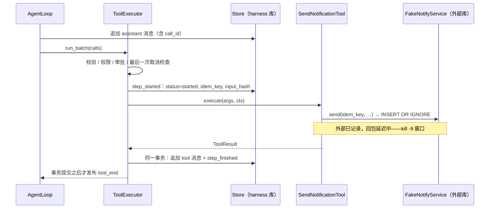

# 14 幂等与副作用

重试、崩溃恢复、超时后的“再试一次”，本质上都在制造 **第二次执行**。本章讨论怎样让“做两次”与“做一次”效果相同；当外部系统做不到这一点时，harness 又该如何诚实地承认“不知道”，而不是赌一把。

## 问题：第二次执行从哪里来

| 来源 | 例子 | 同一幂等键能否挡住 |
|---|---|---|
| 工具瞬时错误重试 | 网络抖动后 `ToolExecutor._invoke()` 重试（见 [13 重试、熔断与降级](/reliability/retry-fallback)） | 能：同一次调用，键不变 |
| 回包丢失 | 请求已到达外部系统，响应在路上丢了，调用方只看到超时 | 能；harness 对外部且非幂等的工具超时报 `unknown`，不鼓励直接重试 |
| 崩溃恢复 | `kill -9` 发生在外部系统已执行、结果尚未落盘之间 | 能：键跨重启稳定（下文详解） |
| 取消宽限期超时 | 不可中断工具在宽限期内没完成，结果标记为 `unknown` | 能，前提是后续由对账或重放接手 |
| 执行中的重复投递 | 端侧还在执行，云端的重试已经到了 | 能，但去重表只记“执行完的”，还要对在途请求去重（见“端侧的幂等消费”） |
| 模型重复决策 | 模型在下一轮又发起了一次参数完全相同的调用 | **不能**：这是一个新的 `call_id`，即一次新的意图 |

最后一行值得停下来想一想。幂等键标识的是“同一个意图”，而不是“同样的参数”。模型两次决定“通知运维部署完成”，在 harness 看来就是两个意图；是否应该合并，取决于业务语义——这时需要 **业务级的键**（例如 `deploy:v1.2.0:notify-ops`），由工具自己根据参数构造，而不是依赖 harness 提供的键。重复调用的另一道防线是循环守卫（见 [08 终止条件、预算与循环守卫](/core/termination-budget)）。

## 幂等键怎么取

flywhl-harness 在 `ToolExecutor._ctx()` 里为每次工具调用构造上下文：

```python
def _ctx(self, call: ToolCall, publish, recovering: bool) -> ToolContext:
    rc = self.rc
    return ToolContext(
        run_id=rc.run_id, session_id=rc.scope, call_id=call.id, workspace=rc.workspace,
        cancel=rc.cancel, blobs=rc.store.blobs, idempotency_key=f"{rc.run_id}:{call.id}",
        emit=lambda u: publish(E.TOOL_UPDATE, {"call_id": call.id, "update": u}),
        state=rc.state, harness=rc.harness, run=rc, recovering=recovering,
    )
```

`ToolContext`（`src/flywhl_harness/tools/base.py`）对这个字段的注释是“跨崩溃重启稳定不变”。之所以稳定，是因为键的两个组成部分在副作用发生之前都已经落盘：

- `run_id` 在 `Harness.start_run()` 创建 Run 记录时生成，恢复时 Run 还是那个 Run；
- `call_id` 来自模型返回的 `tool_use` 块。Loop 在 `_call_model()` 末尾先 `_append(final)` 把整条 assistant 消息写入会话日志，然后才把其中的调用交给执行器。崩溃后，`unpaired_tool_calls()` 从日志里读回的是同一条消息、同一组 `call_id`。

几种候选方案的对比：

| 候选 | 问题 |
|---|---|
| 执行时生成随机 UUID | 每次尝试都是新值，重试与恢复时外部系统认不出是同一请求——等于没有键 |
| 时间戳 | 同上；并且同一毫秒的两个不同调用会撞键 |
| 参数哈希 | 用户确实想发两次同样内容时会被误合并；审批人修改参数后键会变化 |
| 业务键（如订单号 + 动作） | 语义最准确，但只有工具自己知道怎么构造 |
| `run_id:call_id` | 只依赖已持久化的标识，跨重试、跨重启都稳定；作为默认值最安全 |

::: warning call_id 必须在 Run 内唯一
这个方案成立的前提是 `call_id` 在同一个 Run 里不重复。Anthropic 的 `tool_use` 块总是带 `id`；OpenAI 兼容 provider 在 `OpenAICompatProvider.stream()` 里对缺失的 id 回退为 `new_id("call_")`，在 harness 一侧生成全局唯一值，并随 assistant 消息一起落盘。
如果回退值只按本条消息里的下标生成（例如 `call_0`），不同轮次的第一个调用就会共享同一个幂等键：第二轮那次真正不同的通知会被外部系统当成重复请求（现在会以 `IdempotencyConflict` 报错），`steps` 表的主键 `(run_id, call_id)` 也会冲突。自己接入新的 provider 时要守住这一点。
:::

键还有两条生产环境的边界：外部系统对幂等键的 **保留时长**（超过保留期再重放就不会被识别；Stripe 等服务的具体保留策略以官方文档为准），要长于“崩溃 → 被接管”的最长时间；键的长度与字符集要满足对方 API 的限制，必要时对 `run_id:call_id` 再做哈希。

## 四件套：幂等键、去重表、条件更新、状态机守卫

幂等不是单一技术，而是四种机制的组合，各自解决不同的问题：

| 机制 | 解决的问题 | 单独使用时的漏洞 | 本项目中的位置 |
|---|---|---|---|
| 幂等键 | 让接收方能认出“这是同一个意图” | 只是一个标识，本身不去重 | `ToolContext.idempotency_key`；`steps.idem_key` 列 |
| 去重表（唯一约束） | 同一个键只生效一次，且在并发下也成立 | 只能挡住“完全重复”，不管状态是否合法 | `FakeNotifyService` 的 `idem_key TEXT PRIMARY KEY`；`events` 的 `PRIMARY KEY(run_id, seq)`；`steps` 的 `PRIMARY KEY(run_id, call_id)`；`BlobStore` 内容寻址 + `INSERT OR IGNORE` |
| 条件更新 / 版本号 | 防止并发写互相覆盖（丢失更新），并充当 fencing token | 不知道业务上哪些迁移合法 | `Store.cas_run()`：`WHERE id=? AND status=? AND version=?` |
| 状态机守卫 | 拒绝非法迁移，终态不可再变 | 自身不防并发，要靠条件更新落地 | `Store.resolve_approval()`：`WHERE status='pending'`；`RunStateMachine`；端云的 `CommandDispatcher._move()` |

`Store.cas_run()` 把“版本号”和“状态守卫”合在一条 SQL 里：

```python
def cas_run(self, rid: str, from_status: str, from_version: int, to_status: str, **fields: Any) -> bool:
    """乐观锁状态迁移：只有 (status, version) 都与预期一致才会成功。"""
    sets = ["status=?", "version=version+1", "updated_at=?"]
    # ...
    n = self._x(
        f"UPDATE runs SET {', '.join(sets)} WHERE id=? AND status=? AND version=?",
        (*vals, rid, from_status, from_version),
    )
    return n == 1
```

`Store.resolve_approval()` 是状态机守卫最直白的形态：审批、超时、取消三方可能同时想“决定”同一个审批对象，只有第一个把 `pending` 改掉的人生效，其余的 `UPDATE` 影响 0 行，返回 `False`：

```python
n = self._x(
    "UPDATE approvals SET status=?, decided_by=?, decision_reason=?, edited_args=?, remember=?, decided_at=?"
    " WHERE id=? AND status='pending'",
    (status, decided_by, reason, _dump(edited_args), int(remember), now(), aid),
)
return n == 1
```

`Store.append_events()` 则是去重表的用法：事件以 `(run_id, seq)` 为主键，`INSERT OR IGNORE` 让同一批事件被写两次也无害——批量落库失败后整批重写时，这一点很重要（见 [15 流式输出、插话与断线续传](/reliability/streaming)）。

这四件套有一个共同的反面教材，**先查再写**（check-then-act）：

```python
# 反例：两个并发请求都可能查到“不存在”，然后都执行
if not db.exists(idem_key):
    send_email(...)
    db.insert(idem_key)
```

查询与写入之间的空隙就是重复执行的窗口。正确的做法是让数据库的唯一约束来做原子判定（`INSERT OR IGNORE` 后看影响行数），或者用条件更新抢占一条记录，再做副作用。

## “恰好一次”的真相

调用方永远无法区分“请求丢了”和“响应丢了”：两者看起来都是超时。于是任何跨网络的投递只能二选一——不重发（**至多一次**，可能丢）或重发（**至少一次**，可能重复）。所谓“恰好一次”，在端到端的意义上只能这样得到：

> 至少一次投递 + 幂等消费 = 效果上的恰好一次

Kafka 的 exactly-once 语义（幂等生产者 + 事务）常被拿来当反例，但它成立的范围是 Kafka 内部的“读-处理-写”链路；一旦处理过程向 Kafka 之外发了一封邮件，这封邮件不在事务保护之内，仍然需要幂等消费来兜底。

flywhl-harness 的分工与此一一对应：**harness 负责“至少一次”**（崩溃后一定会接管、一定会对未完成的调用重新处理），**工具与外部系统负责“幂等消费”**。当工具无法提供幂等消费时，harness 宁可退化为“至多一次 + 明确报告未知”，也不冒重复执行的风险：

| 工具性质 | 恢复时的处理 | 副作用次数 |
|---|---|---|
| 支持对账，且外部已有记录 | 补写对账结果，不重发（`reconciled`） | 1 |
| 只读，或声明 `idempotent=True` | 用同一幂等键重新执行 | 1（由外部去重保证） |
| 写操作、不幂等、不支持对账 | 不执行，返回“结果未知”（`unknown`） | 0 或 1，交给人或模型核实 |

## 超时不等于没发生

同样的“不知道”在不崩溃的时候也会出现：外部调用超时了。调用方只知道“没等到回包”，不知道请求有没有被对方处理。
`ToolExecutor._race()` 的超时分支因此按副作用区分：

```python
# src/flywhl_harness/agent/executor.py · ToolExecutor._race（超时分支）
task.cancel()
with contextlib.suppress(asyncio.CancelledError, Exception):
    await task
if tool.effect_for(args) == Effect.EXTERNAL and not tool.idempotent:
    # 外部副作用超时 ≠ 没发生：请求可能已经被对方处理，只是响应没回来
    return ToolResult.error(
        f"工具执行超时（{timeout:.0f}s），结果未知：请求可能已经生效（幂等键 {ctx.idempotency_key}）。"
        "请先核实外部状态，不要直接重试。"), "unknown"
return ToolResult.error(f"工具执行超时（{timeout:.0f}s），已中止。可以缩小范围后重试，或设置更长的超时。"), "timeout"
```

| 工具 | 超时状态 | 给模型的提示 |
|---|---|---|
| 只读、本地写 | `timeout` | 缩小范围后重试，或设置更长的超时 |
| 外部但幂等（如 `send_notification`、`idempotentHint=true` 的 MCP 写工具） | `timeout` | 同上：同参数再调一次不会多出副作用 |
| 外部且非幂等（如未声明幂等的 MCP 写工具、自定义的付款工具） | `unknown` | 请求可能已经生效，先核实外部状态，不要直接重试 |

`timeout` 的提示鼓励重试，对非幂等的外部调用就是在鼓励重复执行。`tests/test_cancel.py::test_external_timeout_is_unknown_not_plain_timeout`
在同一批里放了一个外部非幂等的 `pay` 和一个只读的 `slow_read`，两者都超时，前者是 `unknown`，后者是 `timeout`。

bash 是 `manages_timeout=True` 的工具：它在自己的超时到点时杀掉进程组，返回 `is_error` 的结果（`[命令超时（Ns），已终止进程组]`），
执行器的计时器只在其后 10 秒兜底，所以上面那个分支轮不到它。为此 bash 在结果的 `details` 里标上 `timed_out`，`_race()` 在工具正常返回时也检查一次：

```python
if task in done:
    r = task.result()
    if (r.details or {}).get("timed_out") and tool.effect_for(args) == Effect.EXTERNAL and not tool.idempotent:
        # 工具自己管理超时（bash）时也一样：外部命令（git push、curl -X POST）超时 ≠ 没发生
        return ToolResult(f"{r.content}\n[结果未知：命令可能已经对外部系统生效（幂等键 {ctx.idempotency_key}）。"
                          "请先核实外部状态，不要直接重试。]", True, r.details, r.tainted), "unknown"
    return r, ("error" if r.is_error else "ok")
```

于是超时的 `git push`、`curl -X POST` 同样是 `unknown` 并带上“先核实”的提示；本地命令（`pytest`、`make`）超时仍是普通错误
（`tests/test_cancel.py::test_external_bash_timeout_is_unknown`）。

MCP 工具还多一步：`tools/call` 不设客户端超时，由执行器统一计时。执行器放弃这次调用（超时或取消）时，
`MCPClient.request()` 会向服务器发一条 `notifications/cancelled`：

```python
# src/flywhl_harness/tools/mcp.py · MCPClient.request（节选）
try:
    return await asyncio.wait_for(fut, self.timeout if timeout is True else timeout)
except (asyncio.CancelledError, asyncio.TimeoutError):
    # 告诉服务器“不用做了”（尽力而为：已经发生的副作用不会因此撤销）
    with contextlib.suppress(Exception):
        await self._send({"jsonrpc": "2.0", "method": "notifications/cancelled",
                          "params": {"requestId": mid, "reason": "客户端取消或超时"}})
    raise
```

这条通知只能让服务器停掉还没做的部分，不改变结果状态的判定：非只读、非幂等的 MCP 工具超时依然是 `unknown`。
另外，harness 的幂等键并不会传给 MCP 服务器；`idempotentHint=true` 表达的是服务器自己的承诺“同参数重复调用没有额外效果”，
harness 据此才允许它在结果未知时重新执行。

## 预写 intent 与对账：副作用视角的完整链路

崩溃恢复的整体机制——心跳租约、CAS 接管、从会话日志重建上下文——见 [11 检查点与崩溃恢复](/reliability/checkpoint-recovery)。这里只看一个工具调用的副作用如何被记账。



关键在于 `step_started` 发生在 `execute` **之前**，而结果与 `step_finished` 在 **同一个事务** 中写入（`ToolExecutor.run_batch()` 里的 `persist()`）：

```python
# src/flywhl_harness/agent/executor.py · ToolExecutor.run_batch 中的 persist
def persist(p: Prepared) -> None:
    msg = results[p.call.id]
    with rc.store.tx():
        rc.log.append_message(msg, rc.run_id)
        rc.store.step_finished(rc.run_id, p.call.id, (msg.details or {}).get("status", "ok"),
                               {"is_error": msg.is_error, "content": clip(msg.text, 2000)})
    persisted.add(p.call.id)
    publish(E.TOOL_END, self._end_data(p.call, msg))  # 落盘之后才发布：事件不领先于持久化
```

`tool_end` 放在事务之后发布，是为了让外部观察者看到的永远不超前于库里的事实：如果先发事件再写库，崩溃发生在两者之间时，
UI 显示“通知已发送、结果 ok”，重启后库里却是 `started`，恢复流程又去对账，同一个调用在用户眼里出现两种结局。于是对任何一个调用，库里只可能是三种状态之一：没有 step 记录、有 intent 无结果、结果与完成标记同时存在。按崩溃时刻逐一推演：

| 崩溃时刻 | 重启后看到的状态 | 恢复行为 | 外部副作用次数 |
|---|---|---|---|
| assistant 消息落盘前 | 日志里没有这次调用 | 重新调用模型，得到新的调用 | 0 → 之后正常执行 |
| assistant 落盘后、`step_started` 前 | 有未配对调用，无 step 记录 | `get_step()` 返回 `None`，走正常执行路径 | 1 |
| `step_started` 后、请求到达外部前 | `started`，外部无记录 | 对账查不到 → 幂等工具用同一键重执行 | 1 |
| 外部已记录、结果落盘前 | `started`，外部有记录 | 对账成功 → 补写 `reconciled` 结果 | 1 |
| 结果事务提交后 | 调用已配对 | 不需要恢复 | 1 |

恢复入口在 `AgentLoop._body()`：它用 `unpaired_tool_calls()` 找出最后一条 assistant 消息里没有结果的调用，以 `recovering=True` 交给执行器。`ToolExecutor._run_one()` 的恢复分支如下：

```python
# ---- 崩溃恢复：有 intent 无 result 的调用先对账 ----
if recovering:
    step = rc.store.get_step(rc.run_id, call.id)
    if step is not None and step.status == "started":
        rec = await tool.reconcile(args, ctx)
        if rec is not None:
            return done(rec, "reconciled")
        if not (effect == Effect.READ or tool.idempotent):
            return done(ToolResult.error(
                "上次执行在进程中断时结果未知，且该工具不支持对账。请先核实外部状态（例如查询目标系统），"
                f"不要盲目重试。幂等键：{ctx.idempotency_key}"), "unknown")
        publish(E.NOTICE, {"level": "info", "code": "recover_reexecute",
                           "text": f"{call.name} 结果未知，但它是只读/幂等操作，将用同一幂等键重新执行"})
# ---- 权限 + PreToolUse hooks ----
# ...
```

三个细节：

- **对账成功会直接返回**，不再经过权限与审批——因为这一次没有新的副作用。
- **重执行路径会继续往下走**，重新做权限判定、PreToolUse hook，必要时再次请求审批，然后再次 `step_started`（`ON CONFLICT ... attempt=attempt+1`）。恢复时原有的待审批对象已被 `Harness.recover()` 置为 `expired`，所以用户可能需要再批一次。
- **抢占式终止也按崩溃处理。** `run_batch()` 捕获 `asyncio.CancelledError` 时设置 `abrupt = True`，不为在途调用补写“未执行”，保留 `started` 状态留给对账。写“未执行”在这里是撒谎：请求可能已经发出去了。

## FakeNotifyService 与 SendNotificationTool 精读

`src/flywhl_harness/tools/demo.py` 用一个独立的 SQLite 文件模拟外部通知系统。“独立”是这个演示的要点：harness 的库与外部系统的库 **不可能放进同一个事务**，这才是需要对账的根本原因。

```python
# src/flywhl_harness/tools/demo.py（节选）
class IdempotencyConflict(Exception):
    """同一个幂等键配了不同的请求内容：说明调用方复用错了键（或参数被改过），必须报错而不是“返回旧结果”。"""


class FakeNotifyService:
    """模拟外部系统：唯一约束保证同一幂等键只生效一次（服务端去重是幂等的最后一道防线）。

    与 Stripe 等真实 API 一致：重复请求只有在 **内容相同** 时才返回上次的结果；内容不同就是冲突。
    """

    def __init__(self, path: str | Path):
        # ...
            c.execute(
                "CREATE TABLE IF NOT EXISTS notifications(idem_key TEXT PRIMARY KEY, recipient TEXT, message TEXT, sent_at REAL)"
            )

    def send(self, idem_key: str, recipient: str, message: str) -> tuple[bool, dict[str, Any]]:
        """返回 (是否本次新发送, 记录)。重复的幂等键直接返回已有记录。"""
        with self._lock, self._conn() as c:
            cur = c.execute(
                "INSERT OR IGNORE INTO notifications VALUES(?,?,?,?)", (idem_key, recipient, message, now())
            )
            row = c.execute("SELECT * FROM notifications WHERE idem_key=?", (idem_key,)).fetchone()
        if cur.rowcount == 0 and (row[1], row[2]) != (recipient, message):
            raise IdempotencyConflict(f"幂等键 {idem_key} 已用于另一条通知（发给 {row[1]}），拒绝用不同内容重放")
        return cur.rowcount == 1, {"idem_key": row[0], "recipient": row[1], "message": row[2], "sent_at": row[3]}

    def lookup(self, idem_key: str) -> dict[str, Any] | None:
        # ... SELECT * FROM notifications WHERE idem_key=?
```

- 去重由 **主键约束** 完成，`rowcount == 1` 表示这次是新插入。`_lock` 只是让同一进程内的连接串行化；即使去掉它，跨进程并发时唯一约束依然保证只插入一行。
- 同键同内容：返回 `(False, 第一次的记录)`。这就是“幂等消费”的标准形态，重复请求不报错，返回与第一次相同的结果。
- 同键异内容：抛出 `IdempotencyConflict`。“同键异参”通常意味着调用方的键生成有 bug（例如上文的 `call_0` 撞键），或者参数在重放前被改过；
  这时返回旧记录等于告诉调用方“你这次的请求成功了”，而实际生效的是另一条内容。Stripe 的幂等键也是这种策略（细节以官方文档为准）。
- `lookup` 是专门给对账用的只读查询。

工具一侧：

```python
# src/flywhl_harness/tools/demo.py · SendNotificationTool（节选）
class SendNotificationTool(Tool):
    name = "send_notification"
    # ...
    effect = Effect.EXTERNAL
    interruptible = False   # 已发出的请求不能半途打断
    idempotent = True       # 外部系统按幂等键去重

    async def execute(self, args: dict[str, Any], ctx: ToolContext) -> ToolResult:
        try:
            fresh, rec = self.service.send(ctx.idempotency_key, args["to"], args["message"])
        except IdempotencyConflict as e:
            return ToolResult.error(str(e))
        ctx.emit({"progress": "请求已送达外部系统，等待回包…"})
        await asyncio.sleep(self.latency)  # 模拟网络回包延迟：崩溃演示就发生在这个窗口内
        note = "" if fresh else "（外部系统按幂等键识别为重复请求，未重复发送）"
        return ToolResult(
            content=f"通知已发送给 {args['to']}{note}",
            details={"idempotency_key": ctx.idempotency_key, "fresh": fresh, "record": rec},
        )

    async def reconcile(self, args: dict[str, Any], ctx: ToolContext) -> ToolResult | None:
        rec = self.service.lookup(ctx.idempotency_key)
        if rec is None:
            return None
        if (rec["recipient"], rec["message"]) != (args["to"], args["message"]):
            return ToolResult.error(f"[对账] 幂等键 {ctx.idempotency_key} 对应的已发送内容与本次参数不一致，需要人工核实。",
                                    details={"idempotency_key": ctx.idempotency_key, "record": rec})
        return ToolResult(
            content=f"[对账] 外部系统确认该通知已发送给 {rec['recipient']}，未重复发送。",
            details={"idempotency_key": ctx.idempotency_key, "reconciled": True, "record": rec},
        )
```

四个属性各管一件事：`effect=EXTERNAL` 让它串行执行并默认需要审批；`interruptible=False` 让取消时给它一个宽限期而不是半途打断（宽限期超时则结果为 `unknown`，见 [12 取消语义](/reliability/cancellation)）；`idempotent=True` 允许恢复时用同一键重执行；`reconcile()` 让恢复时优先查询而不是重放。“先写外部系统、再 sleep”精确地复刻了最危险的窗口：副作用已经发生，调用方还不知道。

冲突在两处都变成明确的错误：`execute` 把 `IdempotencyConflict` 作为工具错误返回给模型；`reconcile` 发现外部记录与本次参数不一致时，
不确认“已发送”，而是返回一条要求人工核实的错误。后者的典型来源是审批人改过参数：恢复分支在审批之前运行，拿到的是 assistant 消息里模型的原始参数，外部系统里却是改过之后的内容。
注意执行器对 `reconcile()` 的任何非 `None` 返回值都记 `reconciled`，所以这种情况的 step 状态是 `reconciled`、结果是 `is_error`，
审计时要连同 `is_error` 一起看。

## reconcile 接口设计

`Tool.reconcile()` 的契约写在基类文档里：返回 `None` 表示“查不到”，由 harness 决定重试还是上报；返回 `ToolResult` 则直接作为这次调用的结果（状态 `reconciled`），可以是“确认已生效”，也可以是 `is_error` 的“记录与本次参数不一致，需要人工核实”。这个接口有一个模糊之处：**基类的默认实现也返回 `None`**，所以“对账后确认没发生”和“这个工具根本不支持对账”是同一个返回值。

当前的决策规则让这种模糊不至于出事——`None` 之后只有只读或幂等的工具会被重执行，而它们重执行本来就安全。但规则也因此偏保守：一个不幂等、却能可靠查询的工具，即使对账明确证明“没发生”，也只会得到 `unknown`。如果要细化，可以让返回值区分下面几种结论：

| 对账结论 | 含义 | 合理的恢复动作 |
|---|---|---|
| 已生效 | 外部有记录 | 补写结果，不重发 |
| 已生效但内容不符 | 外部有这个键的记录，内容与本次参数不同 | 不重发，转人工；演示工具已按这一行实现 |
| 确认未生效 | 外部系统能保证这个请求以后也不会生效 | 可以重执行，即便工具不幂等 |
| 无法判断 | 不支持查询、查询失败、或请求可能仍在途中 | 幂等则重执行，否则上报 |

“确认未生效”比看上去更难成立：查询时刻查不到，不代表在途请求以后不会到达（它可能还在某个网关的重试队列里）。只有外部系统能给出“这个键已作废”的保证（例如先调用一次取消接口），“查不到”才等于“没发生”。这也是为什么幂等消费比对账更根本——有了外部去重，查不到时放心重放即可；没有去重，对账只能缩小、不能消除重复的可能。

实现 `reconcile()` 时还有几条约束：它必须是 **只读** 的，自身可以安全重试；它应该足够快，因为恢复流程会逐个调用；它返回的内容会进入模型上下文，应当清楚地标明这是对账结果而非原始回包（演示中用 `[对账]` 前缀，`details.reconciled=True` 供 UI 与审计使用）。

## 不支持对账的工具怎么办

`unknown` 是一个诚实的结果，但不是终点。当前实现把它作为 `is_error` 的工具结果交给模型，结果文本要求“先核实外部状态，不要盲目重试”，并附上幂等键。可选的改进路径，按成本从低到高：

| 做法 | 适用 | 说明 |
|---|---|---|
| 把幂等键传给外部 API | 对方支持幂等键（支付、消息、工单类 API 常见） | 把 `ctx.idempotency_key` 放进请求头或请求体，再把工具标成 `idempotent=True` |
| 补一个查询接口做 `reconcile()` | 对方能按业务键查询 | 例如按“工单标题 + 创建者 + 时间窗口”查重，结论只能算“无法判断”之外的近似 |
| 拆分“准备”与“提交” | 工具内部有多步 | 前置计算都是纯函数，真正的副作用只有一次调用，缩小未知窗口 |
| 工作区快照回滚 | 本地文件写入 | `write` / `edit` 是 `WRITE` 且未声明幂等，恢复时会得到 `unknown`（`bash` 按命令内容动态判定副作用，判为只读的命令会被重执行，其余同样得到 `unknown`）；执行前的影子 git 快照（见 [18 Workspace 与沙箱](/governance/workspace-sandbox)）提供了回到已知状态的手段 |
| 升级为人工任务 | 高风险外部操作 | 本项目未实现。生产中应生成一条待人工核实的任务，并在核实前阻止对同一目标的后续副作用 |

`write` 是一个有意思的例子：用同样的内容覆盖同一个文件，本身就是幂等的；`edit`（查找替换）则不是——第二次执行可能找不到原文，或者替换了不该替换的地方。是否声明 `idempotent` 应当按工具的真实语义逐个判断，而不是按副作用等级一刀切。

## 多步业务流程：Saga、TCC 与 Outbox

单个调用幂等之后，还剩一个更大的问题：Agent 往往串起多个副作用，例如“创建工单 → 预约维修 → 通知客户 → 更新 CRM”。第三步失败时，前两步已经生效，而它们分属不同系统，不存在一个能回滚全部的事务。

| 模式 | 思路 | 对参与方的要求 | 适合 | 在 Agent 场景中的注意 |
|---|---|---|---|---|
| Saga | 每一步配一个补偿动作；失败时逆序执行已完成步骤的补偿 | 每步都有可执行的补偿（取消预约、撤回工单），补偿本身幂等、可重试 | 步骤跨系统、允许短暂不一致 | 补偿也是副作用，要有自己的幂等键（例如原键加 `:compensate`）；“发出去的通知”通常无法补偿，只能再发一条更正 |
| TCC | Try 预留资源 → 全部成功后 Confirm，否则 Cancel | 参与方要支持“预留”这种中间状态 | 库存、额度、座位等可预留资源 | 预留有超时；Agent 思考时间长，预留窗口要足够 |
| Outbox | 状态变更与“待发事件”在同一个本地事务写入，再由投递器异步、至少一次地发出 | 只要求本地有事务数据库；消费方幂等 | 一个服务要可靠地通知其它系统 | 投递器以事件 ID 作为幂等键；本项目若要增加 Run 状态 webhook，应采用此模式 |

LLM 在流程中途改变计划时（例如预约之后决定换一家维修点），已执行的步骤只有两种处理方式：**补偿**，或者 **作为既成事实写进上下文**。前者应该是一次显式的、经过审批的工具调用，而不是 harness 在背后自动回滚——是否补偿是业务决策。后者在 flywhl-harness 中天然成立：所有工具结果都已追加进会话日志，模型下一轮看得到“预约已经创建”；如果担心长对话中模型忽略这一点，可以在压缩时把“已发生的不可逆副作用清单”作为必须保留的内容。

flywhl-harness 没有实现 Saga 引擎，但 `steps` 表（`tool`、`effect`、`idem_key`、`status`）已经是一本按时间排序的副作用账本，补偿编排可以从这里读出“哪些 `EXTERNAL` 调用已经成功”。

## 端侧的幂等消费

当执行者不在云端、而在用户设备上时，同样的原则以另一种形态出现：云端指令至少一次地投递，端侧用执行去重表保证每条指令只执行一次，重复投递时重发上一次的 ACK。`src/flywhl_harness/runtime/dispatch.py` 的 `EdgeExecutor` 是这一模式的最小实现，详见 [26 端云协同](/advanced/edge-cloud)。

只查“已执行表”还不够：云端的重试可能比端侧执行得快，重复指令在第一次还没执行完时就到了，这时表里还没有记录。`EdgeExecutor` 为此多维护一张在途表：

```python
# src/flywhl_harness/runtime/dispatch.py · EdgeExecutor.on_message（节选）
if cid in self.executed:  # 重复投递：不再执行，重发上次的 ACK
    await self.transport.to_cloud(self.executed[cid])
    return
if cid in self._inflight:  # 执行中又收到同一条指令：等那一次的结果
    await self.transport.to_cloud(await asyncio.shield(self._inflight[cid]))
    return
fut: asyncio.Future[dict[str, Any]] = asyncio.get_running_loop().create_future()
self._inflight[cid] = fut
```

两次投递都会收到 ACK，但 handler 只执行一次（`tests/test_runtime.py::test_edge_dedupes_duplicate_arriving_mid_execution`）。
`asyncio.shield` 保证某个等待方被取消时不会把共享的 Future 一起取消，执行那一方仍能 `set_result`，其它等待方照样拿到 ACK。这是“先查再写”在异步代码里的变体：判断与登记之间没有 `await`，在单线程事件循环里就是原子的。

## 动手验证

**1. 真正的 kill -9。** 示例在子进程里启动 Run，等外部系统记录了通知、工具还在等待回包时发送 `SIGKILL`，再由新进程接管：

```bash
.venv/bin/python examples/02_crash_resume.py
```

```text
» 外部系统已经收到通知，但子进程还没拿到回包 → 现在 kill -9
  崩溃现场：run.status = running，steps = [('send_notification', 'started')]，外部通知数 = 1
━━ 新进程接管 ━━
» recover() 接管了：['r_…']
  工具结果状态：reconciled  内容：[对账] 外部系统确认该通知已发送给 ops-team，未重复发送。
  Run 最终状态：completed
  外部通知总数 = 1 ✓ 副作用恰好一次
```

同样的场景有对应的测试：

```bash
.venv/bin/python -m pytest -q tests/test_recovery.py::test_kill_dash_9_then_recover
```

**2. 观察去重表的行为**，包括“同键异参”的冲突：

```python
import os, tempfile
from flywhl_harness.tools.demo import FakeNotifyService, IdempotencyConflict

svc = FakeNotifyService(os.path.join(tempfile.mkdtemp(), "ext.db"))
print(svc.send("r_1:call_a", "ops-team", "v1.2.0 已上线")[0])   # True  新发送
print(svc.send("r_1:call_a", "ops-team", "v1.2.0 已上线")[0])   # False 重复，返回首次记录
try:
    svc.send("r_1:call_a", "dev-team", "内容被改了")
except IdempotencyConflict as e:
    print("冲突：", e)    # 幂等键 r_1:call_a 已用于另一条通知（发给 ops-team），拒绝用不同内容重放
print(svc.lookup("r_1:call_b"), svc.count())                    # None 1
```

对应的测试是 `tests/test_runtime.py::test_fake_notify_rejects_same_key_different_payload`；端侧在途去重与外部超时的测试见上文。

**3. 改造练习。** 复制一份示例 02，在“新进程接管”创建 harness 之后加上两行，让工具变成“不幂等、不支持对账”：

```python
t = h.tools.get("send_notification"); t.idempotent = False
async def _none(args, ctx): return None
t.reconcile = _none
```

再运行，工具结果状态会变成 `unknown`，内容是“上次执行在进程中断时结果未知，且该工具不支持对账……”；外部通知数仍为 1，Run 也仍以 `completed` 结束——那是因为脚本化模型不理会这条错误。换成真实模型，后续走向就取决于模型如何理解“结果未知”。对比两次运行，就能看清“幂等 + 对账”到底买到了什么：不是“少发一次”，而是“知道发没发”。

## 小结

- 幂等键标识“同一意图”，必须由崩溃前已持久化的标识构成；`run_id:call_id` 满足这一点，前提是 `call_id` 在 Run 内唯一。
- 幂等键、去重表、条件更新、状态机守卫各管一件事，组合使用；避免先查再写。
- 端到端的“恰好一次”只能是“至少一次投递 + 幂等消费”。harness 负责前者，工具与外部系统负责后者；两者都做不到时，诚实地返回 `unknown`。
- 超时不等于没发生：外部且非幂等的工具超时记 `unknown`；MCP 调用被放弃时发 `notifications/cancelled`，但这不撤销已发生的副作用。
- 幂等消费要拒绝“同键异参”，对账要核对内容而不只是“有没有这个键”；端侧去重要同时覆盖已执行和在途的重复。
- 预写 intent 加同事务的结果写入，把每个调用限定在三种可判定的状态里，事件在提交之后才发布；对账与重执行据此展开。
- 多步副作用需要 Saga / TCC / Outbox 这样的流程级方案；LLM 改变计划时，已发生的事要么显式补偿，要么作为既成事实留在上下文里。
