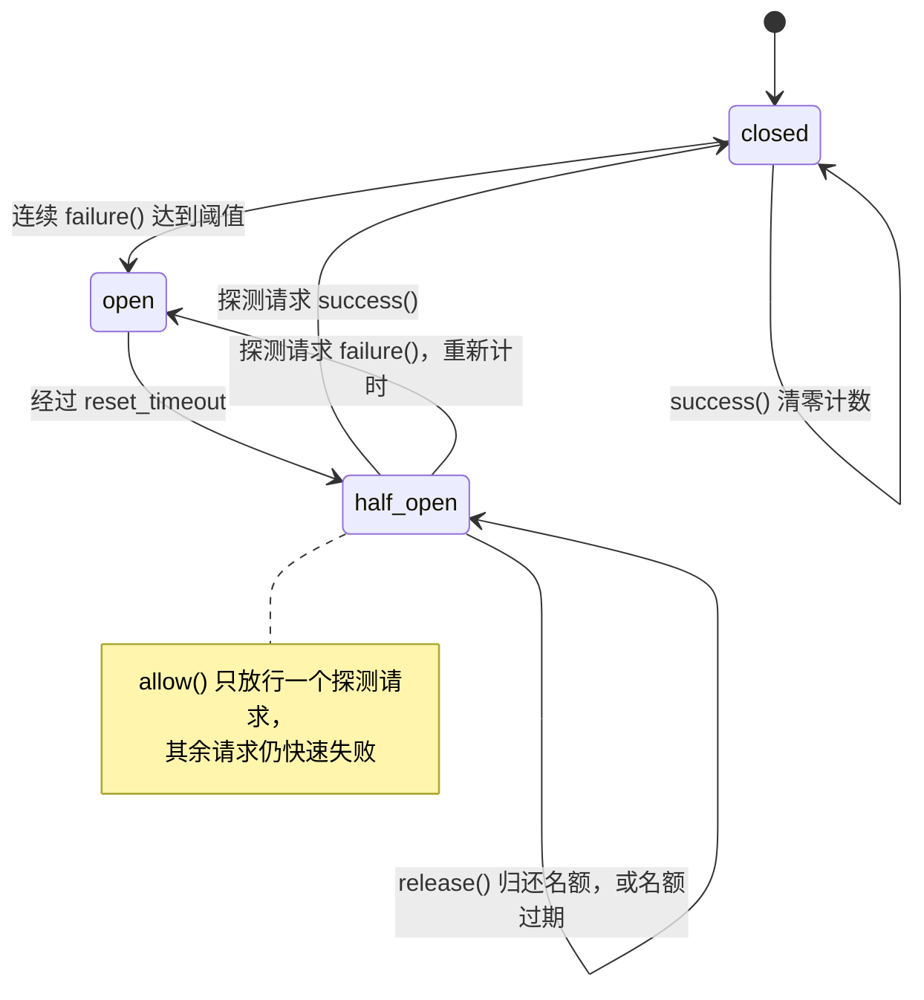
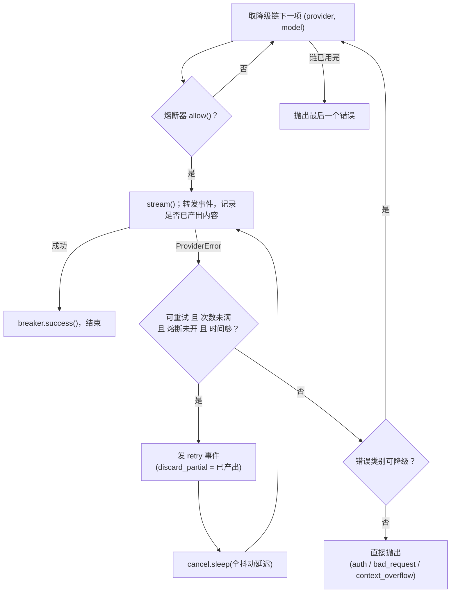

# 13 重试、熔断与降级

一次 Agent Run 会调用模型几十次、调用工具上百次，其中某一次失败几乎是必然的。本章讨论失败发生时该 **重试同样的请求、改变输入再试、换一个模型，还是干脆放弃**，以及怎样做到“重试不放大故障”。

## 问题：失败不止一种

普通 Web 服务里，“失败了就退避重试”大体够用。Agent harness 里有三个特殊之处，让这条朴素规则不再成立：

| 特殊之处 | 后果 |
|---|---|
| 请求很大（几十 K 到上百 K token），且按 token 计费 | 盲目重试一个注定失败的请求（例如上下文超长）既浪费钱又浪费时间 |
| 模型输出是 **流式** 的，失败可能发生在输出到一半时 | 半截文本已经推给 UI、半截 `tool_use` 参数不完整，不能简单“接着读” |
| 一次 Run 串联了很多次调用，上层还有预算与截止时间 | 每一层各自重试，延迟与成本会成倍放大；剩余时间不够时重试只是白等 |

所以重试的第一条纪律是 **先分类，再决定**。`src/flywhl_harness/runtime/retry.py` 的模块文档把全章浓缩成三条：分类决定策略；指数退避 + 全抖动；用截止时间、熔断器、重试预算和“只有一层重试”防止风暴。

## 错误分类决策表

| 失败 | 典型信号 | 归类 | 策略 | 本项目中谁处理 |
|---|---|---|---|---|
| 限流 | HTTP 429，常带 `Retry-After` | `rate_limit` | 遵守 `Retry-After` 退避；仍失败可换 key / 区域 / 模型 | `ResilientProvider` 重试 → 降级链 |
| 过载 | 529、503，或响应体含 overloaded | `overloaded` | 有限次退避重试，然后降级 | 同上 |
| 服务端错误 | 其它 5xx | `server` | 同上 | 同上 |
| 超时 / 断连 | SDK 的超时、连接异常 | `timeout` / `network` | 同上；流式中断需整体重发 | 同上 |
| 上下文超长 | 400/413/422 且错误信息含 “too long” 等 | `context_overflow` | **不原样重试**：先压缩，再试一次 | `AgentLoop` 强制压缩 |
| 请求非法 | 其它 4xx（消息结构、参数错误） | `bad_request` | 不重试；修复输入或直接失败 | 直接抛出，Run 以 `failed` 结束 |
| 鉴权 | 401 / 403 | `auth` | 不重试，告警 | 直接抛出 |
| 模型不存在 | 404 | `not_found` | 不重试，但 **可以换模型** | 跳过重试，直接沿降级链切换 |
| 原因不明的客户端错误 | SDK 抛出的其它异常（响应解析失败、流被截断等） | `unknown` | 不重试、不降级 | 直接抛出 |
| 工具瞬时错误 | 工具抛 `TransientToolError` | — | 只对只读 / 幂等工具有限重试，且受截止时间约束 | `ToolExecutor._invoke()` |
| 工具永久错误 | 工具抛其它异常、超时 | — | 不重试，作为 `is_error` 结果回给模型；外部且非幂等的工具超时记为 `unknown`，要求先核实 | `ToolExecutor._invoke()` / `_race()` |
| 语义失败 | 参数 schema 校验失败、格式不符 | — | 必须 **改变输入** 再试，并有次数上限 | 回给模型自我修正；预算与循环守卫兜底 |
| 输出截断 | `stop_reason=max_tokens` | — | 带工具调用：整批不执行（`truncated`），让模型分步重来；纯文本：提醒模型从中断处续写，最多 3 次 | `AgentLoop._body()` |

表的最后四行说明一件事：工具与语义层面的失败，“重试者”往往是模型本身——harness 的职责是把失败变成模型读得懂的结果（见 [06 工具系统](/core/tools)），而不是在背后悄悄重放。

## classify_http_error：把 HTTP 错误归一化

分类的唯一入口在 `src/flywhl_harness/llm/base.py`。`ErrorKind` 枚举了上表的类别，`RETRYABLE_KINDS` 定义哪些值得原样重试：

```python
RETRYABLE_KINDS = frozenset({ErrorKind.RATE_LIMIT, ErrorKind.OVERLOADED, ErrorKind.SERVER, ErrorKind.TIMEOUT, ErrorKind.NETWORK})

class ProviderError(Exception):
    # ...
    @property
    def retryable(self) -> bool:
        return self.kind in RETRYABLE_KINDS
```

`classify_http_error()` 负责把状态码与响应体映射到类别：

```python
def classify_http_error(status: int, body: str, headers: dict[str, str] | None = None, provider: str | None = None) -> ProviderError:
    headers = {k.lower(): v for k, v in (headers or {}).items()}
    retry_after = None
    if "retry-after" in headers:
        try:
            retry_after = float(headers["retry-after"])
        except ValueError:
            retry_after = None
    low = body.lower()
    if status == 429:
        kind = ErrorKind.RATE_LIMIT
    elif status in (529, 503) or "overloaded" in low:
        kind = ErrorKind.OVERLOADED
    elif status >= 500:
        kind = ErrorKind.SERVER
    elif status in (401, 403):
        kind = ErrorKind.AUTH
    elif status == 404:
        kind = ErrorKind.NOT_FOUND
    elif status in (400, 413, 422) and any(h in low for h in _OVERFLOW_HINTS):
        kind = ErrorKind.CONTEXT_OVERFLOW
    elif status == 408:
        kind = ErrorKind.TIMEOUT
    elif 400 <= status < 500:
        kind = ErrorKind.BAD_REQUEST
    else:
        kind = ErrorKind.UNKNOWN
    return ProviderError(kind, body[:500] or f"HTTP {status}", status=status, retry_after=retry_after, provider=provider)
```

几处值得细看的地方：

- **分支顺序就是优先级。** 503 在“≥500”之前被单独拎出来归为过载；上下文超长必须排在通用 4xx 之前，否则会被吞成 `bad_request`，Loop 就失去了“压缩后再试”的机会。
- **上下文超长靠关键字识别。** `_OVERFLOW_HINTS` 收录了 `context length`、`prompt is too long`、`reduce the length` 等不同厂商的措辞，并且同时接受 413、422——有的网关用“请求体过大”表达同一件事。这是启发式规则：厂商改了错误文案，分类就会退化成 `bad_request`。如果 provider 返回结构化的错误类型字段，应优先使用它。
- **“overloaded” 子串优先于 4xx 判断。** 响应体里出现这个词即归为过载，哪怕状态码是 4xx。这是有意的宽松：有些兼容层用 200/4xx 包裹上游的过载错误。
- **`Retry-After` 只解析秒数。** HTTP 规范允许它是一个 HTTP 日期，这种情况下 `float()` 失败，`retry_after` 退化为 `None`，退避回到纯抖动。

SDK 抛出的非 HTTP 异常由各 provider 自己映射。以 `src/flywhl_harness/llm/anthropic.py` 为例：

```python
# src/flywhl_harness/llm/anthropic.py · AnthropicProvider._map_error
def _map_error(self, e: Exception) -> ProviderError:
    a = self._sdk
    if isinstance(e, a.APITimeoutError):
        return ProviderError(ErrorKind.TIMEOUT, str(e), provider=self.name)
    if isinstance(e, a.APIConnectionError):
        return ProviderError(ErrorKind.NETWORK, str(e), provider=self.name)
    if isinstance(e, a.APIStatusError):
        headers = dict(e.response.headers) if getattr(e, "response", None) is not None else {}
        return classify_http_error(e.status_code, str(getattr(e, "message", e)), headers, self.name)
    if isinstance(e, a.AnthropicError) and "api_key" in str(e).lower():
        return ProviderError(ErrorKind.AUTH, f"未配置 Anthropic 凭据：{e}", provider=self.name)
    # 其它客户端错误（响应解析失败、流被截断……）原因不明：按 UNKNOWN 上报，不冒充鉴权失败
    return ProviderError(ErrorKind.UNKNOWN, f"{type(e).__name__}: {e}", provider=self.name)
```

最后两个分支是分类的诚实问题。只有错误信息明确提到 `api_key` 时才归为 `auth`；其它客户端错误一律报 `unknown`。
如果把“不知道是什么”都当成鉴权失败，告警会把人引向错误的排查方向。`unknown` 不在 `RETRYABLE_KINDS` 里，也不在降级集合里，所以它会直接抛出、不计入熔断。

provider 只负责“如实上报类别”，**自己不重试**——这是下一节的前提。

## 全抖动退避

`RetryPolicy.backoff()` 只有四行：

```python
@dataclass
class RetryPolicy:
    max_attempts: int = 4          # 含首次尝试
    base_delay: float = 0.5
    max_delay: float = 20.0
    deadline: float | None = None  # 绝对截止时间（time.monotonic），由上层预算传入

    def backoff(self, attempt: int, retry_after: float | None = None, rng: random.Random | None = None) -> float:
        r = rng or random
        delay = r.uniform(0, min(self.max_delay, self.base_delay * (2 ** (attempt - 1))))
        if retry_after:
            delay = max(delay, retry_after)
        return delay
```

即 `delay = uniform(0, min(cap, base·2^(n−1)))`。为什么在整个区间上均匀取值，而不是“指数值 ± 一点抖动”？AWS 架构博客的经典文章《Exponential Backoff And Jitter》做过对比：当大量客户端因同一次故障同时失败时，不加抖动的指数退避会让它们在 1s、2s、4s……整齐地同时重来，每一轮都是一次小型“惊群”；把等待时间铺满整个区间后，重试在时间轴上被打散，服务端承受的并发峰值和总调用量都明显下降，而实现最简单的正是全抖动。

用默认参数（`base_delay=0.5`、`max_delay=20`）各采样一万次，得到的分布如下（可以用本章末尾的脚本复现）：

| 第 n 次重试 | 等待区间 | 平均等待 |
|---|---|---|
| 1 | [0, 0.5] | 0.25s |
| 2 | [0, 1] | 0.5s |
| 3 | [0, 2] | 1.0s |
| 4 | [0, 4] | 2.0s |
| 5 | [0, 8] | 4.0s |
| 6 | [0, 16] | 8.0s |
| 7 | [0, 20]（触顶） | 10.0s |

```
时间轴 →      0s        1s        2s        4s
无抖动：      ×         ×         ×         ×        所有客户端同一刻重试
全抖动：  · ·· · ·· ·  ·  · · ·   ·  · ·   ·  ·    重试均匀散开
```

**与 `Retry-After` 的关系**：服务端明确告诉你“N 秒后再来”时，它比任何客户端猜测都可靠，所以取 `max(抖动值, retry_after)` 作为下限。这里有两个边界需要清楚：

1. `retry_after` 不受 `max_delay` 限制。服务端说 120 秒就等 120 秒——除非截止时间不够（见下文），那时直接放弃重试，交给降级。
2. 当 `retry_after` 大于抖动区间时，所有客户端都会在 **恰好** `retry_after` 秒后醒来，同步又回来了。实验里 `backoff(1, retry_after=3)` 连续五次都返回 `3`。生产环境可以改成 `retry_after + uniform(0, j)`，在下限之上再加一小段抖动。

## 全链路只有一层负责重试

假设 SDK、API 网关、编排引擎三层各自“失败重试 3 次”，一次底层故障最多会被放大成 3 × 3 × 3 = 27 次调用，延迟也按层叠加。flywhl-harness 的规则是：**重试只发生在 `ResilientProvider` 这一层**，其它层只做分类或“改变输入后的一次性重试”。

| 层 | 做什么 | 代码 |
|---|---|---|
| 官方 SDK | 关闭自动重试 | `AnthropicProvider.__init__()` 里 `max_retries=0` |
| Provider 适配层 | 只分类，不重试 | `classify_http_error()`、`_map_error()` |
| `ResilientProvider` | 退避重试 + 熔断 + 降级 | `src/flywhl_harness/llm/resilient.py` |
| `AgentLoop` | 不重试同样的请求；只在上下文超长时 **压缩后** 再试一次 | `AgentLoop._body()` |
| `ToolExecutor` | 工具瞬时错误的有限重试（只读 / 幂等工具） | `ToolExecutor._invoke()` |
| 崩溃恢复 | 进程级的“从检查点继续”，不是请求重试 | 见 [11 检查点与崩溃恢复](/reliability/checkpoint-recovery) |

::: warning 网关也算一层
如果你在 harness 前面放了带自动重试的 LLM 网关，就必须在网关和 `ResilientProvider` 之间关掉其中一个；否则上表的“只有一层”就不成立了。OpenAI 兼容 provider 用 httpx 直连，本身不重试。
:::

## 截止时间沿调用链传递

重试有意义的前提是“还来得及”。`RetryPolicy.deadline` 是一个绝对时刻（`time.monotonic()` 坐标系），`time_left()` 返回剩余秒数；`retry_async()` 和 `ResilientProvider.stream()` 在睡眠之前都做同一个检查：

```python
delay = policy.backoff(attempt, retry_after(e))
left = policy.time_left()
if left is not None and left < delay:
    raise  # 剩余时间不足以再试一次：不重试
```

用绝对截止时间而不是“每层各自的超时”，是因为截止时间可以原样向下传递：上层剩 30 秒，下层无论嵌套多深都知道自己只有 30 秒。工具调用已经这样做了，`ToolExecutor._invoke()` 用 Run 的墙钟预算收紧单个工具的超时，并把剩余时间放进 `ToolContext`：

```python
# src/flywhl_harness/agent/executor.py · ToolExecutor._invoke（节选）
timeout = float(tool.timeout or rc.config.tool_timeout)
left = rc.budget.deadline_left()
ctx.time_left = left
if left is not None:
    timeout = max(1.0, min(timeout, left))  # 截止时间沿调用链传递
if tool.manages_timeout:
    # 工具自己会在超时后清理并返回部分结果；执行器的计时器只做兜底，留出 10 秒余量
    own = float(args.get("timeout") or getattr(tool, "default_timeout", timeout))
    timeout = (min(own, left) if left is not None else own) + 10
```

`manages_timeout` 是给 bash 这类“超时也有东西可交”的工具准备的。bash 用 `min(参数里的 timeout, ctx.time_left)` 作为自己的超时，
到点后杀掉进程组、保留已经产生的输出，返回 `[命令超时（Ns），已终止进程组]`。如果执行器的计时器先到，`_race` 只能把工具任务整个取消，
部分输出就丢了。所以执行器把自己的计时器往后推 10 秒，只在工具没能按时收尾时兜底
（`tests/test_runtime.py::test_bash_own_timeout_keeps_partial_output`）。

::: tip 一个尚未接通的地方
`create_provider()` 构造 `RetryPolicy(max_attempts=cfg.max_retries)` 时没有设置 `deadline`，所以目前模型调用的重试只受次数约束，不受 Run 的 `max_wall_seconds` 约束。接通的思路是在每次 `_call_model()` 前，用 `rc.budget.deadline_left()` 算出绝对截止时刻并随请求传入（例如放进 `ModelRequest.metadata`，由 `ResilientProvider` 读取），而不是把它写死在共享的 policy 对象上——同一个 `ResilientProvider` 被所有 Run 共享。
:::

## 重试预算：故障期间自动收敛

指数退避解决“什么时候重试”，不解决“总共重试多少”。当 provider 大面积故障时，每个请求都重试 3 次，流量就变成平时的 4 倍，恰好在对方最脆弱的时候压上去。Google SRE 书《Handling Overload》一章给出的办法是客户端级的重试比例上限；Envoy 的 `retry_budget` 也是同一思路（按活跃请求比例限制重试，默认值以官方文档为准）。

`RetryBudget` 用两个滑动窗口实现：

```python
class RetryBudget:
    """重试预算：滑动窗口内“重试次数 / 请求次数”不超过 ratio（另有最低保底次数）。"""
    def __init__(self, ratio: float = 0.2, min_retries: int = 3, window: float = 60.0, clock: Callable[[], float] = time.monotonic):
        # ...
    def can_retry(self) -> bool:
        self._trim()
        return len(self._retries) < max(self.min_retries, self.ratio * len(self._requests))
```

- `ratio` 让重试量与正常流量成比例：平时偶发失败都能重试，故障时重试被“削顶”，总流量最多是正常的 1.2 倍。
- `min_retries` 是低流量保底：窗口里只有 2 个请求时，`0.2 × 2 = 0.4`，没有保底就一次也重试不了。
- `test_retry_budget` 验证了边界：10 个请求、10% 比例、保底 1 次 → 第 1 次重试放行，第 2 次被拒。

`retry_async()` 已支持 `budget` 参数，但 `ResilientProvider` 目前没有接入预算。生产化时，预算应按 **provider（或 API key）** 维度建、在所有 Run 之间共享——单个 Run 内的预算没有意义，风暴是所有 Run 一起制造的。

## 熔断器：别再打一个已经挂掉的服务

重试预算限制的是“重试量”，熔断器更进一步：某个 provider 连续失败到阈值，就在一段时间内 **完全不再调用它**，直接快速失败，让上层立即降级。



```python
# src/flywhl_harness/runtime/retry.py · CircuitBreaker（节选）
class CircuitBreaker:
    @property
    def state(self) -> str:
        if self.opened_at is None:
            return "closed"
        if self.clock() - self.opened_at >= self.reset_timeout:
            return "half_open"
        return "open"

    def allow(self) -> bool:
        s = self.state
        if s == "closed":
            return True
        if s == "half_open" and (not self._probing or self.clock() - self._probe_at >= self.reset_timeout):
            self._probing, self._probe_at = True, self.clock()  # 只放行一个探测请求
            return True
        return False

    def release(self) -> None:
        """结果不说明服务健康与否（取消、非重试类错误）：归还探测名额，状态不变。"""
        self._probing = False

    def success(self) -> None:
        self.failures, self.opened_at, self._probing = 0, None, False

    def failure(self) -> None:
        self._probing = False
        self.failures += 1
        if self.failures >= self.failure_threshold or self.opened_at is not None:
            self.opened_at = self.clock()
```

设计要点：

- **状态是推导出来的。** 没有显式的“从 open 迁到 half_open”的动作，`state` 根据 `opened_at` 与时钟实时计算；`clock` 可注入，测试里用一个列表 `t` 驱动时间（`test_circuit_breaker_states`）。
- **半开只放一个。** `_probing` 保证恢复探测期间不会有一大批请求同时冲上去；探测失败时 `opened_at is not None` 成立，直接重新打开并重新计时。
- **只有可重试的错误才计入失败。** 调用方（`retry_async()` 与 `ResilientProvider`）只在 `retryable` 时调用 `failure()`：401 或上下文超长说明的是请求或配置的问题，不是 provider 不健康，不应把整条通道熔断掉。
- **“连续失败”而不是“失败率”。** 任何一次成功都会清零计数。这在低并发的 Agent 场景下足够；高并发服务通常用滑动窗口里的失败率加最小样本数，避免个别成功掩盖大面积失败。

### 探测名额一定要归还

`_probing` 如果只在 `success()` 与 `failure()` 里复位，探测请求以别的方式结束时就会出问题：抛出不可重试的错误（调用方不调用 `failure()`）、被取消、调用方中途停止迭代流。
`_probing` 一直是 `True`，`state` 一直是 `half_open`，`allow()` 从此永远返回 `False`，这条通道再也不放行任何请求。现在有两道防线：

| 防线 | 做法 | 覆盖的情况 |
|---|---|---|
| 主动归还 | 结果说明不了服务健康与否时调用 `release()`：`ResilientProvider.stream()` 在非重试类 `ProviderError` 和任何 `BaseException`（取消、生成器被关闭）时归还；`retry_async()` 在非重试错误和取消时归还，取消不重试 | 调用方知道探测怎么结束的 |
| 自动过期 | `allow()` 记下放行时刻 `_probe_at`，名额占用超过 `reset_timeout` 就作废，允许新的探测 | 调用方忘了回报，或回报路径本身出了错 |

`retry_async()` 的对应逻辑：

```python
# src/flywhl_harness/runtime/retry.py · retry_async（节选）
except BaseException as e:
    if breaker is not None:
        breaker.failure() if isinstance(e, Exception) and is_retryable(e) else breaker.release()
    if not isinstance(e, Exception):
        raise  # 取消等：不重试
```

`test_circuit_breaker_probe_is_released_or_expires` 验证了两条路径：半开时第二次 `allow()` 被拒；`release()` 后可以再探测；名额占着不还，过了 `reset_timeout` 也能再探测。

## ResilientProvider：重试 + 熔断 + 有序降级

`src/flywhl_harness/llm/resilient.py` 把上面所有零件组装成一个 `Provider`。它本身也是 `Provider` 的子类，所以 Loop 对“背后有没有重试、有几个备用模型”一无所知。

```python
_FALLBACK_KINDS = {ErrorKind.RATE_LIMIT, ErrorKind.OVERLOADED, ErrorKind.SERVER, ErrorKind.TIMEOUT, ErrorKind.NETWORK, ErrorKind.NOT_FOUND}

class ResilientProvider(Provider):
    async def stream(self, req: ModelRequest, cancel: CancelToken) -> AsyncIterator[StreamEvent]:
        last: ProviderError | None = None
        for i, (provider, model) in enumerate(self.chain):
            breaker = self.breakers[i]
            if not breaker.allow():
                last = ProviderError(ErrorKind.OVERLOADED, f"{provider.name}/{model} 熔断中", provider=provider.name)
                continue
            if i > 0:
                yield StreamEvent("notice", info={"code": "fallback", "text": f"降级到 {provider.name}/{model}"})
            sub = req if i == 0 else replace(req, model=model)
            attempt = 0
            while True:
                emitted = False
                try:
                    async for ev in provider.stream(sub, cancel):
                        if ev.type != "start":
                            emitted = True
                        yield ev
                    breaker.success()
                    return
                except ProviderError as e:
                    last = e
                    if e.retryable:
                        breaker.failure()
                    else:
                        breaker.release()  # 鉴权失败、请求非法等不代表服务不健康
                    attempt += 1
                    if not e.retryable or attempt >= self.policy.max_attempts or not breaker.allow():
                        break
                    delay = self.policy.backoff(attempt, e.retry_after)
                    left = self.policy.time_left()
                    if left is not None and left < delay:
                        break
                    yield StreamEvent("retry", info={
                        "attempt": attempt, "delay": round(delay, 2), "error": str(e),
                        "kind": e.kind, "discard_partial": emitted, "model": model,
                    })
                    await cancel.sleep(delay)
                except BaseException:
                    breaker.release()  # 取消、生成器被关闭等：结果不说明服务健康与否，归还探测名额
                    raise
            if last is not None and last.kind not in _FALLBACK_KINDS:
                raise last
        assert last is not None
        raise last
```



逐段解释“为什么这样写”：

1. **两层循环，外层降级、内层重试。** 先在当前模型上用尽重试次数，再切换到下一个。顺序反过来（一失败就降级）会让一次短暂抖动就把流量推到能力更弱的备用模型上。
2. **熔断中的模型直接跳过，但记一个 `last`。** 如果整条链都在熔断中，最终抛出的是一个 `overloaded` 错误，上层能看懂原因。
3. **`not breaker.allow()` 也是停止重试的条件。** 本次失败恰好把熔断器打开时，继续在这个模型上重试已经没有意义，立刻跳去降级。
4. **`not_found` 不可重试但可降级。** 模型名写错或已下线时，原样重试毫无用处，换一个模型却可能成功。
5. **不可降级的错误直接抛出。** 鉴权失败换模型（同一个 key）依然失败；请求非法换模型依然非法；上下文超长要交给 Loop 去改变输入。
6. **切换时发 `notice`。** 降级必须是可观测的事件，而不是静默行为（UI 与轨迹中都能看到 `fallback`）。
7. **`except BaseException` 只为归还名额。** 用户取消时，`CancelToken.guard` 取消挂起的 `__anext__`，生成器内部收到 `CancelledError`；
   消费方提前停止迭代、关闭生成器时，`yield ev` 处抛出 `GeneratorExit`。两者都不说明 provider 的健康状况，所以只 `release()`，然后原样抛出。

降级链来自配置：`create_provider()` 把 `[(base, model)] + [(base, m) for m in cfg.fallback_models]` 交给 `ResilientProvider`。也就是说，配置文件里的降级链是 **同一 provider、不同模型**；要跨厂商降级，需要自己构造 `ResilientProvider([(anthropic, "..."), (openai_compat, "...")])`。熔断器按链上的位置建立，`Harness` 只创建一次 provider，所以熔断状态在所有 Run 之间共享——这正是熔断器该有的作用域。

### 流式重试：整体重发，丢弃半截

流式调用的失败可能发生在已经输出了一半时。主流模型 API 并不支持“从第 N 个 token 继续生成”，所以唯一安全的做法是 **整体重发请求**，并告诉上层把已经展示的半截内容扔掉。`emitted` 就是为此记录的：只要在失败前转发过 `start` 之外的任何事件，`retry` 事件里的 `discard_partial` 就为 `True`。

Loop 一侧的处理在 `AgentLoop._call_model()`：

```python
elif t == "retry":
    if sev.info.get("discard_partial"):
        text_acc.clear()
    yield self._ev(E.MODEL_RETRY, message_id=mid, **sev.info)
```

`text_acc` 是“被取消时用来保存已生成文本”的累积缓冲，清空它保证取消时不会把上一次尝试的半截文本拼进来；`model_retry` 事件则通知 UI 清空同一 `message_id` 下已渲染的内容（前端处理见 [15 流式输出、插话与断线续传](/reliability/streaming)）。半截 `tool_use` 不需要专门清理：每次尝试都由 provider 新建一个 `MessageBuilder`，上一次尝试的工具块随旧 builder 一起被丢弃，而工具只会从 `done` 事件携带的完整消息里取出执行。

::: warning 中断的流同样计费
被中断的那次尝试，服务端已经处理了输入并生成了部分输出，这些 token 通常照常计费。目前的实现里，失败尝试的 usage 随异常一起丢失了——最终消息的 `usage` 只反映最后一次成功的尝试，`resilient.py` 模块文档里“如实记录”的说法尚未完全兑现。生产环境应在 provider 收到 `message_start`（含输入 token 数）后就把用量记入成本台账，失败时也不丢。
:::

## 上下文超长：改变输入，而不是重试

`context_overflow` 不在 `RETRYABLE_KINDS` 里，也不在 `_FALLBACK_KINDS` 里，`ResilientProvider` 会把它原样抛给 Loop。`_call_model()` 把它转换成内部异常 `_ContextOverflow`，`AgentLoop._body()` 接住后强制压缩，然后重跑这一轮：

```python
# src/flywhl_harness/agent/loop.py · AgentLoop._body（节选）
try:
    async for ev in self._call_model():
        yield ev
except _ContextOverflow:
    # 上下文超长：不能原样重试——先强制压缩，再重试这一轮（每轮最多一次）
    yield self._ev(E.TURN_END, turn=self.turn, aborted="context_overflow")
    self._overflow_retries += 1
    if self._overflow_retries > 1:
        raise ProviderError(ErrorKind.CONTEXT_OVERFLOW, "压缩后上下文仍然超长")
    async for ev in self._maybe_compact(force=True):
        yield ev
    continue
self._overflow_retries = 0
```

这里体现的是“语义失败必须改变输入再试，并且有上限”：压缩后仍然超长，说明问题不在历史长度（可能是单条消息或系统提示本身就超过窗口），再压一次也不会好转，于是以 `failed` 结束。
计数在每次模型调用成功后清零，所以这个“一次”是 **每轮一次**：长 Run 后期再撞上一次超长，仍然有压缩重试的机会。
被放弃的那一轮先发一个带 `aborted="context_overflow"` 的 `turn_end`，UI 和轨迹里每个 `turn_start` 都有配对的结束事件。

## 输出截断：续写而不是当作完成

`stop_reason=max_tokens` 也是一种“请求没失败、结果却不能用”的情况，Loop 按有没有工具调用分开处理：

```python
# src/flywhl_harness/agent/loop.py · AgentLoop._body（节选）
if not calls and msg.stop_reason == StopReason.MAX_TOKENS:
    # 纯文本回复被长度上限截断：不能当作“完成”，让模型从中断处续写（有上限，防止无限续写）
    n = rc.state.get("continuations", 0)
    if n < 3:
        rc.state["continuations"] = n + 1
        yield self._append(user_message(reminder(
            "你的上一条回复达到输出长度上限被截断。请直接从中断处继续，不要重复已经输出的内容。"),
            kind=MsgKind.REMINDER))
        yield self._ev(E.TURN_END, turn=self.turn)
        continue
    yield self._ev(E.NOTICE, level="warn", code="truncated", text="回复多次被长度上限截断，可能不完整")
```

- **带工具调用的截断**：参数可能不完整，整批调用都不执行，各补一条 `truncated` 结果，提示模型“分多次写入”后重新调用；
- **纯文本截断**：截断的文本已经落盘，追加一条提醒让模型接着写。续写计数放在 `rc.state` 里，整个 Run 最多 3 次；用完之后不再续写，发一条 `truncated` 警告，再按正常结束流程走；
- 这与流式重试的“整体重发”不同：截断是一次成功的调用，前半段内容有效，接着写比重来便宜。

`tests/test_loop.py` 的 `test_truncated_tool_calls_are_not_executed` 与 `test_truncated_text_reply_is_continued` 分别覆盖这两条路径。

正常情况下不应走到这一步：每轮调用前 `_maybe_compact()` 会按估算的水位主动压缩（见 [07 上下文工程与压缩](/core/context-engineering)）。超长错误是估算失准时的最后一道防线，`test_context_overflow_forces_compaction` 验证了这条路径。

## 工具层的瞬时错误

工具的失败同样要分类。`src/flywhl_harness/tools/base.py` 定义了 `TransientToolError`，表示“网络抖动、锁冲突”一类再试一次可能就好的错误。`ToolExecutor._invoke()` 只对两类工具自动重试：

```python
# src/flywhl_harness/agent/executor.py · ToolExecutor._invoke（节选）
while True:
    try:
        return await self._race(tool, args, ctx, timeout)
    except TransientToolError as e:
        attempt += 1
        retryable = tool.effect_for(args) == Effect.READ or tool.idempotent
        delay = 0.2 * 2 ** attempt
        left_now = rc.budget.deadline_left()
        if retryable and attempt < 3 and (left_now is None or left_now > delay + 1):
            await rc.cancel.sleep(delay)
            continue
        tried = f"共尝试 {attempt} 次" if retryable else "非幂等工具不自动重试"
        return ToolResult.error(f"工具暂时不可用（{tried}）：{e}"), "error"
    except PathEscape as e:
        return ToolResult.error(f"{e}。只能操作工作区内的文件。"), "denied"
    except Exception as e:
        return ToolResult.error(f"工具 {tool.name} 执行异常：{type(e).__name__}: {e}"), "error"
```

- **只读或幂等才重试。** 一个非幂等的写操作报“瞬时错误”时，副作用可能已经发生了一半，重放就是重复执行。错误信息会写明“非幂等工具不自动重试”，模型不会误以为 harness 已经试过了。幂等性的判定与幂等键见 [14 幂等与副作用](/reliability/idempotency)。
- **最多 3 次尝试**，退避 0.4s、0.8s，用 `cancel.sleep` 等待，用户取消可以立即打断。
- **退避前看截止时间。** Run 剩余的墙钟时间不够“退避 + 1 秒”就不再重试，与 `retry_async()` 的截止时间检查同理。
- **其它异常一律变成 `is_error` 结果**，不重试，由模型读到错误后决定下一步。这是“失败变成明确结果”原则（见 [03 架构总览](/guide/architecture)）在工具层的体现。

工具超时也按副作用区分：只读、本地写、幂等工具超时记为 `timeout`，模型可以缩小范围后重试；外部且非幂等的工具超时记为 `unknown`，
内容是“请求可能已经生效……请先核实外部状态，不要直接重试”。超时不等于没发生，详见下一章。

## 限流与背压：本项目未实现的部分

flywhl-harness 只做了“被限流之后怎么办”，没有做“如何不被限流”。单机演示足够，多租户生产环境不够。下表是生产化时通常补齐的机制：

| 机制 | 解决的问题 | 做法要点 |
|---|---|---|
| 令牌桶（RPM + TPM） | 主动不超过厂商配额，而不是撞上 429 再退 | 按租户 / API key 两个维度各维护请求数桶和 token 数桶；LLM 的配额通常两者同时生效 |
| 预占与对账 | 调用前不知道会消耗多少 token | 调用前按估算的输入 token + `max_tokens` 预占，返回后按实际 `usage` 归还差额；flywhl 的 `ContextManager.estimate()` 已能提供输入估算 |
| 优先级队列 + 并发上限 | 后台批量任务挤占交互式请求 | 交互式 Run、后台长任务、子代理分不同优先级；全局并发上限之下按优先级出队 |
| 舱壁隔离 | 一个慢 provider 或一个大租户拖垮所有人 | 每个 provider / 租户独立的并发池与队列；一个池耗尽只影响自己 |
| 多 key / 多区域轮转 | 单 key 被限流 | 429 时先换同模型的其它 key 或区域，再考虑降级到其它模型 |

接入位置的选择很关键：限流器应当包在 **每一次尝试** 外面（重试也要先取令牌），所以合理的结构是 `ResilientProvider` 的链上每一项都是一个“限流包装过的 provider”，而不是在 `ResilientProvider` 外面再包一层——后者只会在第一次尝试前排队，重试时绕过限流。

## 降级的坑与归因

降级让 Run 继续往前走，但“换了一个模型”本身就是一种行为变化：

| 坑 | 表现 | 应对 |
|---|---|---|
| 工具调用行为不同 | 备用模型更容易漏调工具、参数格式不同 | 评测时按“实际服务的模型”分组看成功率；对备用模型单独跑回归评测 |
| 提示词效果不同 | 同一份系统提示在另一个模型上遵循度下降 | 降级链只放评测过的模型，而不是“能调通就行” |
| 上下文窗口不同 | 备用模型窗口更小，切过去立刻超长 | `ResilientProvider.model_info()` 返回的是链首模型的信息，水位按主模型估算；选择窗口不小于主模型的备用模型，或在切换后按新窗口重新估算 |
| 前缀缓存失效 | 缓存按模型维度存在，切换后整段上下文按全价重新处理 | 成本监控里把降级视为一次成本尖峰；频繁降级比偶尔失败更贵 |
| 历史中的 thinking 块 | 由主模型生成的 thinking 签名对另一模型可能无效 | 具体限制以各厂商官方文档为准；Anthropic 服务端降级时 `MessageBuilder.drop_non_text()` 会丢弃边界之前的 thinking / tool_use |

归因依赖每条 assistant 消息都记录 **实际** 服务的模型。`AnthropicProvider.stream()` 在收到 `message_start` 时用服务端返回的模型名覆盖 `MessageBuilder.model`，降级后落盘的消息就带着备用模型的名字；评测与回放据此区分“主模型的表现”和“备用模型的表现”（见 [22 轨迹、回放与评测](/multi-agent/trajectory-eval)、[23 可观测性与成本](/multi-agent/observability-cost)）。一个尚不精确的地方：Loop 为失败或被取消的消息构造 `Message` 时填写的是 `rc.model` 与 `rc.provider.name`（链首的模型与 provider 名），所以这两类消息的归因总是指向主模型。

## 动手验证

运行本章相关的测试：

```bash
.venv/bin/python -m pytest -q tests/test_runtime.py \
  -k "jitter or breaker or budget or classification or resilient or retries_model or overflow or bash_own_timeout"
.venv/bin/python -m pytest -q tests/test_loop.py -k truncated
```

| 测试 | 验证了什么 |
|---|---|
| `test_full_jitter_bounds_and_retry_after` | 退避值落在 `[0, min(cap, base·2^(n−1))]`，`Retry-After` 作为下限 |
| `test_circuit_breaker_states` | 连续失败 → open；超时 → half_open 且只放一个探测；成功 → closed |
| `test_circuit_breaker_probe_is_released_or_expires` | `release()` 归还探测名额；不归还时名额在 `reset_timeout` 后过期 |
| `test_bash_own_timeout_keeps_partial_output` | bash 自己的超时先于执行器兜底触发，保留部分输出 |
| `test_truncated_tool_calls_are_not_executed` / `test_truncated_text_reply_is_continued` | 截断的工具调用不执行；截断的文本被续写 |
| `test_retry_budget` | 10 个请求、10% 比例时只放行 1 次重试 |
| `test_retry_async_respects_classification` | 429 重试到成功；401 立即抛出 |
| `test_resilient_provider_retry_then_fallback` | 主模型持续 529 → 出现 `retry` 与 `notice`，最终由备用模型回答 |
| `test_resilient_provider_does_not_retry_auth` | 401 只调用 1 次 |
| `test_loop_retries_model_and_reports` | Loop 能感知重试并产出 `model_retry` 事件 |
| `test_context_overflow_forces_compaction` | 超长错误触发强制压缩，Run 最终 `completed` |

再用一个“输出一半就断流”的 provider 观察 `discard_partial`：

::: code-group

```python [partial_retry.py]
import asyncio
from flywhl_harness.cancel import CancelToken
from flywhl_harness.llm.base import ErrorKind, MessageBuilder, ModelRequest, Provider, ProviderError, StreamEvent
from flywhl_harness.llm.resilient import ResilientProvider
from flywhl_harness.runtime.retry import RetryPolicy

class Flaky(Provider):
    """第一次吐出半截文本后断流，第二次正常完成。"""
    name = "flaky"
    def __init__(self): self.calls = 0
    async def stream(self, req, cancel):
        self.calls += 1
        b = MessageBuilder(self.name, req.model)
        yield StreamEvent("start")
        b.text(0, "半截输出……"); yield StreamEvent("text_delta", "半截输出……", 0)
        if self.calls == 1:
            raise ProviderError(ErrorKind.NETWORK, "连接被重置")
        b.text(0, "完整回答"); yield StreamEvent("text_delta", "完整回答", 0)
        yield StreamEvent("done", message=b.build("stop"))

async def main():
    rp = ResilientProvider([(Flaky(), "m1")], RetryPolicy(max_attempts=3, base_delay=0.01))
    async for ev in rp.stream(ModelRequest(model="m1", system="", messages=[]), CancelToken()):
        print(ev.type, ev.delta or ev.info or (ev.message.text if ev.message else ""))

asyncio.run(main())
```

```text [输出]
start
text_delta 半截输出……
retry {'attempt': 1, 'delay': 0.0, 'error': '[network] 连接被重置', 'kind': <ErrorKind.NETWORK: 'network'>, 'discard_partial': True, 'model': 'm1'}
start
text_delta 半截输出……
text_delta 完整回答
done 半截输出……完整回答
```

:::

如果把 `raise` 挪到第一个 `text_delta` 之前，`discard_partial` 就会变成 `False`——没有内容推给过上层，也就没有东西需要丢弃。想看退避分布，可以对 `RetryPolicy().backoff(n, rng=random.Random(0))` 每个 `n` 采样一万次，结果应与前文的表一致。

## 小结

- 先分类再决定：同样的请求重试、改变输入再试、换模型、放弃，四种策略对应不同的错误类别；分类的单一入口是 `classify_http_error()`。
- 全抖动把重试在时间上打散；`Retry-After` 是下限，但当它大于抖动区间时同步会重新出现。
- 全链路只有一层负责重试，SDK 的自动重试必须关闭；截止时间、重试预算、熔断器共同防止重试风暴，其中模型调用的截止时间与重试预算在本项目中尚未接通。
- 熔断器的探测名额必须归还：结果说明不了服务健康与否时 `release()`，忘了归还也会在 `reset_timeout` 后过期。
- 截止时间已经接到工具层：`ctx.time_left` 沿调用链传递，自管超时的工具（bash）先于执行器收尾并保留部分输出。
- 上下文超长每轮最多压缩重试一次；纯文本被 `max_tokens` 截断时续写，最多 3 次。
- 流式重试只能整体重发，并通过 `discard_partial` 让上层丢弃半截输出；被中断的尝试同样产生成本。
- 降级是行为变化，必须可观测、可归因。

延伸思考：本章的重试都假设“请求本身没有副作用”。模型调用确实如此，但工具调用不是——一次超时的“发送通知”到底发出去没有？下一章 [14 幂等与副作用](/reliability/idempotency) 讨论这个问题。
