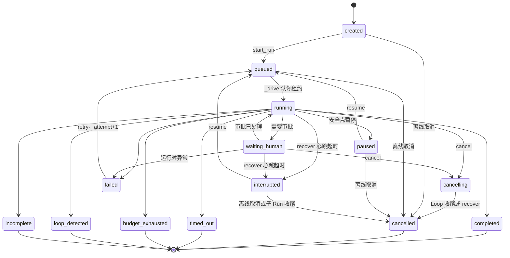
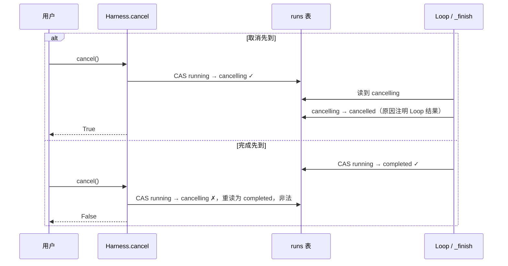

# 10 Run 生命周期状态机

一个 Run 从创建到结束，会被很多方同时“碰”到：后台 Loop、用户点的停止按钮、审批弹窗、心跳超时后来接管的另一个 Worker，还有异步回调。
本章讲清楚三件事：flywhl-harness 怎样用一个 14 态的显式状态机和 CAS，让这些并发操作 **只有一个赢家**；
每个状态的语义为什么不能合并；以及接管、重试、关闭服务这些边界情况怎样落到迁移表上。

## 为什么需要显式状态机

最省事的写法是给 Run 加几个布尔字段：

```python
# 反例：用布尔字段拼状态
run.is_running = True
run.is_cancelled = False
run.waiting_approval = False
run.is_paused = False
```

4 个布尔值有 16 种组合，其中大部分没有意义：`is_running and is_cancelled` 算什么？`waiting_approval and is_paused` 呢？
更麻烦的是，每处代码只改自己关心的那一位，没人能保证组合合法。一个经典事故是这样的：用户取消后，
`is_cancelled=True`；随后迟到的审批回调把 `is_running=True, waiting_approval=False` 写了回去，Run 就“复活”了。

显式状态机用一个字段表达唯一的当前状态，再用一张白名单表约束能去哪：

| 原则 | 在 flywhl-harness 中的落点 |
|---|---|
| 显式状态，终态不可变 | `RunStatus` 枚举；终态在 `TRANSITIONS` 里的出边集合为空 |
| 迁移表驱动 | `TRANSITIONS: dict[RunStatus, frozenset[RunStatus]]`，表外一律 `IllegalTransition` |
| CAS 原子迁移 | `Store.cas_run()`：`WHERE status=? AND version=?` |
| 每次迁移产生事件 | `Harness._transition()`（有活动 EventHub）或 `_offline_transition()`（没有）写 `status` 事件，带 from / to / reason / version |
| 等待类状态带超时 | 审批默认 600 秒超时、默认拒绝 |
| 迟到的回调写入前校验状态 | 所有写状态的路径都经过 CAS；审批决定也是 CAS |

## 14 个状态



`TRANSITIONS` 里还有 `waiting_human → cancelled`、`cancelling → interrupted`、`interrupted → failed` 三条边，
不过目前运行时代码里没有调用方（见下文“迁移表逐条解读”），为了图面清晰没有画出来。

按用途把 14 个状态分成四组：

| 分组 | 状态 | 说明 |
|---|---|---|
| 初始 | `created` · `queued` | 已登记、等待某个 Worker 开始驱动 |
| 活动（`ACTIVE`） | `running` · `waiting_human` · `cancelling` | 有 Worker 持有它、必须持续心跳；心跳过期由 `recover()` 接管 |
| 挂起 | `paused` · `interrupted` | 没有 Worker 在跑，等待 `resume()` |
| 终态（`TERMINAL`） | `completed` · `cancelled` · `failed` · `timed_out` · `budget_exhausted` · `loop_detected` · `incomplete` | 出边为空（`failed` 例外，见下文） |

```python
# src/flywhl_harness/runtime/state.py
TERMINAL = frozenset({S.CANCELLED, S.COMPLETED, S.FAILED, S.TIMED_OUT, S.BUDGET_EXHAUSTED, S.LOOP_DETECTED, S.INCOMPLETE})
ACTIVE = frozenset({S.RUNNING, S.WAITING_HUMAN, S.CANCELLING})
```

`ACTIVE` 这个集合决定了按心跳判定崩溃的范围：`recover()` 的第一轮只在 `stale_runs(ACTIVE, ...)` 里找心跳过期的 Run。
`paused` 不在里面，所以暂停了一周的 Run 不会被误判成“Worker 崩溃”。它本来就没有 Worker，也不需要心跳。
`queued` 和 `paused` 由第二轮 `runs_with_status(QUEUED, PAUSED)` 单独处理，规则不看心跳，见下文和第 11 章。

## 迁移表逐条解读

```python
# src/flywhl_harness/runtime/state.py
TRANSITIONS: dict[RunStatus, frozenset[RunStatus]] = {
    S.CREATED: frozenset({S.QUEUED, S.CANCELLED}),
    S.QUEUED: frozenset({S.RUNNING, S.CANCELLED}),
    S.RUNNING: frozenset({S.PAUSED, S.WAITING_HUMAN, S.CANCELLING, S.INTERRUPTED, *_ENDINGS}),
    S.WAITING_HUMAN: frozenset({S.RUNNING, S.CANCELLING, S.CANCELLED, S.INTERRUPTED, S.FAILED}),
    S.PAUSED: frozenset({S.QUEUED, S.CANCELLED}),
    S.CANCELLING: frozenset({S.CANCELLED, S.INTERRUPTED}),
    S.INTERRUPTED: frozenset({S.QUEUED, S.CANCELLED, S.FAILED}),
    S.FAILED: frozenset({S.QUEUED}),  # 重试：新的 attempt
    S.CANCELLED: frozenset(),
    # ... 其余终态同样为空集
}
```

每条边由谁触发，对照源码如下（函数都在 `src/flywhl_harness/runtime/manager.py` 的 `Harness` 上）：

| 迁移 | 触发方 | 说明 |
|---|---|---|
| `created → queued` | `start_run()`、`run_subagent()`，经 `_offline_transition()` | 登记后立即排队 |
| `queued → running` | `_drive()`，`expect={QUEUED}`，同一次 CAS 写入 `worker_id` 和 `heartbeat_at` | 认领租约；认领失败说明别的 Worker 抢先了，安静退出 |
| `running → waiting_human` | `ToolExecutor._on_approval_created()` 经 `_set_status()` | 审批对象建好之后才迁移 |
| `waiting_human → running` | `ToolExecutor._run_one()` 经 `_set_status()`；`_finish()` | 审批处理完（批准、拒绝或超时）继续；Loop 若在等待态结束，先回到 running 再进终态 |
| `running → paused` | `_finish()`（Outcome = paused） | 由 `pause()` 或关闭服务的 `aclose()` 请求，只在安全点发生，见第 11 章 |
| `running / waiting_human → cancelling` | `cancel()`；`_finish()` | 取消请求先“占位”，Loop 再收尾 |
| `cancelling → cancelled` | `_finish()`；`recover()` | Loop 补齐配对后收尾；或者进程在取消途中死掉，由恢复流程收尾 |
| `running / waiting_human → interrupted` | `recover()`，`expect_version` 钉住扫描时的版本 | 心跳过期，判定 Worker 崩溃；残留的子 Run 也先到这里 |
| `paused / interrupted / failed → queued` | `resume()`，`expect={PAUSED, INTERRUPTED, FAILED}`；`retry()` 只放行 failed，再委托给 `resume()` | 带 resume note 重新启动；从 failed 出发时 `attempt + 1` |
| `created / queued / paused / interrupted → cancelled` | `cancel()` 的离线分支；`recover()` 收尾子 Run | 没有 Worker 在跑，直接补配对结果，然后迁移 |
| `running → 六种结束态` | `_finish()` | 把 Loop 的 `Outcome.status` 原样映射 |
| `running / waiting_human → failed` | `_drive()` 的 `except Exception` | 运行时自身故障（不是模型或工具的失败） |
| `waiting_human → cancelled`、`cancelling → interrupted`、`interrupted → failed` | 暂无调用方 | 表里预留的合法迁移 |

两点值得注意：

- **`failed` 既在 `TERMINAL` 里，又有出边 `failed → queued`**。它对“这一次 attempt”来说是终态，但整个 Run 允许以新的 attempt 重来，
  `RunStateMachine.transition()` 在这条边上会把 `attempt + 1`。docstring 里“终态不可变”这句话对 `failed` 要打个折扣。
  入口是 `Harness.retry()`（HTTP 为 `POST /api/runs/{rid}/retry`，Web UI 在失败的 Run 上显示“重试”按钮），
  它从持久化的历史继续，而不是从头再来；
- **`queued` 没有到 `interrupted` 的边，也不带心跳**。进程死在 `created → queued` 或 `resume()` 的 `→ queued` 之后、`_drive()` 认领之前，
  Run 就停在 `queued`。`recover()` 的第二轮把 `updated_at` 空闲超过 `stale_after_seconds` 的 `queued` 当作孤儿，直接 `_launch()`，
  由 `_drive()` 走正常的 `queued → running` 认领，不需要新的迁移边。

## 五个容易混淆的状态

有些系统把“暂停”“等审批”“等外部事件”合并成一个 `blocked`。合并之后，恢复条件、超时策略、谁有权推进就全都说不清了。
下面这张表说明了 flywhl-harness 为什么把它们分开：

| | `paused` | `waiting_human` | `interrupted` | `cancelling` | `incomplete` |
|---|---|---|---|---|---|
| 谁让它进入 | 用户（`pause()`）或关闭服务（`aclose()`） | Loop（需要审批） | 恢复流程（心跳超时） | 用户 / hook / 系统（`cancel()`） | Loop（多次验收未通过） |
| 进程还在跑吗 | 不在，Loop 已退出 | 在，协程挂在审批 future 上 | 不在，原 Worker 已死或失联 | 在，Loop 正在收尾 | 不在，已结束 |
| 是否需要心跳 | 否 | 是 | 否 | 是 | 否 |
| 怎样离开 | `resume()` 或取消；`paused_by=shutdown` 的由 `recover()` 自动 resume | 审批决定、审批超时、取消 | `resume()` 或取消；`recover(auto_resume=True)` 接管后立即 resume | 只能到 `cancelled` | 不能离开（终态） |
| 超时策略 | 无（用户主动挂起的只能由用户恢复） | 审批超时默认拒绝 | 等 `recover()` 扫描 | 取决于在途工具的宽限期 | 无 |
| 恢复时给模型的说明 | “暂停了 N 秒”+ 工作区漂移 | 无需说明，同一个协程继续 | “进程意外中断”+ 漂移 + 对账 | 无（不再恢复） | 无 |

“恢复时给模型的说明”这一行能说明问题：`paused` 和 `interrupted` 都走 `resume()`，但 `Harness._resume_note()` 会根据状态生成完全不同的说明。
暂停是“有计划的离开”，崩溃却意味着“可能有做了一半的副作用”。把两者合并，就等于丢掉了恢复时最关键的那条信息。
`failed` 经 `retry()` 也走 `resume()`，说明里写的是上次失败的原因，并提醒模型不要重复已经成功的步骤。

`incomplete` 和 `completed` 的区别同样关键。Loop 的 Stop 验收（计划项未完成、验证命令失败、Stop hook 阻止）多次不过时，
会以 `incomplete` 如实结束，**绝不伪装成 `completed`**。下游如果只看“任务成功了吗”，这两者必须区分开。

## CAS 迁移：`RunStateMachine.transition`

```python
# src/flywhl_harness/runtime/state.py · RunStateMachine.transition
def transition(
    self, run_id: str, to: RunStatus | str, *, expect: set[RunStatus] | frozenset[RunStatus] | None = None,
    reason: str = "", retries: int = 3, expect_version: int | None = None, **fields,
) -> tuple[RunRecord, RunRecord]:
    # ...
    to = RunStatus(to)
    for _ in range(1 if expect_version is not None else retries):
        cur = self.store.get_run(run_id)
        if cur is None:
            raise KeyError(f"Run 不存在：{run_id}")
        if expect_version is not None and cur.version != expect_version:
            raise TransitionConflict(f"{run_id}: 版本已从 {expect_version} 变为 {cur.version}，放弃基于旧观察的迁移")
        frm = RunStatus(cur.status)
        if expect is not None and frm not in expect:
            raise IllegalTransition(f"{run_id}: 当前状态 {frm} 不在预期 {sorted(expect)} 中，拒绝迁移到 {to}")
        if to not in TRANSITIONS[frm]:
            raise IllegalTransition(f"{run_id}: 非法迁移 {frm} → {to}")
        extra = dict(fields)
        if reason:
            extra["status_reason"] = reason
        if to == S.QUEUED and frm == S.FAILED:
            extra["attempt"] = cur.attempt + 1
        if self.store.cas_run(run_id, frm, cur.version, to, **extra):
            return cur, self.store.get_run(run_id)  # type: ignore[return-value]
    raise TransitionConflict(f"{run_id}: 状态迁移到 {to} 时连续发生并发冲突")
```

这段代码里有两道独立的检查：

- **`TRANSITIONS`**：这条边在任何情况下是否合法（`completed → running` 永远不行）；
- **`expect`**：调用方的业务前提。比如 `_drive()` 写的是 `expect={QUEUED}`，意思是“只有还在排队时我才接手”。
  `running → running` 本来就不在表里，但 `expect` 把意图写得更明确，报错信息也更好懂。

CAS 失败时 **不是盲目重试**，而是重读一次状态，再把两道检查重新走一遍：

| 重读后的情况 | 结果 | 调用方得到的语义 |
|---|---|---|
| 状态没变，只是 version 变了（比如中间发生过一次 waiting_human 往返） | 用新 version 再 CAS，成功 | 正常迁移 |
| 状态变了，但新状态到目标仍然合法 | 用新状态再 CAS | 正常迁移（`from` 变了） |
| 状态变了，到目标已不合法（比如已经 `completed`） | `IllegalTransition` | **“你来晚了”**：明确告诉调用方失去了竞争 |
| 连续 3 次 CAS 都被抢先 | `TransitionConflict` | 冲突异常频繁，交给上层处理 |

第三行是并发控制里最重要的一种语义：失败本身也是一个明确的答案。`Harness.cancel()` 正是靠它返回 `False`，告诉用户“任务刚好已经完成”。

### `expect_version`：钉住观察时的版本

“重读后重新判定”适合“我要的是某个目标状态”的调用方，却不适合“我是基于某次观察才做的决定”的调用方。
崩溃接管就是后者：扫描时看到 `running` 且心跳过期，于是决定接管；可在真正迁移之前，别的 Worker 可能已经完成了
`running → interrupted → queued → running` 一整轮接管。重读后状态仍然是 `running`，`running → interrupted` 照样合法，
默认的重试逻辑会把一个刚被别人接管、正在健康运行的 Run 再抢一次。

传入 `expect_version` 后只尝试一次，版本和观察时不一致就直接 `TransitionConflict`，不重读、不重试。
`recover()` 里所有“基于扫描结果”的迁移都带着 `expect_version=run.version`。

## 并发场景推演

### 场景一：取消与完成竞争

用户点停止的那一刻，Loop 可能正好产出最后一条消息。`Harness.cancel()` 的做法是 **先用 CAS 占位，再发令牌**：

```python
# src/flywhl_harness/runtime/manager.py · Harness.cancel（活动 Run 分支）
cur = self.store.get_run(run_id)
if cur is not None and cur.status in (RunStatus.RUNNING, RunStatus.WAITING_HUMAN):
    try:
        self._transition(a, RunStatus.CANCELLING, f"{reason}（发起人：{by}）")
    except Exception:
        return False  # 刚好完成了：完成者胜出
a.rc.cancel.cancel(reason, by)
return True
```

Loop 结束后，`Harness._finish()` 读取当前状态，再决定最终落在哪个终态：

```python
# src/flywhl_harness/runtime/manager.py · Harness._finish
cur = RunStatus(self.store.get_run(a.run_id).status)  # type: ignore[union-attr]
target = RunStatus(out.status)
if cur == RunStatus.CANCELLING and target != RunStatus.CANCELLED:
    # 取消请求已先一步通过 CAS 占位：即使 Loop 恰好完成，最终状态也以取消为准（先到者胜出）
    target, out.reason = RunStatus.CANCELLED, f"取消请求先于完成到达（Loop 结果：{out.status}）"
```



为什么“取消先到”时，即使 Loop 已经算出了 `completed` 也要判成 `cancelled`？
因为 `cancel()` 返回 `True` 的那一刻，用户已经得到了“取消成功”的答复。最终状态必须和给出去的答复一致，
否则 UI 上就会出现“我点了停止、系统说好的，结果任务显示已完成”。真实的 Loop 结果并没有丢，它被写进了 `status_reason`，便于审计。

`_finish()` 自己也是按这个顺序处理的：目标是 `cancelled` 而当前还在 `running` 或 `waiting_human` 时，
会先迁移到 `cancelling` 再到 `cancelled`，保证状态轨迹里总能看到 `cancelling` 这一步（hook 要求终止时就走这条路径）。

### 场景二：审批通过与取消同时到达

这个场景牵涉两个对象：审批对象（`approvals` 行）和 Run 状态。两者各自用 CAS 保证“只决定一次”：

```python
# src/flywhl_harness/policy/approvals.py · ApprovalBroker.request（节选）
try:
    # ...
    try:
        return await cancel.guard(asyncio.wait_for(asyncio.shield(fut), self.timeout))
    except asyncio.TimeoutError:
        # ... 超时：CAS 为 expired，默认拒绝
except RunCancelled:
    self.store.resolve_approval(rec.id, "expired", decided_by="system:cancel", reason="运行已取消")
    raise
```

理想的推演是：取消先到，`guard` 抛出 `RunCancelled`，审批对象被 CAS 成 `expired`，之后的人工批准 CAS 失败，UI 提示“已被处理过”。
但 `CancelToken.guard()` 在“审批结果”和“取消信号”**同时就绪**时优先返回结果（`if task in done: return task.result()`）。
只要取消和批准在执行器协程被唤醒之前都已到达，不管先后顺序如何，`request()` 拿到的都是“批准”，审批记录也停在 `approved`。

防住这种情况的是执行器里的最后一个安全点：

```python
# src/flywhl_harness/agent/executor.py · ToolExecutor._run_one
# ---- 最后一个安全点：审批/hooks 期间可能已经收到取消；副作用发出之前必须再检查一次 ----
rc.cancel.raise_if_cancelled()

# ---- 预写 intent（+ 写操作前快照）----
```

批准之后、写 intent 之前再检查一次取消：`RunCancelled` 抛出，这个调用没有 step 行，批次收尾时补一条 `skipped` 的合成结果，副作用没有发出。
下面“动手验证”里的实验在两种顺序下都得到 Run 为 `cancelled`、工具结果为 `skipped`、外部通知数为 0。
这条规则可以概括为：**在发起任何新的副作用之前，最后再检查一次取消**。

### 场景三：迟到的状态回写

审批处理完之后，执行器会调用 `_set_status("running", ...)`。如果此时取消已经把状态改成了 `cancelling`，这次回写就是“迟到”的：

```python
# src/flywhl_harness/runtime/manager.py · Harness._set_status
async def _set_status(self, a: ActiveRun, to: str, reason: str) -> None:
    cur = self.store.get_run(a.run_id)
    if cur is None or cur.status == to:
        return
    with contextlib.suppress(Exception):  # 取消可能已经抢先迁移到 cancelling：以先到者为准
        self._transition(a, RunStatus(to), reason)
```

`cancelling → running` 不在迁移表里，状态机抛出 `IllegalTransition`，这里吞掉异常，状态保持 `cancelling`。
这是“终态（以及即将进入终态的状态）不被异步回调改写”的标准实现：**写入方不需要知道发生了什么竞争，状态机替它拒绝**。

另一种迟到来自进程之外：原 Worker 已经死了，用户这时才在 UI 上点“批准”。`resolve_approval` 的 CAS 会成功（审批还是 pending），
但已经没有协程在等这个 future 了。稍后 `recover()` 想把它标成 `expired`，CAS 失败，审批记录就停在 `approved`。
这不会造成误执行：恢复后，这个调用没有 step 行，会重新走一遍权限和审批流程，生成一个新的审批对象。
但审计时要注意：**`approved` 只代表“有人批准过”，不代表“按这次批准执行过”**，是否执行要看 steps 和 tool 结果。

### 场景四：两个 Worker 同时接管

两个进程同时扫到同一个心跳过期的 Run（版本 v），都想把它改成 `interrupted`。两者都带着 `expect_version=v`：
先提交的那个 CAS 成功，版本变成 v+1；后到的那个要么重读时发现版本变了，要么 CAS 影响 0 行，都以 `TransitionConflict` 结束，
`recover()` 跳过这个 Run。

更隐蔽的是“基于旧观察”的情形：B 扫描时看到版本 v，A 却在 B 迁移之前完成了一整轮接管，Run 又回到 `running`。
没有 `expect_version`，B 重读后会认为 `running → interrupted` 合法，把 A 正在跑的 Run 再抢一次；钉住版本之后，B 的迁移直接失败。

接管之后还有第二道关：`resume()` 把 Run 放回 `queued`，真正开始执行要靠 `_drive()` 的认领 CAS（`expect={QUEUED}`）。
两个 Worker 同时 `_launch()` 同一个 `queued` 孤儿时，只有一个认领成功，另一个安静退出：

```python
# src/flywhl_harness/runtime/manager.py · Harness._drive
try:
    # 与状态迁移同一个 CAS 认领租约：之后心跳若发现 worker_id 变了，说明已被别的 Worker 接管
    self._transition(a, RunStatus.RUNNING, "开始执行", expect={RunStatus.QUEUED},
                     worker_id=self.worker_id, heartbeat_at=now())
except (IllegalTransition, TransitionConflict):
    # 认领失败：别的 Worker 抢先接管了它。安静退出——绝不能把别人正在跑的 Run 标成 failed
    a.hub.close()
    self._active.pop(a.run_id, None)
    return
```

认领单独放在一个 `try` 里：如果它落进驱动循环的 `except Exception`，就会走 `→ failed`，把别人正在跑的 Run 标成失败。
这里 CAS 就充当了 fencing token，租约和心跳的细节见 [11 检查点与崩溃恢复](/reliability/checkpoint-recovery)。

## 等待类状态必须有超时

任何“等外部输入”的状态都可能永远等不到。flywhl-harness 里各个等待点的超时策略如下：

| 等待点 | 超时 | 超时后 | 驱动方式 |
|---|---|---|---|
| `waiting_human`（审批） | `permissions.approval_timeout`，默认 600 秒 | 审批 CAS 为 `expired`，按 **拒绝** 处理 | 进程内 `asyncio.wait_for` |
| `cancelling` 中的不可中断工具 | 工具自己的 `cancel_grace`，没有则用 `cancel_grace_seconds`（默认 5 秒） | 工具结果标记 `unknown`（附幂等键） | 进程内 `asyncio.wait_for` |
| 活动态的心跳 | `stale_after_seconds`，默认 10 秒 | 下次 `recover()` 扫描时迁移到 `interrupted` | 服务端启动时 `recover()` 一次，之后 `recovery_loop()` 周期扫描；以库方式使用时要自己调用 |
| `queued` 孤儿 | `updated_at` 空闲超过 `stale_after_seconds` | 下次 `recover()` 直接启动 | 同上 |
| `paused` / `interrupted` | 无 | `paused_by=shutdown` 的下次 `recover()` 自动 resume；其余一直等 `resume()` 或取消 | — |

审批超时的处理有一个细节：

```python
# src/flywhl_harness/policy/approvals.py · ApprovalBroker.request（节选）
except asyncio.TimeoutError:
    if self.store.resolve_approval(rec.id, "expired", decided_by="system:timeout", reason="审批超时"):
        return ApprovalDecision(False, by="system:timeout", reason=f"审批在 {self.timeout:.0f}s 内未得到答复，默认拒绝")
    return self._from_record(rec.id)  # 与超时同时到达的人工决定胜出
```

超时本身也要经过 CAS。如果超时触发的瞬间人工决定刚好写进去，超时的 CAS 会失败，这时以库里的人工决定为准。
“默认拒绝”而不是“默认批准”，是 fail-closed 原则：没人看的高风险操作，宁可不做。

::: warning 进程内定时器 vs 持久定时器
这里的超时是进程内的 `asyncio.wait_for`。进程一死，定时器就没了。`approvals.expires_at` 字段虽然写入了截止时间，
但目前没有任何代码去扫描它，过期审批要等 `recover()` 接管时才会被统一作废。
真正的持久执行引擎（例如 Temporal）会把定时器本身也当作持久状态，由服务端触发。见 [25 持久执行引擎映射](/advanced/durable-execution)。
:::

## 每次迁移都要留痕

```python
# src/flywhl_harness/runtime/manager.py · Harness._transition / _offline_transition
def _transition(self, a: ActiveRun, to: RunStatus, reason: str, expect: set[RunStatus] | None = None,
                **fields: Any) -> None:
    before, after = self.state.transition(a.run_id, to, expect=expect, reason=reason, **fields)
    a.hub.publish(Event(E.STATUS, {"from": before.status, "to": after.status, "reason": reason, "version": after.version}))

def _offline_transition(self, run_id: str, to: RunStatus, reason: str, **kw: Any) -> RunRecord:
    """不在活动 EventHub 中的迁移（创建、恢复、离线取消……）：同样写一条 status 事件，保证“每次迁移都有记录”。"""
    before, after = self.state.transition(run_id, to, reason=reason, **kw)
    self.store.append_event_next(run_id, E.STATUS, {"from": before.status, "to": after.status, "reason": reason,
                                                     "version": after.version})
    return after
```

`status` 事件和其他事件一样，带着 seq 落进 `events` 表。Web UI 检查器的“概览”页签用这些事件画出两样东西：
“状态流转”列表（每一条显示 `from → to`、原因和 version）和可展开的“状态机全图”（高亮当前状态和刚走过的那条边）。
原因里带着发起人，比如 `用户在 Web UI 点击停止（发起人：web-user）`，审计时可以回答“谁、何时、为何”。页面打开之前就结束的 Run，
这两样会从 `GET /api/runs/{rid}/trajectory` 返回的事件里补出来。

没有活动 EventHub 的迁移走 `_offline_transition()`，事件序号由 `Store.append_event_next()` 在事务内按 `MAX(seq) + 1` 分配：

| 迁移 | 位置 | 为什么没有 EventHub |
|---|---|---|
| `created → queued` | `start_run()`、`run_subagent()` | EventHub 在 `_launch` 时才创建 |
| `→ interrupted`、`→ cancelled` | `recover()` | 被接管的 Run 在本进程没有 EventHub |
| `→ queued` | `resume()` / `retry()` | 迁移发生在 `_launch()` 之前 |
| 离线 `→ cancelled` | `cancel()` 的离线分支 | 没有活动的 EventHub |

所以 02 崩溃示例里 `runs.version` 是 6，事件表里也正好 6 条 status 事件。剩下的缝隙是：`_offline_transition()` 先 CAS、再追加事件，
两步不在同一个事务里，进程死在中间会少一条审计记录（状态本身是对的）。要彻底补上，可以把迁移记录的写入放进状态机自身，
与 CAS 在同一个事务里写一张迁移历史表（outbox 的思路）。

## 常见坑

| 坑 | 后果 | 本项目的防线 |
|---|---|---|
| 用多个布尔字段拼状态 | 非法组合、迟到回调让 Run“复活” | 单一 `status` 字段 + 迁移白名单 |
| 先读状态、在应用层判断、再写 | 读和写之间被别人改了（TOCTOU） | 判断条件下推到 SQL：`WHERE status=? AND version=?` |
| 只比较 status、不比较 version | ABA：`running → waiting_human → running` 之后，旧请求误以为什么都没变 | `version` 每次迁移 +1 |
| 终态后被异步回调改写 | 已取消的任务显示为运行中或已完成 | 终态出边为空；`_set_status` 吞掉非法迁移 |
| 取消请求和最终状态不一致 | 用户收到“取消成功”，任务却显示完成 | `cancel()` 先 CAS 占位，`_finish()` 以 `cancelling` 为准 |
| 等待态没有超时 | 无人值守的审批永远挂着 | 审批超时默认拒绝（但定时器在进程内） |
| 迁移不留痕 | 事后说不清为什么停了 | 在线、离线迁移都写 `status` 事件 + `status_reason` |
| 基于旧观察做决定 | 把别的 Worker 刚接管的 Run 再抢一次 | 接管用 `expect_version` 钉住扫描时的版本 |
| 认领失败当成运行失败 | 把别人正在跑的 Run 标成 `failed` | `_drive()` 认领失败安静退出 |
| 挂起态没有 Worker 却被当作崩溃 | 暂停的任务被误恢复 | `paused` 不在 `ACTIVE`，不参与心跳扫描 |

## 动手验证

```bash
# 状态机的合法性与 CAS
.venv/bin/python -m pytest tests/test_policy.py::test_state_machine_cas -q
# 取消的完整迁移轨迹：running → cancelling → cancelled，原因里带发起人
.venv/bin/python -m pytest tests/test_cancel.py::test_cancel_interrupts_interruptible_tool_within_one_step -q
# 完成之后再取消：返回 False，终态不变
.venv/bin/python -m pytest tests/test_cancel.py::test_cancel_after_completion_loses_race -q
# 失败重试、离线迁移审计、基于旧观察的接管被拒
.venv/bin/python -m pytest tests/test_lifecycle.py::test_retry_failed_run_continues_from_history \
    tests/test_lifecycle.py::test_offline_transitions_are_audited \
    tests/test_lifecycle.py::test_takeover_based_on_stale_observation_is_fenced -q
# 三个取消场景的迁移轨迹
.venv/bin/python examples/03_cancel_semantics.py
```

`03_cancel_semantics.py` 每个场景都会打印类似下面的轨迹，`created → queued` 这条离线迁移也在里面：

```text
状态迁移：[('created', 'queued'), ('queued', 'running'), ('running', 'cancelling'), ('cancelling', 'cancelled')]
```

**复现场景二：审批与取消同时到达**。把下面的脚本保存为 `race.py`，放在仓库根目录运行：

```python
import asyncio, sys, tempfile
from pathlib import Path
from tests.conftest import make_harness
from flywhl_harness.tools.demo import FakeNotifyService

async def main(order: str):
    ws = Path(tempfile.mkdtemp())
    h = make_harness(ws, [{"tool_calls": [{"name": "send_notification", "args": {"to": "ops", "message": "hi"}}]}, "完成"],
                     on_ask="wait", cancel_grace_seconds=3.0)
    h.tools.get("send_notification").latency = 0.3
    s = h.create_session("t")
    run = await h.start_run(s.id, "发通知")
    while not h.store.list_approvals("pending"):
        await asyncio.sleep(0.02)
    ap = h.store.list_approvals("pending")[0]
    if order == "approve_then_cancel":
        h.resolve_approval(ap.id, True); await h.cancel(run.id)
    else:
        await h.cancel(run.id); h.resolve_approval(ap.id, True)
    rec = await h.wait(run.id)
    tool = [m for m in h.log(s.id).messages() if m.role == "tool"][0]
    svc = FakeNotifyService(h.data_dir / "external_notify.db")
    print(order, rec.status, tool.details["status"], "外部通知数", svc.count())

asyncio.run(main(sys.argv[1]))
```

```bash
.venv/bin/python race.py approve_then_cancel
.venv/bin/python race.py cancel_then_approve
```

两种顺序都会输出 `cancelled skipped 外部通知数 0`。把 `_run_one()` 里那行 `rc.cancel.raise_if_cancelled()` 注释掉再跑，
两种顺序都会变成 `cancelled ok 外部通知数 1`，这就是缺少最后一个安全点时的行为。
另外去查 `approvals` 表，审批记录是 `approved`，正好印证了场景三的结论：批准过不等于执行过。

## 小结

- 14 个状态分四组：初始、活动（必须心跳，含过渡态 cancelling）、挂起（等 resume）、终态。`ACTIVE` 决定了按心跳判定崩溃的范围；
- 迁移表是白名单，CAS 是执行机制，`expect` 表达调用方前提，CAS 失败后重读、重新判定，失败本身就是明确的答案；
  基于某次观察做出的决定（崩溃接管）用 `expect_version` 钉住版本，不重读；
- 取消与完成竞争时，先占位者胜，最终状态必须与已经给出去的答复一致；
- 迟到的回调由状态机拒绝，写入方不需要知道竞争的存在；
- 等待类状态必须有超时，并且 fail-closed；超时触发本身也要经过 CAS；
- 几处边界都落在已有的迁移边上：发起新副作用前最后检查一次取消；离线迁移也写 `status` 事件；`queued` 孤儿由 `recover()` 直接启动、
  靠认领 CAS 保证只有一个 Worker 执行；`failed` 经 `retry()` 以新的 attempt 从历史继续。

**延伸思考**

1. 如果加入一个 `waiting_event` 状态（等待 CI 完成、等待 webhook），它和 `waiting_human` 的超时、心跳、恢复语义应该有哪些不同？
2. `retry()` 目前在同一个会话分支上继续，失败那次尝试的消息都留在上下文里。如果改成先 `branch()` 回到失败前的条目，上下文和 resume note 分别要怎么变？
3. 把状态机搬到 PostgreSQL 上，`cas_run` 的写法是否需要改？`SELECT ... FOR UPDATE` 和 CAS 各适合什么场景？

下一章看 `interrupted` 之后发生了什么：[11 检查点与崩溃恢复](/reliability/checkpoint-recovery)。
