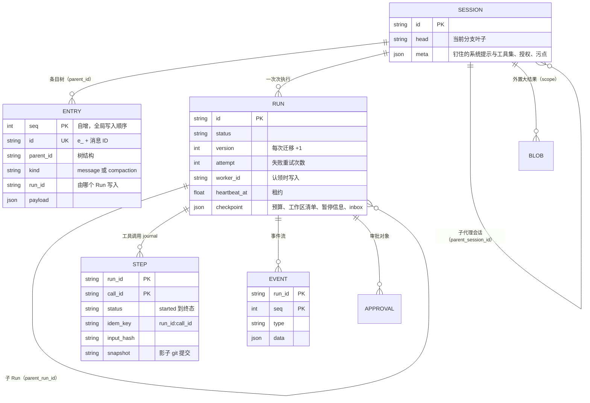
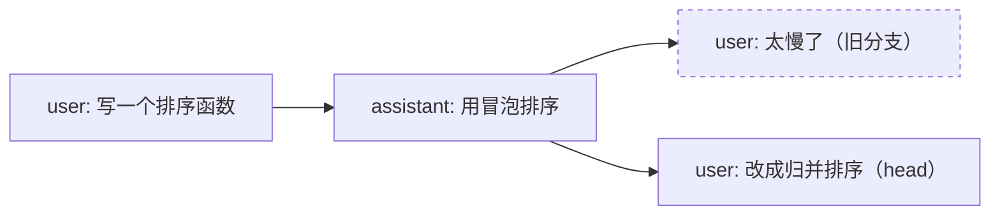

# 09 状态与持久化：四层模型

一次 Run 可能跑几分钟到几小时，这期间进程会崩溃，浏览器会断线，用户会回到某一步重新开一个分支。
本章回答三个问题：harness 到底要持久化哪些东西，按什么粒度切分，每次写入的原子边界划在哪里。
只有这三件事都想清楚了，“任何时刻 `kill -9` 之后都能从存储重建并继续”才成立。

## 一次 Run 需要记住什么

先别急着建表，先把“状态”按 **它回答的问题** 拆开。这几类状态的写入频率、可变性和寿命都不一样，硬塞进同一张表一定会出问题：

| 要回答的问题 | 存在哪 | 写入频率 | 可变性 | 寿命 |
|---|---|---|---|---|
| 模型下一轮应该看到什么 | `entries`（会话条目） | 每条消息一次 | 只追加 | 跟会话一样长 |
| 当前分支是哪条、用哪个系统提示和模型 | `sessions.head` / `sessions.meta` | 分支、授权、清理时 | 原地更新 | 跟会话一样长 |
| 这个任务处于哪个阶段、谁在跑、花了多少 | `runs` | 状态迁移、心跳 | 原地更新（CAS） | 跟任务一样长 |
| 这个副作用到底做没做过 | `steps` | 每次工具调用两次（intent / 结果） | 状态推进 | 恢复与审计期 |
| UI 断线后从哪里接着播 | `events` | 每个增量 | 只追加 | 可按 TTL 清理 |
| 谁、何时、批准了什么 | `approvals` | 每次审批 | 只能决定一次（CAS） | 审计期 |
| 50KB 的命令输出放哪 | `blobs` | 大结果外置时 | 内容寻址、不可变 | TTL |

前四行的粒度一层比一层细：Session ⊃ Run ⊃ Step ⊃ Event，这就是源码 docstring 里说的“四层模型”。
`entries` 跟 Session 同一个粒度，`approvals` 和 `blobs` 是两张辅助表，各自只负责一类问题。

## 业界的两种持久化模型

“怎么让长任务挺过崩溃”这件事，业界大致有两条路线：

| | 快照式（checkpoint） | 事件溯源式（event sourcing） |
|---|---|---|
| 代表 | LangGraph checkpointer：每个 super-step 结束时存一次图状态，用 `thread_id` 定位 | Temporal：只追加事件历史，Worker 重放确定性的工作流代码 |
| 恢复方式 | 读最新快照，从下一步继续 | 从头重放代码；遇到非确定性操作（Activity 结果、时间、随机数）时从历史里读，不重新执行 |
| 对代码的要求 | 低：状态可序列化即可 | 高：工作流代码必须是确定性的 |
| 时间旅行 / 分叉 | 指定历史快照 ID 重跑 | 重置到历史中的某个事件 |
| 存储代价 | 每步一份全量（或增量）状态 | 事件只追加，历史长了要靠 continue-as-new 截断 |

很多系统会把两者组合起来：以事件为真相源，再定期打快照来加速恢复。

Anthropic 的工程文章《Scaling Managed Agents》描述的是另一种思路（细节以原文为准）：session 是一份 **只追加的事件日志**，
放在上下文窗口之外持久保存；harness 本身无状态，崩溃后新实例按 sessionId 唤醒，读回事件就能接着干。
文章拿“宠物与牛群”打比方：harness 实例应该像牛群里的一头牛，随时可以换掉，而不是要精心照顾的宠物。

### Agent harness 的特殊之处

通用工作流引擎之所以需要“确定性重放”，是因为业务代码里夹着非确定性操作，重放时必须把它们替换成历史结果。
Agent 的情况简单很多：**最大的两类非确定性结果，也就是 LLM 输出和工具结果，本身就是上下文的内容**。
它们一写进 `entries`，恢复时就不需要重放任何代码，把 entries 重新拼成上下文、让 Loop 接着跑下一轮就行。

所以 flywhl-harness 是一个混合体：

| 表 | 在混合模型里的角色 |
|---|---|
| `entries` | 只追加的日志，同时直接充当“快照”：上下文 = 从根到 head 的路径 |
| `runs` | 可变的状态行，相当于一个小快照（状态、版本、心跳、工作区清单） |
| `steps` | 预写日志（write-ahead journal），专门回答“副作用做没做过” |
| `events` | 审计流 / 播放流，**不参与恢复** |

::: tip 哪些运行时状态跟着持久化
`RunContext` 里的派生状态按“恢复后能不能从零开始”分成两类：

- **会持久化**：预算计数（`Budget.state()` 写进 `runs.checkpoint.budget`，恢复时 `restore()`）、
  暂停前排队未注入的插话（`checkpoint.inbox`）、污点标记（会话级，写进 `sessions.meta.tainted`）。
  这几项要是归零，反复暂停就能绕过限额、丢掉用户输入，或者让读过不可信内容的会话“洗白”；
- **只在内存**：循环守卫窗口、`stop_blocks`、工具间共享的 `rc.state`（比如读文件的时间戳）。恢复时从零开始。

代价放在 [11 检查点与崩溃恢复](/reliability/checkpoint-recovery) 里讨论。
:::

## 数据模型



全部定义都在 `src/flywhl_harness/runtime/store.py` 的 `SCHEMA` 字符串里，一个 SQLite 文件装下 7 张表。下面逐层精读。

## Session：容器与冻结的 meta

`sessions` 只有一个经常变的字段：`head`，指向当前分支的叶子条目。另一个值得细看的是 `meta`，它在 `Harness.create_session()` 里初始化：

```python
# src/flywhl_harness/runtime/manager.py · Harness.create_session
meta = {
    # 钉住：系统提示与工具集在会话创建时冻结（版本钉住 + 前缀稳定）；
    # 模型以当前 Harness 为准（这里记录创建时的模型，实际服务的模型记录在每条 assistant 消息上）
    "system_prompt": sp, "model": self.model, "provider": self.provider.name, "tools": self.tools.names(),
    "mode": mode or cfg.permissions.mode, "grants": [], "clear_watermark": 0,
}
```

`_build_rc()` 按 `meta["tools"]` 取工具子集，之后 Harness 新注册的工具不会出现在老会话里。
模型则没有钉死：用换了模型的 Harness 继续老会话是允许的，但 `_note_model_switch()` 会发一条 `model_switched` 通知并改写 `meta["model"]`，
回放和评测时能看出“这里换过模型”。

为什么系统提示要存一份 **渲染后的全文**，而不是每次请求时现场生成？原因有两个：

1. **前缀稳定**：`build_system_prompt` 会读 AGENTS.md 和技能清单。用户在会话中途改了 AGENTS.md，如果每轮都重新生成，
   系统提示就变了，之前缓存的前缀全部失效（见 [07 上下文工程与压缩](/core/context-engineering)）；
2. **恢复一致**：崩溃之后用新进程恢复时，新进程的代码或配置可能已经升级。会话按创建时的提示继续，
   而不是半路换成另一套指令（版本钉住的完整讨论见 [11 检查点与崩溃恢复](/reliability/checkpoint-recovery)）。

`grants`（会话级授权，“记住这个选择”）、`clear_watermark`（旧工具结果的清理水位）和 `tainted`（读过不可信内容）会在运行中更新，
因为它们本来就是会话级、需要跨 Run、跨崩溃保留的状态。

## Entry：只追加的会话树

### 表结构的两个 ID

`entries` 同时有两个标识：

- `seq INTEGER PRIMARY KEY AUTOINCREMENT`：全局写入顺序，`list_entries` 按它排序，展示整棵树时用；
- `id TEXT UNIQUE`：业务 ID。`SessionLog.append_message()` 用 `e_<message_id>` 作为条目 ID：

```python
# src/flywhl_harness/runtime/session.py · SessionLog.append_message
def append_message(self, msg: Message, run_id: str | None = None) -> Entry:
    return self.store.append_entry(self.session_id, "message", msg.to_dict(), run_id=run_id, entry_id=f"e_{msg.id}")
```

条目 ID 由消息 ID 决定，再加上 `UNIQUE` 约束，同一条消息就 **不可能落盘两次**：第二次写会直接抛 `IntegrityError`，
不会悄悄多出一条重复的历史。这其实是一个很便宜的幂等保护，下文“动手验证”里可以亲手试一下。

### 追加即移动 head

```python
# src/flywhl_harness/runtime/store.py · Store.append_entry
def append_entry(
    self, session_id: str, kind: str, payload: dict[str, Any], *, run_id: str | None = None,
    parent_id: Any = _HEAD, entry_id: str | None = None,
) -> Entry:
    """追加一个条目并把 session.head 移到它上面。默认挂在当前 head 之下。"""
    with self.tx() as c:
        if parent_id is Store._HEAD:
            r = c.execute("SELECT head FROM sessions WHERE id=?", (session_id,)).fetchone()
            # ...
            parent_id = r["head"]
        eid = entry_id or new_id("e_")
        t = now()
        cur = c.execute(
            "INSERT INTO entries(id,session_id,parent_id,kind,run_id,payload,created_at) VALUES(?,?,?,?,?,?,?)",
            (eid, session_id, parent_id, kind, run_id, _dump(payload), t),
        )
        c.execute("UPDATE sessions SET head=?, updated_at=? WHERE id=?", (eid, t, session_id))
        return Entry(eid, session_id, parent_id, kind, payload, run_id, cur.lastrowid or 0, t)
```

“读 head → 插入条目 → 移动 head”三步放在 **同一个事务** 里。要是拆开写，两个并发追加可能读到同一个 head，
各自插入后互相覆盖 head，其中一条就成了没人指向的孤儿分支。`parent_id` 用哨兵对象 `_HEAD` 而不是 `None` 作默认值，
因为 `None` 本身有含义：“挂在根上”。

### 分支：只移动指针

这套设计借鉴了 pi 的 JSONL 会话树：每条 entry 带 `id` / `parentId`，分支只是移动叶子指针，旧分支原样留在文件里。
flywhl-harness 里对应 `SessionLog.branch()`：

```python
# src/flywhl_harness/runtime/session.py · SessionLog.branch
def branch(self, entry_id: str | None) -> None:
    """把当前分支头移到 entry_id（None 表示回到会话开头）。"""
    if entry_id is not None:
        e = self.store.get_entry(entry_id)
        if e is None or e.session_id != self.session_id:
            raise KeyError(f"条目不存在或不属于当前会话：{entry_id}")
    self.store.update_session(self.session_id, head=entry_id)
```



branch 之后追加的条目自然挂在新的 head 下面。整个过程没有删除，也没有复制。有两个约束需要注意：

- `Harness.branch()` 在会话有活动 Run 时直接拒绝，因为运行中的 Loop 正在往 head 下追加，这时挪 head 会把一轮对话劈成两半；
- 分支只作用于 entries，**不回滚工作区文件**。回到第 3 步重来，磁盘上还是第 5 步写出的文件。
  要连文件一起回到过去，得配合影子 git 快照（见 [18 Workspace 与沙箱](/governance/workspace-sandbox)）。

### 递归 CTE 取路径

“当前分支的完整历史”就是从 head 沿 `parent_id` 一路走到根：

```python
# src/flywhl_harness/runtime/store.py · Store.path
rows = self._q(
    """
    WITH RECURSIVE p(id, parent_id, depth) AS (
      SELECT id, parent_id, 0 FROM entries WHERE id = ?
      UNION ALL
      SELECT e.id, e.parent_id, p.depth + 1 FROM entries e JOIN p ON e.id = p.parent_id
    )
    SELECT entries.* FROM entries JOIN p ON entries.id = p.id ORDER BY p.depth DESC
    """,
    (head,),
)
```

- 锚点是 head（depth=0），每次递归向父节点走一步、depth+1；最后按 depth **降序** 排，得到“根 → head”的正序；
- 递归部分没有按 `session_id` 过滤，靠的是 `id` 全局唯一，parent 链不会串到别的会话；
- 代价是 O(路径长度)：每次调用都要重走整条链，还要把每条 payload 做一次 JSON 反序列化。
  `SessionLog.context()` 一轮里会被调用好几次（压缩判断、todo 提醒、构造请求各一次），会话越长越贵。
  生产实现通常会缓存“路径 + 上下文视图”，只在追加或分支时增量更新。

`context()` 在路径的基础上再处理压缩：找到最近的 compaction 条目，用摘要替换它之前的历史。
原始条目仍然留在库里，可以回查、回放。压缩的细节见 [07 上下文工程与压缩](/core/context-engineering)。

## Run：一行可变状态

`runs` 的字段按用途可以分成五组：

| 分组 | 字段 | 谁写 |
|---|---|---|
| 身份 | `id` · `session_id` · `parent_run_id` · `prompt` · `config` | 创建时 |
| 状态机 | `status` · `version` · `attempt` · `status_reason` | 只能经 `cas_run` |
| 租约 | `worker_id` · `heartbeat_at` | 认领（`queued → running` 的同一次 CAS）写入两列；之后 `Store.heartbeat()` 默认每 2 秒条件续租 `heartbeat_at` |
| 结果 | `usage` · `result` · `error` | `Harness._finish()` |
| 检查点 | `checkpoint`（`at`、`budget`、`manifest`、`paused_at` / `paused_by`、`inbox`） | `Harness._checkpoint()`：每个 `turn_end` 与结束时 |

状态字段和其他字段走两条完全不同的写路径，这是故意设计的：

```python
# src/flywhl_harness/runtime/store.py · Store.cas_run / update_run
def cas_run(self, rid: str, from_status: str, from_version: int, to_status: str, **fields: Any) -> bool:
    """乐观锁状态迁移：只有 (status, version) 都与预期一致才会成功。"""
    sets = ["status=?", "version=version+1", "updated_at=?"]
    # ...
    n = self._x(
        f"UPDATE runs SET {', '.join(sets)} WHERE id=? AND status=? AND version=?",
        (*vals, rid, from_status, from_version),
    )
    return n == 1

def update_run(self, rid: str, **fields: Any) -> None:
    """更新非状态字段（用量、检查点、结果）。状态字段必须走 cas_run。"""
    assert "status" not in fields, "状态迁移请使用 cas_run / RunStateMachine"
    # ...
```

`cas_run` 是单条 `UPDATE ... WHERE status=? AND version=?`。比较和写入在数据库里一步完成，没有“先读后写”的窗口。
影响行数为 0，就说明有人抢先改过状态。`version` 每次迁移加 1，所以即使状态值碰巧绕回原样（比如 `running → waiting_human → running`），
旧版本号也不会被误认成新的。这是 ABA 问题的标准解法。

`update_run` 用断言把“绕过状态机改 status”这条路堵死了。状态机本身见 [10 Run 生命周期状态机](/reliability/run-lifecycle)。

::: warning status_reason 只保留最后一次
`status_reason` 是 `runs` 表上的一个普通列，每次迁移都会覆盖。完整的“谁、何时、为何”历史在 `events` 表的 `status` 事件里。
有活动 EventHub 的迁移走 `Harness._transition()`；没有 EventHub 的迁移（`start_run` 的 `created → queued`、`resume` / `retry` 的 `→ queued`、
`recover` 的各种接管、离线取消）走 `_offline_transition()`，同样落一条 `status` 事件（详见第 10 章）。
:::

## Step：工具调用的预写日志

`steps` 以 `(run_id, call_id)` 为主键，一次工具调用对应一行，写两次：

```python
# src/flywhl_harness/runtime/store.py · Store.step_started
def step_started(
    self, run_id: str, call_id: str, *, tool: str, effect: str, idem_key: str,
    input_hash: str, snapshot: str | None = None,
) -> None:
    """预写 intent：在真正执行副作用 **之前** 落盘。重复写入（恢复后重试）时 attempt + 1。"""
    self._x(
        """INSERT INTO steps(run_id,call_id,tool,effect,idem_key,input_hash,status,attempt,snapshot,started_at)
           VALUES(?,?,?,?,?,?,'started',1,?,?)
           ON CONFLICT(run_id, call_id) DO UPDATE SET status='started', attempt=attempt+1,
             started_at=excluded.started_at, input_hash=excluded.input_hash""",
        (run_id, call_id, tool, effect, idem_key, input_hash, snapshot, now()),
    )
```

第一次写在 `ToolExecutor._run_one()` 里，时机是权限、hooks、审批都通过之后、真正执行之前；第二次是结果出来后由 `step_finished` 写终态。
恢复流程只关心一件事：**有没有 `started` 却没有终态的行**。有，就说明“意图已经发出，结果不知道”。

几个容易误读的细节：

- **不是每个调用都有 step 行**。参数非法、权限拒绝、审批拒绝的调用在写 intent 之前就返回了；`step_finished` 是 `UPDATE`，
  对不存在的行什么也不做。所以 `steps` 只记录“走到执行这一步的调用”，审计全部调用请看 entries 里的 tool 结果；
- **终态取自结果消息的 `details.status`**，实际值有 `ok` / `error` / `cancelled` / `unknown` / `reconciled` / `skipped` / `timeout` 等，
  比 `StepRecord` 注释里列出的 `started | completed | failed | unknown | cancelled` 更多，以代码为准；
- `ON CONFLICT ... attempt=attempt+1`：恢复后用同一个 `call_id` 重新执行只读或幂等工具时，同一行的 attempt 加 1，不会插入新行；
  `input_hash` 也一并刷新（取的是 hook 与审批改写之后的 `args`），journal 记录的始终是最近一次真正执行的参数；
- `idem_key` 固定为 `f"{run_id}:{call_id}"`（见 `ToolExecutor._ctx()`），同一个调用无论重试多少次幂等键都不变，外部系统才能据此去重；
- `input_hash` 是参数的短哈希，`snapshot` 是写操作前影子 git 的提交号，回滚和审计时用；
- `output` 只存截断到 2000 字符的内容。完整结果在 entries 里，step 只是 journal，不负责保存全量数据。

幂等键怎么设计、外部系统怎么配合，见 [14 幂等与副作用](/reliability/idempotency)。

## Event：带序号的事件流

```sql
CREATE TABLE IF NOT EXISTS events(
  run_id TEXT NOT NULL,
  seq INTEGER NOT NULL,
  type TEXT NOT NULL,
  data TEXT NOT NULL,
  ts REAL,
  PRIMARY KEY(run_id, seq)
);
```

seq 有两个分配者，每个 Run 内都单调递增：

- **有活动 EventHub 时**：`EventHub.publish()` 在内存里分配。新 EventHub 用 `max_event_seq(run_id)` 作为起点，所以 seq 跨进程也是连续的；
- **没有 EventHub 时**（创建、恢复接管、离线取消、模型切换通知）：`Store.append_event_next()` 在 **同一个事务** 里取 `MAX(seq) + 1` 再插入，
  `BEGIN IMMEDIATE` 一开始就拿写锁，两个 Worker 同时写离线事件也不会撞号：

```python
# src/flywhl_harness/runtime/store.py · Store.append_event_next
def append_event_next(self, run_id: str, type: str, data: dict[str, Any]) -> int:
    """没有活动 EventHub 时追加一条事件：序号在同一事务内分配（max + 1），不会和并发写入撞号。"""
    with self.tx() as c:
        seq = int(c.execute("SELECT COALESCE(MAX(seq), 0) + 1 FROM events WHERE run_id=?", (run_id,)).fetchone()[0])
        c.execute("INSERT INTO events(run_id,seq,type,data,ts) VALUES(?,?,?,?,?)", (run_id, seq, type, _dump(data), now()))
    return seq
```

在 02 示例的数据库里可以看到，崩溃前最后一条已落库事件是 seq 15 的 `tool_update`；
接管时的 `running → interrupted`、`interrupted → queued` 两条离线事件是 16 和 17，新 EventHub 以 17 为起点，`queued → running` 是 18。

`(run_id, seq)` 主键加上 `INSERT OR IGNORE`，让写入变成幂等的：同一批事件写两次也只留一份。
消费端的 `Harness.subscribe()` 则用 `ev.seq <= last` 丢弃重复，“先查库补齐、再接实时流”的衔接处因此不重不漏。
断线续传的完整机制见 [15 流式输出、插话与断线续传](/reliability/streaming)。

## 两张辅助表

**approvals**：审批对象有自己的状态 `pending | approved | rejected | expired`，决定只能做一次：

```python
# src/flywhl_harness/runtime/store.py · Store.resolve_approval
n = self._x(
    "UPDATE approvals SET status=?, decided_by=?, decision_reason=?, edited_args=?, remember=?, decided_at=?"
    " WHERE id=? AND status='pending'",
    (status, decided_by, reason, _dump(edited_args), int(remember), now(), aid),
)
return n == 1
```

人工批准、超时、取消、崩溃恢复这四个来源可能同时去改同一条审批，`WHERE status='pending'` 保证只有第一个生效。
后面几章会反复用到这个模式：**凡是会被并发决定的对象，都用条件更新做 CAS**。

**blobs**：超大工具结果外置到这里，上下文里只放一个句柄。

```python
# src/flywhl_harness/runtime/store.py · BlobStore.put
ref = "blob_" + sha256_hex(text)[:16]
t = now()
self._s._x(
    "INSERT INTO blobs(scope,ref,size,data,created_at,expires_at) VALUES(?,?,?,?,?,?)"
    " ON CONFLICT(scope, ref) DO UPDATE SET expires_at=excluded.expires_at",
    (scope, ref, len(text), text, t, t + ttl if ttl else None),
)
```

- 内容寻址：相同内容得到相同 ref，重复写入不会多存一份；冲突时只刷新 `expires_at`。
  如果用 `INSERT OR IGNORE`，旧行的过期时间不变，刚拿到的句柄可能在下一次 `purge_expired()` 时就被清掉；
- 主键是 `(scope, ref)`：同一份内容在两个会话里各存一份，A 会话拿到的句柄在 B 会话里读不到，防止句柄跨会话泄漏数据；
- `expires_at` 支持 TTL，`purge_expired()` 负责清理。注意 ref 只取了 16 个十六进制字符（64 位），在单个 scope 内碰撞概率可以忽略，
  但它不是密码学意义上的“不可猜测”，隔离靠的是 scope，而不是 ref 的保密性。

## 事务边界：哪些写必须原子

持久化设计里最容易出错的就是事务边界。flywhl-harness 的规则可以归纳成一张表：

| 写入组合 | 是否同一事务 | 为什么 |
|---|---|---|
| 插入 entry + 移动 head | 是（`append_entry` 内） | 防止并发追加互相覆盖 head |
| 工具结果 entry + step 终态 | 是（`run_batch` 的 `persist`） | 防止“结果写了、journal 还是 started”，恢复时重复对账或重复执行 |
| step `started` | **单独提交，且必须在执行之前** | 副作用一旦发出，intent 必须已经落盘 |
| 状态迁移 | 单条 CAS 语句 | 比较和写入原子完成 |
| 离线 `status` 事件：分配 seq + 插入 | 是（`append_event_next` 内） | 防止并发写入撞号 |
| 离线迁移 + 它的 `status` 事件 | **否**：CAS 成功后再追加事件 | 两者之间崩溃会少一条审计事件，但状态本身是对的 |
| 事件批量写入 | 一批一个事务，不与上面任何写入同事务 | 事件不是真相源，丢了可以从 entries 推导 |

工具结果那一处的代码：

```python
# src/flywhl_harness/agent/executor.py · ToolExecutor.run_batch 内的 persist
def persist(p: Prepared) -> None:
    msg = results[p.call.id]
    with rc.store.tx():
        rc.log.append_message(msg, rc.run_id)
        rc.store.step_finished(rc.run_id, p.call.id, (msg.details or {}).get("status", "ok"),
                               {"is_error": msg.is_error, "content": clip(msg.text, 2000)})
    persisted.add(p.call.id)
    publish(E.TOOL_END, self._end_data(p.call, msg))  # 落盘之后才发布：事件不领先于持久化
```

`tool_end` 放在事务块之外，提交之后才发布，跟下文“事件永远不领先持久化”是同一条规则。
`append_message` 内部本身就有一个 `tx()`，外面又包了一层。之所以能这样嵌套，是因为 `Store.tx()` 是可重入的：

```python
# src/flywhl_harness/runtime/store.py · Store.tx
@contextmanager
def tx(self) -> Iterator[sqlite3.Connection]:
    with self._lock:
        outer = self._depth == 0
        if outer:
            self._conn.execute("BEGIN IMMEDIATE")
        self._depth += 1
        try:
            yield self._conn
        except BaseException:
            self._depth -= 1
            if outer:
                self._conn.execute("ROLLBACK")
            raise
        else:
            self._depth -= 1
            if outer:
                self._conn.execute("COMMIT")
```

只有最外层负责 BEGIN 和 COMMIT，内层只记深度。异常时由最外层整体回滚。这里捕获的是 `BaseException`，
所以 `asyncio.CancelledError` 打断事务时同样会回滚。

用 `BEGIN IMMEDIATE` 而不是默认的 `BEGIN`（DEFERRED），原因在于 DEFERRED 事务开始时只拿读锁，第一次写的时候才升级成写锁。
两个进程同时持有读锁、又同时想升级，其中一个会直接收到 `SQLITE_BUSY`，而且等待也没用。
IMMEDIATE 一开始就拿写锁，冲突只会表现为排队等待（Python `sqlite3.connect` 的默认 `timeout=5.0` 秒）。

### 按崩溃点逐一推演

把“进程在哪一刻死掉”逐个列出来，检验这套边界：

| 崩溃点 | 磁盘上有什么 | 恢复时发生什么 |
|---|---|---|
| assistant 消息落盘之前 | 上一轮的完整历史 | 这一轮模型调用白做了，重新调用（只浪费 token） |
| assistant（含 tool_use）落盘后、step 写入前 | 未配对的 tool_use，没有 step 行 | 视为“从未执行”，走完整的权限 → 执行流程 |
| step `started` 之后、结果落盘之前 | 未配对的 tool_use + `started` 行 | **结果未知**：对账，或者用同一幂等键重执行，或者标记 unknown |
| 结果事务提交之后 | 配对完整，step 有终态 | 正常进入下一轮 |

第二行和第三行的区别全靠 step 行是否存在来判断。所以 intent **必须在副作用之前单独提交**，不能跟结果攒在一起最后再写。

## 事件永远不领先持久化

```python
# src/flywhl_harness/agent/loop.py · AgentLoop._append
def _append(self, msg: Message) -> Event:
    """消息落盘（检查点）后再发 message_end：事件永远不会领先于持久化状态。"""
    self.rc.log.append_message(msg, self.rc.run_id)
    return self._ev(E.MESSAGE_END, message=msg.to_dict())
```

把顺序反过来，看看会出什么问题：先发 `message_end`，UI 显示“模型说：已删除临时文件”，然后进程在落盘前死掉。
恢复后的历史里没有这条消息，模型会重新生成一段回答，UI 上的说法和真正的历史就对不上了。
更糟的情况是工具结果：UI 显示“通知已发送”，journal 里却还是 `started`，运维看到的“事实”和系统恢复时依据的事实不一致。

反过来的顺序（先落盘再发事件）最坏也只是“落盘了但事件没发出去”。客户端重连时从库里补齐即可，因为 entries 才是真相源。

## entries 与 events：为什么存两份

一个自然的疑问：events 里已经有 `message_end`（带完整消息），为什么不像纯事件溯源那样，直接从事件重建上下文？

| 维度 | 从 events 重建上下文 | 单独的 entries 表（本项目） |
|---|---|---|
| 树与分支 | events 按 Run 组织、线性，表达不了“回到第 3 步分叉” | `parent_id` + `head` 天然是树 |
| 压缩 | 要在事件流里定义“从这里起替换历史”的语义 | 一个 compaction 条目 + `first_kept_entry_id` |
| 读放大 | 构建上下文要扫过大量增量事件（文本 delta 占大头） | 只读消息粒度的条目 |
| 跨 Run | 一个会话的上下文跨越多个 Run 的事件 | 条目属于会话，Run 只是写入者（`run_id` 列） |
| 保留策略 | 事件想按 TTL 清理，又不能删掉上下文 | 事件可以放心清理，上下文不受影响 |
| 代价 | 一份数据 | 每条消息写两次（entry + `message_end` 事件） |

结论是职责分离：**entries 回答“模型看到什么”，events 回答“发生过什么、UI 怎么播”**。
双写的一致性靠上一节的顺序规则保证：entries 先写，events 后写，两者冲突时以 entries 为准。

## 写放大治理

流式输出时每个 token 增量都是一个事件，一次长回答就是上千条 `message_update`。`EventHub` 把事件分成两类处理：

```python
# src/flywhl_harness/runtime/manager.py · EventHub.publish / flush
def publish(self, ev: Event) -> Event:
    self.seq += 1
    ev.seq, ev.run_id = self.seq, self.run_id
    self._buffer.append(ev)
    if ev.type not in EPHEMERAL_EVENTS or len(self._buffer) >= 64:
        self.flush()
    elif self._flusher is None or self._flusher.done():
        self._flusher = asyncio.get_running_loop().create_task(self._delayed_flush())
    return ev

def flush(self) -> None:
    if self._buffer:
        batch, self._buffer = self._buffer, []
        self.store.append_events(self.run_id, batch)
        self._fanout(batch)
```

- `EPHEMERAL_EVENTS = {message_update, tool_update}`：高频增量先进缓冲区，攒满 64 条或者等到 50ms（`_delayed_flush`）再批量写；
- `flush()` 先落库、再扇出给订阅者：订阅者拿到的事件一定已经在 `events` 表里，断线重连时从库里补读不会缺这一条；
  慢订阅者队列满了就被踢下线，收到一个“落后”标记后自己从库里补齐；
- 其他事件（`message_end`、`tool_end`、`status`……）一到就 flush，连同缓冲区里排在它前面的增量一起写；
- 崩溃最多丢 50ms 的增量，而这些增量的最终结果已经在 `message_end` 和 entries 里了，丢了不影响恢复。

### 批量要配一个事务

连接以 `isolation_level=None`（autocommit）打开。在 autocommit 模式下，裸的 `executemany` 每一行都是一个独立的隐式事务，
64 行就是 64 次 WAL 提交：批量减少了 Python 层的调用次数，却没有减少提交次数。所以 `Store.append_events()` 在外面包了一层 `tx()`：

```python
# src/flywhl_harness/runtime/store.py · Store.append_events
def append_events(self, run_id: str, events: list[Event]) -> None:
    if not events:
        return
    with self.tx() as c:  # 一批一个事务：autocommit 下逐行提交要慢一个数量级
        c.executemany(
            "INSERT OR IGNORE INTO events(run_id,seq,type,data,ts) VALUES(?,?,?,?,?)",
            [(run_id, e.seq, e.type, _dump(e.data), e.ts) for e in events],
        )
```

下面这个小实验可以看出两种写法的差距：

```python
# 在任意目录运行：python3 bench.py
import sqlite3, time
c = sqlite3.connect("bench.db", isolation_level=None)
c.execute("PRAGMA journal_mode=WAL"); c.execute("PRAGMA synchronous=NORMAL")
c.execute("CREATE TABLE IF NOT EXISTS ev(run_id TEXT, seq INT, data TEXT, PRIMARY KEY(run_id, seq))")
rows = lambda b: [("r", b * 64 + i, "x" * 200) for i in range(64)]
t = time.perf_counter()
for b in range(200):
    c.executemany("INSERT OR IGNORE INTO ev VALUES(?,?,?)", rows(b))
print("autocommit", time.perf_counter() - t)
t = time.perf_counter()
for b in range(200, 400):
    c.execute("BEGIN"); c.executemany("INSERT OR IGNORE INTO ev VALUES(?,?,?)", rows(b)); c.execute("COMMIT")
print("事务包裹", time.perf_counter() - t)
```

在作者的机器上，前者约 190ms，后者约 20ms（具体数字随磁盘而变，数量级的差距是稳定的）。

其余几处控制写放大的手段：

- `steps.output` 只存 2000 字符，完整结果只在 entries 里存一份；
- 超大结果外置到 blobs，entries 里只放句柄和预览（见 [06 工具系统](/core/tools)）；
- 心跳只更新 `heartbeat_at` 一列，不产生事件。

## SQLite 的崩溃安全级别

```python
# src/flywhl_harness/runtime/store.py · Store.__init__
self._conn.execute("PRAGMA journal_mode=WAL")
self._conn.execute("PRAGMA synchronous=NORMAL")  # WAL 下可抵御进程崩溃；抵御断电需 FULL
```

| 故障 | WAL + `NORMAL`（当前） | WAL + `FULL` |
|---|---|---|
| 进程崩溃 / `kill -9` | 已提交事务全部保留 | 已提交事务全部保留 |
| 操作系统崩溃 / 断电 | 数据库保持一致，但最近提交的若干事务可能回滚 | 已提交事务持久 |
| 每次提交的开销 | 不 fsync，只在 checkpoint 时 fsync | 每次提交 fsync WAL |

对一个本地运行的 harness 来说，主要威胁是进程崩溃，`NORMAL` 已经足够。断电后丢掉最后几个事务，
相当于“崩溃点往前挪了几步”，前面那张崩溃推演表依然成立，因为事务边界没有变。
有一种情况必须警惕：**外部系统已经确认了副作用，而本地 intent 却因断电丢失**。这时恢复流程会把那个调用当成“从未执行”，
真正去执行一次。防住这种情况的最后一道防线是外部系统按幂等键去重，所以幂等键必须是确定性的（`run_id:call_id`），
不能是每次执行时随机生成的值。

另外两处细节：

- 进程内是单连接加 `threading.RLock`。SQLite 连接不适合多线程并发使用，串行化最简单；
- `PRAGMA foreign_keys=ON` 打开了，但 `SCHEMA` 里并没有声明任何外键。表之间的关系目前靠应用层维护，没有数据库约束。

### 工作区文件也要原子写

SQLite 之外，`write` / `edit` 工具写出的文件同样是持久化状态。直接 `open("w")` 写到一半被 `kill -9`，
磁盘上会留下一个截断的文件，恢复后的模型读到的既不是旧内容也不是新内容。`tools/fs.py` 用的是“临时文件 + 原子替换”：

```python
# src/flywhl_harness/tools/fs.py · _atomic_write
def _atomic_write(p: Path, text: str) -> None:
    """原子写入：写临时文件 → fsync → os.replace。进程在写一半时被杀，原文件要么是旧内容，要么是新内容。"""
    tmp = p.with_name(f".{p.name}.flywhl-tmp")
    with tmp.open("w", encoding="utf-8") as f:
        f.write(text)
        f.flush()
        os.fsync(f.fileno())
    if p.exists():
        os.chmod(tmp, p.stat().st_mode)
    os.replace(tmp, p)
```

- 临时文件和目标在同一目录，`os.replace` 才是同一文件系统内的原子重命名；
- 先 `fsync` 再替换，避免断电后“新名字指向一个还没刷盘的空文件”；
- `chmod` 沿用原文件权限，否则改一行就会把可执行脚本的 `x` 位丢掉；
- 崩溃时最多残留一个 `.<文件名>.flywhl-tmp`，原文件不受影响。

## 生产化路线

单个 SQLite 文件适合单机和教学。多 Worker、多租户的生产环境里，每一层都有对应的替代方案：

| 本项目 | 生产替代 | 要点 |
|---|---|---|
| SQLite 单文件 | PostgreSQL | 行级锁；`cas_run` 的写法原样可用；Worker 认领任务用 `SELECT ... FOR UPDATE SKIP LOCKED` |
| `blobs` 表 | 对象存储（S3 / OSS） | 表里只存 `ref + hash + size`，读取时发签名 URL；内容寻址天然支持去重 |
| `events` 直接扇出 | 同事务写 outbox 表，再由投递进程发到 Kafka 等消息系统 | 避免“库写成功、消息没发出”或者反过来；消费者按 `(run_id, seq)` 去重 |
| 不分区 | 按租户 + 时间分区（`events` 尤其需要） | 热分区小，旧分区可以整块归档或删除 |
| `expires_at` + 手动 purge | 分区级 TTL、冷热分层 | events 和 blobs 量最大、价值衰减最快，优先分层 |
| 明文 payload | 列级或信封加密，敏感字段脱敏 | entries 和 events 里有用户输入与工具输出，是 PII 的主要所在 |
| `worker_id` + `heartbeat_at` | 租约表或者带 TTL 的租约 | 判定逻辑不变，fencing 仍然交给存储端的 CAS（见第 11 章） |

迁移时有一条原则不能变：**真相源只有一个**。上下文以 entries 为准，状态以 runs 的 CAS 为准，
其他存储（事件总线、缓存、搜索索引）都是派生出来的，都可以重建。

## 动手验证

**1. 分支只移动指针**，同一消息不能落盘两次：

```python
# branch_demo.py；在仓库根目录执行 .venv/bin/python branch_demo.py
from flywhl_harness import Store
from flywhl_harness.runtime.session import SessionLog
from flywhl_harness.types import user_message, Message, TextBlock

st = Store(":memory:")
s = st.create_session("分支演示")
log = SessionLog(st, s.id)
log.append_message(user_message("写一个排序函数"))
a1 = log.append_message(Message(role="assistant", content=[TextBlock("用冒泡排序")]))
log.append_message(user_message("太慢了"))
log.branch(a1.id)                                    # 回到 a1，旧分支保留
log.append_message(user_message("改成归并排序"))
for row in log.tree():
    print("*" if row["on_path"] else " ", row["label"])
print("条目总数", len(st.list_entries(s.id)), "当前路径长度", len(log.path()))
log.append_message(log.messages()[0])                # 抛出 IntegrityError: UNIQUE constraint failed: entries.id
```

预期：4 个条目，路径长度 3，“太慢了”不在路径上（前面没有 `*`），最后一行抛出 `IntegrityError`。

**2. 观察一次崩溃恢复留下的四层数据**：

```bash
.venv/bin/python examples/02_crash_resume.py
# 示例使用 mkdtemp 创建的临时工作区，数据库在 <临时目录>/.flywhl/harness.db
DB=$(ls -dt ${TMPDIR:-/tmp}/flywhl-02-* | head -1)/.flywhl/harness.db
sqlite3 "$DB" "SELECT status, version, attempt, status_reason FROM runs;"
sqlite3 "$DB" "SELECT tool, status, attempt, idem_key FROM steps;"
sqlite3 "$DB" "SELECT seq, type, json_extract(data,'$.from'), json_extract(data,'$.to') FROM events WHERE type='status';"
sqlite3 "$DB" "SELECT seq, kind, json_extract(payload,'$.role'), json_extract(payload,'$.meta.kind') FROM entries ORDER BY seq;"
```

可以看到：run 的 `version=6`（created → queued → running → interrupted → queued → running → completed，共 6 次迁移），
step 终态是 `reconciled`，事件表里正好 6 条 status 事件，每次迁移一条。其中 created → queued、running → interrupted、
interrupted → queued 三条由 `_offline_transition()` 写入。`runs.checkpoint` 里能看到 `budget` 和 `manifest`。

**3. 状态 CAS 与离线迁移审计的单元测试**：

```bash
.venv/bin/python -m pytest tests/test_policy.py::test_state_machine_cas -q
.venv/bin/python -m pytest tests/test_lifecycle.py::test_offline_transitions_are_audited \
    tests/test_lifecycle.py::test_write_is_atomic_and_keeps_mode -q
```

## 小结

- 状态按“回答什么问题”拆分：entries 管上下文，runs 管生命周期，steps 管副作用，events 管播放和审计。粒度依次变细，职责互不重叠；
- 会话是一棵只追加的树，分支只移动 head，路径用递归 CTE 计算；
- 原子边界只有几条：entry 和 head、工具结果和 step 终态各自同事务；intent 必须在副作用之前单独提交；状态迁移用单语句 CAS；
  离线事件的序号在事务内分配；工作区文件用临时文件 + `os.replace` 原子替换；
- 事件不领先持久化：先写 entries，再发事件。事件丢了可以补，反过来就会出现两份对不上的“事实”；
- SQLite WAL + `NORMAL` 防得住进程崩溃，防不住断电，最后一道防线是外部系统按确定性幂等键去重。

**延伸思考**

1. 如果要支持“从任意历史条目 fork 出一个全新会话”（而不是同一会话内的分支），哪些表需要复制，哪些可以共享引用？
   blobs 的 scope 隔离会带来什么问题？
2. entries 的 payload 里存的是完整消息 JSON。如果改用 PostgreSQL 的 JSONB 并给 `meta.kind` 建索引，哪些查询会受益？
3. `steps` 现在只服务于恢复。如果要用它统计“每个工具的平均耗时和失败率”，缺哪些字段？

下一章把 `runs.status` 展开，逐条拆解 14 个状态和它们之间的迁移：[10 Run 生命周期状态机](/reliability/run-lifecycle)。
