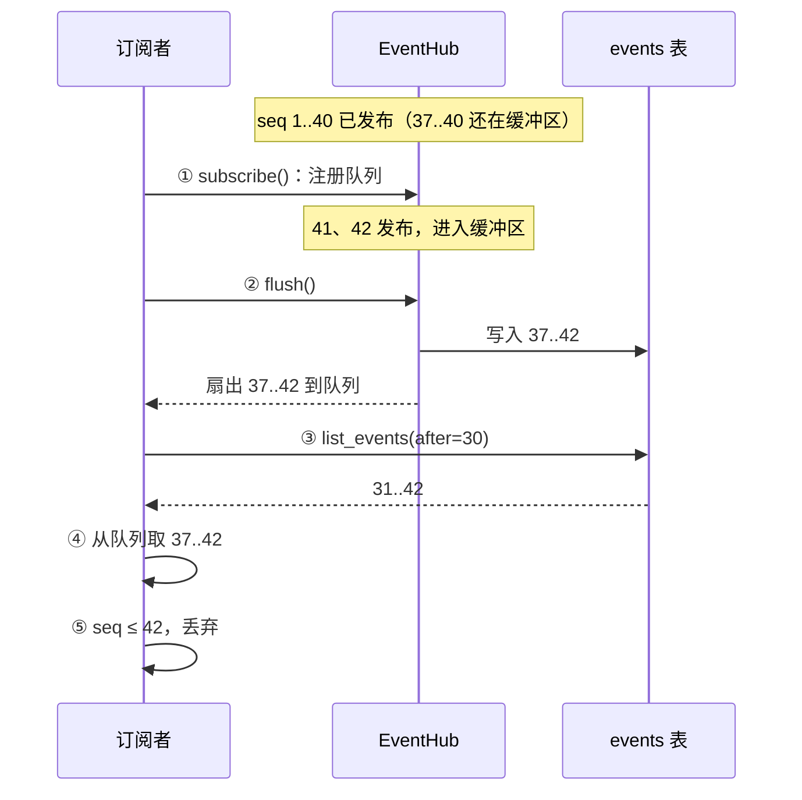

# 15 流式输出、插话与断线续传

模型一个 token 一个 token 地生成，用户希望一个 token 一个 token 地看到；用户还会在 Agent 工作时继续输入、刷新页面、断网重连。本章沿着一个 token 从 provider 到浏览器的完整路径，讨论如何做到 **低延迟、不重不漏、与连接无关**，以及运行中的用户输入应当在什么时刻生效。

## 问题：流式不只是“边生成边显示”

| 需求 | 难点 | 本项目的做法 |
|---|---|---|
| 首 token 尽快可见 | 每个增量都要穿过 Loop、事件枢纽、HTTP 层 | 全链路 async generator，增量事件直通订阅者 |
| 增量事件可回放 | 一次回答可能有上千个 delta，逐条写库是严重的写放大 | 增量事件攒批写入，状态事件立即写入 |
| 断线后不重不漏 | 重连期间 Run 仍在产生事件 | 每个事件带单调 `seq`，先落库再扇出；订阅时先注册、再补库、再接实时，按 `seq` 去重 |
| 刷新页面任务不丢 | 连接断开不能等于任务取消 | Run 在后台 Task 中执行，连接只是订阅者 |
| 慢客户端不拖垮 Agent | 生产者不能被消费者阻塞 | 全链路有界队列；队列满就让订阅者转为“从库里补齐” |
| 运行中继续输入 | 随时注入会破坏 `tool_call` / `tool_result` 配对 | 插话在安全点注入，排队在本该停止时注入；结束前再排空一次，没处理的明确告知 |
| 输出到一半失败 | 半截文本已经显示，半截工具参数不完整 | 重试时丢弃半截；半截工具调用永不执行 |

## 完整链路

```mermaid
flowchart LR
    P["Provider<br/>HTTP SSE / SDK 流"] --> SE["StreamEvent<br/>text_delta · toolcall_delta · retry · done"]
    SE --> RP["ResilientProvider<br/>重试 · 降级 · notice"]
    RP --> LP["AgentLoop._call_model()<br/>→ Event（message_update 等）"]
    LP --> DR["Harness._drive()"]
    DR --> HUB["EventHub.publish()<br/>分配 seq · 攒批落库 · 落库后扇出"]
    HUB --> DB[("events 表<br/>PK(run_id, seq)")]
    HUB --> SUB["Harness.subscribe()<br/>补库 + 实时 + 去重"]
    DB --> SUB
    SUB --> SSE["GET /api/runs/{rid}/events<br/>id / event / data · ping"]
    SSE --> ES["浏览器 EventSource<br/>自动重连带 Last-Event-ID"]
    ES --> UI["onEvent：按 seq 去重<br/>requestAnimationFrame 合并渲染"]
```



| 层 | 产物 | 职责 |
|---|---|---|
| provider（`llm/anthropic.py`、`llm/openai_compat.py`） | `StreamEvent` | 把各家协议归一化成 `start → 增量* → done`；`MessageBuilder` 拼装完整消息 |
| `ResilientProvider` | `StreamEvent`（多了 `retry`、`notice`） | 失败时整体重发，用 `discard_partial` 告诉上层丢弃半截（见 [13 重试、熔断与降级](/reliability/retry-fallback)） |
| `AgentLoop` | `Event` | 映射为 `message_start / message_update / message_end` 等统一事件；落盘后才发 `message_end` |
| `EventHub` | 带 `seq` 的 `Event` | 编号、持久化、扇出（只扇出已落库的事件） |
| `Harness.subscribe()` | 有序、无重复的事件流 | 断线续传的核心 |
| `server/app.py` | SSE 文本帧 | 心跳、断开检测、续传入口 |
| `web/app.js` | DOM | 去重、合并渲染、以持久化状态校正 |

## 为什么选 SSE

| 维度 | SSE | WebSocket |
|---|---|---|
| 方向 | 服务端 → 客户端 | 双向 |
| 断线重连 | 浏览器内建自动重连，并自动带上 `Last-Event-ID` | 需要自己实现重连与续传协议 |
| 协议 | 普通 HTTP 响应，代理与鉴权中间件都认识 | 需要 Upgrade，部分代理需要额外配置 |
| 数据 | UTF-8 文本 | 文本与二进制 |
| 适合 | 事件推送，控制操作走独立 REST 接口 | 高频双向交互、音频等二进制流 |

Agent 的事件流天然是单向的：用户的操作（停止、插话、审批）频率很低，用 `POST` 发出即可，不需要和事件流共用一条连接。SSE 的内建续传恰好是本章最需要的能力。需要注意的是 HTTP/1.1 下浏览器对同一域名的并发连接数有上限（常见为 6 个），每个 SSE 连接都占一个；同时打开很多标签页时，应部署在 HTTP/2 之后。

## EventHub：编号、落库、扇出

`src/flywhl_harness/runtime/manager.py` 里，每个活动 Run 有一个 `EventHub`：

```python
# src/flywhl_harness/runtime/manager.py · EventHub（节选）
class EventHub:
    def __init__(self, store: Store, run_id: str, start_seq: int = 0, queue_size: int = 2000):
        # ...

    def publish(self, ev: Event) -> Event:
        self.seq += 1
        ev.seq, ev.run_id = self.seq, self.run_id
        self._buffer.append(ev)
        if ev.type not in EPHEMERAL_EVENTS or len(self._buffer) >= 64:
            self.flush()
        elif self._flusher is None or self._flusher.done():
            self._flusher = asyncio.get_running_loop().create_task(self._delayed_flush())
        return ev

    def _fanout(self, batch: list[Event]) -> None:
        for q in list(self._subs):
            for ev in batch:
                try:
                    q.put_nowait(ev)
                except asyncio.QueueFull:  # 背压：慢消费者的积压直接丢弃，改为通知它“从库里补齐”
                    self._subs.remove(q)
                    while not q.empty():
                        q.get_nowait()
                    q.put_nowait(_LAGGED)
                    break

    async def _delayed_flush(self) -> None:
        await asyncio.sleep(0.05)
        self.flush()

    def flush(self) -> None:
        if self._buffer:
            batch, self._buffer = self._buffer, []
            self.store.append_events(self.run_id, batch)
            self._fanout(batch)
```

**先落库、再扇出。** `publish()` 只编号、进缓冲区；扇出发生在 `flush()` 里，排在 `append_events()` 之后。订阅者收到的每个事件都已经在库里，
这是“事件永远不领先于持久化状态”在事件流上的体现，代价是文本增量最多晚 50ms 才推到浏览器。好处在崩溃时最明显：
如果先扇出再落库，客户端可能见过一个还在缓冲区里的 `seq`，进程随后被 `kill -9`；恢复后编号从库里的最大值继续，新事件复用这几个 `seq`，
带着更大 `Last-Event-ID` 重连的浏览器会把它们（可能是 `status`、恢复 `notice` 这类重要事件）当作重复丢掉。

**seq 的连续性。** `Harness._launch()` 构造枢纽时传入 `self.store.max_event_seq(run.id)`，所以 Run 被暂停后恢复、或崩溃后被接管，`seq` 接着库里的最大值继续编号，客户端手里的 `Last-Event-ID` 在恢复之后仍然有效。
没有活动枢纽时发生的迁移（创建后进入 `queued`、`resume`、`recover` 接管、离线取消）由 `Harness._offline_transition()` 同样写一条 `status` 事件，
序号由 `Store.append_event_next()` 在同一事务里按“库中最大值 + 1”分配，不会与并发写入撞号。所以续传时客户端能看到完整的状态迁移序列，而不只是活动期间的那一段。
反过来，Worker 失去租约后（Run 已被别的 Worker 接管），`EventHub.fence()` 清空缓冲区，之后 `flush()` 一律丢弃：这个 Run 的序号空间已经归新主人，旧 Worker 再写就会和新主人撞号（见 [12 取消语义](/reliability/cancellation) 的“自我 fencing”）。

**写放大治理。** `EPHEMERAL_EVENTS`（`events.py`）只包含 `message_update` 与 `tool_update` 两种增量事件。它们先进缓冲区，50ms 后或攒满 64 条时批量写入；其余事件（状态迁移、消息结束、工具开始/结束、审批……）到达时立即 `flush()`——而且是连同缓冲区里在它之前的增量一起写，所以库里的顺序与 `seq` 顺序一致。一段一千个 delta 的回答，写库次数从一千次降到“生成耗时 / 50ms”量级。
`Store.append_events()` 把一批事件包在一个 `Store.tx()` 里：连接是自动提交模式，不包事务时 `executemany` 的每一行都是一个独立的隐式事务，逐行提交要慢一个数量级。

子代理的进度也走这条路：子 Run 有自己的枢纽和事件序列，非增量事件同时以父 Run 中 `task` 调用的 `tool_update`（`update.subagent`）转发出来，
前端在工具卡片里逐行显示子代理的工具调用与结论，不需要再订阅子 Run。

**扇出与背压。** `publish()` 是同步函数，在驱动 Run 的那个 Task 里调用。如果它因为某个订阅者消费太慢而阻塞，整个 Agent 都会停下来等一个浏览器标签页。几种处理慢消费者的策略：

| 策略 | 后果 | 是否采用 |
|---|---|---|
| 阻塞生产者 | 一个慢客户端拖慢 Run 本身 | 否 |
| 丢弃最旧的事件 | 文本增量缺一段，界面显示错乱；状态事件丢了更糟 | 否 |
| 合并文本增量 | 可以缓解，但状态事件与最终结果仍不能丢 | 可作为补充 |
| 踢下线，让它从库里补齐 | 生产者永不阻塞；订阅者稍后凭 `seq` 追上，内容完整 | **是** |

`_LAGGED` 哨兵就是“你被踢下线了”的通知：枢纽清空它的队列（扇出的都是已落库的事件，库里都有），放入哨兵，并把它从订阅列表移除。

背压要一路传回枢纽才有用。SSE 端点在 `subscribe()` 和网络写出之间还有一个 `pump` 任务和中间队列，这个队列也是有界的（256 条）：
浏览器读得慢 → 写出阻塞 → 中间队列满、`pump` 阻塞在 `q.put()` → 不再从枢纽队列取事件 → 枢纽队列（2000 条）满 → `_LAGGED` → 从库补齐。
如果中间队列没有上限，`pump` 永远不阻塞，枢纽队列永远不满，慢客户端的积压就会在中间队列里无限增长，踢下线的设计路径永远不会触发。

## subscribe：为什么不重不漏

`Harness.subscribe()` 是断线续传的核心。下文用 ① 到 ⑤ 指代其中五个步骤：① `a.hub.subscribe()` 注册实时队列；② `a.hub.flush()` 把缓冲区写进库（并扇出）；③ `list_events(run_id, after_seq)` 从库里补发；④ `await q.get()` 接实时流；⑤ `(ev.seq or 0) <= last` 时丢弃重复。`q is None` 表示 Run 不在本进程活动，库里就是全部。

```python
# src/flywhl_harness/runtime/manager.py · Harness.subscribe
async def subscribe(self, run_id: str, after_seq: int = 0) -> AsyncIterator[Event]:
    """先从库里补齐 seq > after_seq 的事件，再接上实时流；按 seq 去重，保证不重不漏。"""
    a = self._active.get(run_id)
    q = a.hub.subscribe() if a else None
    try:
        if a:
            a.hub.flush()
        last = after_seq
        for ev in self.store.list_events(run_id, after_seq):
            yield ev
            last = ev.seq or last
        if q is None:
            return
        while True:
            ev = await q.get()
            if ev is _LAGGED:
                # 与正常路径同序：先重新订阅（之后的事件进新队列），再从库里补齐，最后按 seq 去重
                a2 = self._active.get(run_id)
                q = a2.hub.subscribe() if a2 is not None else None
                if a2 is not None:
                    a2.hub.flush()
                for ev2 in self.store.list_events(run_id, last):
                    yield ev2
                    last = ev2.seq or last
                if q is None:
                    return
                continue
            if ev is _CLOSED:
                for ev2 in self.store.list_events(run_id, last):  # 关闭前可能还有未投递的尾巴
                    yield ev2
                    last = ev2.seq or last
                return
            if (ev.seq or 0) <= last:
                continue
            yield ev
            last = ev.seq or last
    finally:
        if a and q is not None:
            a.hub.unsubscribe(q)
```

不重不漏的论证只需要看“注册”这个时刻 T。由于事件在 `flush()` 里先落库、再扇出，每个事件都有一个确定的 flush 时刻：

- 在 T **之后** flush 的事件（包括 T 之前发布、当时还在缓冲区里的），扇出时 `q` 已经在订阅列表里，一定进了队列；
- 在 T **之前** flush 的事件已经在库里，第 ③ 步能读到。第 ② 步的 `flush()` 不是正确性所必需的（缓冲事件迟早会扇出到 `q`），它让这批事件立刻入库，补发阶段一次读全，不必等 50ms 的定时 flush；
- 两部分可能重叠（T 之后、第 ③ 步读库之前 flush 的事件，既在库里又在队列里），第 ⑤ 步按 `seq` 丢弃重复。

所以每个事件至少出现一次（不漏），并且只被交付一次（不重）。反过来写——先读库、再订阅——读库与订阅之间 flush 的事件既不在读到的结果里，也不在队列里，就丢了。



`_LAGGED` 分支是同一个论证的重演，所以顺序必须与正常路径相同：先注册新队列，再 `flush()`、读库，最后靠第 ⑤ 步去重。
如果反过来先读库补齐、再重新注册，补发时每个事件都要 `yield` 给消费者，消费者挂起（例如等网络写出）期间新发布的事件既不在已读出的列表里，
也不在尚未注册的新队列里；之后的实时事件 `seq` 更大，会把 `last` 推过这段空隙，这些事件就永远丢了。

`_CLOSED` 分支里“再补一次尾巴”的原因：`EventHub.close()` 先 `flush()` 再投递哨兵，但这个订阅者可能曾因 `_LAGGED` 重新订阅过、或者有事件在它处理哨兵之前已入库而未入队，最后再按 `last` 读一次库是零成本的保险。
也正因为有这次补读，`close()` 遇到订阅者队列恰好满时可以放心清空积压、保证 `_CLOSED` 投递成功；否则哨兵进不了队列，订阅者消费完积压后会一直等在 `q.get()` 上：

```python
# src/flywhl_harness/runtime/manager.py · EventHub.close
def close(self) -> None:
    self.flush()
    self.closed = True
    for q in self._subs:
        if q.full():  # 订阅者收到 _CLOSED 后会从库里补齐尾巴，所以清空积压不会丢事件
            while not q.empty():
                q.get_nowait()
        q.put_nowait(_CLOSED)
    self._subs.clear()
```

## SSE 端点精读

```python
@app.get("/api/runs/{rid}/events")
async def events(rid: str, request: Request, after: int = 0) -> StreamingResponse:
    run_dict(rid)
    last = int(request.headers.get("last-event-id") or after or 0)

    async def gen():
        # 有界队列：客户端读得慢时 pump 阻塞，背压传回 EventHub（其队列满了会触发 _LAGGED → 从库补齐）
        q: asyncio.Queue = asyncio.Queue(256)

        async def pump() -> None:
            try:
                async for ev in h.subscribe(rid, last):
                    await q.put(ev)
            except asyncio.CancelledError:
                return  # 消费端已经退出（客户端断开）：不再放结束标记——队列满时阻塞的 put 会让任务永远卡住
            await q.put(None)  # 正常结束：消费端还在读，阻塞式放入即可（背压）

        task = asyncio.create_task(pump())
        yield "retry: 1500\n\n"
        try:
            while True:
                try:
                    ev = await asyncio.wait_for(q.get(), 15)
                except asyncio.TimeoutError:
                    if await request.is_disconnected():
                        break
                    yield ": ping\n\n"
                    continue
                if ev is None:
                    yield "event: stream_end\ndata: {}\n\n"
                    break
                yield f"id: {ev.seq}\nevent: {ev.type}\ndata: {json.dumps(ev.to_dict(), ensure_ascii=False, default=str)}\n\n"
        finally:
            task.cancel()
            with contextlib.suppress(asyncio.CancelledError, Exception):
                await task

    return StreamingResponse(gen(), media_type="text/event-stream",
                             headers={"Cache-Control": "no-cache", "X-Accel-Buffering": "no"})
```

| 细节 | 原因 |
|---|---|
| `Last-Event-ID` 头优先于 `?after=` | 浏览器自动重连时只会带头；前端主动重连（新建 `EventSource`）时用查询参数 |
| 中间队列 `Queue(256)` 有界 | 让慢客户端的背压传回枢纽，触发 `_LAGGED` → 从库补齐，而不是在这里无限堆积 |
| 首帧 `retry: 1500` | 告诉浏览器断线后 1.5 秒重连，而不是用浏览器默认值 |
| 每帧 `id: <seq>` | 浏览器记住最后一个 `id`，重连时作为 `Last-Event-ID` 发回 |
| `event: <type>` | 前端按类型注册监听器；带 `event` 字段的帧不会触发 `onmessage` |
| 15 秒无事件发 `: ping` | 冒号开头的行是 SSE 注释，浏览器忽略；作用是让代理、负载均衡器看到流量，不因空闲断开 |
| 心跳时检查 `is_disconnected()` | 没有事件可写时，写失败这种断开信号不会出现，只能主动问 |
| 结束时发 `stream_end` | 服务端正常关闭连接时，`EventSource` 会认为是断线并自动重连；需要一个显式的“真的结束了”信号，前端收到后自己 `close()` |
| `X-Accel-Buffering: no` | 阻止 nginx 缓冲响应体，否则增量会被攒成大块才发出 |

**为什么要单独的 `pump` 任务。** 最直接的写法是 `await asyncio.wait_for(agen.__anext__(), 15)`，但超时会 **取消** 正在进行的 `__anext__()`，`CancelledError` 被抛进 `subscribe()` 生成器内部的 `await q.get()`，生成器执行 `finally`（取消订阅）后就结束了——第一次心跳之后流就断了。把订阅放进独立任务，超时取消的只是一个普通队列上的 `get()`，生成器完好无损。

**客户端断开只停止推送。** `finally` 里取消的是 `pump`，它的 `finally` 又让 `subscribe()` 取消订阅；Run 本身的 Task 毫不知情。

## Run 与连接解耦

`Harness._launch()` 用 `asyncio.create_task(self._drive(a, prompt))` 驱动 Run，HTTP 请求只是创建它、然后返回。之后的连接都只是 `EventHub` 的订阅者：

| 用户动作 | 发生了什么 |
|---|---|
| 刷新页面 | 旧连接断开、订阅取消；新页面先用库里的会话时间线渲染历史，再以会话详情返回的 `last_seq` 为起点订阅（`selectSession()`）。`run_dict()` 先 `flush_if_active()` 再取库中最大 `seq`，所以 `last_seq` 不会落后于已经扇出的事件。Run 不受影响；唯一的代价是正在生成的那条消息，`message_start` 早于起点，草稿不显示，要等它的 `message_end` 到达才出现 |
| 关闭标签页 | 同上，Run 继续执行，稍后打开还能看到结果 |
| 网络抖动 | `EventSource` 1.5 秒后带 `Last-Event-ID` 重连，从库里补齐 |
| 点击“停止” | 显式 `POST /api/runs/{rid}/cancel`，走取消语义 |

这里有一个单进程假设：`subscribe()` 只在 `self._active` 里找活动 Run，找不到就只回放库里的事件然后结束。多 worker 部署时，订阅请求可能落到不是正在执行该 Run 的进程上，就只能看到历史、看不到实时流。生产化需要跨进程的扇出——例如事件入库后通过 Redis pub/sub 或 Postgres `LISTEN/NOTIFY` 广播，或者订阅方直接轮询事件表的尾部；`seq` 去重的逻辑保持不变。

## 三种打断语义

用户在 Agent 工作时的输入有三种完全不同的意图，混为一谈会出问题：

| | 停止（取消） | 插话（steer） | 排队（follow-up） |
|---|---|---|---|
| 接口 | `POST /api/runs/{rid}/cancel` | `POST /api/runs/{rid}/steer`，`mode=steer` | 同左，`mode=follow_up` |
| 实现 | `Harness.cancel()`：CAS 迁移到 `cancelling`，触发 `CancelToken` | `Harness.steer()` → `Inbox.steer()` | `Harness.follow_up()` → `Inbox.follow_up()` |
| 对正在生成的模型流 | 立即中断上游连接，不再为后续 token 付费 | 不打断 | 不打断 |
| 对正在执行的工具 | 可中断的中止；不可中断的给宽限期 | 不打断 | 不打断 |
| 生效时机 | 下一个可取消的等待点（毫秒级） | 下一个安全点：当前这批工具全部完成后、下一次模型调用前 | Agent 本来要停下时（模型没有再调用工具） |
| 落盘形式 | 已生成的文本存为 `aborted` 消息；半截工具调用丢弃；未执行的调用补合成结果 | 一条 `kind=steer` 的 user 消息 | 一条 `kind=follow_up` 的 user 消息 |
| 事件 | `status`（cancelling → cancelled） | `notice: steer_queued`，注入时 `message_end` | `notice: follow_up_queued`，注入时 `message_end` |

取消的细节见 [12 取消语义](/reliability/cancellation)。插话和排队的注入点都在 `AgentLoop._body()` 的主循环里：每轮开头先过安全点（取消、暂停检查），紧接着注入插话；模型不再调用工具、本该停止时，把排队的输入作为新输入继续。

```python
# src/flywhl_harness/agent/loop.py · AgentLoop._body（节选）
while True:
    self._safe_point()
    for text in rc.inbox.drain_steer():
        yield self._append(user_message(text, kind=MsgKind.STEER))
    # ... 预算检查、压缩、调用模型
    if not calls:
        if rc.inbox.pending()["steer"] or rc.inbox.pending()["follow_up"]:
            for ev in self._drain_inbox():
                yield ev
            yield self._ev(E.TURN_END, turn=self.turn)
            continue
        gaps = await self._stop_gaps(msg)
        # ... 验收未通过：反馈给模型继续
        if rc.inbox.pending()["steer"] or rc.inbox.pending()["follow_up"]:
            # 验收（可能要跑测试）期间又有新输入到达：继续处理，而不是丢掉
            for ev in self._drain_inbox():
                yield ev
            yield self._ev(E.TURN_END, turn=self.turn)
            continue
        # ... 结束
    async for ev in self.executor.run_batch(calls):
        yield ev
```

`_drain_inbox()` 一次取出两类输入，插话在前、排队在后，各自保留原来的 `kind`：

```python
# src/flywhl_harness/agent/loop.py · AgentLoop._drain_inbox
def _drain_inbox(self) -> list[Event]:
    """模型准备结束时取出排队的输入：插话（steer）在前，追加任务（follow_up）在后。"""
    evs = [self._append(user_message(t, kind=MsgKind.STEER)) for t in self.rc.inbox.drain_steer()]
    evs += [self._append(user_message(t, kind=MsgKind.FOLLOW_UP)) for t in self.rc.inbox.drain_follow_up()]
    return evs
```

结束前检查两次，是因为 `_stop_gaps()` 会运行 Stop hook 和验收命令（可能要跑一整套测试），这段时间足够用户再发一句“顺便把单位也写上”。
第二次检查让这句话被处理，而不是在 Run 结束后悄悄消失（`tests/test_lifecycle.py::test_follow_up_arriving_during_stop_check_is_processed`）。

为什么插话不立即生效？模型正在生成的这次调用，上下文里本来就没有这句话；把它插进历史的唯一安全位置，是一整批工具结果之后——若插在 `tool_call` 与 `tool_result` 之间，下一次请求的消息结构就不合法了。如果用户真的想“立刻改方向”，那是“停止 + 新输入”，代价是丢弃正在生成的内容。pi 的设计与此相同：运行中再次发送输入，必须明确选择 steer 还是 followUp。

`test_steer_injected_at_safe_point` 断言了位置：`steer` 消息出现在 `tool` 结果之后。用 curl 实测（下文“动手验证”）可以看到同样的顺序：插话在 `sleep` 工具执行期间被接受（一次实测中是 `seq 28` 的 `steer_queued`），在 `sleep` 的 `tool_end`（`seq 38`）之后、下一次模型调用之前注入（`seq 40` 的 `message_end`，`meta.kind=steer`）。具体编号随工具进度事件的多少略有浮动，顺序不变。

Loop 结束之后，`Harness._finish()` 再看一眼收件箱，按 Run 的去向处理还没注入的输入：

```python
# src/flywhl_harness/runtime/manager.py · Harness._finish（节选）
pending = rc.inbox.pending()
if pending["steer"] or pending["follow_up"]:
    if out.status == "paused":
        a.cp["inbox"] = pending  # 恢复时带回
    else:  # 不能静默丢弃用户的输入：明确告知哪些排队消息没有被处理
        a.hub.publish(Event(E.NOTICE, {"level": "warn", "code": "inbox_dropped",
                                       "text": "以下排队消息未被处理：" + "；".join(pending["steer"] + pending["follow_up"])}))
```

| Run 的去向 | 未注入的输入 |
|---|---|
| 暂停（用户暂停、关闭服务） | 写进检查点的 `inbox`；`resume` 时 `_launch()` 把它们放回新的 `Inbox`，恢复后照常注入 |
| 取消、失败、预算耗尽等其它终态 | 发一条 `notice: inbox_dropped`，逐条列出没有被处理的消息 |
| 进程崩溃 | 丢失：`Inbox` 本身是内存里的两个 `deque`，只有暂停时才落盘 |

“已排队”通知发出之后，这句话要么被注入、要么被带回、要么被明确告知未处理，不会出现用户以为 Agent 看到了、实际却没有的情况。
崩溃是剩下的缺口；要补上它，需要在 `steer()` / `follow_up()` 接受输入时就落盘。

## 工具参数的流式

工具参数以 partial JSON 的形式增量到达：`toolcall_start`（id、name）→ 若干 `toolcall_delta`（JSON 片段）→ `toolcall_end`。前端在工具卡片里直接追加原始片段，让用户看到 Agent 正在写什么；但 **执行** 有严格得多的条件。

`AnthropicProvider._kwargs()` 为每个工具打开了 `eager_input_streaming`：

```python
# 流式 + 自定义工具：开启 eager_input_streaming，大参数（文件内容）边生成边到达；
# 代价是服务端不再校验参数——harness 的执行层本来就会做 schema 校验
kw["tools"] = [{"name": t["name"], "description": t["description"], "input_schema": t["parameters"],
                "eager_input_streaming": True} for t in req.tools]
```

不开启时，服务端会先缓冲并校验一段参数再发出，写一个大文件时用户要盯着空白卡片等很久；开启后参数几乎与生成同步到达，代价是服务端不再保证 JSON 合法与完整（这一特性的确切行为以 Anthropic 官方文档为准）。harness 用三道关口兜底：

1. **块完整才解析。** `MessageBuilder.tool_call()` 只在 `content_block_stop` 时对累积的 JSON 做一次解析；失败时保留原文与 `parse_error`，执行器把它变成“参数不是合法 JSON……请重新生成”的错误结果回给模型。
2. **消息完整才执行。** `AgentLoop._call_model()` 不处理 `toolcall_end`，工具只从 `done` 事件携带的完整消息里取出。被取消或出错时 `MessageBuilder.build(partial=True)` 会直接丢弃工具块；输出被 `max_tokens` 截断时，整批调用判为失败、不执行。
3. **执行前做 schema 校验。** `ToolExecutor._prepare()` 用工具的 JSON Schema 校验并做类型修正，失败同样回给模型。

“块完整就执行”能再省一点延迟（一个长读操作可以在模型还在写下一个调用时就开始），但会让权限判定、只读批并发、审批卡片的展示都面对一个“还没写完的批次”。flywhl-harness 选择等整条消息结束，用一点延迟换取简单与一致。

## 流式重试与半截输出

当流在中途失败、`ResilientProvider` 决定重试时，前端收到 `model_retry`：

```javascript
model_retry(d) {
  if (d.discard_partial && S.live) { S.live.text = ""; S.live.thinking = ""; S.live.thinkingEl.classList.add("hidden"); S.live.tools.innerHTML = ""; scheduleLive(); }
  addNotice({ level: "warn", text: `模型调用重试 #${d.attempt}（${d.kind}）：${d.delay}s 后重试${d.discard_partial ? "，已丢弃半截输出" : ""}` });
},
```

清空的是同一个 `message_id` 下的全部实时缓冲：文本、thinking（连同它的展示区域一起隐藏）和工具卡片。漏掉任何一种，上一次尝试的残留就会和新一次的增量拼在一起。Loop 一侧对应的处理（清空 `text_acc`）以及成本问题见 [13 重试、熔断与降级](/reliability/retry-fallback)。

## 前端渲染：增量只是草稿

`web/app.js` 的事件处理有三层，越往后越“权威”：

```javascript
function connect(runId, after) {
  disconnect();
  S.lastSeq = after || 0;
  const es = new EventSource(`/api/runs/${runId}/events?after=${S.lastSeq}`);
  S.es = es;
  for (const t of EVENT_TYPES) es.addEventListener(t, (e) => onEvent(JSON.parse(e.data)));
  es.addEventListener("stream_end", () => { es.close(); if (S.es === es) S.es = null; });
}

function onEvent(ev) {
  if (ev.seq <= S.lastSeq) return; // 按 seq 去重：断线续传时不会重复处理
  S.lastSeq = ev.seq;
  // ... 分发到 H[ev.type]
}
```

1. **增量：`requestAnimationFrame` 合并。** `message_update` 只把 delta 追加到 `S.live.text`，然后 `scheduleLive()`；同一帧内无论来多少 token，只重新渲染一次 Markdown。不这样做，每个 token 都触发一次完整的 Markdown 解析和重排，长回答时界面会明显卡顿。pi-web-ui 用的是同样的手法。
2. **消息结束：用持久化消息重绘。** `message_end` 携带的是已经落盘的完整消息，`finalizeLive()` 用它构建的 DOM 整体替换实时草稿——草稿里的任何拼接偏差都在这一刻被纠正。
3. **Run 结束：以会话时间线为准。** `run_end` 调用 `refreshDetail()` 重新拉取会话详情并重绘，这是最终的权威视图。

客户端也按 `seq` 去重，这是防御性的：服务端的 `subscribe()` 已保证同一条连接内不重复，但跨连接时（浏览器自动重连、前端手动重连、切换会话后重新订阅）只要任何一处在边界上多给了一个事件，`onEvent` 都不会重复渲染。`EVENT_TYPES` 是一份显式清单——服务端新增一种事件类型而前端没有登记，浏览器会静默忽略它。

客户端按 `seq` 去重之所以安全，前提是同一个 `seq` 永远只对应一个事件。缓冲区里的事件已经分配了 `seq`、但还没入库时，进程可能被 `kill -9`，
恢复后这几个 `seq` 会被新事件重新使用。`EventHub` 只扇出已经落库的事件（见上文“先落库、再扇出”），客户端见过的 `seq` 一定在库里，这种复用就不会被任何客户端观察到。

## 动手验证

**1. 测试。**

```bash
.venv/bin/python -m pytest -q \
  tests/test_runtime.py::test_sse_resume_with_last_event_id \
  tests/test_loop.py::test_steer_injected_at_safe_point \
  tests/test_loop.py::test_follow_up_runs_after_natural_stop \
  tests/test_lifecycle.py::test_follow_up_arriving_during_stop_check_is_processed \
  tests/test_cancel.py::test_budget_and_inbox_survive_pause
```

`test_sse_resume_with_last_event_id` 先完整读一遍事件流，断言 `id` 从 1 开始严格递增；再取中间某个 `seq` 作为 `Last-Event-ID` 重新请求，断言拿到的恰好是“之后的全部事件”——不重不漏。`id` 从 1 开始，是因为 `created → queued` 这次离线迁移也写了 `status` 事件。
后两个测试分别覆盖“验收期间到达的排队输入被处理”和“暂停时未注入的输入写进检查点”。

**2. 用 curl 观察 SSE 帧与插话时机。** 启动一个使用演示模型的服务：

```bash
.venv/bin/flywhl serve -w playground --provider mock --port 8799
```

另开终端：

```bash
SID=$(curl -s -X POST localhost:8799/api/sessions -H 'content-type: application/json' \
      -d '{"title":"t"}' | python3 -c 'import sys,json;print(json.load(sys.stdin)["id"])')
RID=$(curl -s -X POST localhost:8799/api/sessions/$SID/runs -H 'content-type: application/json' \
      -d '{"prompt":"等待 3 秒"}' | python3 -c 'import sys,json;print(json.load(sys.stdin)["id"])')
sleep 1
curl -s -X POST localhost:8799/api/runs/$RID/steer -H 'content-type: application/json' \
     -d '{"text":"顺便列出目录","mode":"steer"}'

# 完整事件流
curl -sN localhost:8799/api/runs/$RID/events | grep -v '^data'
# 从 seq 40 之后续传
curl -sN -H 'Last-Event-ID: 40' localhost:8799/api/runs/$RID/events | grep -v '^data'
```

第一条命令输出以 `retry: 1500` 开头，之后是一组组 `id: N` / `event: 类型`，最后是 `event: stream_end`（Run 结束后才请求时会立即回放完毕）；第二条命令的第一个 `id` 是 41。在 `data` 行里查找 `steer`，可以看到 `steer_queued` 通知出现在工具执行期间，`kind: steer` 的 user 消息出现在 `tool_end` 之后。

**3. Web UI。** `flywhl serve -w playground` 后：

- 输入“等待 20 秒”，在工具执行期间把输入框的模式切到“插话”发送一句话，观察它在工具结束后才出现在对话里；切到“排队”再试一次，观察它在 Agent 回答完之后才被处理；
- 打开“事件”页签，点击“模拟断线重连”：前端主动断开连接，事件列表插入一条断线标记；2 秒后以当前 `last seq` 重连，补发的事件 `seq` 紧接断点、没有重复；
- 在 Agent 输出长文本时刷新页面，任务不会中断。

## 小结

- 事件带单调 `seq`，跨暂停与恢复保持连续，离线迁移也写 `status` 事件，是续传、去重、审计的共同基础。
- 增量事件攒批写入、状态事件立即写入，先落库再扇出；生产者永不阻塞，背压沿有界队列传回枢纽，慢订阅者被踢下线后从库里补齐。
- “先注册、再落库、再补发、按 `seq` 去重”保证不重不漏；顺序反过来就会漏。
- Run 与连接解耦：断线、刷新、关闭页面都不影响任务，停止必须显式。
- 停止、插话、排队是三种不同语义：插话在安全点注入以保护消息配对，排队只在本该停止时注入；验收期间到达的输入照样处理，暂停时带回，其它终态明确告知未处理。
- 工具参数可以流式展示，但只有完整、合法、通过校验的调用才会执行；前端的增量渲染只是草稿，以持久化消息为准。

延伸思考：当执行者不在服务端而在用户的设备上时，“事件流”变成了“指令流”，丢包、重复、乱序成为常态。[26 端云协同](/advanced/edge-cloud) 讨论这种情形。
